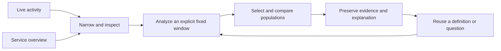

# Whole-product coherence proposal — 2026-10-22

Follow-through: the accepted bounded [Activity analysis handoff](ACTIVITY_ANALYSIS.md)
is now implemented. A bounded [population continuation](POPULATION_WORKSPACE.md#contextual-selection-comparison-and-restoration)
also implements selected-versus-current comparison and starting-scope restoration.
Bounded [Saved task composition](SAVED_WORKSPACE.md) now adds investigation/evidence
entry, secondary storage tools and relevant recovery. Broader population controls,
case outlines and explicit blank-authoring work remain proposed. The review below records its original baseline and rationale.

Status at review: review and proposed sequence, not implemented behavior or an additional
authorized backlog. Reviewed baseline: `f54d07c`. The
[active implementation plan](IMPLEMENTATION_PLAN.md) remains authoritative until
the proposed sequencing is adopted.

This reconciles independent [architecture](WHOLE_PRODUCT_ARCHITECTURE_REVIEW_2026_10_22.md)
and [design/usability](WHOLE_PRODUCT_DESIGN_REVIEW_2026_10_22.md) passes across the
product. See those reviews for evidence, limitations and individual findings.

## Product direction

**See the part of your system that matters, isolate what is unusual, and preserve
an explanation someone else can inspect and reuse.**

Start with ordinary OpenTelemetry, without requiring a Goo manifest. Activity is
the default entrance. Services offer a scoped entrance into the same work.
Definitions make recurring questions and domain meaning reusable. Investigations
preserve explanations and their evidence. Instrumentation and compilation enrich
this loop; they are not prerequisites for using it.

The diagram describes the intended interaction spine, not a new execution owner.
Live buffers, fixed source reads, saved evidence and reusable definitions retain
their distinct semantics and lifetimes.

## Recommended bounded sequence

1. **Make Activity → analysis continuous.** Replace the generic disclosure into
   a tall blank editor with a contextual **Analyze this scope/window** action,
   reusing existing selected-record staging and paused-parent restoration.
   Keep **New question** explicit. Carry the applied selector and an explicit
   fixed window; label the next source read. Staging must not fetch or publish.
   Acceptance: a real live → staged → run → paused-return journey, exact bounds,
   keyboard focus/scroll restoration, dirty-draft handling and no hidden reads.
2. **Give a selected population one coherent set of actions.** Build supported
   narrow/widen, field/column selection, selection-versus-rest and comparison
   around visible selection context. Prefer this user task over a broad
   comparison-shell rewrite. Reuse passive charts, tables and inspectors as
   their contracts fit. Acceptance: exact predicates and complement semantics,
   totals independent of the displayed page, common visual domains where
   compatible, explicit missing/unknown values, keyboard equivalents and a
   capture/reopen journey. Unsupported selections stay unavailable.
3. **Make Saved a place to continue an investigation.** Browse investigations
   and evidence, then show one selected case with contextual evidence/review
   actions. Move raw-ID entry, storage-specific catalogs and recovery tools
   behind relevant actions/disclosures. This is presentation consolidation,
   not a universal storage model. Acceptance: old links and exact pinned
   citations reopen, optional retention remains optional, selecting does not
   execute sources, and pending recovery remains discoverable when relevant.
4. **Align secondary entrances and onboarding.** Services hand off their scope;
   Definitions explain and author reusable meaning; Examples teach real tasks.
   Reassess Operations navigation only after its supported capabilities and
   direct links have parity elsewhere. Separate a short user quickstart from
   developer architecture, API and implementation history in the README.
   Its current Start/Explore instructions still begin with Run query and the
   reservation Completion SLO, rather than the implemented Activity entrance.

Extract pure question/link/evidence protocol from navigation when the first cut
touches it, protected by existing Go/JS fixtures. This is a supporting boundary
improvement, not a prerequisite generic state store or request framework.

## Consolidate without erasing meaning

- One scope context and one primary continuation per working surface; advanced
  authoring, storage controls and diagnostics appear when relevant.
- Shared display primitives and visual vocabulary; execution and publication
  remain with their family-specific owners.
- Comparison is an action on explicit populations/windows, not a second
  workbench. Units, bases, independent windows and exact table fallbacks remain
  visible.
- Notes, tags and optional review help explain evidence across surfaces.
  Training labels and exports remain later, explicit projections of reviewed
  context; do not make classification administration the investigation entry.
- Source adapters, OTel capability checks and the offline Databricks compiler
  preserve portability. No new universal backend or native store migration is
  justified by this review.

## Retire stale work and retain gates

Do not restart compact Activity entry, the shared record inspector, compact
definition rows, live/saved operation separation, immutable publication or the
already adopted transport helpers. Their delivered contracts still need protection.
Do not automatically remove the Python proxy, merge live/fixed/saved owners,
make XTDB mandatory, claim exact tail custody, or launch another component sweep.
Remaining API policy discrepancies should be decided explicitly when their owners
are touched, rather than silently normalized by a shared helper.

The proposed priority changes emphasis within D1/D2: first repair the analysis
handoff, then deliver useful population operations and contextual comparisons.
E1 discovery/capability work remains valuable within those existing entrances.
F1 custody/recovery remains prerequisite-gated. This review does not establish
that all these cuts are scheduled or complete.

## Evidence and follow-through

The peer reviews distinguish running-UI observations from source inspection and
proposals. This is an expert review, not customer research or a full regression
run. No runtime changes are part of this round. For implementation, keep the
affected storyboards, screenshots, Bombadil actions/invariants and diagrams in
step; use property/model tests for changed selection and execution protocols,
not for documentation-only changes.
