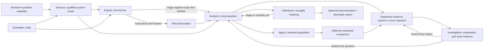

# Whole-product design review at f54d07c

Reviewed 2026-10-22. **Current implementation observations and proposed design;
not customer research, an implementation claim or a second authorized backlog.**
The [active plan](IMPLEMENTATION_PLAN.md) owns delivery order. This fresh review
reassesses that order by user outcome; it does not assume comparison work is next.

## Product promise

**See the part of your system that matters, isolate what is unusual, and preserve
an explanation someone else can inspect and reuse.**

Goo's distinctive value is continuity of meaning: ordinary OpenTelemetry can lead
to a scoped question, inspectable evidence, an explanation and a reusable
code-managed definition. The live stream is a good entrance. It is not the whole
product, nor should authoring a grammar be the price of entry.

The immediate design priority is completing that journey with fewer competing
controls and fewer conceptual handoffs. More independent widgets, a new dashboard
home, a universal query editor or another component-extraction program would not
solve the remaining friction on their own.

## Review method and limits

This review inspected source at `f54d07c` and the deployed local application at
`http://127.0.0.1:8088`. Chromium walkthroughs covered fresh Activity, Services,
Operations, Saved investigations, Definitions, Examples, the advanced record editor,
Measurements, the live-record inspector/fixed staging transition and `/api-docs`.
The desktop viewport was 1440×1000; a narrow measurement view was also checked at
390×844. Existing service, comparison, retention and component storyboards and
contracts supplement source review; their execution was not repeated here.

The fresh Activity entry opened one `/api/tail` connection and displayed real
local rows before the fold, without a preliminary population/aggregate request.
Inspecting a held row generated no API request. Staging its fixed investigation
performed one recipe-metadata GET, with **no telemetry read or publication**.
Navigation/disclosure checks observed no uncaught page errors or horizontal page
overflow at checked sizes. No fixtures, annotations, captures, definitions or
documents were published. No rebuild, broad tests, trace/video recording or
runtime edits were performed. Temporary review screenshots/logs are outside the
tracked product files; no new screenshot baseline is claimed.

This is an expert walkthrough, not an accessibility audit, latency benchmark,
formal usability study, exhaustive workflow validation or native-store health
check. Latest deployed/backend evidence is in [API acceptance](API_ACCEPTANCE.md)
and [VALIDATION.md](../VALIDATION.md). In particular, a configured optional store,
Docker health status and a successful native operation are different observations.

## Reconcile the earlier reviews first

The [earlier usability review](WHOLE_PRODUCT_USABILITY_REVIEW.md) examined
`290e101`. Several of its largest findings have since been addressed. The
[stream-first whole-product design](STREAM_FIRST_WHOLE_PRODUCT_DESIGN.md) also
predates shipped work. Do not reimplement their delivered recommendations.

| Earlier recommendation | Current disposition | Remaining design issue |
| --- | --- | --- |
| Put useful activity before query authoring. | Delivered: true fresh entry auto-connects one bounded log/span monitor with compact scope, pause and rows. The fixed editor mounts explicitly. | The transition into analysis still exposes the old competing controls; finish contextual handoff rather than redesigning the entry again. |
| Remove live Operations from Saved. | Delivered: independent saved-operation presentation and explicit continuation; no live editor reparented into Saved. | Saved still leads with several store-specific catalogs and raw-ID forms rather than an investigation/evidence task view. |
| Replace full-card definition forests with compact selected-detail libraries. | Delivered for record/native definitions, fixed reuse, document revisions and compatible retained metadata. Exact IDs and local-search bounds remain explicit. | Definitions still has several separate catalog sections; Examples duplicates a broad measurement library. Consolidate task roles, not the already-shared row component. |
| Share record/attribute inspectors and scope facts. | Delivered across live/fixed/Saved/context records and held service rows, with supplied-parent limits; native identity/value presentation also has shared adoption. | Residual aggregate/native compositions need targeted adoption, not a universal observability object or another exhaustive component sweep. |
| Contextualize global lookback. | Delivered for Saved and route-specific discovery/preview uses. | Analysis mode still has multiple fresh/fixed time actions; clarify their consequences at handoff. |
| Add retained catalog, pinned review and retry recovery. | Delivered with distinct native owners, exact citations and a bounded browser-local native journal. | Discovery of these capabilities is fragmented in Saved. Recovery does not extend to every document/file write or make local drafts durable. |
| Add API documentation and acceptance. | Delivered: 64 operations, explicit effect/limit differences, actual handler/proxy observations and deployed journeys. | Improve task-oriented onboarding and touched-policy coverage; do not restart a broad mechanical HTTP migration. |

The strongest improvements now come from joining the delivered pieces. The
[product essence](PRODUCT_ESSENCE.md) remains sound. The
[S2/A3 acceptance reconciliation](S2_A3_ACCEPTANCE.md),
[definition-library contract](DEFINITION_LIBRARY.md) and
[Live Activity contract](LIVE_ACTIVITY.md) describe useful boundaries to preserve.

## Ranked decisions

### 1. Make Activity → analysis one contextual continuation

**Observed:** Activity is compact and useful. Its **Questions, charts and saved
views** disclosure still opens a tall blank editor with both **Show recent
activity** and **Run question**, followed by fresh-window, share, add, tail and
library controls. The inspector's better path already stages the selected
observation's original window and retains a paused parent. However, its restored
state says **Shared question restored** and **Run again** even though this is a
new investigation from a held observation; other text says **Run question**.
These messages expose implementation reuse rather than the user's actual intent.
Sources: `stream-entry.js`, `exploration.js`, `index.html`, question/session owners.

**Proposed:** use the existing checked fixed staging as the common **Analyze this
scope/window** transition, showing the proposed selector, original window and
which read will occur. Keep **New question** as an intentional separate authoring
choice. A generic disclosure need not reset the user's context or introduce a
second interpretation of “recent activity.” Make the primary action state-based:
Run analysis for a staged scope, Rerun fixed window for an applied result, and
Refresh for a newly resolved recent interval. Keep Return to paused activity.

Do not pretend the held observation was captured. Its local identity/window and
the later fixed population are different evidence. If an anchor check is added,
name its bounded evidence: no match on a page is not proof the event never existed,
and duplicate reported IDs do not establish unique physical events.

**Acceptance:** Activity → inspect → stage analysis preserves environment, qualified
filters, signal and window; staging makes no source/publication call; the named Run
performs the read; return restores the held parent without a query or automatic
resume. A separate blank New question is unambiguous. Old shared/fixed links remain
inert and restore their own bounds. Remove contradictory restored/run status text.

### 2. Organize narrowing around one selected population

**Source-backed:** range brushing, categorical Include/Exclude, retained child
populations, record-derived shared fields, saved baselines and typed predicates
already exist, but use several trays, action groups and entry modes. Activity
filters and fixed population filters also have different lifetime and population
semantics. The question a person needs answered is simpler: **what have I
selected, compared with what, and what can I do with it?**

**Proposed:** one supplied selection context per owning result: parent scope,
selection definition, current local/applied state and a small continuation row.
Offer Narrow/Apply, open a retained child, widen an explicitly named bound, inspect,
compare with a named baseline, and preserve supported evidence where applicable.
Start with existing typed operations and useful contextual fields/columns; do not
begin with a broad D1 visual-shell rewrite or promise a complete predicate algebra.
A Go-supported selection-versus-rest complement is valuable only when its parent
population, missing-field behavior, overlap and denominator are explicit.

**Acceptance:** selected controls retain all parent predicates and namespace/window
semantics; local preview does not read; Apply names the new read; parent return
retains chart, baseline, inspector and focus. Counts remain full aggregates, never
selected-page counts. Unavailable operations explain the prerequisite. Comparison
is one continuation of an understood selection, not a new destination.

### 3. Make Saved an investigation/evidence task view

**Observed:** Saved now correctly excludes the live Operations editor. It still
presents Investigation notes, Tags and notes, Pending evidence saves, Retained
evidence, general captures and operation captures as separate vertically stacked
entrances. The default expanded capture grid and raw-ID opener dominate before
someone has chosen whether to find a case or a piece of evidence. Individual
compact library/inspector implementations are no longer the principal problem.
Sources: `index.html`, `documents.js`, `captures.js`, `retention-catalog.js`,
`retention-citations.js`, `retention-recovery.js`.

**Proposed:** within the existing destination, lead with **Investigations** and
**Evidence**, a visible pending count when nonzero, and one selected viewer. Search
must name what it covers; backend-specific tabs/facets and raw-ID recovery can be
progressive tools. A selected investigation leads with question/finding/open
questions and compact citations, rather than expanding every evidence object.
Retained evidence and file captures can share a browse shell without sharing their
identity, search clocks, current-head tags or availability guarantees.

**Acceptance:** find an investigation, inspect an exact citation and return without
telemetry reads or overwriting a draft. Retained catalog tags remain per-load
current-head snapshots; pinned reviews remain exact historical references.
Optional-store failure does not imply file documents disappeared. Forget local
retry does not withdraw a potentially committed assertion. Dirty drafts and
native-only retry promises stay explicit.

### 4. Give secondary surfaces narrower, clearer roles

**Observed/source-backed:** Services is a useful qualified catalog and dashboard
entrance, while native measurements still begin with Define → Preview → Investigate.
Operations remains a primary mode containing sample-launch links and a **Save
investigation** button for a legacy capture. Definitions contains record/native/
application catalog sections plus an executable bound-HTTP preview. Examples
also renders the broad current measurement library: the populated local page
included ordinary user/test revision titles such as “Same native title” and
“Later revision,” not just curated examples.

**Proposed:** Services scopes the common workflow; Definitions owns reusable
meaning and its selected authoring tools; Operations becomes a declared-behavior
capability reached from a service/definition once existing routes have parity;
Examples teaches a small set of real tasks using those surfaces. Lead native
measurement entry with **Find an instrument** or **Use a saved definition**, with
binding/authoring disclosed progressively. Remove the duplicated full measurement
catalog from Examples and contextualize Go/sample-specific launch links.

Do not hide arbitrary native metrics behind Go manifests, equate database-client
latency with database-server utilization, or infer a convention version from an
instrumentation library version. Keep ordinary custom/non-Go OTel useful.

### 5. Make preserving meaning one visible consequence, not one generic write

The user needs a consistent action vocabulary, but the mechanics must stay honest:
**Save view** stores configuration; **Save definition** stores reusable meaning;
**Capture this question** rereads; **Retain these observations** preserves an exact
supported server-held selection; **Add to investigation** stages a citation or
creates a named child; **Save investigation revision** publishes the narrative.

Exact tail retention remains gated on server-proven membership, canonical rows,
per-row basis/window, expiry and request identity. The current Activity observation
handle is not a `resultToken`. Do not fabricate membership or silently substitute
a reread to make the product promise look complete. Expose the truthful existing
analysis/capture path while a bounded custody contract is investigated. More
review/classifier vocabulary and dataset exports should follow an actual review
task, not precede this basic observe-to-evidence continuity.

### 6. Treat onboarding and the developer contract as product surfaces

**Observed:** `/api-docs` clearly exposes 64 operations, effects, server boundaries
and structural-versus-domain validation without an execution console. This is a
strength. The README's first screen is an implementation chronology spanning many
internal cuts and historical/current recommendations. Its Start material still
refers to waiting and **Run query**/the reservation Completion SLO, rather than the
current Activity default. That makes an otherwise much-improved product harder to
understand before it opens.

**Proposed:** lead README with the promise, current local-lab status, one correct
start sequence, a short ordinary-OTel journey and three links: User guide,
Definitions/instrumentation, and API/developer contracts. Move implementation
chronology to the existing plan/validation history. Explain the supported loop
from unfamiliar telemetry → reusable YAML definition → optional reviewed Go
annotation/weave handoff. Generated source is a reviewable suggestion, not proof
of correct business semantics or an automatic code edit.

Keep the API's direct-Go/browser differences and explicit side effects visible.
Address a touched proxy policy as its own small tested behavior change. OpenAPI is
not authentication, complete semantic validation, stable public-version policy or
proof every endpoint fault mode has passed.

## Target flow and navigation

The existing main destinations can remain during bounded adoption. Renaming all
of them now would conceal rather than solve mismatched tasks.

The fixed and live owners remain distinct. Services/declarations, native metrics,
spans and logs share scope/return/display conventions, not interchangeable arithmetic.
The same supplied-data header/inspector/catalog primitives remain passive and
framework-neutral. UI simplification does not justify a universal mutable scope
store, a subscribing web component or a second semantic evaluator in JavaScript.

## Consolidate, remove, retain and defer

| Surface/piece | Decision | Boundary |
| --- | --- | --- |
| Activity + generic advanced entry | Consolidate the transition around scoped Analyze; retain explicit New question and paused return. | Live buffer statistics are not query totals or saved evidence. |
| Fixed population controls | Consolidate selection context and supported field/range actions; remove competing fresh/fixed primary buttons after parity. | Preserve Go predicates, full totals and separate source clocks. |
| Services/distributed overview | Retain as a qualified entrance; adopt common continuation and selected-detail treatment. | Reported edges are not complete topology, causal proof or business identity. |
| Native measurements | Retain typed discovery/evaluation; foreground observed-instrument browsing over package-first setup. | Units, temporality, histogram support, exact stream identity and coverage remain typed. |
| Operations | Retain route/contracts until service/definition-context parity; then reduce primary-navigation prominence. | Do not lose cross-service package use or conflate invocations with outcomes. |
| Saved catalogs and notes | Consolidate the landing/task hierarchy and selected case viewer; demote raw-ID recovery. | Separate stores, review clocks, exact citations, failure and recovery limits stay visible. |
| Definitions | Retain compact row/selected authoring work; consolidate purpose/type discovery and contextual reuse. | Same-title definitions and parallel revisions never imply an inferred latest winner. |
| Examples | Remove the second broad measurement-library catalog; keep curated executable task entries. | Preserve compatibility labs and existing links in secondary help/developer context. |
| Annotation/review | Retain exact typed targets, branch history, applicability and pinned review; integrate contextual entry. | No automatic classifier labels, cross-target inheritance or universal retry promise. |
| Comparison | Retain existing useful implementations; harmonize one real selected-population use case when reached. | No standalone Compare destination or client-side invented complements/fleet percentiles. |
| Instrumentation/authoring | Retain validated YAML and optional source-template handoff; keep expert tools behind reusable-definition intent. | Go weaving is optional; generic OTel remains first-class and generated semantics require review. |
| Developer/API/docs | Retain effect-aware contract and actual acceptance; correct current onboarding and add task paths. | Do not silently normalize wire policies or claim production auth/stability from schemas. |
| New universal components/frameworks | Defer; adopt an existing passive composition in two real consumers where contracts agree. | Avoid a giant workbench option matrix, global state owner or universal telemetry record. |
| Exact tail custody, multiplayer, training export, broad warehouse migration | Gate on concrete supported contracts/tasks. | Do not use the review as automatic approval for these research programs. |

## Bounded cuts and acceptance

These are recommendations for reconciliation into the existing queue, not a new
parallel implementation plan. They intentionally prioritize a complete user loop
over finishing every visual family or mechanical refactor first.

1. **Contextual Analyze handoff.** Reuse current inspector staging and paused return;
   add one scoped Analyze entry and explicit blank New question, then remove the
   contradictory duplicate primary/state language. Test live/log/span/fixed/saved
   entry, stale completion, keyboard return and zero source reads during staging.
2. **One bounded selected-population task.** Choose a real time/field narrowing and
   explicit widening case. Keep selection context visible and offer existing
   baseline comparison as a continuation. Add complement only with a typed Go
   contract. Test missing/empty fields, full totals independent of pages and paused
   parent restoration; Hegel/Quint cover changed semantics, not duplicated UI code.
3. **Saved task landing and selected case.** Recompose existing document/evidence/
   pending owners under investigation/evidence views. Prove pinned old reviews,
   optional backend failure, dirty notes, original retry intent and source-free
   reopening. Do not require a metadata-store migration or global search engine.
4. **Secondary-role and onboarding cleanup.** Curate Examples, correct README Start,
   align Save/Add names and expose native discovery by purpose. Keep old routes and
   declared-operation entry points while testing ordinary non-Go telemetry.
5. **Targeted residual composition.** Adopt common display/context conventions for
   one remaining native/aggregate case and a real comparison decision. Delete old
   markup after parity. Broader D1/E1 work follows its demonstrated user task,
   rather than being presumed next because its predecessor was a refactor.

For each cut, browser evidence should show the next useful decision in context,
not just an isolated component or a full-page feature inventory. Preserve one
source owner, scope/mode clarity, no hidden publication, narrow-screen containment,
keyboard/focus return and known-to-unknown transitions. Keep real OTLP storyboards,
Bombadil actions and rejecting model controls tied to changed protocols. A docs-only
review does not require rerunning expensive lab campaigns; implementation does.

## Agreements and deliberate disagreements

I agree with the stream-first design, the typed semantic core, passive display
components, explicit evidence/custody boundaries and the rejection of a universal
request/state owner. The delivered refactors meaningfully improved the product;
they should not be rolled back or endlessly reopened.

I would not automatically advance to a broad comparison presentation rewrite
because C2 acceptance has advanced. First make the existing Activity → analysis →
selection → evidence loop read as one product; then let its concrete comparison
needs select the relevant D1 work. Nor would I block that loop on exact tail custody,
rename navigation immediately, merge stores, or add more observability widgets to
compensate for task fragmentation. These are sequencing/design recommendations
for the parent's synthesis, not a unilateral change to the authorized queue.
