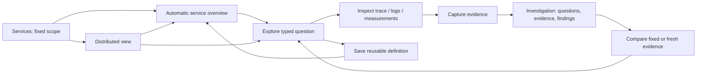

# Whole-product design and product review

Reviewed 2026-10-20. **Review and proposed design; not implemented behavior.**
This pass covers navigation, discovery, services, distributed relationships,
exploration, measurements, manifests/packages, and saved investigations. The
[comparison review](COMPARISON_PRODUCT_REVIEW.md) remains a narrower companion.
This review inspected current UI source and documented contracts; it did not run
a new browser campaign or generate new screenshots.

## Product center

Goo should make ordinary OTel telemetry immediately useful, then let teams refine
its meaning in reusable, reviewable definitions. The core experience is:

**See what is happening → ask why → retain evidence → explain and share.**

A new user should not need to understand a grammar, package kinds, a source
manifest, or receipt formats to discover an emitting service and inspect its
activity. An advanced user should be able to inspect the exact definition behind
every chart and promote a useful question into a package. These are two depths of
one experience.

## Current product assessment

| Surface | Implemented foundation | Product friction / opportunity |
| --- | --- | --- |
| Services | One observed catalog across spans, logs and native metric points; scoped service detail, operation names, convention suggestions, native instrument previews, reported dependency diagnostics. | Detail lists evidence and possible questions but does not yet deliver an immediate operational dashboard. Discovery requires explicit execution. |
| Explore | Typed span/log filters, full-population groups, summaries/distributions, trace and log inspection, recipes, fixed question state. | Powerful controls and separate summary switches put setup ahead of a quick answer. The initial interaction can feel like learning a query builder. |
| Measurements | Typed native/lifecycle definitions, discovery and planning, exact source and kernel semantics, immutable packages. | Users cross between Records and Measurements and encounter definition detail before understanding the operational result. |
| Operations | Application-owned manifests and YAML produce rich operation overviews and guided diagnostics. | Separate top-level destination can imply special treatment for Go/demo apps instead of a richer capability of the same service. |
| Investigations | Typed questions, linked immutable evidence, comparisons, findings, child revisions and sharing. | Many capture/open/save entry points and verbose provenance compete with the narrative. It is hard to see the question → evidence → finding structure at a glance. |
| Definitions | Ad hoc telemetry packages, measurement packages and application-owned contracts. | Distinct schemas/maturity are necessary internally but lack a simple user-facing explanation of when each is useful. |
| Examples | Executable reference journeys and independent applications. | They should teach normal workflows through product surfaces, rather than become another operating mode. |

Current service detail performs four independent source reads. Existing generic
HTTP suggestions select observed route attributes but include mixed span kinds;
their own documentation correctly says these are captured-span summaries, not
request throughput. Existing discovery resolves reported parent IDs across
services and counts child span records, with unresolved/ambiguous/invalid
diagnostics. It is not yet a distributed application dashboard.

## Whole-product priorities

| Priority | Outcome | Bounded implementation |
| --- | --- | --- |
| P0 | Useful service defaults without a manifest. | Upgrade the existing Services detail into an automatic operational overview from capability-supported typed queries. Keep Explore as the general workspace; avoid a competing Home dashboard. |
| P0 | Useful distributed-service defaults. | Add a Distributed view within Services, sharing its exact environment/window and observed catalog, with dependency summary, service activity and explicit relation diagnostics. |
| P0 | One scope and a predictable next step. | Every handoff preserves explicit environment/window/selector; show a breadcrumb and return path. Separate local staging, source execution, capture and publication in labels/status. |
| P0 | Preserve unknown and partial evidence. | Widget-specific state, independent read clocks and global partial indication; failed reads never become zero or green health. |
| P1 | Progressive disclosure. | Show operational results first, chart → dimension → trace/log drilldown next, and definitions/provenance on demand. Keep essential scope/unknown labels visible. |
| P1 | One investigation narrative. | Compact question/evidence/finding outline with consistent Add to investigation and Save revision behavior; preserve existing immutable storage. |
| P1 | Explain definitions by purpose. | Present reusable telemetry questions, native measurements and application contracts as clearly named capabilities of Definitions, with revision/source links from dashboards. |
| P2 | Reduce duplicate product routes. | Once parity is proven, expose Operations as service capabilities and migrate old links; do not remove working advanced functionality prematurely. Keep Examples secondary. |

## Proposed automatic dashboard contract

Generate a **versioned dashboard plan**, not another query engine or handwritten
SQL layer. Inputs are fixed scope, observed discovery inventory, available saved
definitions and explicitly matched manifest/package revisions. Output is bounded
widget descriptors with a stable key, label, typed question/measurement, source
requirements, support state, limitations and drilldown projection. Existing Go
validation/compiler and source adapters execute the questions.

Generation is a pure planning operation over supplied metadata and does not read
telemetry. Opening/loading an explicitly selected dashboard executes its bounded
supported plan, labelled as source reads; the user need not click each widget.
This is different from source-free plan preview or reopening frozen evidence.
Use one visibly fixed scope per load, bounded concurrency and cancellation. Never
auto-execute more queries because a widget expands or a dimension is selected
unless the interaction clearly requests that read. No background polling in the
first slice; a Refresh action proposes/loads a new fixed scope explicitly.

### Evidence and declaration are separate inputs

| Input | What it can establish | What it cannot establish |
| --- | --- | --- |
| Observed inventory | A service/signal/instrument/key was observed in a particular bounded read; recognized metadata shape can suggest a widget. | Complete fleet membership, presence on every record, correct units/version from name alone, healthy service, complete tracing. |
| Manifest or saved package | Declared identity, selector, operation/subject grain, expected instrumentation, explicit policy and source binding; a revision to cite. | Current deployment membership, current emission, completeness, actual values, verified outcomes merely because declared. |
| Executed supported telemetry query | Values and states over its actual bound source population, with read time and semantic limits. | Unsampled traffic totals, causal attribution, synchronized snapshots across independent reads. |

Matched declarations enrich defaults; they must not silently replace observed
population or error policy. A registry metadata `compatible-shape` proposal is
not executable support until its source binding and evaluator are available.
On conflict, show the declared and observed identities/bindings and withhold the
affected widget. A trace-only app remains useful without a manifest; a log-only
or metrics-only service remains visible; a declared-only service says **Not
observed in this window**, not **Down**. Declarations are not an authoritative
fleet roster unless the user supplies such an explicit contract.

### Single-service overview: first slice

Use the existing service detail, with one concise header containing service
identity, environment, fixed window, observed signal chips and definition links.
Start with these bounded widgets:

1. **Observed activity**: span/log record counts over time and reported span error
   share where supported. Label signal grain. Keep unknown/unset statuses visible.
2. **Span duration**: latency distribution/heatmap and operation or observed route
   breakdown, with direct slow/error-span inspection. HTTP request RED requires
   explicit server-kind, eligibility and policy binding; otherwise label generic
   span summaries accurately.
3. **Logs**: reported severity breakdown and links to matching records. Severity
   is not application failure rate; no logs is not evidence of no errors.
4. **Native instruments**: show supported discovered gauge/counter/histogram
   evaluations with exact identity/unit/temporality. Counter rates require valid
   interval coverage. Unsupported instruments remain discoverable without fake
   charts. Do not guess fleet percentiles or utilization from unrelated points.
5. **Dependencies**: incoming/outgoing resolved parent relationships in the chosen
   scope, with unresolved diagnostics and links to contributing trace evidence.
6. **Application contracts**, when explicitly bound: declared operation and
   lifecycle views use their existing grain, outcome policy and revision. Present
   a richer section of the same service, rather than an alternate product.

Default low-cardinality dimensions come from supported observed conventions:
templated routes, RPC methods, database systems, messaging destinations, release
and region. Distinguish resource and record attributes. Do not default to raw URL,
SQL text, message ID or user identifiers. Pin semantics to explicit convention
versions/aliases and source bindings; never merge units or renamed fields by
guesswork. Keep native resource pressure separate from span latency.

### Distributed-services overview: first slice

Within Services, offer **Service list** and **Distributed view**, with a list/table
alternative to the graph. Use the same scope and service identities. The view
can combine observed activity by service, resolved parent edges and explicitly
declared application membership without requiring a new telemetry pipeline.

- **Observed edges**: exact same-trace parent/child ID resolution in scope, showing
  counted child span records. These counts include retries/exporter duplicates
  and are not unique calls, throughput or end-to-end transactions.
- **Reported links**: retain OTel span-link identity and direction, distinct from
  parent edges. Do not draw all asynchronous links as synchronous calls.
- **Declared edges/membership**: visually separate and labelled; only available
  when an actual declaration contract supplies them. Existing operation
  manifests must not be assumed to declare deployment topology.
- **Contextual hints**: shared destination, resource, business attributes or
  nearby timestamps remain optional contextual exploration; they never become
  exact graph edges or causal proof.
- **Unresolved/ambiguous boundaries**: show a compact diagnostic count and access
  to contributing records. Missing parents may be outside scope or not retained;
  never invent an external service node from an unresolved ID.

Selecting a node opens its service overview with scope intact. Selecting an edge
offers its exact contributing trace population if the adapter can express it;
otherwise offer a clearly labelled wider trace search, not an allegedly exact
drilldown. Use bounded topology size, deterministic ordering and explicit overflow
diagnostics; avoid a giant force-directed graph as the only usable surface.

Do not sum per-service span counts into distributed request volume. Service p95s
cannot produce end-to-end p95. Sampling, partial traces, async boundaries and
different independent read times remain visible. A later explicit application
selector can define distributed membership; the first slice can say **Observed
services in this environment** rather than claiming it has discovered every
distributed application.

## Cohesive workflow and information design

This is proposed navigation composition. Existing execution/capture/revision
contracts remain the authority. A chart's **Explore** action stages the exact
typed question, including fixed window and filters, and labels any wider context.
The normal Run action executes it. **Capture evidence** must disclose when it
rereads the source rather than preserving the exact previously displayed result.
**Add to investigation** stages a card; **Save revision** publishes it. Share
links should identify whether they open a runnable question, a live dashboard
definition or immutable evidence. Frozen reopening must not execute a dashboard.

At the visual level, share chart typography, scope bars, status labels, attribute
viewers, table treatment and primary-action hierarchy across Services and Explore.
Use compact scope/definition summaries before charts and detailed provenance
disclosures afterward. A partially unavailable dashboard should still show its
supported widgets and a concise missing-capability explanation. Preserve useful
results on a partial load without presenting old values as current.

## Near-term delivery order and acceptance

1. **Dashboard planning primitive**: deterministic service plan from recorded
   inventory + explicit bindings; capability reasons, stable questions and strict
   budgets. No new DSL, automatic objective or backend-specific UI SQL.
2. **Service overview**: start with generic span/log activity, duration/status and
   observed operations using existing executors. Add supported native evaluations
   only when the plan has an unambiguous source binding. Document each widget's
   grain and read basis.
3. **Distributed view**: first a useful dependency table and bounded deterministic
   graph over existing resolved parent evidence; shared node/edge drilldowns,
   partial states and manifest-vs-observed labels.
4. **Investigation integration**: retain constituent question/capture IDs through
   existing evidence contracts. A frozen whole-dashboard artifact would require
   an explicit future contract; do not imply current documents already freeze
   a service dashboard by merely saving its definition.

Use real OTLP journey fixtures for a manifest-free HTTP service, a manifest-bound
operation service, a log-only service, a metrics-only service, and a declared-only
service. Include supported and unsupported instruments, unknown statuses, missing
dimensions, one source failure, delayed responses after scope changes, partial
traces and ambiguous parent IDs. Demonstrate service → chart → trace/log → capture
→ finding → fresh-browser reopen, plus distributed node/edge traversal and mobile
containment. Generate screenshots from these journeys and update architecture
and storyboard docs with actual support status.

Property tests should prove plan determinism, scope/selector preservation,
namespace/unit isolation and absence of invented support. State/swarm campaigns
cover cancellation, partial refresh, old response rejection, changed investigation
and failed save recovery. Bombadil explores both dashboard routes and question
handoffs; Quint observed replay verifies read intent, fixed scope and immutable
reopening, with rejecting mutations for invented edges, changed membership,
wrong units and implicit source reads.

## Deferred explicitly

An authoritative CMDB, live collaborative canvas, polling scheduler, automatic
causal diagnosis, universal SLO/alert creation, generalized whole-dashboard
snapshot persistence, statistical sampling correction, complete distributed
transaction reconstruction and arbitrary manifest topology schemas are separate
features. They should not block useful automatically composed defaults now.

## Implementation follow-through

The first [service dashboard slice](SERVICE_DASHBOARDS.md) now implements the pure
Go planner, bounded automatic record/native widgets, explicit matching contract
revision metadata, partial-state loading and a source-free distributed relationship
table within Services. The review above remains the design snapshot. Full graphical
topology, async/declaration edges, definition
route consolidation and whole-dashboard persistence remain proposed.

The next slice implements namespace-aware service identity and declared-operation
span cards; see [service identity](SERVICE_IDENTITY.md). These preserve ordinary
question/capture workflows. Schema URL remains declared metadata for trace data,
and contract cards remain span-record evidence rather than outcome/conformance
claims. Declared-only catalog entries now retain independent registry provenance,
explicit absence states and ordinary fixed-question capture workflows. Exact
edge-population selectors remain a future slice.
