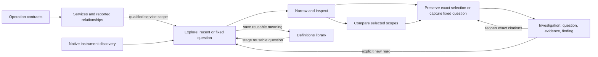

# Whole-product usability and coherence review

Reviewed 2026-10-22. **Expert usability review and proposed work, not customer
research or a claim that the recommendations are implemented.** The review
covers the whole application: Explore, Services/distributed views, native
measurements, Operations, Definitions, saved evidence/investigations, annotations,
comparisons, examples and the shared display library.

The main opportunity is to make the existing product easier to read and direct.
Goo has a useful semantic foundation and enough visualization primitives to support
its core workflow. The next quality improvement should consolidate entry points,
actions and result presentation before adding more independent workbenches.

## Method and current boundary

I inspected the running local application through Chromium at 1440×1000 and
390×844, navigated the five primary destinations, opened the measurement tab,
ran recent activity and service discovery against existing local telemetry, and
opened a service detail. No telemetry fixtures, annotations or documents were
published. The navigation/activity checks observed no uncaught page errors and
no horizontal page overflow at the checked sizes. This is a limited walkthrough,
not an accessibility audit, performance benchmark or exhaustive browser campaign.

The runtime inspected was the live-page retention milestone (`290e101` source
baseline). The parent work in progress adds retained-evidence search, exact review
citations and pending-save recovery. Those additions were **not yet deployed or
validated by this review**. Recommendations below account for their intended
place; they do not reclassify that work as missing once it lands.

Source review included `ui/index.html`, `workspace.js`, `exploration.js`,
`population-workspace.js`, `inventory.js`, `service-browser.js`,
`service-dashboard.js`, `measurements.js`, `documents.js`, `captures.js`,
`telemetry-packages.js`, `distributions.js`, `tail.js`, `meaning.js`,
`retention.js`, and product/component styles. Existing journey frames 59, 60,
93–100 supplement the walkthrough; historical frames are not fresh observations.
The [product essence](PRODUCT_ESSENCE.md), [earlier product review](WHOLE_PRODUCT_REVIEW.md),
[recent-activity design](LIVE_EXPLORATION_DESIGN.md) and
[component sweep](WHOLE_PRODUCT_COMPONENT_SWEEP.md) supply the accepted direction.

New review frames are actual viewport captures of that runtime. They deliberately
show what fits before scrolling; they are not mockups or replacement feature
storyboards:

- [Initial Explore](reviews/screenshots/2026-10-22-explore-entry.png).
- [Recent activity, desktop](reviews/screenshots/2026-10-22-recent-desktop.png).
- [Recent activity, mobile](reviews/screenshots/2026-10-22-recent-mobile.png).
- [Saved investigations entry](reviews/screenshots/2026-10-22-saved-entry.png).

## What should remain

Keep the same core loop: **see activity → narrow a population → inspect an item →
compare evidence → preserve an explanation → reuse the question**. Existing
strengths support it:

- Recent activity reads ordinary OTel spans/logs without a Goo manifest. Services
  distinguishes observed telemetry from declarations, and service identity retains
  namespace semantics.
- Charts, facets, selections, attribute inspection and trace waterfalls already
  provide useful transitions. Shared tables, compact latency, evidence summaries,
  typed attributes and selected-item shells supply the basis for consistency.
- Explicit reads, immutable captures, retained exact observations and parent-linked
  reviews prevent a saved explanation from silently becoming a different answer.
- Native counter/histogram limitations and missing coverage are represented honestly.
  Simplification must preserve these semantics rather than turn unknown into green.

A new top-level dashboard, generic visual-builder framework, whiteboard or chat
interface would add another place to learn before addressing the current friction.

## Highest-priority findings

| Priority | Observed friction and concrete location | Recommendation | Acceptance condition |
| --- | --- | --- | --- |
| P0 | Initial Explore offers **Show recent activity** and **Run question** as equally prominent primary actions, plus share/add/tail controls before a result exists (`exploration.js`). | Make recent activity the default entry. Keep one primary action for the current state; put fixed-question authoring behind Advanced question. Expose result actions when there is an applicable result or explicit question draft. | An unfamiliar-data journey begins by choosing environment/window and one primary action. Existing fixed links still stage without reading. |
| P0 | The first span row in the live walkthrough began near y=1585 at desktop width and y=3053 on mobile. Four timeline bands, range editors, scope/status blocks and stacked facets precede records (`population-workspace.js`, `service-timeline.js`). | Use a compact applied-scope/action strip, one primary activity chart, optional additional measures and a range editor revealed by selection. On mobile make facets a disclosure/drawer, not a mandatory block above records. | With representative data, first useful activity is visible in the initial viewport; target a first record within about 1000px desktop and 1000px mobile. Keep scope, active selection and decisive partial/gap state visible. Validate with fixed fixtures rather than treating these one-run coordinates as universal. |
| P0 | Saved investigations contains notes, tag catalog, general captures, operation captures, and the live **Application operations** workbench. `workspace.js` reparents `#operations` into `savedEvidenceHost` on navigation. | Keep Saved investigations dedicated to finding/reopening durable investigations and evidence. Put live operation execution behind an explicit Continue in Operations/Explore action. Preserve old capture links during migration. | Opening Saved investigations never displays an unrelated live query editor as part of a saved object. Navigation alone performs no telemetry read. |
| P0 | Capture, investigation, notes, saved view, package and retained selection have overlapping names/actions. Operations' **Save investigation** actually creates a legacy operation capture (`index.html`). | Adopt one action vocabulary tied to persisted object and side effect; see the contract below. Keep exact selection retention visibly distinct from recapturing a query. | Across records, services, native metrics and Operations, a user can distinguish configuration, evidence, draft citation and published narrative without reading implementation prose. |
| P0 | A populated Definitions page exposed 103 record-definition revisions and 22 measurement revisions. Many share the same display title, with separate full cards and repeated Edit/Explore/Tags actions (`telemetry-packages.js`, `index.html`). | Use a compact, searchable library with type/environment/origin facets. Visually group related declared names and expose exact revisions on demand. Do not invent a latest authoritative head or collapse distinct bindings by title. | The ordinary task is finding a reusable definition; selecting a historical exact revision remains available. Exercise hundreds of duplicate titles and different environments/units, not only six clean samples. |
| P1 | The global **New query lookback** remains visible in saved/definition contexts while applied/frozen scopes have their own clocks (`index.html`, `workspace.js`). | Move time authoring beside the active scope. Keep a compact fixed-window summary on results and saved evidence. Show the global value only where it is a default for a new read. | Changing a new-query default never appears to retime a saved capture, current applied result, pinned review or live tail. |
| P1 | Shared components exist, yet scope, provenance, current counts and caveats are repeated across wrappers and nested widgets. Native/service and population views expose several nearly identical action/disclosure rows. | Standardize a result composition, not only individual widgets: scope/state → primary result → continuation → optional exact evidence. Reuse `goo-evidence-summary`, shared chart frame, tables and inspector shell through app adapters. | Every owning result has one primary summary and one exact-evidence disclosure. Incompatibility, missing coverage and stale/gap state remain adjacent to the affected result. |
| P1 | Live service detail expanded nine timeline bands for four record measures and the displayed native streams. Axis limits included long decimals such as `1.4977396951255395`, while small exact IDs/stream details competed with the useful values (`service-timeline.js`, native timelines). | Give the overview a bounded primary chart set and expand exact-stream plots on demand. Share human-scale tick/duration formatting with exact values in details. Never choose an arbitrary stream as a fleet value or convert unit `1` to percent without declared semantics. | A service overview exposes useful values and coverage before its stream catalog. Display rounding does not alter retained identity, computation, units or unknown gaps. |
| P1 | The primary records table repeats a long trace-ID action, selection checkbox, Inspect record button and a separate Captured attributes disclosure for each row (`exploration.js`). | Make inspection the dominant row gesture, keep selection controlled, and put trace continuation in a compact accessible action. Remove duplicate attribute presentation only after the shared inspector has keyboard/parity coverage. | Dense 100-row pages remain scannable. Row selection, keyboard inspection, trace continuation and focus return are independently discoverable without long IDs dominating each row. |
| P1 | Measurements starts with Define → Preview → Investigate, packages and several preview/run buttons. This puts authoring ahead of examining an already emitting instrument (`measurements.js`). | Lead with Find an instrument or Use a saved measurement. Generate a checked binding from discovery, then disclose authoring. Reuse the scope/result/capture conventions without flattening native metrics into record queries. | A user with no manifest can inspect a reported instrument, see its unit/stream/coverage, then retain or reuse it. Unsupported temporality/layouts remain explicit. |
| P1 | Live controls and comparison preparation are separate nested workflows; the tail has a different window from the fixed overview (`tail.js`, `population-workspace.js`). | Offer one clearly scoped Live action area with connection/follow/gap state and an adjacent baseline summary. Keep independent windows visible. Make prepare/start stages concise rather than adding another full-height panel. | Switching presentation/disclosing controls does not subscribe. Selection pauses live updates before exact review. Resume exposes a gap; a fixed comparison is not relabeled as the tail population. |
| P2 | Operations and Definitions still expose implementation categories and Go/sample-specific destinations as prominent product concepts. | After parity, make operation contracts capabilities of a service or reusable definition. Keep Examples secondary and contextual. Retain legacy navigation/deep links until normal workflows cover their capabilities. | A non-Go OTel application has the complete core journey; no sample app or Goo annotation is a prerequisite. |

The desktop/mobile coordinates come from one populated local two-minute read
(303 matching spans and 179 matching logs); they measure layout position, not
telemetry completeness or human task time. Full documents can remain long. The
problem is requiring that much travel before the first decision or observation.

## A small action vocabulary

The goal is a stable consequence for each verb across the whole application.
These are proposed labels; no storage migration is required merely to rename them.

| User action | Consequence that must stay explicit |
| --- | --- |
| Show recent activity / Refresh | Resolve fresh bounds and execute the supported questions. |
| Run fixed question | Execute the displayed fixed scope. |
| Filter / Exclude / Select range | Stage local intent; an explicit Apply or Open selected action controls source execution. Direct source-reading shortcuts must say Filter and run. |
| Inspect | Read already supplied evidence locally. A separately fetched trace/log context is a named continuation. |
| Save view | Preserve question/layout configuration; no evidence capture or automatic subscription. |
| Save definition | Preserve a reusable, validated semantic definition and exact revision. |
| Capture question | Reread the fixed question and preserve bounded evidence. Explain that late arrivals can change the new read. |
| Retain selection | Preserve exact server-held observations with their original basis; no fresh telemetry read. Uncommitted expiry remains explicit. |
| Add to investigation | Stage an exact evidence/review citation in the chosen narrative, or create an explicitly named child of a selected saved revision. |
| Save investigation revision | Publish the narrative/draft as an immutable revision. |
| Retry pending save | Reuse its original target, intent and request key; no new source query or silently changed selection. |

Storage names such as XTDB, pgx, receipt formats and annotation hashes belong in
exact details or backend configuration. The everyday selection action should name
what is preserved. Keep operational limits visible at the point where they matter:
for example, an uncommitted selected page can expire, and a failed durable save can
remain uncertain until its original request is recovered.

## One application structure, several honest lenses

Do not replace the typed kernels with a universal untyped evaluator. Consolidate
workflow composition while preserving the different meaning of records, native
streams and application contracts.

The same applied-scope strip, action grammar and return path should survive each
handoff. A service overview can retain its rich widget plan and a native metric
can retain stream identity, temporality and interval coverage. They should not
require separate mental models for Save, Add to investigation, Back or Retry.

## Saved investigations and the work already in progress

The parent milestone is adding native retained-evidence search, pinned review
citations and pending native saves. It is the right foundation. The final layout
should avoid another stack of independent storage catalogs:

1. A small task header: **Investigations**, **Evidence**, and a visible pending-save
   count when nonzero. These are views within one destination, not new top-level routes.
2. One search/filter row whose scope is explicit. Type, service, environment, tag
   and time should say whether they filter retained members, capture windows or
   narrative metadata. A local page search must not masquerade as full-catalog search.
3. A compact result list with name, type, scope, recorded/captured time and status.
   Exact IDs and revision lineage are secondary. Preserve branch and missing-store
   states; never imply all storage backends were searched successfully if one failed.
4. Opening an investigation emphasizes its question and finding, then citations.
   Selected evidence or a comparison appears in one inspection region; do not
   expand every receipt and its full data into the initial document.
5. A pending save is an operational state attached to its intended object, not an
   annotation or classifier label. Show Retry unchanged, inspect intent, and a
   clearly local Forget action. Forgetting a local retry does not withdraw a
   potentially committed server assertion.

Pinning an exact review is essential: later review branches can be inspected as
new knowledge without rewriting the interpretation a saved investigation cited.
A backend await token is a read lower bound, not that historical review identity.
Native durability should not imply that unsaved file-backed narrative drafts or
all other product actions have become retry-safe. Label the actual scope of recovery.

## The shared primitives worth consolidating

The existing passive web components are a good fit for both server-rendered HTML
and the SPA. The largest remaining gains are adoption and application composition:

| Shared pattern | Reuse/consolidate | Keep in the application adapter |
| --- | --- | --- |
| Applied scope/status strip | Environment, qualified entity, UTC window, staged/fixed/frozen/live mode and decisive result state. | Query semantics, time resolution, reads and navigation. |
| Result action row | One primary continuation plus consistent secondary disclosure; predictable location across charts, tables and native results. | Whether an action stages, reads, captures, subscribes or publishes. |
| Catalog row and filter toolbar | Compact names/types/scope/time/status, local search vs server search labels, loading/empty/failed/paged states. | Store-specific queries, identity, cursors and mutation policy. |
| Selected-item composition | Shared inspector heading, close/return, value/state, attributes and one continuation area. | Resolving exact selected keys, trace expansion, additional reads and durable selection. |
| Comparison composition | Aligned baseline/current labels, common scale/unit when comparable, clear direction/magnitude, table fallback. | Full-population arithmetic, compatibility, uncertainty and query planning in Go. |
| Narrative citation | Compact question/evidence/review link and optional exact details. | Exact revision resolution, pending drafts, citation validation and publication. |
| State and action feedback | Concise empty/partial/unavailable/unknown/uncertain messages; visible pending save state and completion. | Recovery receipts, request IDs, context generations and retry behavior. |

Avoid a universal interactive `goo-workbench` component that knows query ASTs,
backend routes, subscriptions and storage. The common composition should first be
an application renderer shared by two real surfaces. Extract a passive shell only
where a stable display/interaction contract is demonstrated.

## A focused delivery sequence

**First coherence round:** make Explore's entry have one primary action, shrink
above-result chrome and the default range editor, move mobile facets behind a
clear disclosure, and remove the live Operations editor from the saved-object
landing page. Standardize Save/Add labels. These are bounded presentation changes
with high value; preserve URL/capture behavior and existing data semantics.

**Second round:** unify Saved investigations' browse/recovery layout and compact
Definitions catalogs. Keep backend-specific adapters but present one discovery
and exact-open model. Exercise long-lived stores and same-title revisions. Parent
retention work can land without waiting for the entire library restructuring.

**Third round:** make native discovery, service detail and operation capability
handoffs use the same scope/result/action composition; consolidate inspected-item
and citation layouts. Remove redundant outer headings and repeated warnings as
adoption happens. Keep source-specific unsupported states legible.

Only then prioritize additional visual types or a multiplayer/spatial layer.
Comparison-versus-rest and automatic anomalous-population suggestions can be
valuable, but require explicit Go-supported population/complement semantics and
reviewable provenance. Do not simulate those capabilities by subtracting displayed
rows or relabeling unrelated aggregate populations.

## Quality gates and executable journeys

The following are proposed acceptance work, not claims this review ran them all.
Extend existing journeys instead of making a separate design-only demo.

| Journey | Required behavior and quality checks |
| --- | --- |
| Unfamiliar application → useful evidence | Ordinary OTel, no manifest; one recent entry; service/facet/time narrowing; first useful activity and record within the compactness budget; keyboard/touch alternatives; no hidden source reads while staging. Extend 93–97. |
| Service symptom → inspect → compare | Preserve full namespace/environment/window across overview, trace/log context and return; distinguish context reads; align comparable values visually; unsupported/gap states stay visible. Extend 59–60, 71, 84. |
| Selected evidence → investigation → later review | Exact members and original basis; attach pinned review; later corrections preserve the old citation; reopen without telemetry access. Extend 98–100 and the parent milestone's next journey. |
| Interrupted save → reload → recovery | No automatic publication on reload; same key and intent; committed-response loss creates no duplicate; missing optional backend is not absence of saved evidence; forgetting local retry does not withdraw server data. |
| Native instrument → retained question | Discover before authoring; exact unit/stream/temporality; no fleet average of percentiles; unknown/reset/layout changes remain unknown or withheld; same capture/Add/Back actions. Extend 72–83. |
| Reusable definition → fresh investigation | Search a populated library; distinguish same-title scopes and exact revisions; stage a definition without executing; run explicitly and return with context. Include ordinary non-Go telemetry. |

Across these journeys:

- Test at desktop and 390px width, including keyboard focus, accessible names,
  non-color selection/gap cues, actual text contrast and long labels/values. No
  horizontal page overflow is necessary but not sufficient for usability.
- Use zero/partial/failed and delayed/obsolete responses, sparse data and hundreds
  of rows/revisions. Existing fixture-rich journeys are necessary; a pristine
  six-example catalog is insufficient for a long-lived product.
- Keep passive-component mount/disclosure source-free. Property/model tests should
  verify semantic identities and transitions, while browser tests verify layout,
  discoverability affordances, read counts and focus restoration.
- Add Bombadil actions for the common scope/filter/inspect/retain/return sequence,
  including mobile drawers and draft cancellation. Assert source-read/publication
  invariants and bounded selection rather than screenshots alone.
- Retain screenshots around decisions: initial entry, selected population, aligned
  comparison, pinned citation and interrupted-save recovery. A full-page image
  containing every feature is not evidence that a person can find the next action.

The measure of success is fewer concepts and less travel for the same trustworthy
investigation. The semantics are an asset; the interface should reveal their
precision progressively while making the common next action obvious.
