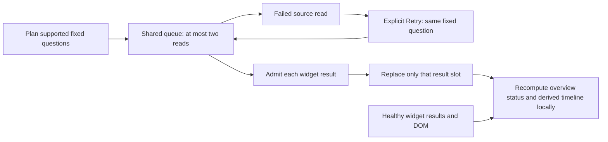

# Recover one service widget

Milestone 354 is implemented and validated. See the
[executable storyboard](journeys/354-widget-recovery.md) and
[validation record](../VALIDATION.md).

A supported widget whose source read failed offers **Retry**. It reads that
widget's original fixed question again, without replanning the overview,
refreshing discovery or rereading successful siblings. Their results, displayed
details, source clocks and evidence bases remain intact. A successful retry gets
its own new source clock; it does not make the overview a shared snapshot.

Retry uses the existing typed source-refusal display, with short reasons and
optional technical details. Source cancellations, timeouts, limits, rejected
source responses and unavailable transports can be retried explicitly. Invalid
local questions, unrecognized result scopes and unsupported prerequisites do not
gain a Retry action. A completed no-data result retains its own state.

Initial reads and retries share the two-request limit. Queued and running cards
are busy; repeated clicks cannot schedule duplicate work. Source attempts use
frozen planner definitions and detached request bodies. Completed recovery
replaces the failed slot rather than adding another result.

Changing service, scope, profile or instrument selection retires pending work and
old controls. The service browser keeps pending ownership active for retries that
outlive initial loading. Derived timeline controls also retire on replacement.
Completed service views retain their existing navigation behavior; leaving while
an overview read is pending follows the existing pending-overview retirement path.

**Capture widget evidence** remains a separate explicit source reread of the fixed
question. Retry does not save evidence or modify an immutable capture.
