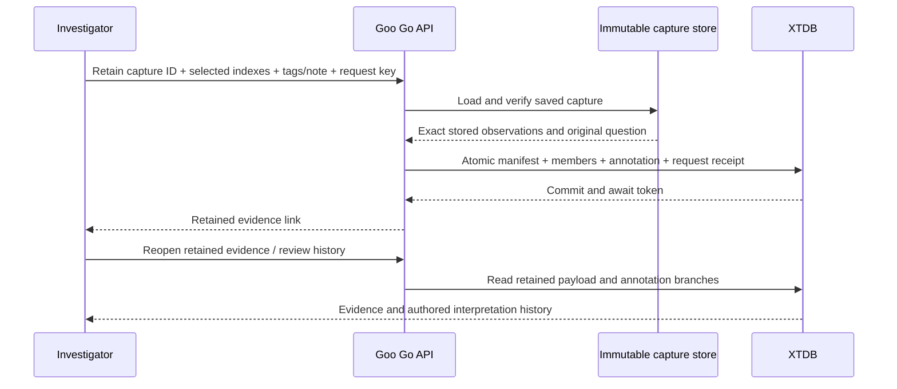

# Tags, notes and retained evidence

Goo's shared annotation contract attaches authored context to an exact target.
It does not turn a note into an observed fact, service-health verdict or classifier
label. The [whole-product design](PRODUCT_ANNOTATIONS_DESIGN.md) remains the roadmap
for richer review, relationships, training vocabularies and dataset exports.

## Cross-product metadata

Open **Tags and notes** on an exactly scoped service, saved exploration view,
investigation revision or saved telemetry package. Enter lowercase tags and a
note, then explicitly save. Service annotations apply to the displayed fixed
half-open time window and exact environment/service/namespace identity. Missing,
present-empty and named namespaces are distinct; an all-namespaces selector is
not an annotation target. Saved artifacts refer to exact content revisions.

A correction appends a child revision. Two corrections of the same parent remain
independent branches; the interface never uses last-write-wins to pick a reviewer.
Withdrawal appends another revision and retains the earlier content. Show history
or open an exact revision link to inspect older assertions. Correcting an older
service assertion retains that assertion's applicability window.

The **Tags and notes across the workbench** disclosure in Saved investigations
finds current active revision heads by exact tag. This is a metadata catalog,
not a telemetry predicate, inherited label or complete service inventory filter.
Opening, editing, cancelling and saving annotations perform no telemetry reads.

The initial file store has bounded catalog scans (10,000 directory entries),
20-item pages and explicit cursor restart errors when the selected catalog changes.
Each artifact is content-addressed and integrity-checked. Attribution is explicitly
`local-user-unverified`; this local lab has no authenticated reviewer identity or
multi-tenant authorization. Notes are bounded to 4,000 UTF-8 bytes and tags to 16
unique lowercase slugs of up to 64 ASCII characters.

## Optional XTDB retained-evidence experiment

The optional backend is a Go adapter using pgx and XTDB 2.2.0's PostgreSQL wire
protocol. It is an experiment alongside the normal annotation store, not a
migration of all metadata to XTDB or a native ClickHouse external-source connector.

Start the ordinary lab, build the query/packages image, then enable the overlay:

```sh
docker compose -f compose.yaml -f compose.xtdb.yaml up -d --no-build xtdb packages query
```

The overlay pins XTDB's image digest, binds ports to loopback, limits memory/CPU,
and preserves its data in a dedicated volume. It sets `GOO_XTDB_URL` only on the
Go packages service. The UI adapter checks configuration; passive display elements
never access the database. The standalone database configuration is for the local
experiment, not a production topology.

1. Save an Explore question as a capture. This existing action explicitly rereads
   the fixed query and retains bounded server-owned evidence; it does not promise
   to freeze an earlier live result verbatim.
2. Open that immutable capture and select up to 20 stored inspection rows.
3. Expand **Retain selected evidence in XTDB**, enter tags/note, and explicitly save.
   This action copies the selected stored observations without querying ClickHouse.
4. Follow **Open retained evidence**. Inspect attributes and correct or withdraw the
   review using the shared annotation panel. Reloading reads XTDB's retained data.

The native transaction publishes the manifest, selected member projections,
initial annotation and request receipt together. A stable request key lets the UI
recover the same initial annotation after a lost response; reusing that key for a
changed intent fails. Member identity includes its original capture row position,
so identical payloads at two positions remain two observations. Content hashes
check integrity; they do not attest origin or establish unique physical events.

The manifest names the original capture receipt/question, evidence basis, source
count, retained-record count and selected indexes. It expressly describes unknown
population completeness. Record JSON is retained without conversion through
floating-point values; original nanosecond strings and JSON numeric tokens survive.
API receipts and manifest reads also include `manifestJSON`, the exact serialized
artifact as a string. This survives JSON proxies and browser decoding; rebuilding
the artifact from display objects may change escapes, key order or numeric tokens
and must not be used to verify its identity. Native member columns project
service, reported trace/span IDs and event-time
nanoseconds for joins within an explicitly selected manifest. The projected service
name alone is not a full service identity; environment and missing/empty namespace
semantics remain in the capture scope and resource attributes. Arbitrary attributes remain in the retained JSON payload;
this spike does not provide an arbitrary-attribute XTDB query compiler.



Captured event time, original custody/basis, capture time, metadata recorded time
and XTDB system time remain separate. Native system-time SQL can reconstruct which
assertions existed at an earlier cutoff. The application still derives branches
from explicit parent edges. An immutable evidence target does not receive a
fabricated business-valid interval merely because the database is bitemporal.

## Prototype limits

The retained-evidence catalog is separate from the file-backed global tag catalog;
there is no cross-store search, production permissions/redaction/deletion policy,
training export, historical-cutoff UI or automatic retention of live result pages.
The await token is returned by initial publication, but cross-node read-basis
propagation is not implemented. Initial capture request retries are idempotent;
correction retries may append equivalent independent revisions. Retained annotation
history is bounded to 1,000 revisions and fails explicitly beyond that bound.
The evidence view links the retained manifest; exact file-annotation deep links
are not reused as native annotation links.

See the [storage assessment](ANNOTATION_STORAGE_SPIKE.md) for Minigraf/XTDB tradeoffs,
external-source clock semantics and the next conformance requirements.

## Executable evidence

[Journey 98](../journeys/annotations.spec.js) covers service/view/document/package
annotations, cancelled drafts, exact links, parallel corrections and withdrawals,
with no additional source reads. Its observed ledger is checked through quint-go,
including negative controls for hidden source reads, implicit publication and
incoherent scope/history. Bombadil explores draft/cancel/history interactions.

[Journey 99](../journeys/retained-evidence.spec.js) emits real OTLP spans, creates an
explicit source capture, selects its stored records, loses a successful native
publication response, retries and reopens the retained evidence with browser source
API reads blocked. This is not a claim that the ClickHouse process was stopped.
Bombadil also explores draft/cancel/history on the retained-evidence surface.
Native Go integration tests exercise rollback/retry, concurrent request recovery,
temporal cutoff queries and immutable record
round-trips against a real optional XTDB instance. Hegel state/swarm campaigns
check the common annotation branch/history contract. Screenshots are in
[the journey index](journeys/README.md).
