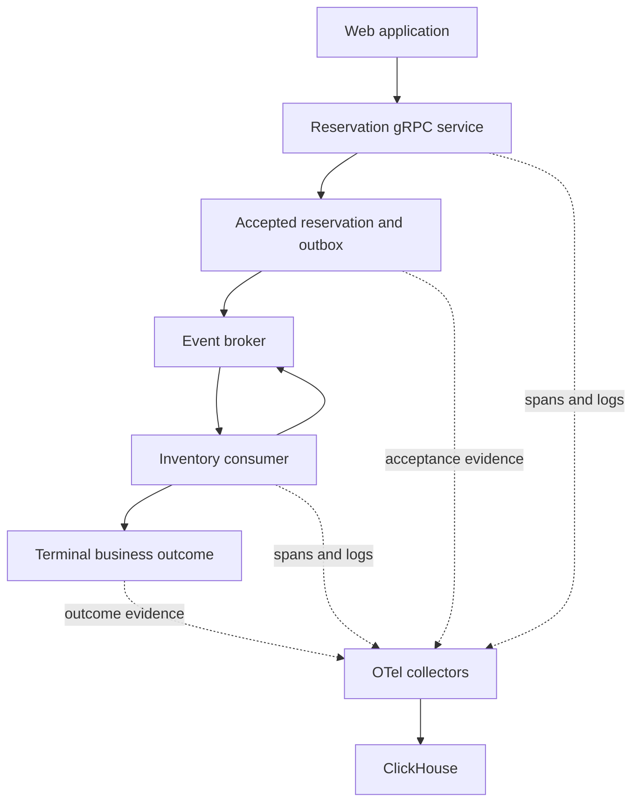

# Grammar of Observability Draft Design for ClickStack

Exported 2026-10-16 from the [editable design Page](https://chatgpt.com/space/page_15a87f394ffc8191b8b5127ebde84cef). This is the original proposal snapshot; examples are illustrative. For current implementation status and next work, see ../README.md, KNOWN_ISSUES.md, and IMPLEMENTATION_PLAN.md.

Draft design for a Grammar of Observability over ClickStack-shaped OpenTelemetry data. The first application is a gRPC reservation service that publishes accepted work to an event consumer. Teams publish measurements, SLOs, alarms, and default views alongside application code; a UI explores the same definitions through typed expressions.

The proposed core is an algebra of populations, measurements, relationships, and views. Named resources and reusable templates package that algebra for deployment. ClickHouse executes queries, a scheduler evaluates operational resources, and rendering adapters present typed results. All EDN and commands below are proposed interfaces, not implemented APIs.

# Design decisions

| Decision | Initial choice | Reason |
| --- | --- | --- |
| Canonical representation | Versioned EDN abstract syntax tree, with a JSON-compatible subset | Clojure tooling and inspectable values; interoperable transport |
| Query backend | ClickHouse with a versioned ClickStack schema adapter | Consume existing collector output |
| Unit of composition | Typed expressions referencing populations and measures | Reuse meaning across alarms, views, and exploration |
| Application ownership | Immutable published package revisions | Changes can be reviewed with code |
| Interactive editing | Session overlays referencing a package revision | Exploration preserves the deployed definition |
| SLO evidence | Explicit measurement basis and completeness policy | Retained traces alone do not establish population coverage |
| Initial deployment | Supplement HyperDX, with capability-checked export | Establish semantics before replacing the entire UI |

Wickham’s layered grammar motivates separating statistical transformations from presentation. Plotje’s plain-data pose model motivates inspectable, composable values. The proposed observability grammar extends those ideas with counting units, operational time, evidence quality, and executable expectations. [Layered grammar paper](https://vita.had.co.nz/papers/layered-grammar.html) · [Plotje poses](https://scicloj.github.io/plotje/plotje_book.pose_model.html)

# Worked service flow

A web application calls ReservationService.CreateReservation over gRPC. The service validates the command and atomically records accepted work with an outbox entry. The outbox publishes ReservationAccepted. An inventory consumer processes the command, possibly through multiple deliveries, and persists a terminal business outcome.

The synchronous contract is fast, successful command handling. The asynchronous contract is confirmed completion within 60 seconds for accepted reservations. These are separate objectives: a fast gRPC response does not establish eventual completion.



The consumer-to-broker edge represents retry or redelivery. Transactional application records and outbox delivery improve business consistency; telemetry still needs its own delivery monitoring, replay, deduplication, and reconciliation. Calling the evidence complete is an operational claim to verify, not a consequence of using an outbox.

# Telemetry and subject identities

| Evidence | Subject and identity | Purpose |
| --- | --- | --- |
| gRPC server span | One server call, identified by trace and span IDs | Synchronous duration and execution evidence |
| Accepted event in structured logs | Accepted reservation, scoped by environment, tenant, reservation ID | Asynchronous denominator and start time |
| Terminal outcome event in structured logs | Same scoped reservation identity | Confirmation, rejection, or expiration |
| Consumer processing span | Processing attempt, identified by trace and span IDs | Retry behavior and processing cost |
| OTel metrics | Instrument stream with resource and attribute identity | Complete low-cardinality operational rates and histograms |
| Associated logs | Individual log records with optional trace/span identity | Error and execution details |

Application attributes include app.reservation.id, app.tenant.id, app.event.id, app.event.version, app.accepted_at, app.completed_at, app.outcome, and app.consumer.group. These are application-defined fields. The schema adapter maps them into logical fields; it does not imply they are OTel standard attributes.

Deduplicate business events by environment, tenant, and event ID. Collapse accepted and terminal records to one subject using the scoped reservation identity. Conflicting payloads for the same event ID are data-quality errors. For this pilot, the application contract permits one immutable acceptance and one immutable terminal decision; conflicting terminal decisions invalidate the affected subject pending reconciliation.

OpenTelemetry messaging spans can represent batches, and span links connect producers and consumers across asynchronous boundaries. A processing span is therefore not automatically one message, and the business relation must work even when trace context is absent. [OTel messaging spans](https://opentelemetry.io/docs/specs/semconv/messaging/messaging-spans/)

# Grammar and result types

The grammar needs a small set of operators with explicit input and output types. Templates expand into these operators and named resources; they do not introduce hidden runtime semantics.

| Operator family | Input | Output | Essential rule |
| --- | --- | --- | --- |
| source, filter, derive | Records | Record population | Preserve identity and field provenance |
| distinct, collapse | Record population | Subject population | Declare key and conflict handling |
| group, aggregate | Population | Grouped values or distributions | Declare counting unit and retained dimensions |
| window, align | Timed evidence | Windowed result | Declare event time, interval boundaries, and alignment |
| ratio | Compatible counts | Ratio with numerator and denominator | Preserve eligibility, window, and grouping compatibility |
| deadline-outcome | Starts and terminal evidence | Classified subject population | Include subjects with no terminal event |
| compare | Two populations or measurements | Comparison | Retain both population definitions |
| relate | Population and declared relation | Related population | Declare multiplicity and evidence strength |
| encode, layer, facet | Typed result | View specification | Presentation does not silently redefine measurement |

Every expression resolves to a type carrying subject grain, units, available dimensions, temporal semantics, and evidence metadata. A distribution can be encoded as a heatmap or summarized into a quantile. A scalar quantile cannot be expanded back into its original distribution. Native histograms retain bucket or sketch semantics; native sums retain temporality and reset handling.

The source adapter binds logical fields to physical columns. ClickStack’s reference schema includes separate logs, traces, and metric tables, attribute maps, span links, and metric exemplars. Pin the adapter to the installed schema and discover its actual columns rather than assuming the current documentation matches every deployment. [ClickStack tables and schemas](https://clickhouse.com/docs/clickstack/ingesting-data/schemas)

For spans, normalize the exporter’s duration representation to a declared time unit and validate it against fixtures. Parse map-backed numeric attributes with an error-producing conversion. Distinguish missing fields from empty strings and zero. Version the mapping of gRPC and messaging semantic conventions rather than silently coalescing fields with potentially different meanings.

# Application package sketch

The service repository contains observability/package.edn, instrumentation requirements, and fixtures. A shared library supplies HTTP, gRPC, and consumer templates. The platform supplies source profiles and notification-route bindings. Application packages contain references to those bindings rather than database credentials or notification secrets.

This package focuses on asynchronous completion. A second population, grpc-calls, selects server calls for CreateReservation and supports a synchronous SLI. It is never unioned with the accepted-reservation population.

```clojure
{:api-version "observability/v0"
 :id :commerce/reservations
 :owner :commerce

 :parameters
 {:environment {:type :string :default "production"}}

 :sources
 {:business-events
  {:profile :platform/clickstack-logs
   :contract :commerce/reservation-events-v1
   :measurement-basis :unsampled-events
   :coverage-policy :platform/business-event-reconciliation}
  :spans
  {:profile :platform/clickstack-traces
   :measurement-basis :retained-spans}}

 :populations
 {:accepted
  {:from :business-events
   :where [:and
           [:= [:field :environment] [:param :environment]]
           [:= [:field :event/name] "reservation.accepted"]]
   :distinct-by [:environment :tenant/id :event/id]
   :subject-key [:environment :tenant/id :reservation/id]
   :time :reservation/accepted-at}

  :terminal
  {:from :business-events
   :where [:and
           [:= [:field :environment] [:param :environment]]
           [:= [:field :event/name] "reservation.terminal"]]
   :distinct-by [:environment :tenant/id :event/id]
   :subject-key [:environment :tenant/id :reservation/id]
   :time :reservation/completed-at}

  :completion
  {:op :deadline-outcome
   :starts :accepted
   :terminals :terminal
   :match-on [:environment :tenant/id :reservation/id]
   :deadline "60s"
   :success [:= [:field :reservation/outcome] "confirmed"]
   :anchor :start-time
   :conflicts :invalidate-subject}}

 :measures
 {:eligible
  {:population :completion
   :where [:= [:field :classification/maturity] :mature]
   :aggregate [:count-subjects]}
  :good
  {:population :completion
   :where [:and
           [:= [:field :classification/maturity] :mature]
           [:= [:field :classification/result] :good]]
   :aggregate [:count-subjects]}}

 :slis
 {:timely-confirmation
  {:numerator :good
   :denominator :eligible
   :zero-denominator :no-data
   :invalid-evidence :unknown}}

 :slos
 {:reservation-completion
  {:sli :timely-confirmation
   :target 0.999
   :window "30d"}}

 :alarms
 {:completion-fast-burn
  {:slo :reservation-completion
   :every "1m"
   :condition
   [:and
    [:> [:burn-rate {:window "1h"}] 14.4]
    [:> [:burn-rate {:window "5m"}] 14.4]]
   :unknown :preserve-state-and-mark-stale
   :notify :commerce/on-call
   :investigate :completion-failures}}

 :views
 {:completion-failures
  {:population :completion
   :where [:= [:field :classification/result] :bad]
   :display {:geometry :table}
   :columns [:reservation/id :classification/reason
             :release/accepted :region/accepted]
   :actions [:compare :follow-processing :inspect-logs]}}

 :dashboards
 {:service-overview
  {:parameters [:environment]
   :panels [{:slo :reservation-completion :display :budget}
            {:slo :reservation-completion :display :burn-rate}
            {:view :completion-failures}]}}}
```

This sketch defines the package boundary and operator behavior. The compiler must reject unresolved references, invalid evidence policies, or incompatible types before publishing. A coverage-policy reference names a runtime evidence check; the declaration alone never changes observed coverage to complete.

# Deadline semantics

Let T be evaluation time, D the 60-second deadline, and L a configured allowance for ingestion delay. Use C = T minus D minus L as the conservative end of an acceptance cohort. A window of width W evaluates starts in [C minus W, C). Its terminal lookup extends through the corresponding deadlines and ingestion allowance, including events outside the acceptance window.

This deliberate delay makes the denominator mature. Every accepted reservation in the cohort contributes once, including reservations with no terminal record. Use all mature starts for this SLI, even when some successful outcomes were already known earlier, so good and bad outcomes have the same cohort selection rule.

| Condition | Result | Reason |
| --- | --- | --- |
| Confirmed by accepted time plus 60 seconds | Good | Timely confirmation |
| Rejected or expired terminal decision | Bad | Business outcome failed |
| Confirmation after the deadline | Bad | Completion was late |
| No terminal decision after maturity | Bad, if evidence coverage is healthy | Deadline elapsed |
| Acceptance is too recent | Pending | Deadline has not matured |
| Coverage is impaired or records conflict | Unknown evidence | Failure cannot be distinguished reliably |

The pilot assumes producer timestamps have adequate clock synchronization and bounded error relative to the 60-second objective. The adapter must expose violations and negative durations. A production contract must define acceptable clock uncertainty or supply an authoritative deadline/completion decision.

Ingestion allowance is a lateness policy, not proof that all data arrived. Track coverage health independently, with reconciliation and collector/exporter health. Query results are provisional until the lateness policy closes; late arrivals trigger versioned corrections within a bounded correction horizon. Beyond that horizon, record a reconciliation discrepancy.

Historical corrections update aggregates and incident evidence but do not replay old paging notifications. Alarm receipts preserve what was known at the original evaluation.

For this proposed target, burn rate is bad fraction divided by 0.001. Both the one-hour and five-minute conditions must hold. Multiwindow burn alerts are grounded in Google’s SRE approach; the chosen windows and 14.4 threshold are pilot defaults, not universal recommendations. [Alerting on SLOs](https://sre.google/workbook/alerting-on-slos/)

Low traffic produces volatile ratios. Show counts beside rates and make any minimum-volume rule explicit. Such a rule suppresses pages; it does not remove failures from SLO accounting. Zero traffic is no-data. An evidence outage is unknown, and cannot recover a firing alarm.

# Query execution and retained aggregates

The reference query plan is:

1. Resolve source profiles, authorization scope, package revision, and parameter types.

2. Select and deduplicate acceptance events in the mature acceptance interval.

3. Find terminal evidence for those identities through their deadlines, allowing late arrivals according to policy.

4. Collapse each subject to one classification; detect conflicting evidence and clock violations.

5. Group by declared acceptance dimensions and compute eligible, good, bad, and unknown counts.

6. Attach coverage status, cohort bounds, evaluation time, source profile revision, and query provenance.

7. Produce an SLI value only when the evidence policy permits it.

Use acceptance-time region and release for cohort attribution; show consumer release separately when debugging. This avoids silently attributing the denominator to the consumer version that happened to finish the work.

Keep this raw-query plan as a semantic reference. Optimize only after it passes the fixtures. A stateful projection may maintain accepted subjects until classification, then emit one versioned subject result. A recording rule can persist per-minute good, bad, and unknown counts by bounded dimensions. Retain enough aggregate history for the 30-day objective even when raw retention is shorter.

Corrections require replacement or retraction of previous contributions. An insert-triggered materialized view that independently counts incoming terminal events cannot account for absent completions and cannot safely retract old classifications. Do not use that design for deadline outcomes. Choose an idempotent projector or bounded recomputation with atomic generation publication, and keep readers from combining partial generations.

Store additive counts and mergeable distribution states, not averages of rates or percentiles. When raw evidence expires, only retained dimensions remain available for historical exploration. The UI must expose that boundary.

# Investigation behavior

The alarm links to the exact package revision, environment, cohort windows, evidence cutoff, and evaluation receipt. This reproduces the evaluated question. Exact result reproduction also requires retained input snapshots or a pinned result; otherwise the UI identifies a recomputation against current data.

A likely workflow is:

1. Open the failed reservation population from the burn alarm.

2. Compare it with good reservations from the same mature acceptance cohort.

3. Partition by acceptance region and release, then inspect consumer version and delivery counts.

4. Select a subgroup with unusually many late or absent completions.

5. Follow the reservation identity into consumer attempts across trace IDs.

6. Inspect linked producer/consumer spans and associated logs.

7. Save a session branch or propose a package change.

| Relation | Meaning | UI treatment |
| --- | --- | --- |
| Log to span by trace and span ID | Direct recorded identity | Exact linked evidence |
| Producer to consumer by recorded span link | Recorded execution relationship | Linked span evidence |
| Reservation to attempts by scoped business ID | Declared application relationship | Business correlation with multiplicity |
| Metric to trace by exemplar | Recorded example from aggregate evidence | Sample exemplar, not the whole population |
| Metric to nearby service logs | Shared context and time | Contextual search |

Relations carry cardinality and do not multiply the original measurement unless an explicit expansion changes the counting unit. Batch spans remain attempts or batches until per-message evidence supports finer grain. Missing trace context does not prevent a business-ID lookup. Tracing can be sampled even when business-event evidence is collected without intentional sampling.

A comparison ranks associations by effect size and displays cohort sizes, missingness, and sampling metadata. It does not label an attribute as a proven cause.

# UI driven by the grammar

The UI edits expressions through controls selected by their types. It needs a field browser with raw attributes as well as published logical fields, so teams can investigate questions their package did not anticipate.

| Expression or result | Offered controls | Invalid operations explained |
| --- | --- | --- |
| Record population | Filter, derive, group, inspect | Fields absent from source or expired projection |
| Duration distribution | Heatmap, quantile, range selection | Recovering a distribution from a scalar percentile |
| Grouped counts | Rate, compatible ratio, ranking | Mixing counting units or incompatible populations |
| Deadline cohort | Good, bad, pending, unknown filters | Treating immature subjects as failed |
| Trace or attempt set | Waterfall, links, related logs | Assuming one tree covers asynchronous processing |
| SLO | Budget, burn windows, contributing cohorts | Showing unknown evidence as healthy |

A range selection on a distribution produces a predicate over the underlying population when that population is available. Selecting an approximate histogram bucket retains bucket-boundary precision. An aggregate with no underlying records or exemplar cannot promise exact event drill-down.

The editor shows the current definition, inferred result type, and an explain panel with units, grain, time bounds, and evidence quality. A session is an overlay on an immutable package revision. Personal saves preserve that overlay; publishing exports an explicit package change for code review.

Presentation composes through encodings, layers, scales, coordinates, and facets. Deployment annotations are separate layers aligned on time; a view can switch from a heatmap to a table while retaining population semantics. Plotje can render suitable result types, while waterfalls and linked browsing use specialized renderers behind the same result contract.

# Packaging and deployment

Proposed commands are validate, explain, plan, apply, and export. CI checks the package schema, references, unit compatibility, template expansion, instrumentation requirements, and fixture results. Runtime validation checks actual source capabilities and evidence health.

Templates are versioned pure expansions. Pin template and source-profile revisions in a lock record and retain the expanded package hash. Avoid arbitrary executable code in published measurement expressions; Clojure authoring functions can generate the data before validation.

Publication uses stable resource IDs, ownership scopes, and an explicit reconciliation policy. Apply is idempotent. Plan identifies additions, definition changes, removed resources, and incompatible source assumptions. Definition changes create new measurement revisions with effective times; historical SLO results retain their original semantics unless an explicit backfill is requested.

The query service enforces tenant and environment authorization outside user-editable predicates. Database access remains server-side. Use typed parameters, bounded lookback and group counts, cancellation, and workload limits to make interactive queries predictable. These controls belong to execution policy rather than the chart grammar.

HyperDX export is an adapter with a capability report: supported, unsupported, or requiring an explicit approximation. Export supported dashboards and simple alarms; preserve IDs and ownership mappings. Never silently weaken a compound burn alarm to a single threshold. ClickStack exposes dashboard and alert APIs, but deployed API and evaluator behavior must be checked against a pinned version. [ClickStack API reference](https://clickhouse.com/docs/clickstack/api-reference)

# Alarm evaluation state

Keep condition evaluation separate from notification delivery. Each evaluation produces true, false, or unknown, plus counts, windows, quality status, and provenance. Only known false can advance recovery. Unknown preserves the last known alarm state, marks evidence stale, and can drive a separate telemetry-health alarm.

Persist pending, firing, and recovered transitions. Deduplicate notifications by alarm revision, grouping key, and incident episode. Store delivery attempts and retries independently. Restarts resume from persisted state. The pilot uses one-minute evaluation and no additional pending duration; additional delay or low-volume gates must be explicit package fields.

# Acceptance fixtures

These are proposed tests for the first implementation, not completed test results.

| Fixture | Required result |
| --- | --- |
| One accepted reservation with three failed attempts and timely eventual confirmation | One good reservation; attempts remain separately inspectable |
| Duplicate acceptance and terminal deliveries | One subject contribution |
| Accepted reservation with no completion after maturity and healthy evidence | One bad reservation |
| Recent acceptance without completion | Pending, excluded from mature SLI |
| Confirmation at exactly 60 seconds | Good under inclusive deadline semantics |
| Confirmation after 60 seconds | Bad even after later success |
| Completion ingested late within correction horizon | Corrected aggregate; original alarm receipt preserved |
| Collector outage or failed reconciliation | Unknown evidence; no false alarm recovery |
| One consumer span covering a batch | No inferred per-message success |
| Producer and consumer have different trace IDs | Business identity and recorded links still work |
| Cross-tenant reuse of reservation ID | No relation across tenants |
| Conflicting terminal records | Invalid subject and unknown SLI under the strict policy |
| Native cumulative counter resets | Correct rate through typed metric adapter |
| Fleet quantile from scalar host P99 values | Compilation error |
| Raw evidence expired but counts retained | Historical SLO works; unavailable drill-down is explicit |
| UI and scheduled evaluation use identical frozen inputs and expression | Same numerical result and evidence classification |

# Implementation sequence and open choices

First implement a pure reference evaluator for small in-memory fixture datasets, including deadline classification, units, identity, and evidence states. Then implement the ClickHouse adapter and compare its results against the same fixtures. Add immutable package publication and a thin investigation UI for populations, distributions, comparisons, and relations. Add durable projection and alarm evaluation after the semantic checks pass.

The pilot can replace selected HyperDX workflows while retaining it for general browsing. A full replacement should follow demonstrated coverage of search, trace inspection, metrics, navigation, and operational behavior.

Three choices remain deliberately open: the deployment reconciler interface (CLI first, later Terraform or CRDs); the production source of reconciled business-event evidence; and the frontend rendering stack. The first concrete technical deliverable should be the reference evaluator plus fixtures and the proposed package schema. This provides evidence for language decisions before committing to a broad UI.

Further domain grounding: [Observability Engineering second edition](https://www.oreilly.com/library/view/observability-engineering-2nd/9781098179915/) for instrumentation, analysis, and SLO workflows; [Liz Fong-Jones on structured events](https://www.honeycomb.io/blog/structured-events-basis-observability) for contextual exploration; [Charity Majors on unified event data](https://charity.wtf/p/there-is-only-one-key-difference-between-observability-1-0-and-2-0) for preserving context. The design above is a proposed synthesis of those ideas.
