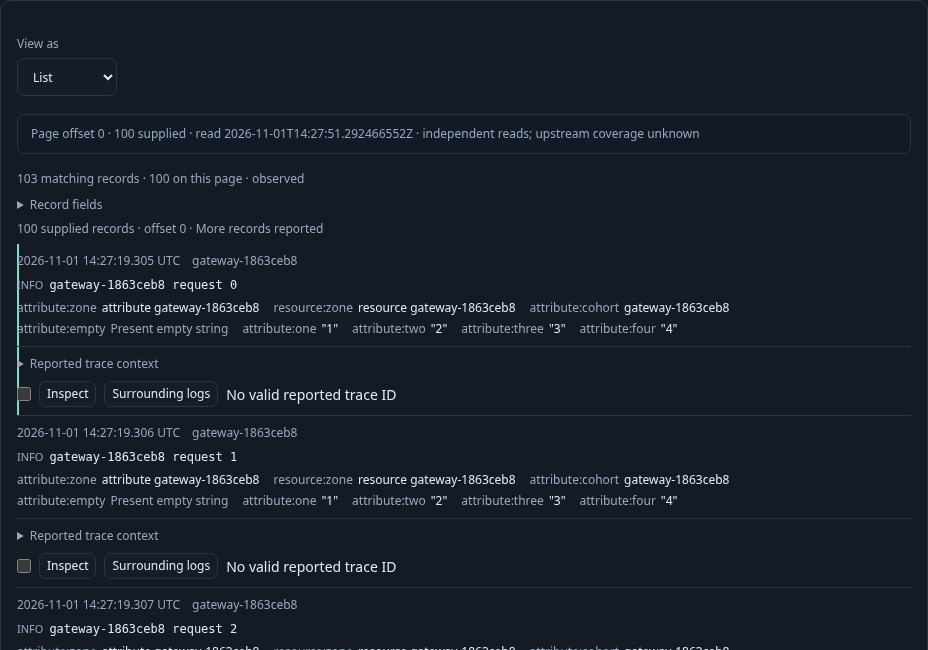
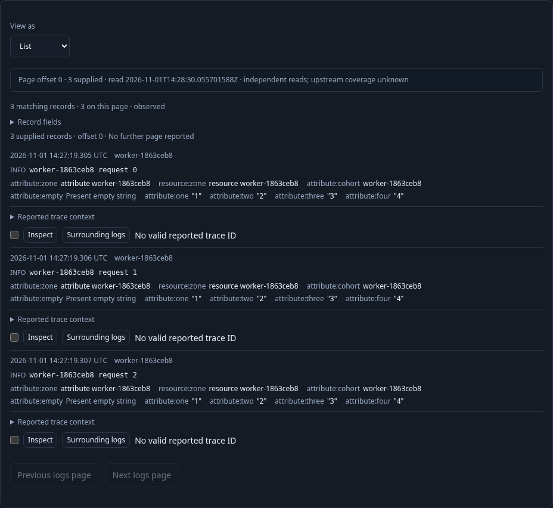
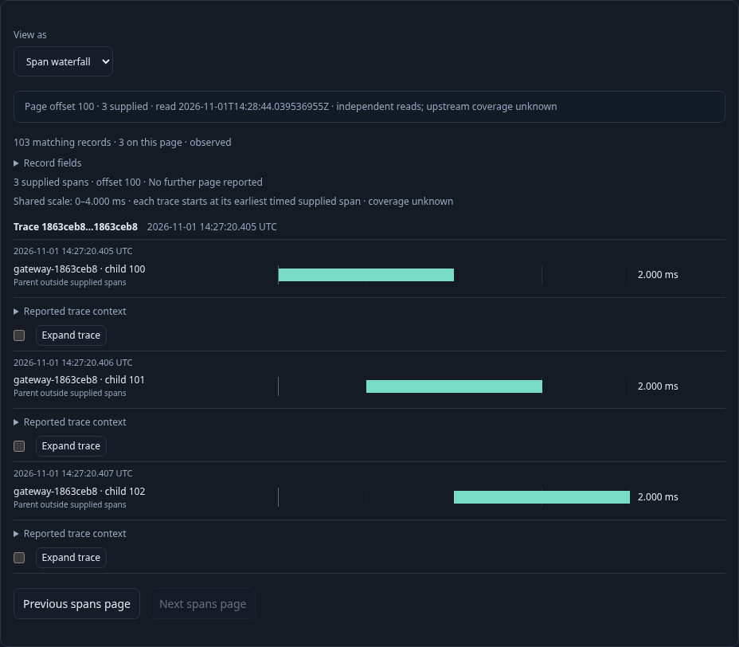

# Records first, without invented groups

A responder starts with the live Activity stream, narrows it to a service, pauses,
and analyzes that fixed scope. **Customize logs** opens a records-only saved view.
No category grouping is required or added. Table and List use the same bounded
page and scoped total; neither promotes displayed rows into a complete dataset.

The executable journey is [302-record-only.spec.js](../../journeys/302-record-only.spec.js).
It sends standard OTLP fixtures to the running collector and reads real
ClickHouse data through an isolated Go server. It creates saved definitions only
through the native UI.

1. Choose List, add eight qualified fields, inspect a log, and Keep its original
   source index and basis. Resource and record attributes with the same name stay
   distinct; an empty string remains a present empty string.
2. Save the regular view. Page 100 of 103 matching logs, reopen the saved question,
   and Run explicitly. Reopening reads configuration only; saved root offset stays
   zero.
3. Open another ungrouped service scope and apply the saved composition locally.
   Its three supplied logs, scope, total and paging stay in place. Save that new
   question separately. A records-only composition is never a category template.
4. Analyze an exact trace-ID scope with no grouping. Customize spans, choose
   Waterfall, inspect and Keep a supplied span, and page the remaining three
   spans. The waterfall shows supplied timing only; it does not imply complete
   trace coverage or fetch ancestors. Save and reopen it without adding a group.

The host uses `/api/explore/page` for records-only root and subsequent page reads.
Local kind changes, inspection, composition reuse, and saved-question loading do
not acquire aggregates. Keep has a separate explicit write and retains the exact
question, basis, source index and record. Current page offset is not saved as the
root question offset. The observed ledger is checked against
`verification/model/record_only_302.qnt`, including altered-count, local-read and
unfinished-prefix negative controls. Hegel exercises actual Go and JavaScript
admission/reuse. The optional Bombadil campaign exercises selection protection,
Table/Waterfall switching, paging and retired actions over the saved native view.

Run with `GOO_RECORD_ONLY_BOMBADIL=1 npx playwright test journeys/302-record-only.spec.js`.
Validation results are recorded in the project validation log after execution.

A separate, explicitly seeded secondary lane tests the boundary between a narrow
records page and an ordinary grouped aggregate/comparison composition. Applying
the full display to that real held page does not read aggregates, load a baseline,
or compare its count. Prepare stays disabled and ignores a synthetic click. Only
an explicit full Run acquires the aggregate snapshot and permits the configured comparison to load
the exact capture and compare through the existing Run preparation flow. The main responder journey above seeds no saved
definitions.
