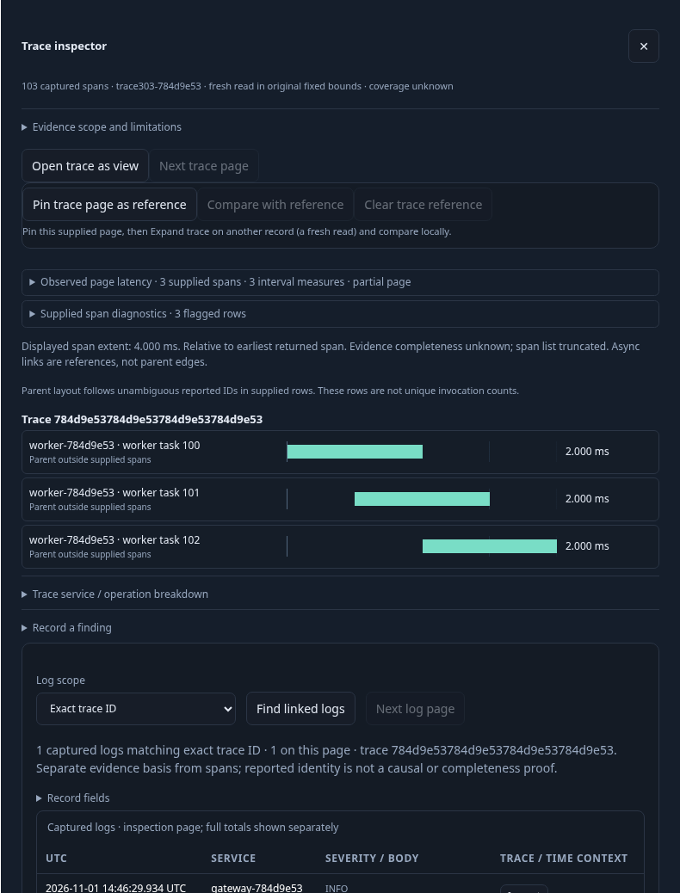
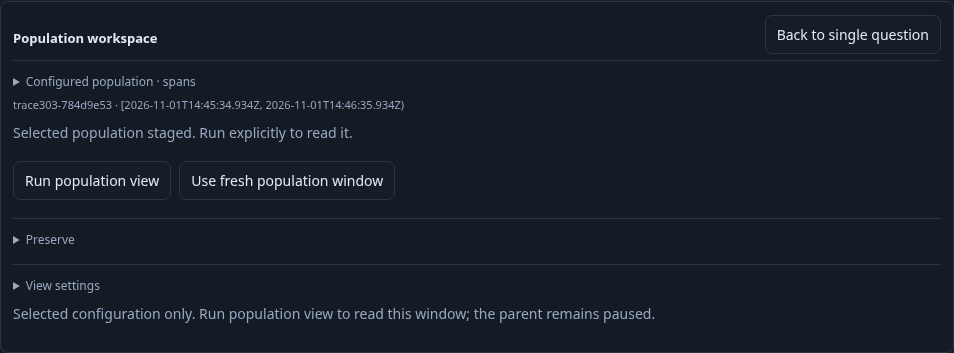
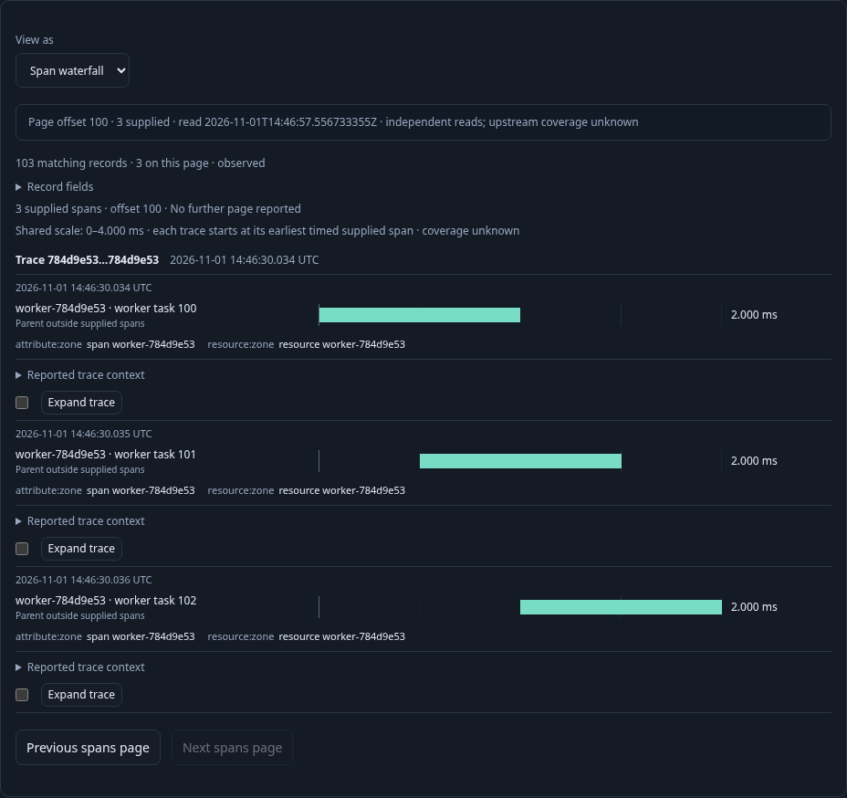

# Continue an inspected trace as a view

A responder has found a log from one service. **Expand trace** opens fresh exact
trace context across services within that log question's fixed window and
explicit environment policy. **Open trace as view** continues this context as a
staged records-only Span waterfall. It reads nothing until **Run population
view**. This is an editable question, separate from capturing a finding.

The [executable journey](../../journeys/303-trace-as-view.spec.js) sends standard
OTLP logs and spans to the real collector and uses an isolated Go server over
ClickHouse. It seeds no saved definitions.

1. Open a service-scoped log question and its linked population. Expand the log's
   trace: 103 spans cross the gateway/worker boundary, while an unrelated trace
   stays excluded. Page the inspector to offset 100.
2. Open trace as view. It stages the exact trace predicate with original fixed
   bounds and environment, resetting delivery to page zero. It omits the
   originating service filter, inspector grouping and requested summaries. No
   held rows, basis or result token transfer into the new view.
3. Run explicitly. The narrow endpoint supplies a count and bounded 100-row page,
   with no aggregate authority. Switch between List, Table and Waterfall locally;
   add qualified record/resource fields, Inspect and Keep an original record.
4. Page the last three spans, save, and return to the retained parent with focus
   on its original Expand trace action. A reattached inspector action cannot
   reopen or replace the current view. Reopen the saved configuration without a
   read, then Run its configured page-zero query explicitly.

Separate lanes in the same executable journey verify an effective typed
named-environment policy through the root inspector handoff, and a direct live
Activity handoff. Opening the view must bypass Activity's ordinary inspector
close callback; the new canvas stays visible. Explicit Return to paused activity
restores the original stream and opener without reading or resuming it. Retired
Activity inspector actions cannot replace that restored screen.

The compact observed lifecycle model is
`verification/model/trace_view_303.qnt`. It checks the nested journey's source,
page and write counts with altered-read/page/write and unfinished-prefix controls.
Fifty Hegel cases exercise actual JavaScript `traceView` projection and actual Go
saved-view admission, covering legacy/current/effective named scope, page reset,
source predicate/group omission, detached configuration and invalid trace IDs.
Existing passive display/Bombadil contracts remain unchanged; this milestone's
new stateful assertions target the application-owned inspector handoff.

Run `npx playwright test journeys/303-trace-as-view.spec.js`. Actual results are
recorded in the project validation log after execution.
