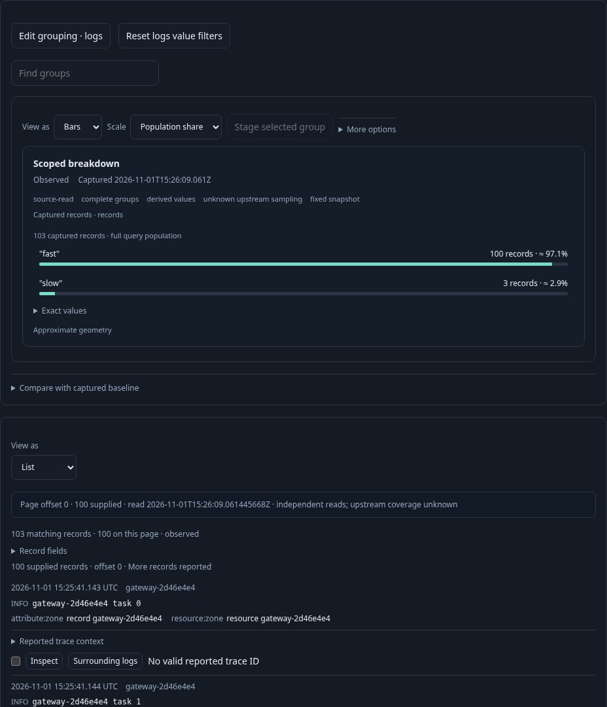
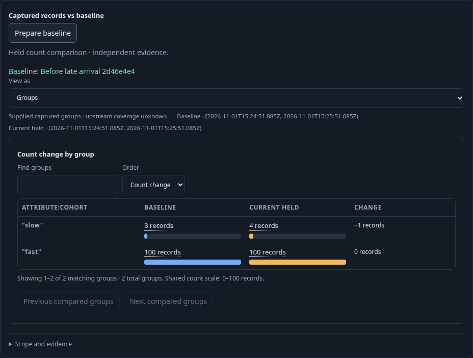
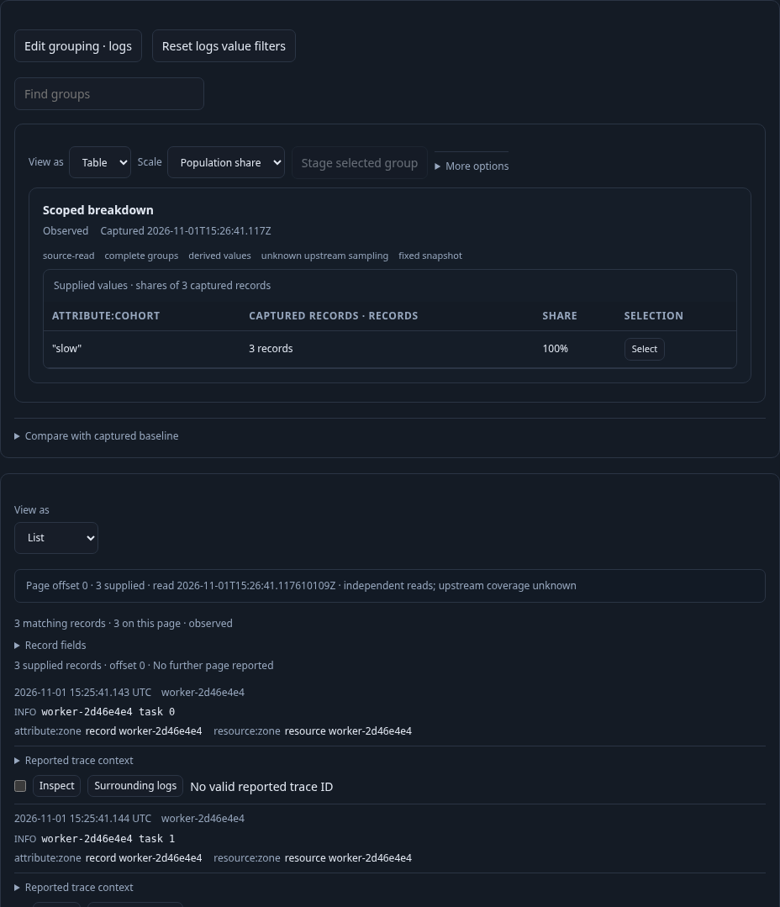

# From raw records to a reusable breakdown

A responder starts with current logs, selects an effective environment through
**Find environments**, scopes to a service, and analyzes that fixed window.
**Customize logs** opens raw records; **List** and qualified fields make individual
observations readable. The next question is simple: how many records belong to
each population? **View settings → Add breakdown** answers it without replacing
the chosen records presentation or importing another service's query.

The [executable journey](../../journeys/304-add-breakdown.spec.js) uses standard
OTLP ingestion, real ClickHouse and an isolated Go server. Saved definitions are
created only through the UI; setup supplies telemetry, never authored definitions.

1. Read 103 source logs through a bounded 100-row page. Choose List with distinct
   `attribute:zone` and `resource:zone` fields. Invalid breakdown text blocks Save;
   Discard returns to the unchanged raw view without reading.
2. Explicitly choose `attribute:cohort` and Bars. Adding stages a configuration,
   preserves the effective environment, predicates and fixed bounds, and resets
   delivery to page zero. It acquires no data. Run explicitly reads full groups:
   100 fast plus three slow records, distinct from the 100 displayed rows.
3. Choose Table locally and save the ordinary team view. Category-template
   authoring becomes available; this journey does not publish a second template.
4. Capture a baseline, then ingest one late matching log inside the same fixed
   window. Run again and Prepare the exact captured baseline. Comparison shows
   103 versus 104 records, with the slow population increasing from three to four.
   The ordinary saved presentation does not contain this later comparison.
5. Reopen the saved definition without reading, Run explicitly, then open another
   service's raw logs. Add the same explicit grouping, Run its three records, and
   Apply the saved composition locally through the existing catalog. Its query,
   effective environment, fixed bounds, totals and supplied records remain the
   destination's. Save that question separately.

A lean span lane starts with **Open trace as view** and a supplied Waterfall with
qualified fields. It saves that raw definition once, reopens it, and uses existing
scope controls to stage one or two grouping fields. An existing single grouping
is visibly prefilled and retained. A different or multiple grouping requires
**Replace existing grouping**; refusal and Discard acquire nothing. Explicit
replacement stages one grouping and preserves the Waterfall and fields through a
full Run. Neither renderer invents groups from displayed spans.

The observed main journey is checked by
`verification/model/add_breakdown_304.qnt`, with corrupted read/page/write counts
and unfinished-prefix controls. Fifty Hegel cases exercise actual JavaScript
`addBreakdown` transitions and Go saved-view admission, including original
record options, page reset, environment policy, grouping consent, invalid fields,
kind refusal and alias isolation. Existing passive display/Bombadil contracts are
unchanged; new verification targets this application-owned authoring transition.

Run `npx playwright test journeys/304-add-breakdown.spec.js`. Actual results are
recorded in the project validation log after execution.
