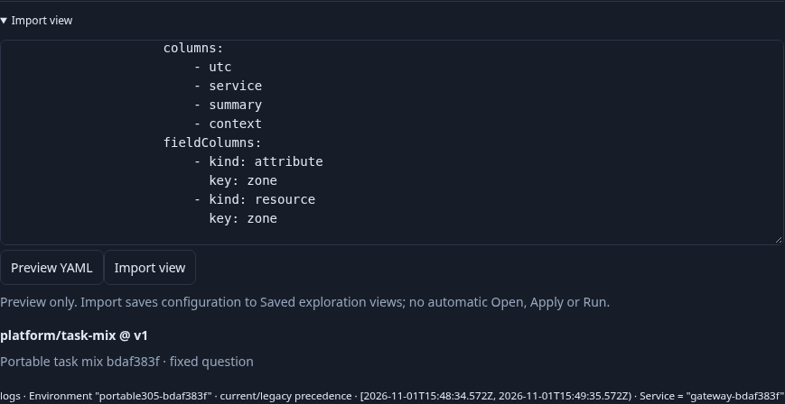
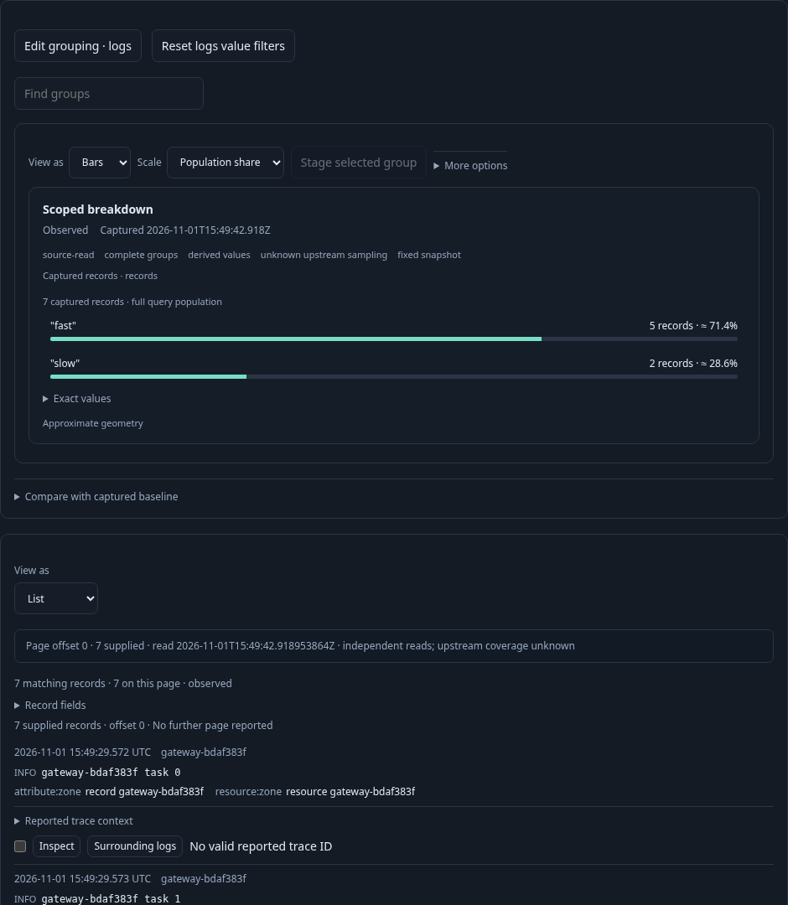
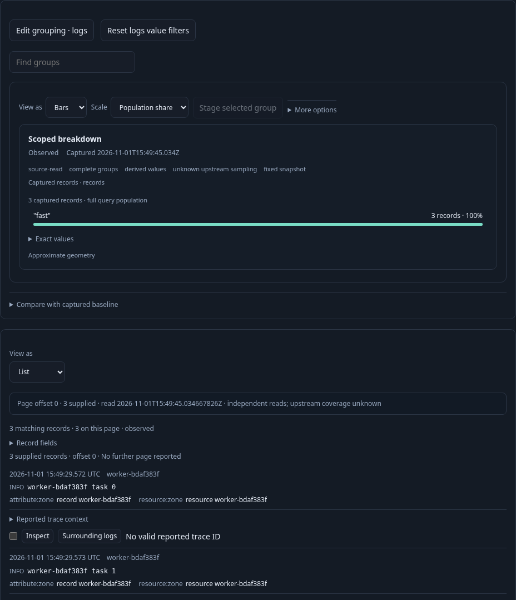

# Share a team view as YAML

A team authors a useful records/chart view, then shares its definition as a
reviewable file. **Export YAML** contains the fixed question and display choices.
The receiving user previews it, explicitly saves an ordinary catalog copy, then
chooses whether to open its original question or apply its presentation to a
different current scope. None of these actions imports observations.

The [executable journey](../../journeys/305-portable-view.spec.js) ingests standard
OTLP logs and uses real ClickHouse through two independently initialized Go
runtimes and saved-view stores. Both runtimes use the same configured telemetry
source. Their catalogs are separate: the destination starts empty. Setup creates
telemetry only; every saved definition is authored or imported through the UI.

1. Start from an effective named-environment log question scoped to a gateway.
   Customize raw records, choose List with distinct record/resource zone fields,
   and Add breakdown by `attribute:cohort`. Explicit Run reads seven source logs
   and their full groups. Save the ordinary team view.
2. In Preserve, choose namespace `platform`, name `task-mix`, revision `v1` and
   Export YAML. Download the actual file. It contains `goo.view-artifact/1`, the
   checked fixed question and composition; it omits the store ID, held rows and
   evidence authority. Export performs no telemetry read or save.
3. Stop that runtime and open a new runtime with an empty saved-view store. In
   Saved exploration views, paste the downloaded file and Preview YAML. The
   preview displays its labels, title, environment, predicate and fixed window.
   No telemetry is read and nothing is saved yet.
4. Import view explicitly saves configuration. It neither opens nor runs it.
   Open original question stages the imported fixed scope; only explicit Run
   acquires its seven matching records and groups. List and both qualified fields
   remain part of the imported composition.
5. Open a different worker scope and read its three records with the same grouping.
   Inspect the imported display and Apply composition locally. The destination's
   query, count, rows, held snapshot and evidence clock remain unchanged. Save the
   worker question separately.

Artifact labels identify a file for review; they do not install a registry package,
resolve services, confer publication provenance or replace store/content identity.
The original fixed scope remains visible before Run. Applying a display uses the
existing compatibility checks and does not import that scope. Comparisons and live
baselines that reference local captures must be removed explicitly before export;
this cut does not rebind or transfer captures.

The observed 14-step lifecycle is checked against
`verification/model/portable_view_305.qnt`, including local-action reads, missing
encode/save counts, altered destination state and unfinished-prefix controls.
Fifty Hegel cases use the actual Go codec and saved-view admission for canonical
compositions and flat views, optional empty maps, environment policies, YAML-looking
string values, stable canonical output and detached results. Malformed documents
are rejected. Backend tests own the strict YAML budgets, local-reference refusal
and explicit query-field admission cases. Existing passive display/Bombadil
contracts remain unchanged.

Run `npx playwright test journeys/305-portable-view.spec.js`. Actual execution
results are recorded in the project validation log.

A bounded secondary lifecycle check holds an actual successful decode response
while the Import disclosure closes. Reopening permits a fresh Preview; the old
completion cannot enable Import or save anything. A subsequent fresh preview
succeeds, with the current telemetry and saved definitions unchanged. This uses
the real server response and is separate from the main 14-step budget.
