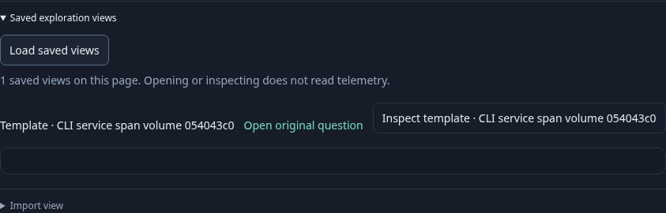
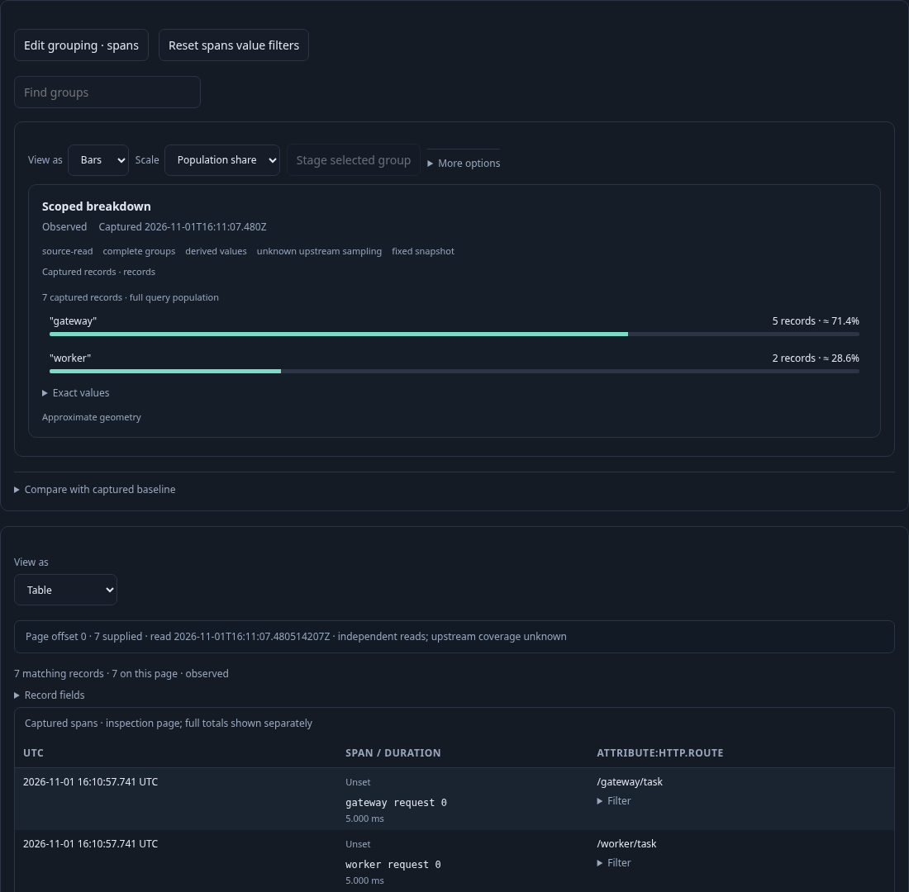
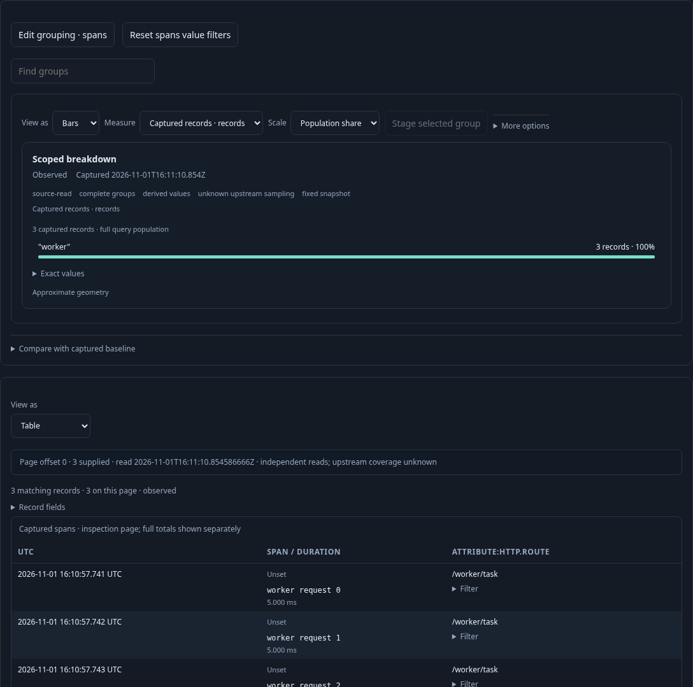

# Repository definition → CLI → catalog

A team keeps a view in its repository, checks it in CI without a running Goo
installation, then explicitly imports it into a chosen catalog. The CLI shares
the existing YAML decoder and saved-view route. Import saves a definition;
opening, applying and running it remain separate browser actions.

The [executable journey](../../journeys/306-view-cli.spec.js) builds the actual Go
CLI and runs it from a disposable working directory. It reads the real checked
[service-requests.yaml](../../config/views/service-requests.yaml), then uses real
OTLP spans and an isolated Go server. Definitions are created only by the actual
CLI and ordinary UI Save; setup never seeds them through a test API call.

1. Before starting the product HTTP server, run `validate-view -file` on the checked
   repository YAML. It returns a versioned JSON validation receipt with the
   admitted fixed question. Validation reads no telemetry and changes no file.
2. Run `import-view` on a duplicate-key YAML file against a test-only HTTP tripwire.
   The actual process exits nonzero, emits no success receipt and makes zero
   requests. Invalid content never reaches the destination.
3. Create an explicit local copy of the checked example, changing only its title,
   named environment and fixed window for this journey. Validate that copy too.
   The checked repository file retains its historical fixed window and remains
   untouched; neither command silently changes scope or chooses a recent window.
4. Ingest seven spans across gateway and worker services, then run the actual
   `import-view -file ... -url ...` against an empty catalog. Its receipt contains
   the artifact labels and verified saved ID. The ordinary stored definition
   matches the validated local file; no Open or Run occurs.
5. Load Saved exploration views. Open original question stages its fixed scope
   without reading. Explicit Run acquires seven spans and full service groups
   (five gateway, two worker), with the imported `http.route` record field.
6. Read another explicitly chosen environment with three worker spans. Inspect
   the imported ordinary template and Apply it using existing compatibility and
   expansion controls. The destination query, held snapshot and read clock stay
   unchanged. Save that destination question separately.

The commands require explicit file/destination flags and produce machine-readable
receipts. Artifact namespace/name/revision remain descriptive file labels; they
are not a registry or publication authority. Existing content identity identifies
the saved definition. A failed response after a POST may follow a successful save;
the command reports that possibility and does not automatically retry.

The observed ten-step CLI/browser lifecycle is checked against
`verification/model/view_cli_306.qnt`, with premature-read, missing-refusal/import,
implicit-Apply-read, missing-save, altered-scope and unfinished-prefix controls.
The ledger separates two successful CLI validations, one local refusal and one
CLI import from browser reads, UI saves and pure template expansion. Fixture
readiness reads are setup. Existing 305 codec properties remain relevant; backend
CLI tests own URL, response identity, bounds, redirects and transport refusal
cases rather than duplicating that matrix in the browser.

Run `npx playwright test journeys/306-view-cli.spec.js`. Actual results are recorded
in the project validation log.
