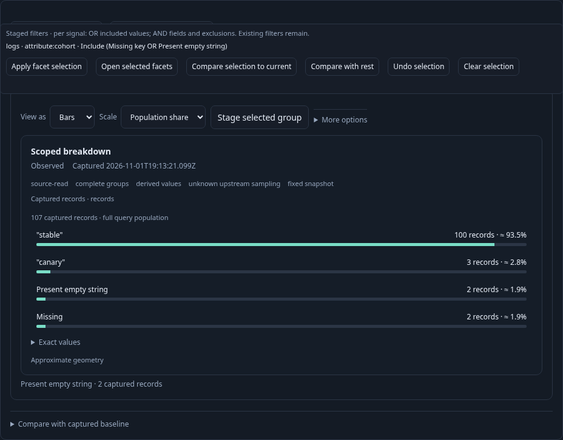
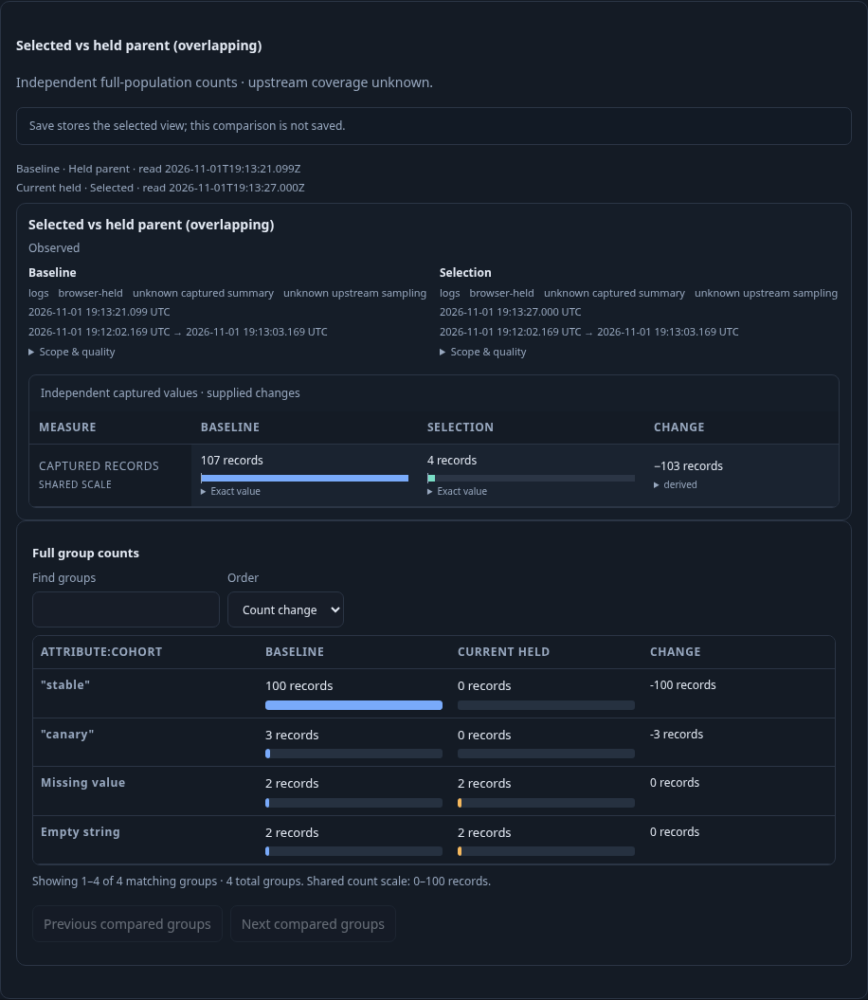
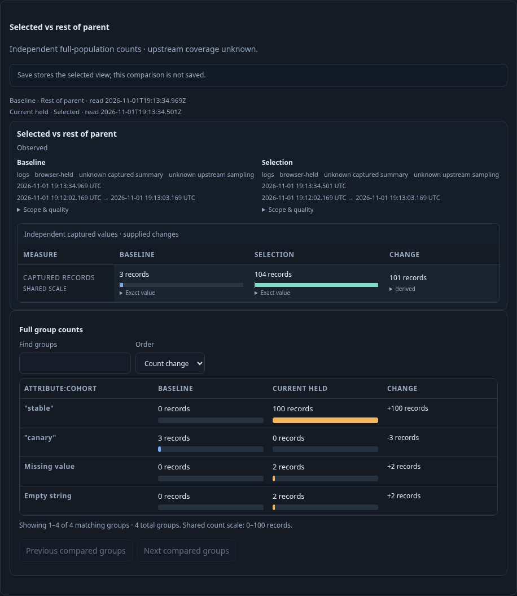

# Compare a cohort without leaving its authored view

An investigator has a reusable count breakdown with records and wants to compare
an unusual population with its parent or everything else inside that parent.
Bars and Table use the existing selection tray. Staging a cohort reads nothing;
an explicit Run acquires only the operands required by the chosen comparison.

The [executable journey](../../journeys/307-authored-cohorts.spec.js) ingests real
OTLP logs and reads ClickHouse through an isolated Go server. The checked parent
contains 107 records: 100 stable, three canary, two present-empty cohort values and
two missing cohort keys. Five additional records fail its original tenant filter.
The 100-row inspection page cannot define any of these whole-population counts.
Saved definitions are created through the UI, never seeded by test API calls.

1. Customize raw logs as List with qualified record/resource fields. Record-based
   selection cannot enable comparison from this narrow page. Add an explicit
   count breakdown and Run it; full groups account for 107 records while the page
   supplies 100. Save this authored parent configuration.
2. Select Missing and Empty using Bars, including a keyboard gesture, then Stage
   each group. The tray preserves both values as a typed OR without reading.
   Compare selection to current opens a retained child and focuses Run.
3. Run reads four selected records. The baseline is the actual held 107-record
   parent, with its original question, basis and clock; it is not reread. The
   operands overlap. The comparison names both roles and uses one count scale.
4. Back restores the same parent snapshot, authored presentation, fields and
   original comparison action focus without reading. Clearing its selection retires
   the old control; reattaching it cannot open another child or issue a request.
5. Page the parent records to offset 100 while keeping its full aggregate held.
   Change the authored chart to Table, select canary by keyboard and Stage it,
   then use the structured record viewer to change Include to Exclude. Pending
   record checkbox work disables comparison until cleared.
6. Compare with rest stages a child. Run independently reads 104 selected records
   and the three-record complement inside the original parent predicates,
   environment and fixed window. The selected page still supplies only 100 rows.
   Missing and empty groups stay distinct; both operands share a 0–100 count scale.
7. Save the selected configuration, with an explicit note that the comparison is
   not saved. Back restores the original Table parent and offset-100 page/focus.
   Reopen stages the saved selected view without reading; explicit Run reads 104
   records and does not silently restore or prepare a comparison.

These are captured query populations with unknown upstream coverage. Disjoint
selection predicates do not establish a simultaneous physical snapshot. Baseline
and selected read clocks are shown separately in UTC, with exact original clocks
in tooltips. No capture or investigation-document write is needed for this flow.

One bounded secondary fault check lets a real selected read succeed and injects
an HTTP 500 for its rest read. The UI keeps the comparison unavailable, emits no
comparison request and performs no automatic retry. An explicit Run then reads
both actual operands successfully. This fault check is separate from the main
observed budget and supplies no fabricated observations.

The fourteen-step main lifecycle is checked against
`verification/model/authored_cohort_307.qnt`, including premature reads, accidental
parent rereads, stale controls, missing rest/save operations, altered parent return
and unfinished-prefix controls. Existing Hegel facet and partition properties
exercise the actual JavaScript planners against Go predicate membership over
missing, empty, named and excluded values. Native assertions independently check
actual SQL membership, full totals, preserved scope and ephemeral Save semantics.
Existing passive display/Bombadil contracts remain unchanged.

Run `npx playwright test journeys/307-authored-cohorts.spec.js`. Actual execution
results are recorded in the project validation log.
