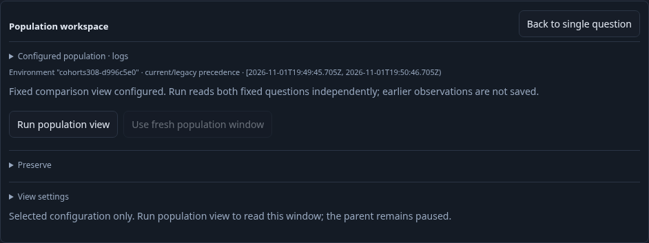
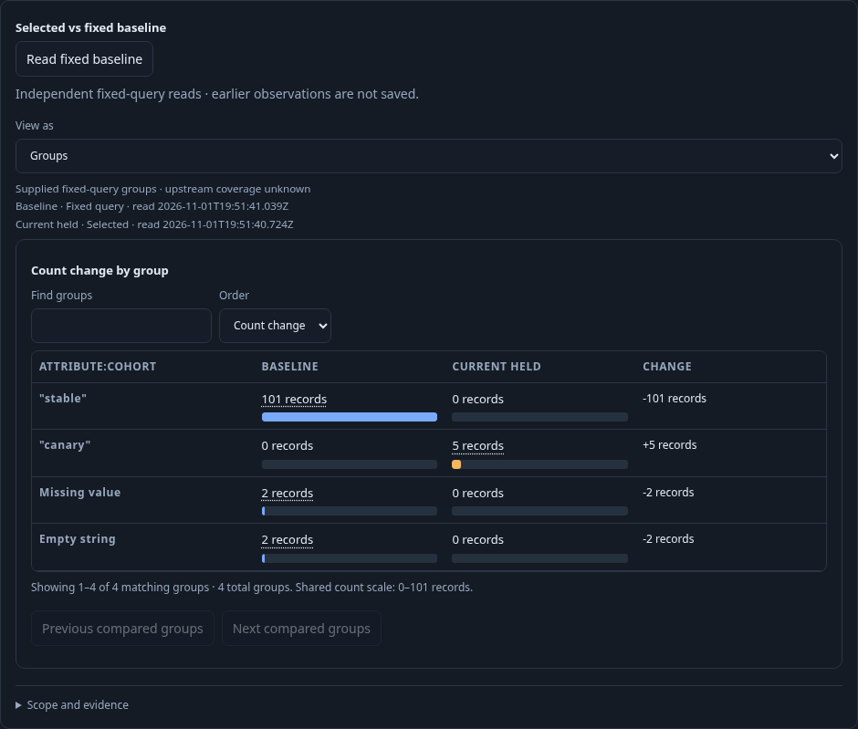

# Save a fixed comparison question — 308

A team discovers a canary population in real OTel logs, compares it to the rest,
and saves both query definitions for another installation. No held rows or source
receipts become configuration.

1. Open the typed effective-environment question, explore linked populations,
   customize logs as a List with qualified record/resource fields, and add a
   `cohort` breakdown. The full parent contains 107 records; its page holds 100.
2. Select `canary`, open **Compare with rest**, and Run explicitly: selected 3,
   independently read rest 104. **Include comparison in view** stages the fixed
   pair without reading or saving. The earlier comparison disappears.
3. Save the definition. Its comparison child owns a fixed `baselineQuery`; the
   selected root and List presentation remain intact. A retired Include button
   cannot change the current configuration. Held-parent comparison has no Include
   action and Back restores its current parent control.
4. Ingest two more canary logs and one stable log with event times inside the
   original bounds. Reopen stages configuration without I/O. Run reads both
   questions afresh: selected 5, baseline 105. These are independent read clocks;
   the generic fixed-baseline labels do not claim a simultaneous partition.
5. Export YAML without telemetry reads, import with the actual Go CLI into a
   second empty store, and Open the imported definition. Open stages only;
   explicit Run again observes 5 versus 105 using the exact original scopes. Both
   whole-composition and aggregate-only Apply remain disabled for this fixed pair.

Executable coverage: [native journey](../../journeys/308-saved-fixed-cohorts.spec.js),
[Go/JavaScript property test](../../verification/fixed_query_artifact_property_test.go),
and [observed lifecycle model](../../verification/model/saved_fixed_cohort_308.qnt).
The browser ledger separates narrow pages, full reads, comparisons and saves;
the actual CLI import runs outside browser request accounting. Model validation
rejects altered source-free transitions, missing reads, changed request budgets and an
unfinished prefix. Source telemetry fixtures are ingested normally; saved
views are authored through the interface, never seeded through the API.

Validation: final real browser/CLI journey passed (1.3 minutes; 1.4 minutes
including runner). Its 12-step observed Quint trace passed in 10.42 seconds
(package 10.431 seconds), including seven counter/preservation mutants and an
unfinished-prefix refusal. Fifty Go YAML round-trip/JavaScript admission and
isolation cases passed in 5.02 seconds; the model smoke test passed in 12.34
seconds. Browser totals: ten full reads, one narrow page, three comparisons and
two authored saves. CLI import is separately verified by its actual receipt in
the second empty store. No captures or seeded definitions were written.
