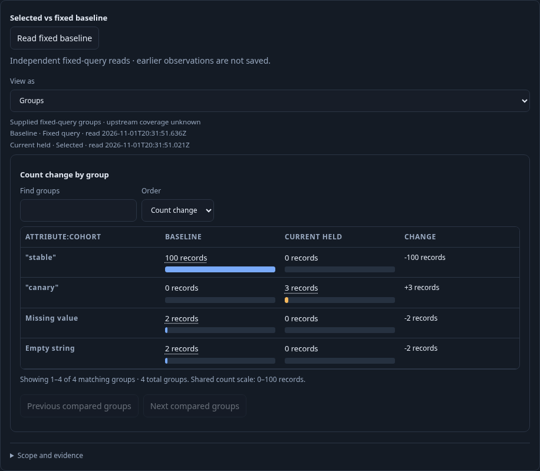
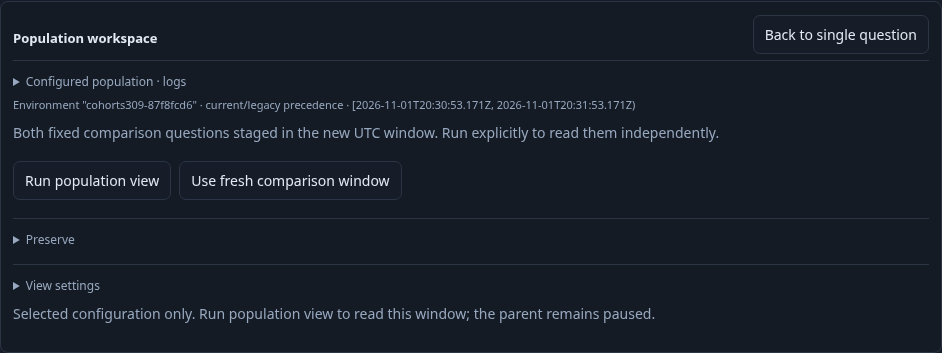

# Move a fixed comparison to another window — 309

An on-call responder reuses a saved canary comparison for a different UTC interval.
The selected and baseline predicates stay independent; changing their shared window
does not establish a partition or simultaneous source snapshot.

1. Author the real OTel log comparison through linked populations, a qualified
   `cohort` breakdown and **Compare with rest**. Include it in the view and Save.
   Run the original fixed window: selected 3 and baseline 104. The List keeps its
   qualified record/resource fields.
2. Open **Comparison window**. An invalid draft blocks preservation/execution;
   Discard restores the admitted configuration and its held observations without
   a read. New logs have event times outside the old interval.
3. Stage one explicit UTC range for both questions. This clears held result
   authority, preserves both predicates/environment/grouping/presentation, and
   performs no read, comparison or save. Run remains an explicit action. A retired
   Stage control cannot rebase the new owner.
4. Save the newly configured pair and reopen it without reading. Explicit Run
   reads both fixed questions independently: selected 5 and baseline 105.
5. Export the saved configuration as YAML. Both fixed operands retain the staged
   bounds; export does not acquire telemetry or save observations.

Executable coverage: [native journey](../../journeys/309-paired-window.spec.js),
[paired-window properties](../../verification/paired_window_property_test.go),
and [observed lifecycle model](../../verification/model/paired_window_309.qnt).
All source fixtures are ingested as OTel logs; saved definitions are authored in
the interface. Full counts are distinct from bounded record pages. No captures,
API-seeded views or new execution service are involved.

Validation: the final native journey passed in 1.2 minutes. Its 14-step observed
Quint trace passed in 13.94 seconds (package 13.992 seconds), including seven
mutants and an unfinished-prefix refusal. Fifty actual JavaScript transitions
validated and round-tripped through Go/YAML passed in 9.03 seconds; model smoke
passed in 12.96 seconds. Main browser totals: ten full reads, one narrow page,
three comparisons and three saves.

The separate 35-second Bombadil campaign passed with 442 snapshots across all
eight phases. It restored the actual UI-authored store, exercised draft/discard,
manual staging and **Use fresh comparison window**, and required zero I/O during
local transitions and exactly four reads/two comparisons overall. Both Summary
and Groups presentations count as visible admitted comparisons. Successful raw
campaigns and temporary stores were removed after review; compact summaries and
ledgers remain.
