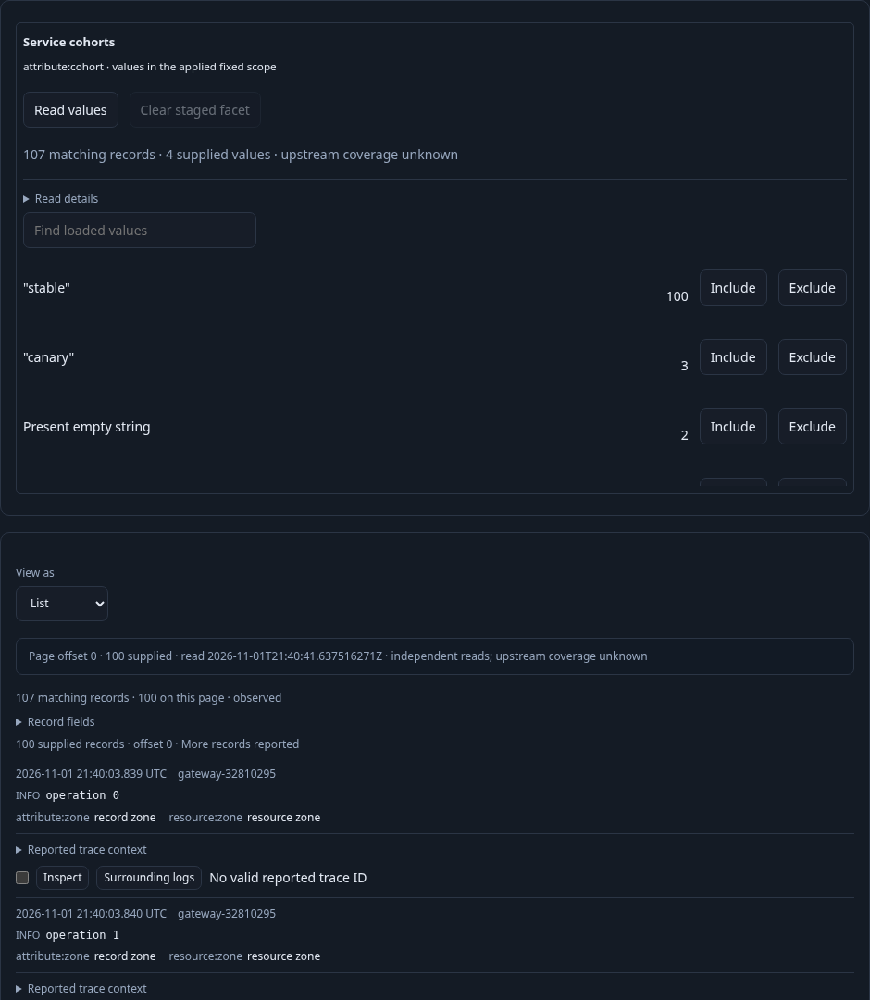
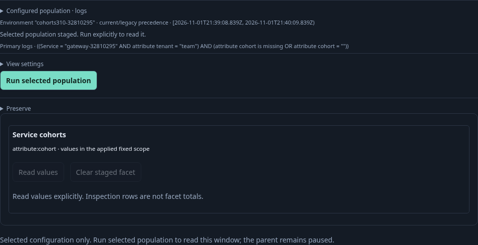
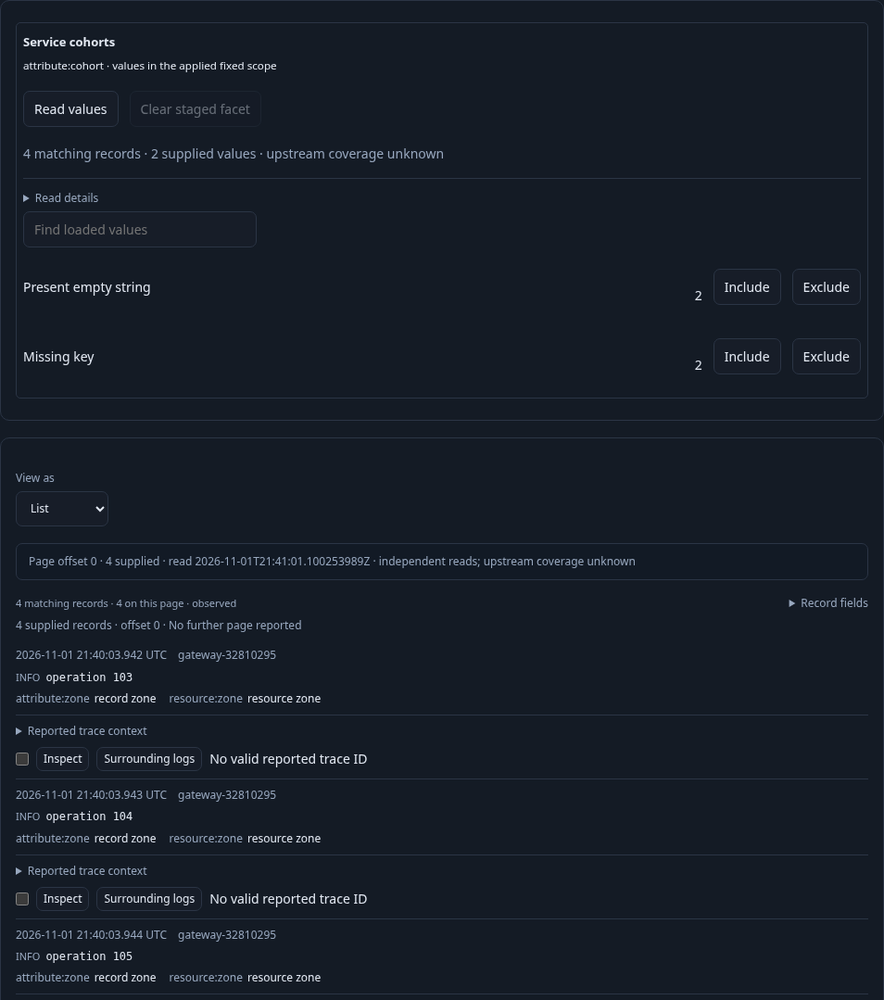

# Contribute a field people use to investigate — 310

A team saves a reusable log view with a cohort facet and a List. Its facet counts
come from the current fixed question, independently of the bounded inspection page.
Missing keys and present empty strings remain different populations.

1. Open the real typed-environment log question and customize its records as a
   List with qualified attribute/resource fields. There are 107 matching logs and
   100 inspection rows. An invalid numeric facet is refused without reading or
   saving; add `attribute:cohort` through View settings → Facet instead.
2. Save and export the view. Import its YAML through Preview/Import in a fresh
   empty catalog. Opening the imported view stages configuration without reads;
   explicit Run obtains count and records. Facet values remain unloaded.
3. Select **Read values** explicitly. The counted-values response covers all 107
   matching logs: stable 100, canary 3, missing 2 and empty 2. These are current
   applied-scope counts with independent count/group receipts, not page tallies.
4. Stage a stable value from the record inspector. Include that same value and
   exclude canary from the declared facet. **Clear staged facet** removes only
   its own pending choices; the inspector's stable choice survives. No read occurs.
5. Clear the global draft, include Missing key and Present empty string, and
   **Open selected facets**. Opening stages a child without acquisition. Run reads
   four matching records; the child retains the facet, List and qualified fields.
   A reattached old parent facet cannot stage into this child. Read values again
   explicitly: only missing and empty appear, totaling four. Counts include the
   applied facet predicate rather than self-excluding it.
6. Apply the saved composition to another compatible question for five outside-team
   logs. Apply preserves its destination predicate, policy and fixed bounds and
   copies no loaded values. A new explicit Read values observes five canary logs.

Executable coverage: [native journey](../../journeys/310-declarative-facet.spec.js),
[Go/JavaScript property tests](../../verification/declarative_facet_property_test.go),
[observed lifecycle model](../../verification/model/declarative_facet_310.qnt), and
[bounded Bombadil actions/invariants](../../verification/bombadil/declarative-facet.ts).
Source fixtures use OTel ingestion; saved definitions use the interface. Queries,
values, read receipts and pending origin markers are not hidden in the declaration.

Validation: the real browser journey passed in 1.9 minutes (2.0 minutes with
runner). Its 20-step observed Quint trace passed in 29.50 seconds (package
29.521 seconds), including seven mutants and unfinished-prefix refusal. Model
smoke passed in 30.89 seconds. Fifty Go/JavaScript/YAML declaration, projection,
reuse and refusal cases passed in 4.44 seconds.

Main browser totals: six full exploration reads for entry/discovery, four bounded
record pages, three explicit counted-value reads, two saves, one export and one
preview decode; no comparisons or captures. The separate 35-second Bombadil
campaign passed with 202 snapshots across all 12 phases, two pages and two
counted-value reads, no full exploration reads/saves/overflow, and final scope
count four. It restored the actual UI-authored saved store. Successful raw
campaigns and temporary store copies were removed after review; compact summaries
and observed ledgers remain.

The [shared component checks](../../journeys/categorical-facet-components.spec.js)
separately cover HTML/property upgrades, passive rendering, focus/Find retention,
invalid replacement and disabled unrepresentable value actions.
