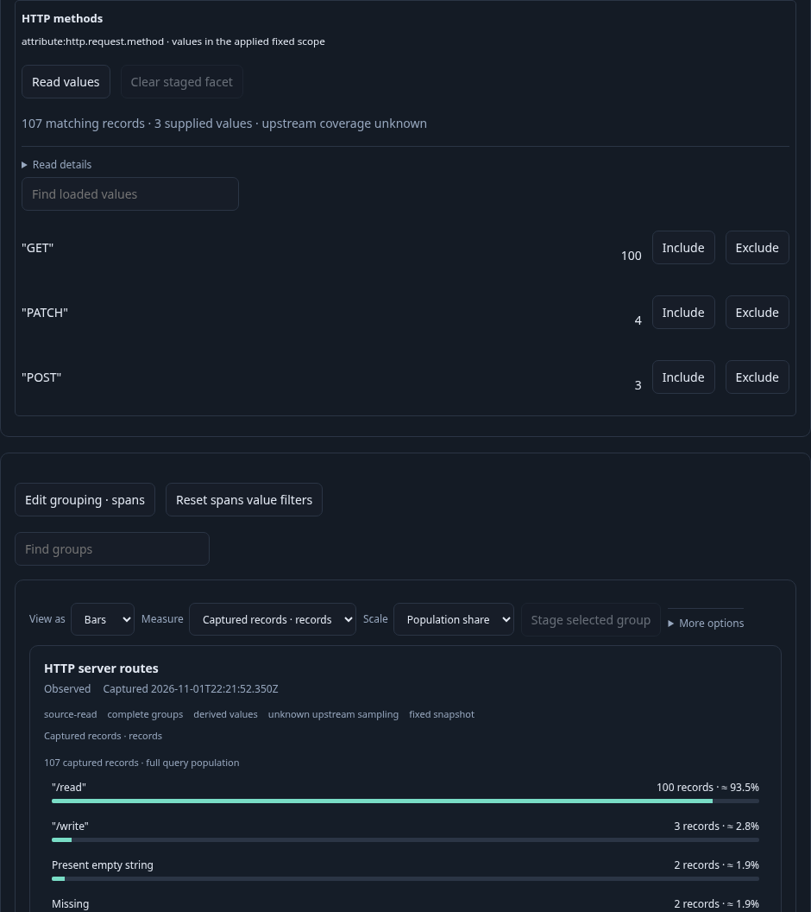
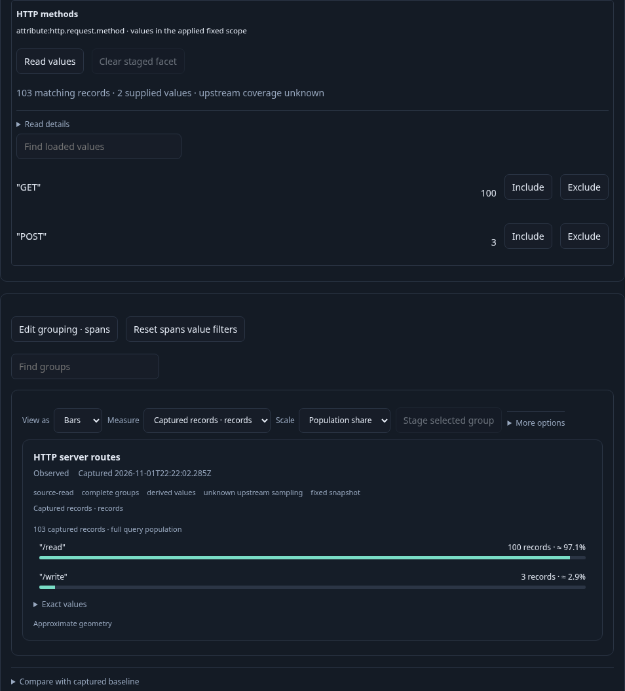
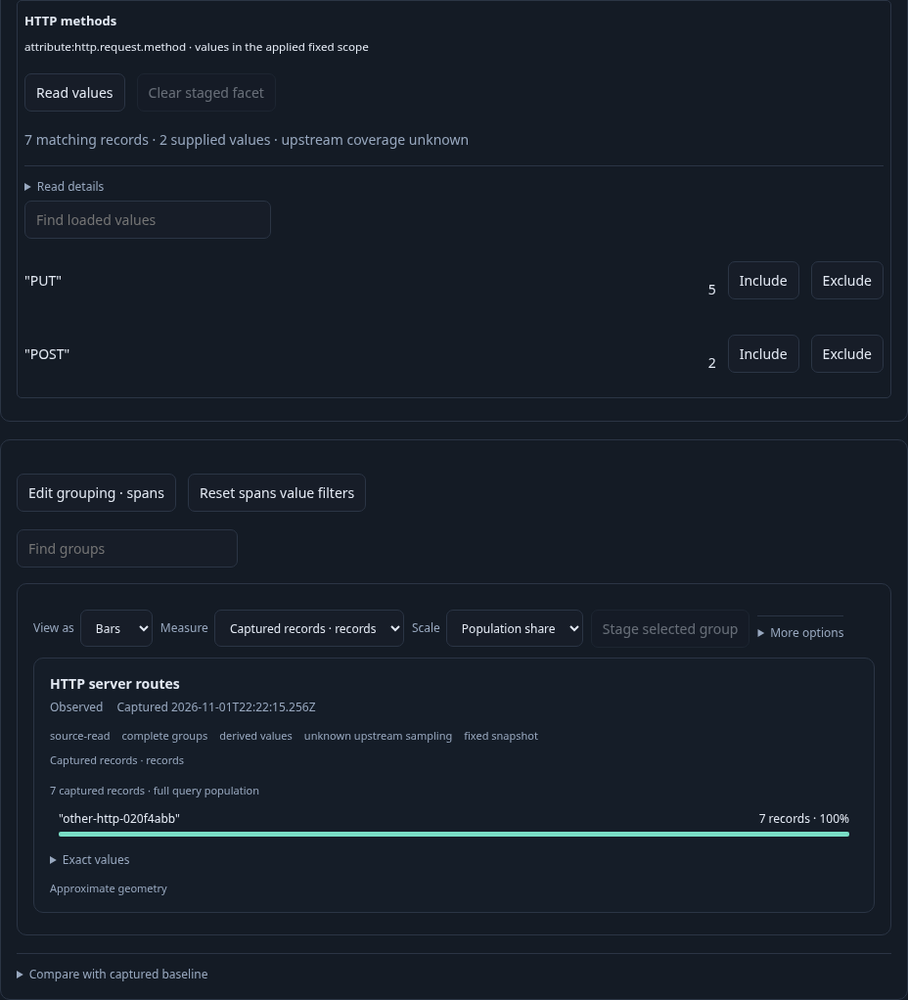

# Discover an HTTP service and keep its useful controls — 311

The existing HTTP route widget becomes a reusable view with a complementary
method facet. It counts captured Server-span records, not unique requests or
verified throughput. Every values read belongs to the currently applied question.

1. Ingest ordinary OTel Server/Client spans, absent/empty/legacy-only methods,
   another service and a conflicting-current-environment resource. Discovery's
   existing named-environment entry does not offer HTTP Customize for the default
   client-only or methodless service profile. The real eligible HTTP service's
   route widget reports 107 spans; client/methodless/foreign-service records do not
   enter its mandatory Server/current-method population.
2. Retire one in-flight pure Customize response by leaving the service detail.
   Its response cannot open a population. Return and Customize the actual route
   widget: its complete checked question is preserved and no source read occurs.
3. Explicit Run obtains four route groups and 100 inspection rows. **Read values**
   separately observes GET 100, POST 3 and PATCH 4: 107 matching records, including
   values/counts beyond the inspection page. The route chart remains grouped by
   `attribute:http.route`; the facet binds `attribute:http.request.method`.
4. Change the chart measure locally and restore count, choose List and qualified
   method/namespace fields, then Save. Include GET and POST and open a staged child
   without reading. Run observes 103 spans; the child retains route chart, facet,
   record presentation and reusable HTTP template marker. Its explicit values read
   reports GET 100 and POST 3 for that applied subset.
5. Save/export and reopen the selected view. Opening stages configuration; Run
   remains explicit, and method values remain unloaded until requested.
6. Apply the saved category template to another eligible service question with an
   effective typed environment policy and a different chart category (`service`).
   Apply reads no telemetry and keeps that destination question/held snapshot.
   The facet stays the literal method field. An explicit values read reports PUT 5
   and POST 2, proving source GET/POST filters and source counts were not copied.

Executable coverage: [native journey](../../journeys/311-http-method-facet.spec.js),
[Go/JavaScript expansion properties](../../verification/http_method_facet_property_test.go),
[observed lifecycle model](../../verification/model/http_method_facet_311.qnt), and
[bounded Bombadil actions](../../verification/bombadil/http-method-facet.ts).
Properties also preserve existing specialized numeric HTTP customization as an
exact-query, data-only view without default facet/template marker, and reject
invalid owner/profile contexts. General templates retain literal facet fields;
they do not magically rebind them to the destination chart category.

Validation: the native journey passed in 1.7 minutes. Its 18-step observed Quint
trace passed in 16.32 seconds (package 16.330 seconds), including seven mutants
and unfinished-prefix refusal; model smoke passed in 17.08 seconds. Fifty new
Go/JavaScript HTTP/general-template cases passed in 4.68 seconds, and the 50-case
310 regression passed in 5.23 seconds with its intentionally expanded template
admission expectation.

Measured after the settled service owner: six full exploration reads, three
explicit values reads, two pure template expansions, three saves, one YAML export
and zero narrow page reads. Discovery, unsupported service visits and the retired
Customize check are recorded separately as the initial baseline (25 source calls,
four exploration calls and one retired pure expansion). These extra visits are
verification controls, not the cost of opening one service.

The separate 35-second Bombadil campaign passed with 514 snapshots across all
11 phases. It retained the literal field, HTTP template/profile and duration.p95
through local selection and child staging, then observed three POST spans with
two exploration/two values reads, no pages/saves/overflow. It restored the actual
UI-authored original view. Reviewed raw campaigns, temporary stores and scripts
were removed; compact summaries, observed ledgers and maintained frames remain.
