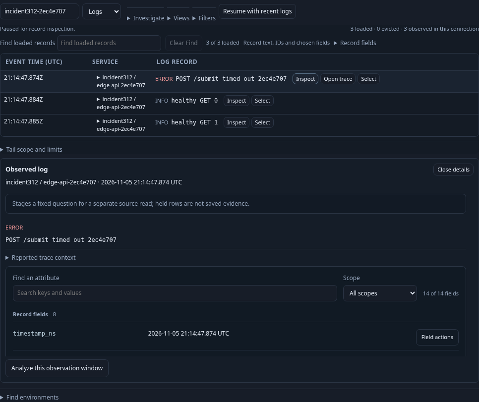
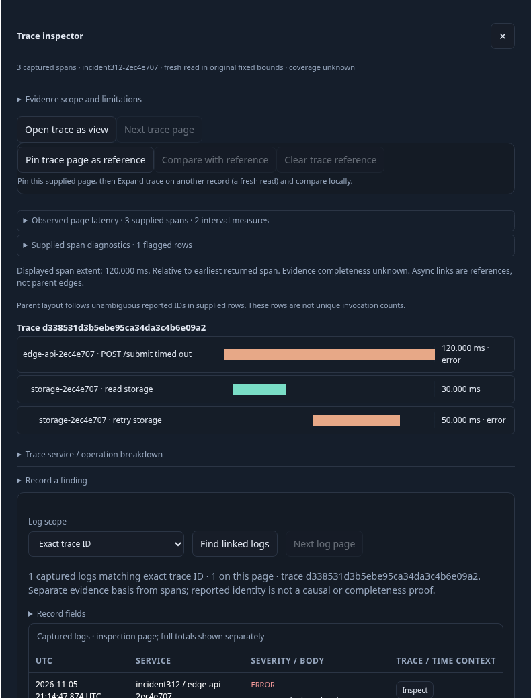
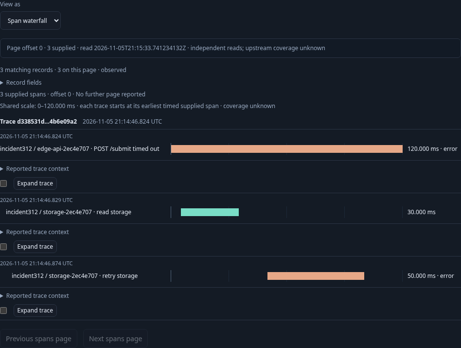
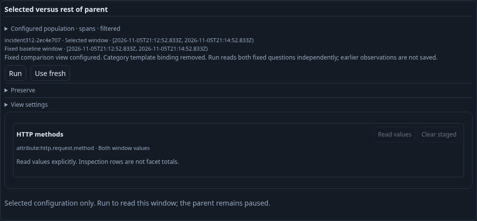

# Follow one incident through the current product — 312

This checkpoint starts with a real timeout log in Activity and follows the actual
navigation available today. It intentionally records detours instead of hiding
missing handoffs behind direct deep links or seeded saved views.

1. Start the log stream in the fixture environment, notice the POST timeout and
   pause. Inspecting the held row is local. The service cell provides filtering;
   move through the global Services entry and enter the environment again.
2. Discover/open the HTTP service and Customize its existing route view. Run
   reads 107 incoming spans with a 100-row inspection limit; Read values separately
   shows GET 100 and POST seven. Narrow by POST through existing staged controls.
3. Exercise one retained-parent lookup/Back and stale-command ABA case. A draft
   filter blocks current commands; discard it and apply the valid POST selection.
   The current scope has seven records; save that reusable fixed question.
4. Inspect the timeout record and open its trace. The inspector reads the Server
   span, two storage children and its correlated error log. Open trace as view
   stages only; Run reads three trace rows across services.
5. Save/reopen the trace view without automatic acquisition, then Run the same
   exact trace question and window explicitly.
6. In a separate ordinary-profile lane, verify explicit comparison promotion
   retains the contributed facet, applied filters and record presentation. Facet
   counts are labeled Both window values; promotion stages the fixed pair
   without acquiring values or either population.









[Maintained browser test](../../journeys/312-incident-checkpoint.spec.js) ·
[whole-product verification review](../reviews/WHOLE_PRODUCT_VERIFICATION_312.md).
Historical 312 validation: final finite browser run passed in 38.9s (43.4s runner), including
all selected lifecycle/promotion checks, with no page errors. Fifty actual
JavaScript/Go transition and lease cases passed in 16.36s. The review records
measured request counts, response sizes/timings and honest navigation friction;
no production code is owned by this storyboard.

337 updates the promotion action to **Include comparison in view**, preserving
the checked facet declaration on the saved fixed pair. The frozen 337 runtime
rerun passes in 51.9 seconds, including facet retention and unchanged local
promotion source budget. Reuse an explicitly compiled binary to avoid compiling
concurrently with browser checks:

```sh
GOO_GENERIC_BINARY=/absolute/path/to/goo bash scripts/run_journeys.sh journeys/312-incident-checkpoint.spec.js
```

338 reruns the current paired-facet label and promotion contract against the
reviewed Go 1.27.3 executable: passes in 1.0 minute, with 107 full matches, 100
inspection rows, seven cohort records, three trace records, no seeded definitions
and no page errors. Maintained frames are refreshed; raw owned stores/requests
are pruned after review, retaining compact receipts.
