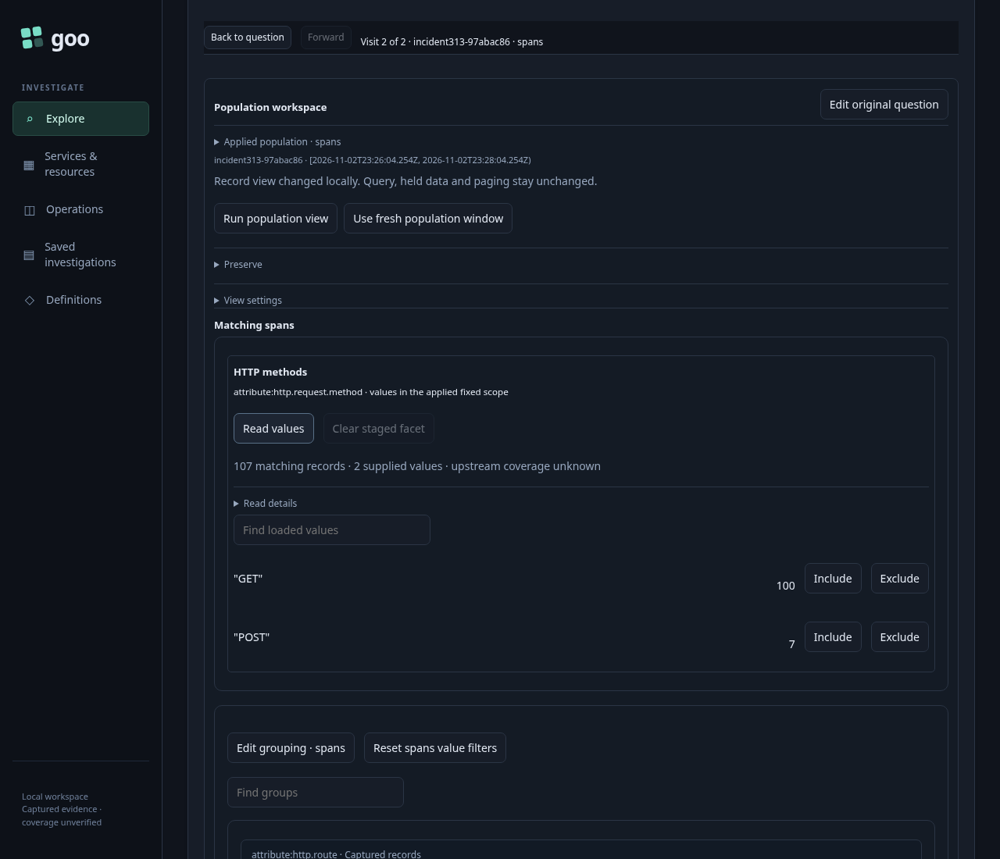
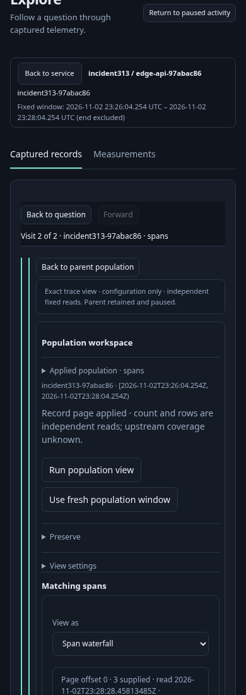
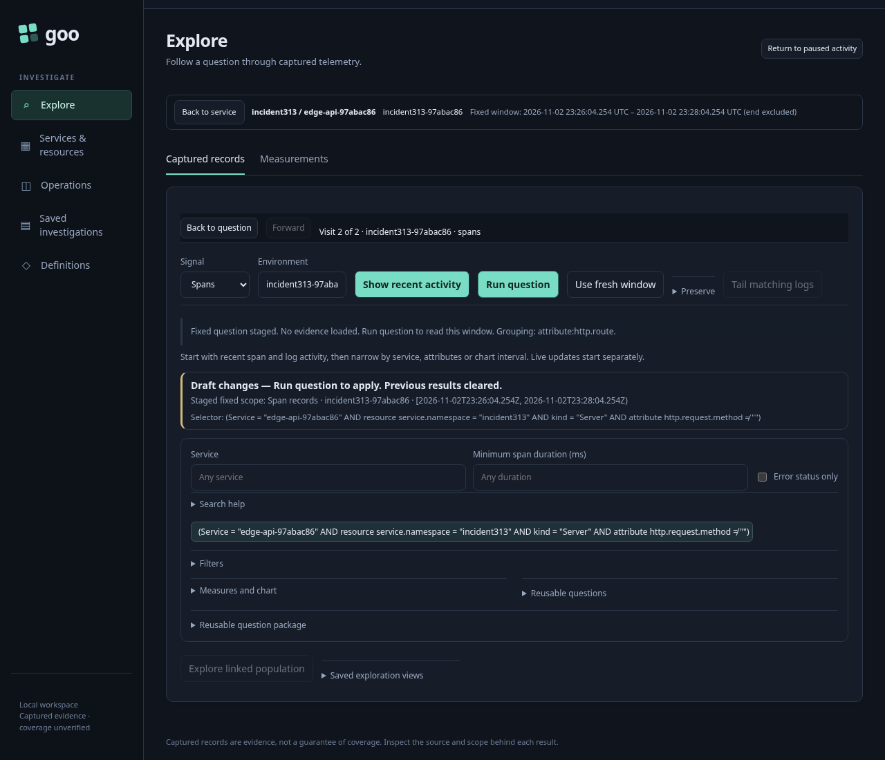

# One active investigation canvas — 313

Start from a real timeout log in Activity, pause the stream and open its trace as
a view. The active population owns the screen: the retained root question,
Signal/Environment controls and root Run remain hidden and inert. Return to
paused Activity restores the original row's focus without starting another tail.

1. Discover the HTTP service and Customize its route view. Run explicitly reads
   107 incoming spans. Stage grouping by service, Run, and verify that the visible
   qualified grouping context and default title describe the new grouping.
2. Return to the route parent, explicitly read HTTP-method values, and select
   POST. The visible comparison explanation identifies Span status as the
   unavailable capability. Open the selected child and Run seven POST spans.
3. At a 390px viewport, inspect the timeout trace. Closing an outstanding trace
   read aborts it; its delayed response cannot reopen the dialog. Reopen the
   inspector, stage its exact cross-service trace view and Run three spans.
   Only the deepest child's Back control is available.
4. Back through retained parents, then choose Edit original question. The
   same-visit staged root question, browser history, scroll and focus return
   without a telemetry read. Scroll is checked in the original 1280px viewport
   within one text line (16px); the earlier run differed by 9px after layout
   anchoring. A separate browser-history return aborts another
   outstanding trace read and keeps its late response out of the new workspace.

[Maintained browser test](../../journeys/313-active-canvas.spec.js).
Validation: the final finite native run passed in 46.7s (50.1s runner), with
no page errors. Both actual retired trace requests reported `net::ERR_ABORTED`;
closing or navigating away also issued the existing cancellation request. The
flow made 22 source requests: 11 full reads (including the two aborted reads),
two record pages, one counted-values read, two discovery reads, one inventory,
one metric discovery, three dashboard aggregate reads and one tail. Local
customization, hidden-root handlers and retained-context returns added no reads.
The existing population Bombadil campaign separately passed 119 records over 30s
with the new hidden/inert-root invariant.

Earlier direct runs exposed
local scheduling pressure: tiny static resources took over ten seconds, and a
second run timed out before issuing any API requests. No OOM was observed. The
final run uses the standard wrapper to pause and restore the demo generator.
