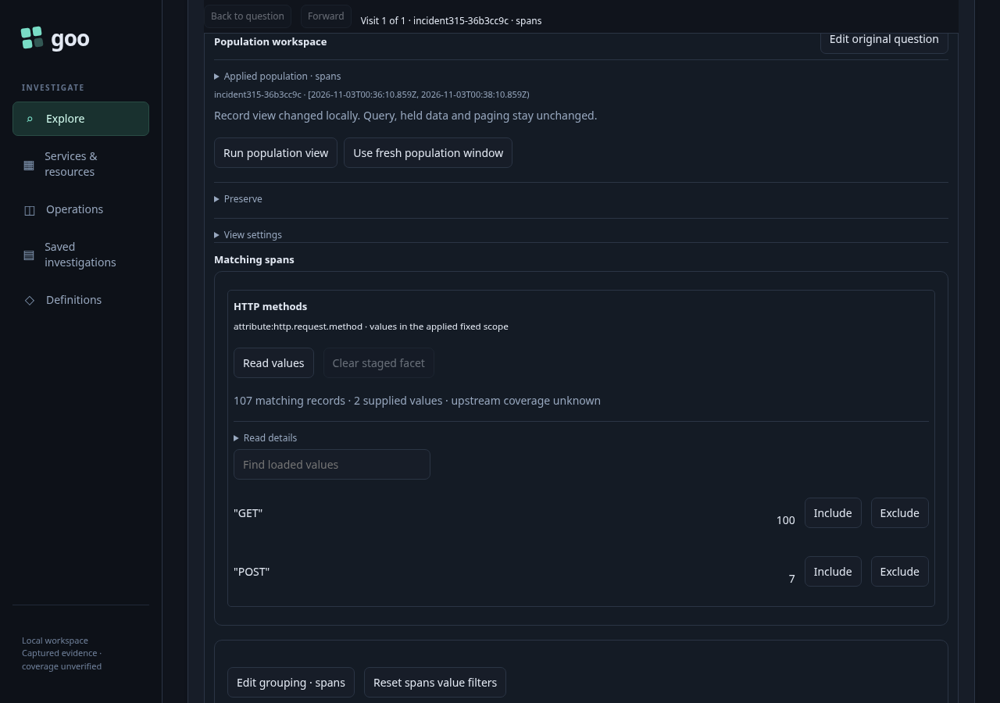
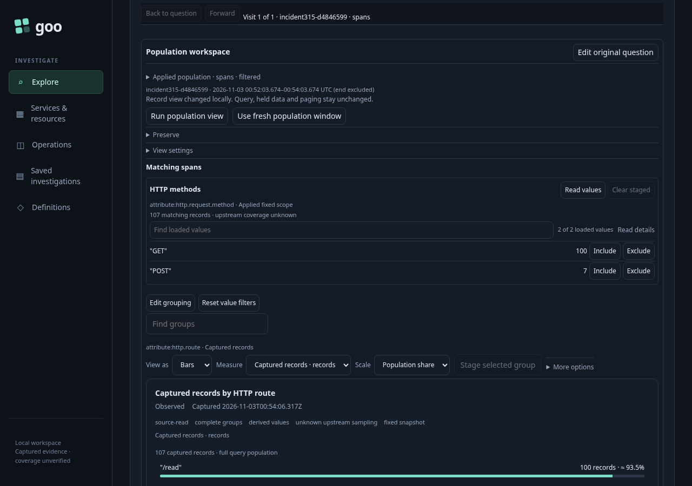
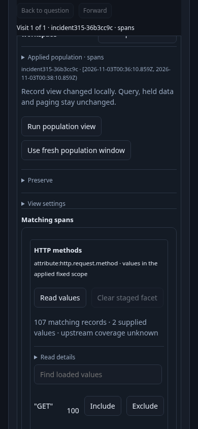
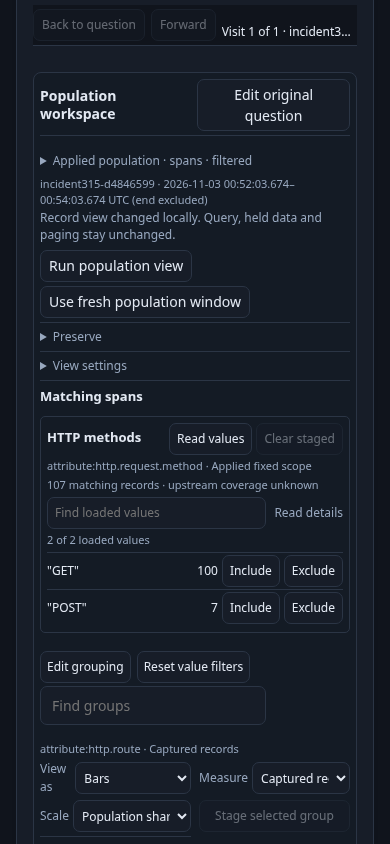
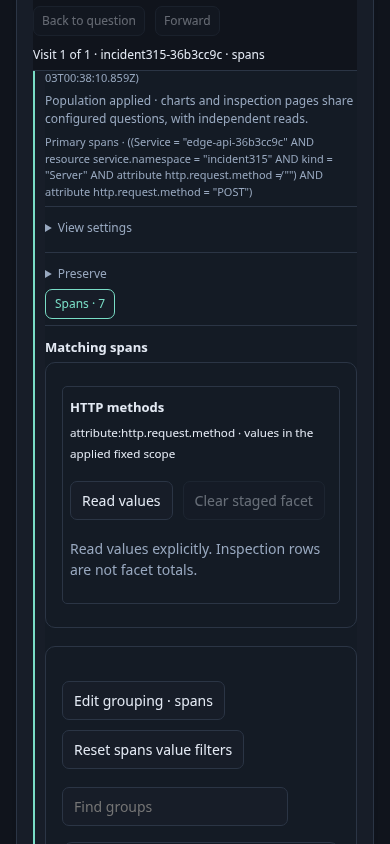
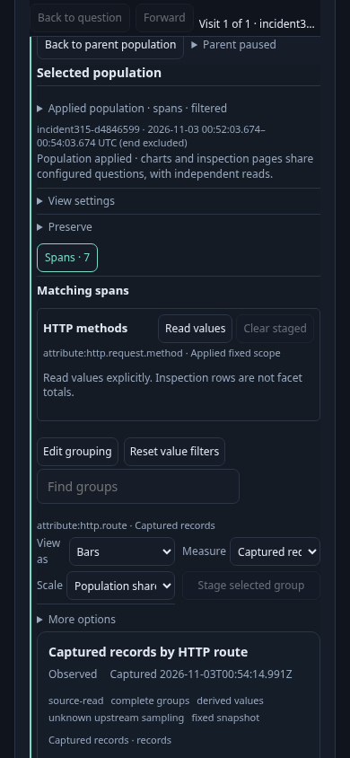
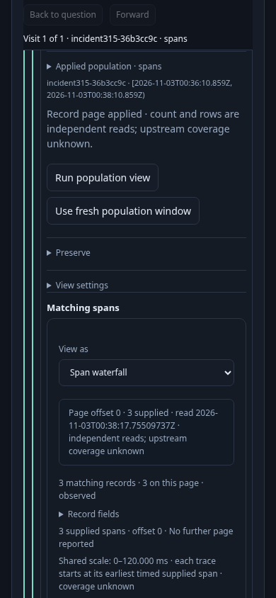
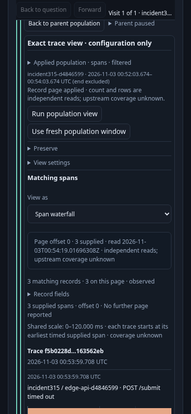

# Compact facets and nested context — 315

Use the same real OTel incident fixture as 313: an HTTP service has 107 incoming
spans, with GET 100 and POST seven; the timeout trace contains three spans across
two services. Discover the service, Customize its HTTP route view, Run explicitly
and Read values. The facet totals cover all 107 matches while the record inspection
page holds 100 rows.

Compare the same journey at 1280×900 and 390×844. Four bounded captures record the
loaded method facet, its narrow layout, the selected POST child, and the exact
trace child. Measurements include facet/row dimensions, active ancestry, chart
and record positions, viewport intersections and source-request counts. Local
staging and Back must preserve held parents without an implicit telemetry read.

[Maintained browser test](../../journeys/315-compact-canvas.spec.js) uses the
standard traffic-pausing wrapper. Set `GOO_COMPACT_PHASE=before` for the baseline;
the default phase is `after`. The unchanged-source baseline passed in 17.7s
(20.4s runner), with no page errors and no reads from local staging or returns.

| Fine-pointer viewport | Facet before → after | Chart top before → after |
| --- | ---: | ---: |
| 1280×900 | 406.3 → 197.7px | 1098.0 → 701.3px |
| 390×844 | 448.3 → 216.5px | 1492.1 → 867.2px |

The desktop chart now has meaningful first-viewport visibility. The narrow root
chart remains 23px below the 844px viewport, while both loaded facet rows fit.
The selected cohort's chart container moves from 1177.4px to 703.1px and
intersects 140.9px of the viewport. That space still contains its heading and read
facts; the actual bar/count rows remain below the viewport. The 120px geometry
bound does not establish meaningful chart-data visibility. The narrow trace's record container
moves from 448.8px to 394.5px. Mobile density still has room to improve.

The capture anchor places the active population at 16px from the viewport top.
It scrolls some outer origin context above the viewport, so these numbers do not
measure total top-of-workspace ancestry. Separately measured child/trail elements
total 156px before and 73px after; that is a reduction of this measured subset,
not a claim about all origin context.

| Canvas | Before | After |
| --- | --- | --- |
| Desktop facet |  |  |
| Narrow facet |  |  |
| Narrow cohort |  |  |
| Narrow trace |  |  |

The final after run passed in 27.3s (31.3s runner), with no page errors. Keyboard
Enter toggles Origin scope, Read details, Applied population selectors and Parent
paused, restores focus, and causes no reads. The filtered marker stays visible;
the exact Primary predicate remains available in the existing scope disclosure.
Find announces 1 of 2 loaded matches, then 2 of 2 when cleared, preserving the held 107
total and its read receipt. Same-owner updates preserve the disclosure; returning
through a child restores held data while the new disclosure starts closed.

Chromium native touch input selected POST and opened the child. Coarse-pointer
mode was observed: both the facet Include and Open selected facets targets were
44px. Back restored the exact held basis, read-at timestamp and 107 total without
acquisition. Both phases used 15 source requests at the same checkpoints.
Maintained bounds limit the loaded facet to 220px desktop / 280px narrow, keep both
narrow values visible, and require desktop chart visibility plus 120px of cohort-container intersection.
The remaining narrow chart-metadata/data-position problem stays explicit.
