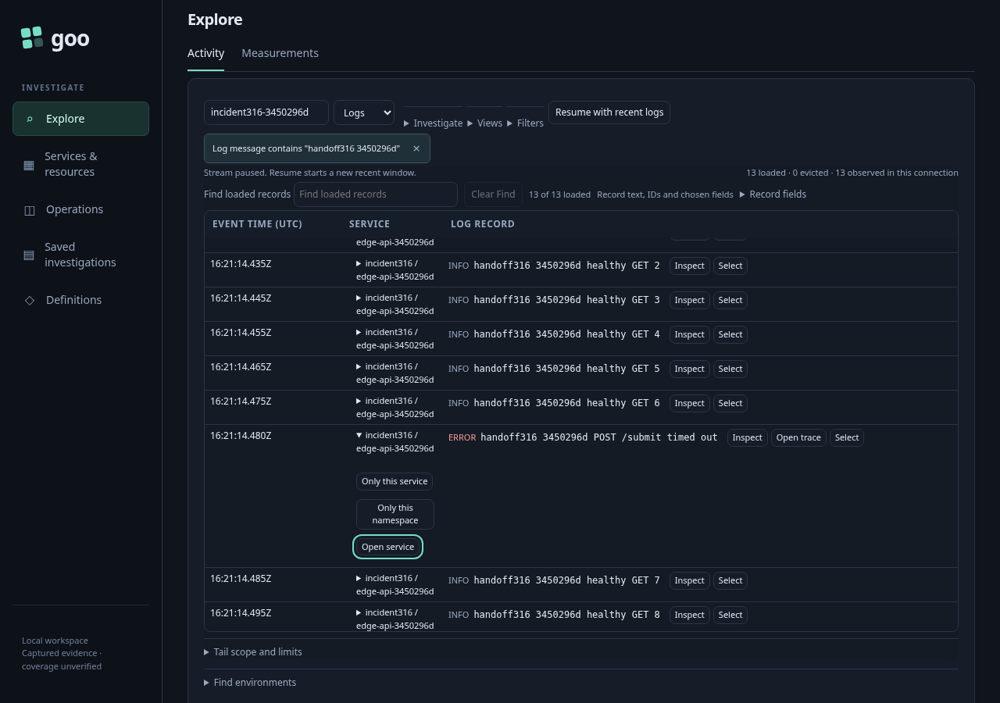
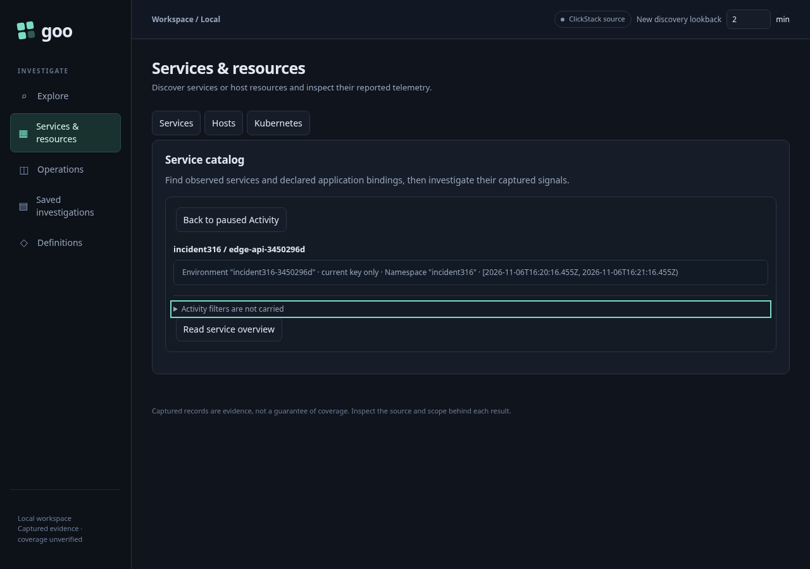
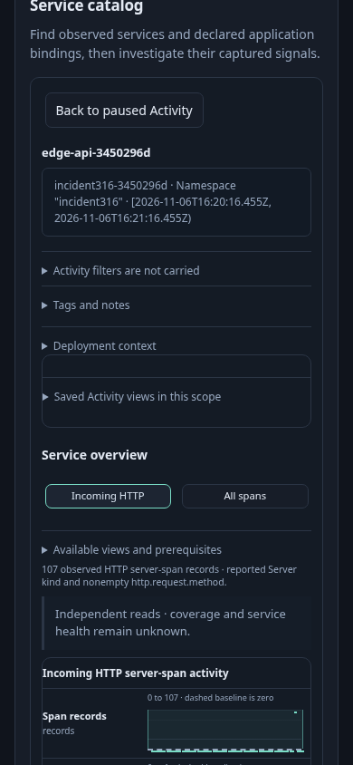

# Open service context from a held Activity observation — 316

Start a real log stream with a log-only body filter. The fixture has thirteen
matching logs, enough to retain a nonzero table scroll position, and 107 HTTP
server spans. The selected timeout row reports its namespace in resource
attributes; a conflicting log attribute must not replace that identity.

1. Let a later Activity poll complete, then pause. Open the selected row's Service
   actions menu using the keyboard. Open service stages Services without a source
   read, retaining the row's original completed window rather than the latest poll.
2. Back before reading restores the held buffer, viewport and visible row-action
   focus. It does not start another tail.
3. At 390×844, use native touch to open the same service context. Read service
   overview explicitly. Existing supporting reads discover the service profile;
   the log body filter is not copied into span/service questions.
4. Back after the read restores the same paused parent. A final held real discovery
   response is retired by Back: the browser request aborts, and its late response
   must not publish a dashboard or restart Activity.

[Maintained browser test](../../journeys/316-service-handoff.spec.js) uses the
standard traffic-pausing wrapper. The final native run and screenshots cover the frozen implementation. Unsupported environment/namespace policy cases are owned
by the protocol and source/destination unit tests rather than a browser matrix.

Validation: native-only acceptance passed in 51.3s (57.5s runner). The final
combined native/Bombadil run passed in 101.953s (105.439s runner), with no page errors. The selected row's completed window was 2000ms older than the latest
completed poll; all service reads used that original window. The desktop table
scrollTop 69 and narrow scrollTop 689 returned exactly, with 13 unchanged records,
the same visible Service actions summary focused, and no new tail connection.

Staging and Back read nothing. Explicit Read made seven source HTTP requests:
four supporting reads and three existing aggregate widgets, plus source-free
observed-profile planning. It found the HTTP-server profile and 107 spans with a
100-row inspection page. The held second discovery request reported
`net::ERR_ABORTED`; releasing its late response produced no second dashboard plan.
The upstream response had already completed before being held, so this proves
browser-request retirement and publication guards, not cancellation of completed
backend work. Unsupported policy counterexamples remain unit-test coverage.

The optional `GOO_SERVICE_HANDOFF_BOMBADIL=1` campaign starts early over the same
real fixture, using identity-only URL query parameters and its own tail. Its 25s
campaign produced 178 snapshots and reached phases 0 through 4. The final state had
13 paused rows, exact returned scope/viewport/focus, and one API attempt: the one
explicit tail. Staging and Back produced no requests. Actor counters are separate
from the main journey's seven completed-read and four retired-read source calls.
The actor exited 0; process wall time including startup was 34.637s. Raw actor/browser
artifacts were pruned after review; three maintained screenshots and compact
results remain.

349 regression: the unchanged handoff assertions passed against the reviewed Go binary in **37.6s** (**39.3s** runner), including narrow touch, seven completed overview source reads and withdrawal of the held discovery response. The 25s Bombadil campaign produced **446** snapshots, reached phases 0–4, and ended with 13 paused rows, `returned`, `passive` and `pausedExact` true, and exactly one source/API attempt (its explicit tail). The actual final JPEG shows that paused 13-row Activity state; logical extraction and visual review agree. Actor requests remain separate from the Playwright counters. This regression precedes the 349 mobile table-layout presentation adjustment; the final 349 journey validates that adjustment separately.
