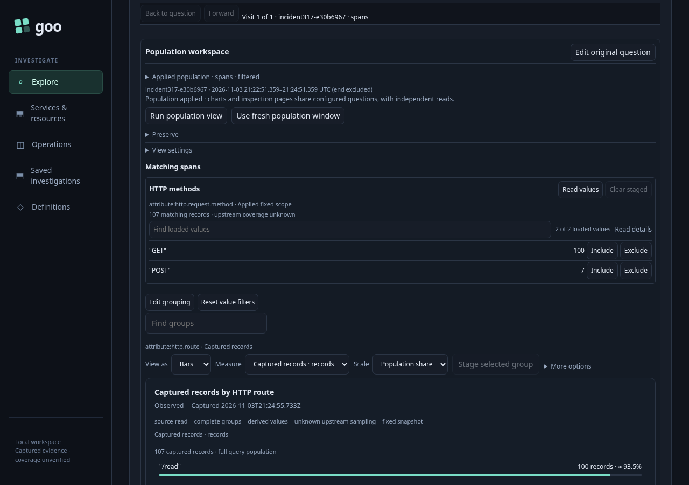
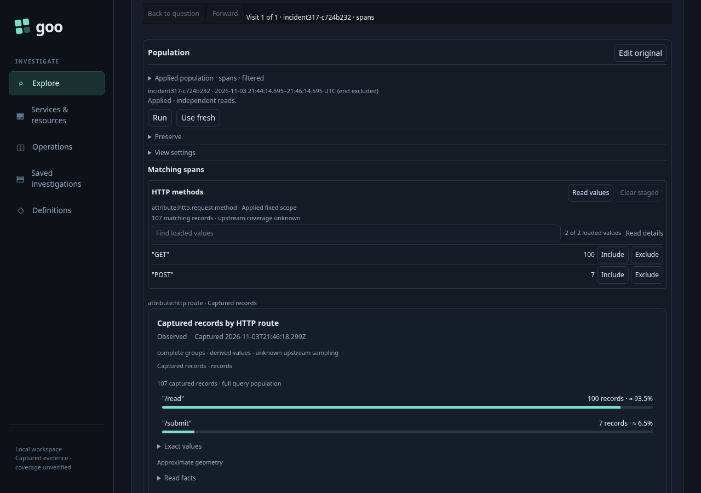
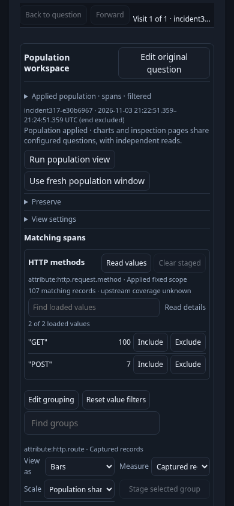
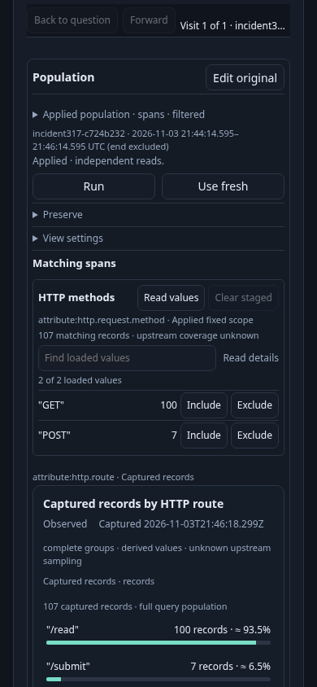
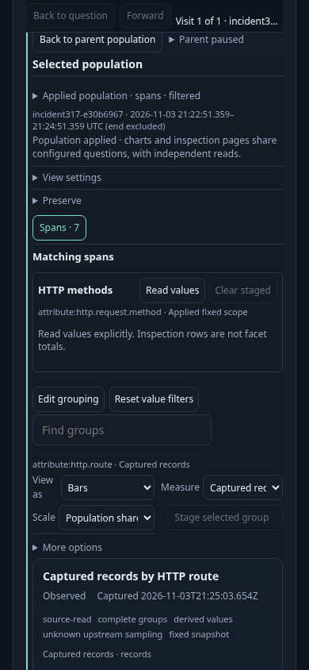
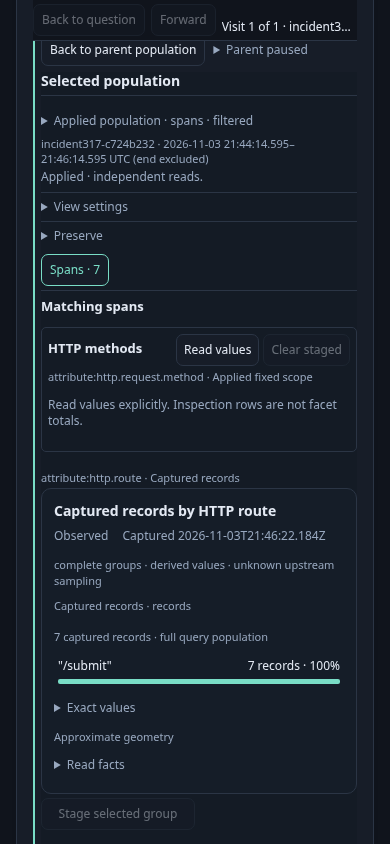
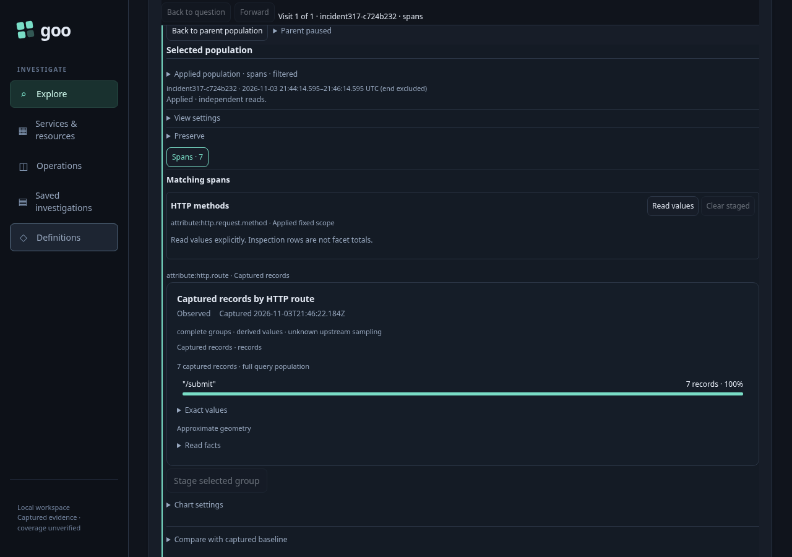

# Put plotted values before optional chart controls — 317

The real OTel fixture has 107 HTTP server spans: 100 for `/read`, seven for
`/submit`. The inspection page holds 100 rows; chart counts and the full-query
107 denominator come from admitted aggregate data, not inspection rows.

Use the same scroll procedure at 1280×900 and 390×844: scroll the active canvas
to block start, then shift the window 16px upward. Existing CSS scroll margins and
sticky context remain in effect; the canvas is not assumed to begin at 16px. Measure the actual plotted label, formatted count/unit, bar track and
positive fill. Every piece must fit completely in the viewport; hit tests at
label/value/track/fill centres must resolve to that plotted row. A chart container
or metadata heading intersecting the viewport does not meet this acceptance.

The unchanged-source baseline passed in 24.4s (26.7s runner):

| Canvas | Baseline track bottoms | Initial visibility |
| --- | ---: | --- |
| Desktop parent | 884 / 929px | Only the first plotted row fits |
| Narrow parent | 1066 / 1111px | Neither plotted row fits |
| Narrow cohort | 902px | The seven-record row is below 844px |
| Desktop cohort | 777px | The seven-record row fits |

The source change places plots before native Chart settings, retains visible
certainty, captured units/full denominator and sampling/freshness exceptions, and
puts exact origin/read facts in a native Read facts disclosure. Full read clocks
and quality facts remain reachable without acquisition.

| Canvas | Before | After |
| --- | --- | --- |
| Desktop parent |  |  |
| Narrow parent |  |  |
| Narrow cohort |  |  |
| Desktop cohort |  |  |

[Maintained browser test](../../journeys/317-plotted-values.spec.js). Set
`GOO_PLOTTED_PHASE=before` to capture a baseline and optionally
`GOO_PLOTTED_BOMBADIL=1` for the bounded held-chart campaign. The test uses the
standard traffic-pausing wrapper and real UI Save for actor configuration; no
records or definitions are seeded through APIs.

Final acceptance passed in 58.266s (60.164s runner), with no page errors. All
plotted labels, counts, tracks and positive fills fit completely and passed centre
hit tests. Final track bottoms were:

| Canvas | After track bottoms |
| --- | ---: |
| Desktop parent | 746 / 791px |
| Narrow parent | 792 / 837px |
| Narrow cohort | 684px |
| Desktop cohort | 639px |

Keyboard Read facts retained the original source origin, full capture clock and
all quality facts without acquisition. Chart settings switched Table/Bars and
ordering locally. Find narrowed the visible rows while retaining the 107 full-query
denominator and the complete held snapshot. Applying display source updated the
named Find input, preserved the Complete checkbox state, and restored the original
rows without a read. Native touch selected a real bar. Back restored the exact
held parent; the main source budget remained 12 HTTP requests.

The 30s Bombadil campaign used a configuration saved through the UI, then made one
explicit read of that real service scope. Its 520 snapshots covered phases 0 through 10;
all invariants passed, including exact held snapshot/quality/read facts, local
settings/Find, staged child and retired-command refusal, and Back. Actor source
counters were separate: one explicit Explore and no later source reads. Process
wall time was 30.381s, exit 0. Raw actor/browser artifacts were pruned after review;
compact metrics and eight maintained before/after screenshots remain.

These are the measured fixture and fine-pointer layout, not universal mobile
certification. Historical 315 evidence remains unchanged.
