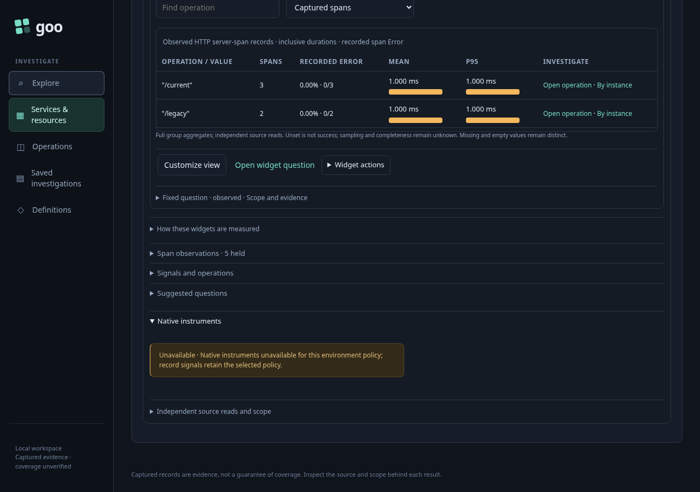
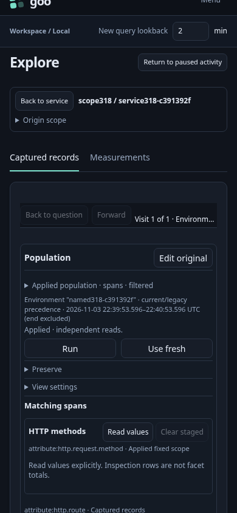
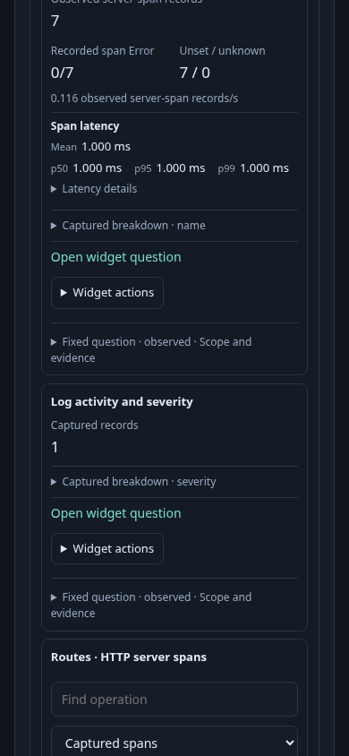

# Typed environment service handoff

The same service and resource namespace occur in five real OTel resource populations. Activity adopts each environment policy through its existing environment discovery and preview controls. Opening a service stages its exact selected policy and completed observation window without a source read; Read service overview explicitly reads the records.

| Selected policy | Included span names | Spans | Metric datapoints |
| --- | --- | ---: | ---: |
| Current key, named | GET /current | 3 | 1 |
| Effective, named | GET /current; GET /legacy | 5 | 2 |
| Effective, present empty | GET /empty | 5 | 1 |
| Effective, unreported | GET /unreported | 7 | 1 |

A conflicting current environment excludes the legacy match. A present empty current key overrides the legacy name. Unreported means neither key exists. Raw metric datapoint presence describes matching records, not a native metric evaluation or a sum of gauge values.

The effective named journey deliberately opens the service from its legacy-only log observation. Customize HTTP route view stages the dashboard widget's exact question without a telemetry read. Explicit Run retains the typed selector and returns the two expected routes, with counts 3 and 2. Back to service and Back to paused Activity preserve held data, exact paused observations and keyboard focus without restarting the stream.

For effective policies, the interface explains that native instruments, deployment context, service annotations and saved Activity views are unavailable for this policy. The journey checks that their APIs are not called. Current-only named scope separately proves the existing native discovery path remains eligible.

Run `bash scripts/run_journeys.sh journeys/318-typed-service-scope.spec.js`. The wrapper pauses its traffic generator and restores it afterward. `GOO_TYPED_SERVICE_BOMBADIL_ONLY=1` runs a separate fresh real fixture and a bounded 30-second actor: environment discovery, named preview, one typed tail, legacy-row service staging and paused return. Actor counters remain separate from the main journey. Both use an isolated runtime and no seeded definitions.

The final main journey passed in 21.5 seconds (23.8 seconds including the runner), with no page errors. It observed 36 source HTTP attempts: four explicit tails, six environment discovery/preview reads, 25 service overview/widget reads and one customized view Run. Each typed overview used six source reads; current-only used seven including native metric discovery. Staging, Customize and both return actions performed no source reads. The exact returned span-name sets above were checked independently of the equal named/empty counts.

The separate actor-only run passed in 36.4 seconds (38.1 seconds including the runner). Its 30.127-second campaign exited successfully with 550 snapshots across phases 0–6. It performed exactly one environment-scope read, one named-log preview and one typed tail, with no other source requests. Service staging and return performed no API requests; both real log observations and the legacy-row return focus remained exact.
