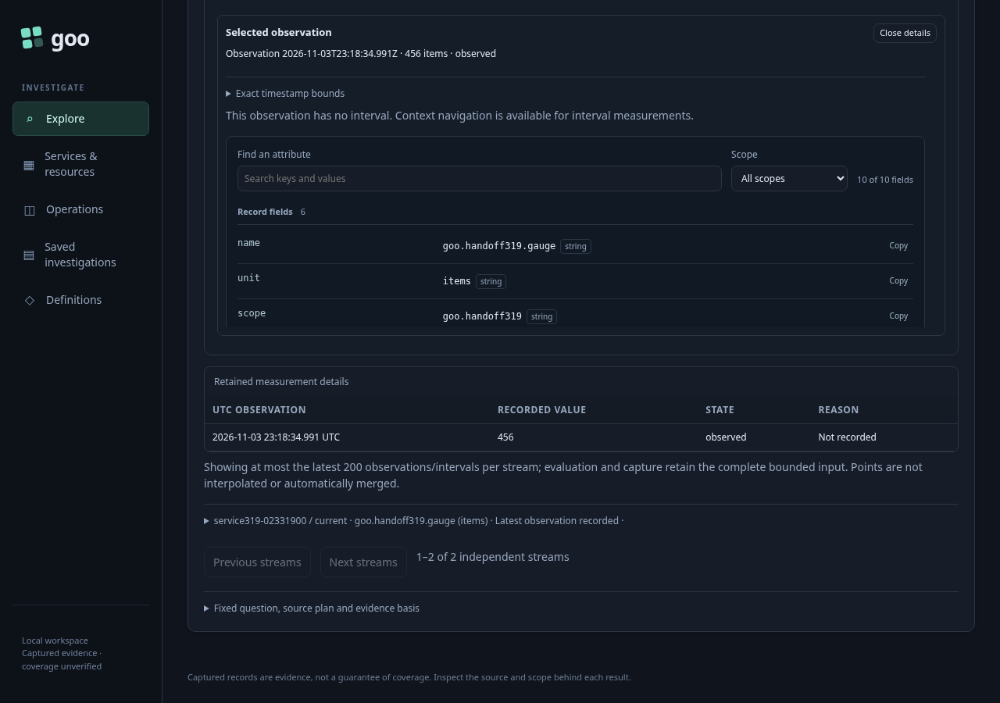
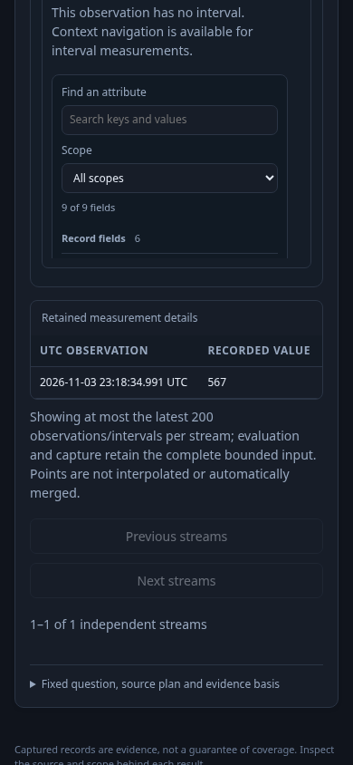

# Typed environment native gauge values

This journey extends the service handoff through discovered native gauge instruments. It uses five real OTel resource populations for the same service and namespace, with different instance IDs and gauge values. No measurement definitions are seeded: the interface discovers the instrument, previews its question without reading telemetry, and runs it explicitly.

| Environment selection | Expected independent instance/value observations |
| --- | --- |
| Current key, named | current: 123 |
| Effective, named | current: 123; legacy: 456 |
| Effective, present empty | empty: 234 |
| Effective, unreported | unreported: 567 |

The conflicting resource has a current environment different from the selected legacy name and value 789. It must be excluded from effective named results. A present empty current key overrides its legacy name. Unreported includes neither key.

For each scope, Activity opens a service from a real observed log row. Service staging performs no source read. Read service overview retains the row's exact completed window. Native instruments exposes the discovered gauge; Preview measurement validates locally at the server without telemetry access. Run measurement explicitly reads the same fixed question. The result oracle checks independent stream instance identities and sample values, as well as exact preview/result question correspondence. It does not infer native values from raw metric datapoint counts.

Back to service and Back to paused Activity must preserve held results and observations without source reads or a stream restart. The typed selector stays intact through discovery, preview and evaluation. This milestone admits typed policies for service per-stream gauges; it does not imply support for other native kinds or resource identity families.

Run `bash scripts/run_journeys.sh journeys/319-typed-native-values.spec.js`. The standard wrapper pauses its traffic generator for the bounded isolated-runtime journey and restores it afterward.

All four native value oracles passed in the integrated run. The main flow made 46 source HTTP attempts: four explicit tails, six environment discovery/preview reads, 32 service overview/widget reads and four explicit measurement reads. Staging, measurement preview, Share question and both return actions made no source reads. Service overview includes an independently evaluated native gauge widget; its read is distinct from the later explicit measurement Run.

A separate 30.206-second Bombadil campaign opened the UI-generated effective-named Share question link. It exited successfully with 266 snapshots across phases 0–8, one explicit measurement/source read and no capture writes. It checked both independent values 123 and 456 in the response and retained UI, exact policy/window, stream filtering, disclosures and sharing without additional source reads. Enable it with `GOO_TYPED_NATIVE_BOMBADIL=1`; its counters remain separate from the main page. The final main-only replay retains all main assertions and leaves this campaign result unchanged.

The final main-only run passed in 31.8 seconds (34.3 seconds including the runner), with no page errors. Screenshots are anchored on actual recorded values. The earlier integrated native-plus-actor run also passed (1.3 minutes test; 1.4 minutes including the runner). Reviewed raw browser/campaign output was removed; compact main/campaign summaries and these three maintained screenshots remain.
