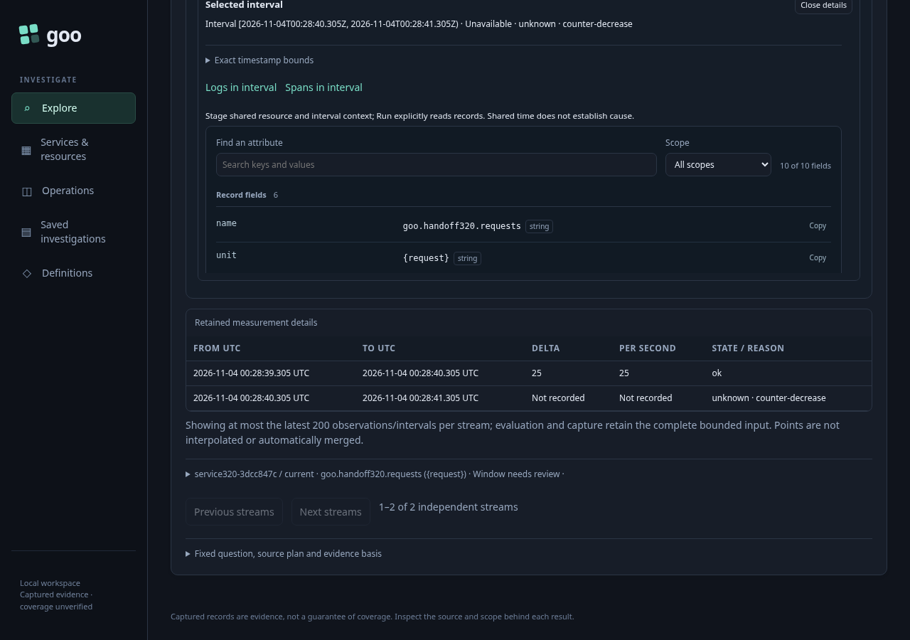
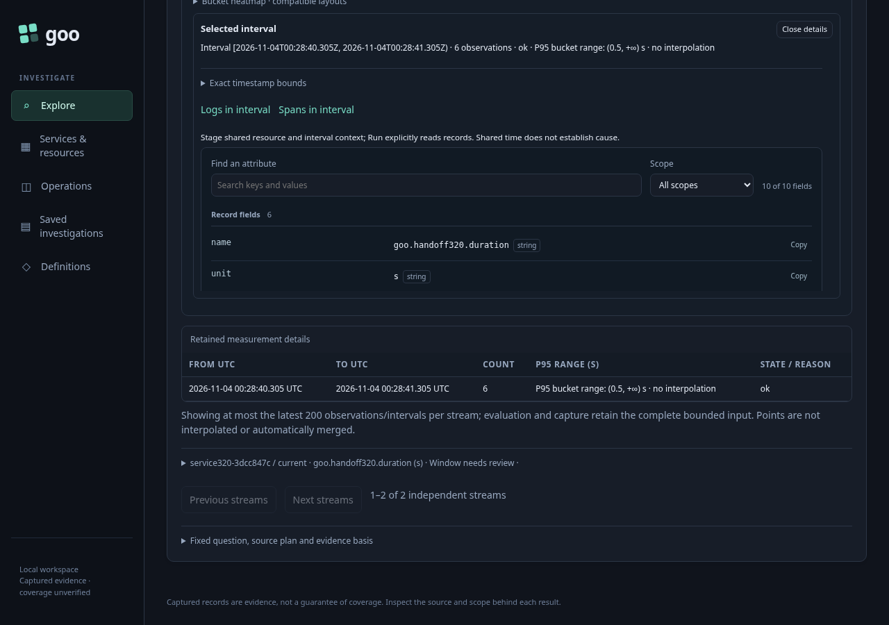

# Typed environment native intervals

The journey follows real Activity log observations into a service, discovered native instruments, explicit measurement preview and Run. The same service and namespace have current-named, legacy-only, conflicting-current, present-empty and unreported resource populations. Each has an independent service instance; definitions are discovered through the interface rather than seeded.

Current-only named and effective-named scope each run a cumulative counter and an explicit delta histogram. Effective named includes the current and legacy-only streams independently. Empty and unreported scope each run the counter, checking exact resource membership through the same codec.

For the current counter, values 100 → 110 → 3 produce one valid one-second delta/rate of 10 and then an unknown counter-decrease interval. The legacy-only counter produces delta/rate 25, followed by its own decrease. Reset intervals must have no fabricated delta or rate. Every interval is checked against its exact recorded nanosecond endpoints, while the interface displays UTC.

The duration histogram keeps seconds and explicit bounds `[0.1, 0.5]`. Current buckets `[1, 2, 1]` contain four observations; legacy buckets `[2, 3, 1]` contain six. They remain separate streams and are not converted into a fleet distribution.

Every preview and result must retain the exact typed environment selector and fixed completed Activity window. Preview, Share question, Back to service and Back to paused Activity perform no telemetry reads. Paused log observations and return focus stay intact. Deployment/entity annotations and saved Activity views remain subject to their existing policy capabilities.

Run `bash scripts/run_journeys.sh journeys/320-typed-native-intervals.spec.js`. The wrapper pauses and restores its traffic generator; the application runtime and capture store are isolated.

The source-frozen journey passed on its first run: 54.5 seconds for the test, 56.9 seconds including the runner. All six explicit measurement cases passed, with no page errors. Main-page source demand was 52 HTTP attempts: four tails, six environment discovery/preview reads, 36 service overview/widget reads and six explicit measurement reads. The overview includes eight native widget evaluations; those are separate from the six later explicit Runs. Staging, Preview, Share and returns added no source reads.

With `GOO_TYPED_INTERVAL_BOMBADIL=1`, the journey then opens its genuine UI-generated effective counter Share link in a separate actor. The 30.128-second campaign passed with 495 snapshots across phases 0–8, exactly one explicit measurement/source request and no capture writes. It checked independent current/legacy interval values, the unknown decrease without a fabricated rate, retained exact policy/window, local stream filters, interval inspection, disclosures and sharing. Its counters are separate from the main page.

Compact summaries and the three maintained screenshots are retained; reviewed raw browser/campaign output has been removed. The wrapper restored its traffic generator after the run.
