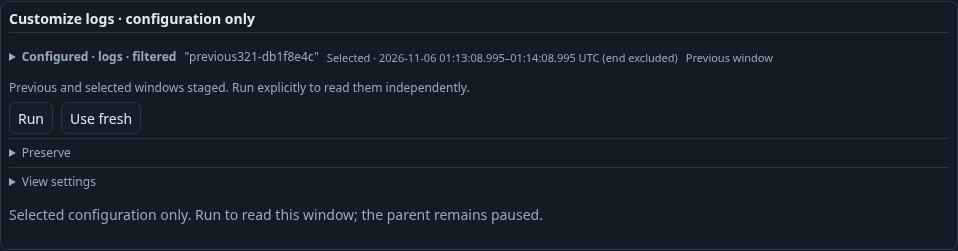
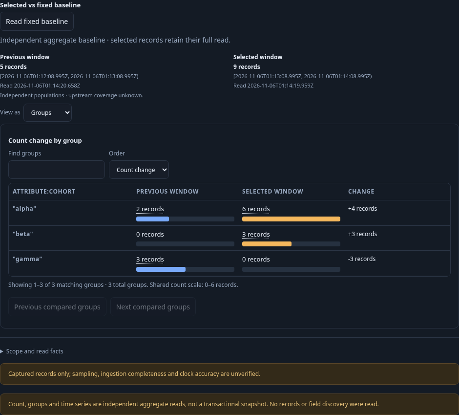
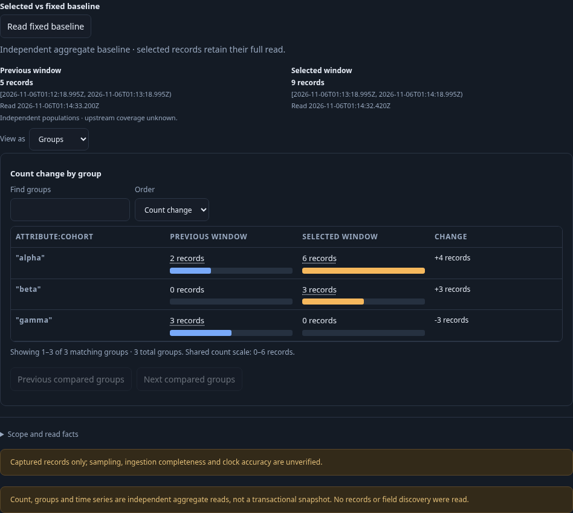

# Compare with the previous window

This journey starts with an ordinary count view over real OTel logs. Its fixed one-minute selected window contains nine matching records: six alpha and three beta. The adjacent preceding minute contains five: two alpha and three gamma. The inspection limit is two; chart and comparison totals must come from full aggregate reads rather than those rows.

The query retains a typed effective-named environment policy, a service, an exact resource namespace and a tenant predicate. After opening the linked population and customizing its display, Compare previous window stages a preceding equal-width baseline without reading telemetry. The existing held snapshot stays immutable and the interface requires an explicit Run.

Run reads the selected question and previous aggregate independently. The count difference is four records, not a rate. Group comparison aligns all three categories: alpha +4, beta +3 and gamma −3. Both UTC windows and their roles must remain visible.

Save and Export YAML preserve the existing fixed-query comparison grammar, including the complete baseline question. Reopening the saved view stages its configuration without running. A second explicit Run rereads both operands. Moving the selected comparison window forward ten seconds stages both operands locally, retaining the preceding adjacent equal-width relationship and all non-time query fields; a third Run verifies the same known populations.

Run `bash scripts/run_journeys.sh journeys/321-previous-window.spec.js`. The standard wrapper pauses and restores its traffic generator. The application runtime and saved-view store are isolated; no definitions are seeded through APIs.

The native main assertions passed: three explicit pair Runs each used one current full exploration and one independent baseline aggregate read. Saved configuration retained its exact baseline question; exporting and reopening added no telemetry reads. The held original snapshot remained unchanged after staging. The final test passed in 54.8 seconds (1.0 minute including the runner), with no page errors. Main source demand was ten HTTP attempts: four setup explorations (root logs, linked logs and spans, customized logs) followed by the three current/baseline pairs. Three `/api/compare` calls derived comparisons from those operands without source access. These are HTTP counts, not physical SQL counts.

`GOO_PREVIOUS_WINDOW_BOMBADIL=1` opens the genuinely UI-saved view in a separate 30-second campaign. It passed with 456 snapshots across phases 0–8, exit zero and 35.713 seconds wall time. It performed two source requests and one derived comparison, with no capture writes. After verifying full 9/5 populations and exact group differences, local display controls and fresh-window staging preserved held observations and made no additional source requests; the old detached Find callback remained harmless. Actor counters are separate from the main page.

Reviewed raw browser/campaign output has been removed; compact main/campaign summaries and these three maintained frames remain. The standard wrapper restored its traffic generator after the run.

339 consolidates exact page-level window facts inside the Applied/Configured
population disclosure. The maintained actor opens that disclosure before
inspecting visible selected/baseline UTC bounds, including after staging a new
window; opening facts does not acquire source data.

The 339 regression passes in 44.0 seconds using the reviewed Go 1.27.3 executable.
All three 9/5 pairs retain their original selectors and independent bounds. The
updated 30-second actor reaches phase 8 across 475 snapshots, verifies the pair
and fresh staged window, and ends with two source attempts, one comparison, zero
capture writes, immutable held facts and no overflow. Exact scope facts are opened
through the summary before visibility checks; that gesture adds no source read.
Current maintained frames are refreshed. Reviewed raw stores and actor output are
pruned after compact receipts are retained.

The 341 regression passes against the same final reviewed Go 1.27.3 binary in
27.9 seconds (33.1 seconds including the runner). All three 9/5 count pairs,
source-free staging/Save/export/open and adjacent-window rebasing remain valid;
the three maintained frames are refreshed. This bounded regression does not run
another actor campaign; the 339 actor result above remains historical.
