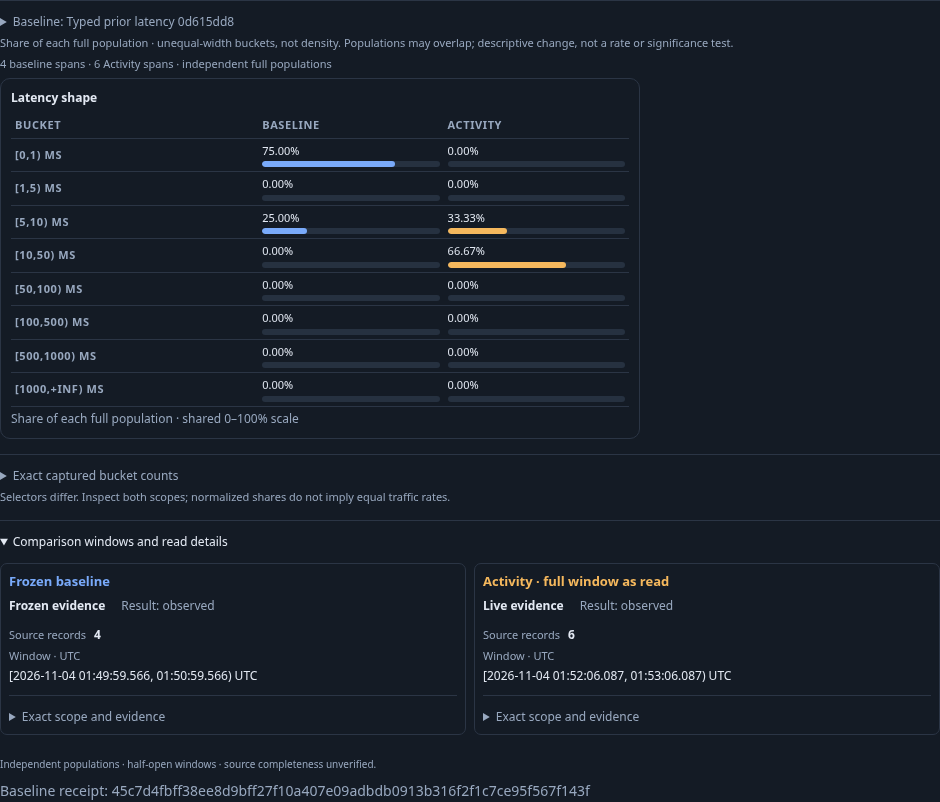
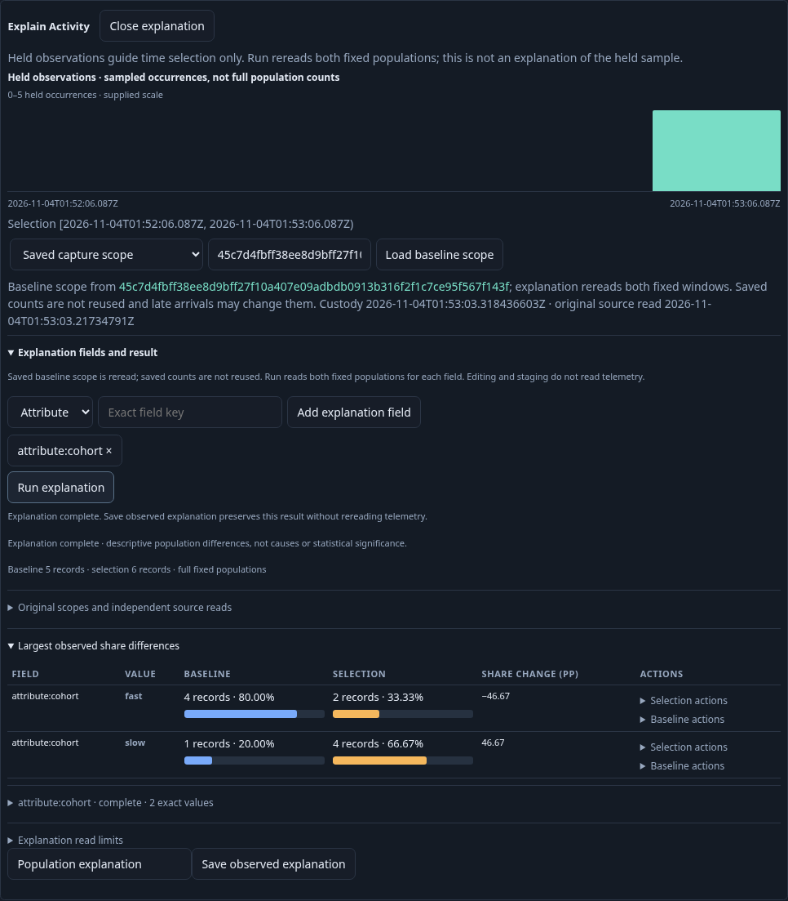
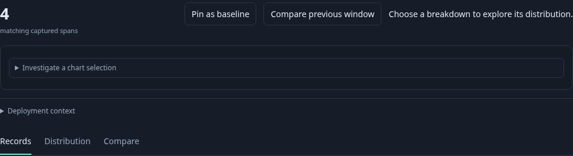

# Typed Activity baselines: frozen evidence and reread scope

The journey captures a real historical duration distribution through the interface, using an effective named environment policy that includes current-key and legacy-only resources. Four historical spans have durations 0.1, 0.2, 0.3 and 8 ms; five current spans have durations 8, 8, 20, 20 and 20 ms. The capture's exact service, resource namespace, owner predicate and fixed UTC bounds remain part of its question.

Activity adopts the same policy through environment discovery and record preview, starts one explicit span stream and pauses its five observed rows. Show latency independently reads the full current population. Loading the saved baseline catalog and receipt compares the stored four-span distribution with that current read; it does not reread the historical telemetry.

One late fast span then arrives inside the saved historical window, and one slow span inside the current window. Refresh latency performs one fresh current read and compares frozen four versus current six. Its context distinguishes original source read, custody time and current read. Saved capture-file bytes must remain unchanged.

Explain uses the same capture differently: Saved capture scope loads its exact original question, without reusing its saved counts. Explicit Run rereads both populations and observes historical five versus current six. A baseline-side include filter for cohort fast stages a question over the actual historical operand; opening its link performs no source read, and explicit Run returns four matching spans. Returning preserves paused Activity rows and focus without starting another subscription.

Run `bash scripts/run_journeys.sh journeys/322-activity-baseline-policy.spec.js`. The standard wrapper pauses and restores its traffic generator. The runtime/store are isolated, telemetry is real OTLP, and no saved definitions or capture evidence are seeded through APIs.

The final native-plus-actor run passed in 53.9 seconds (57.4 seconds including the runner), with no page errors. The main page made nine source HTTP attempts: one root exploration, one explicit capture reread, environment discovery and preview, one tail subscription, initial and refreshed latency, one explanation Run and one side-question Run. Catalog/receipt reads, two pure baseline comparisons, explanation/filter planning and navigation did not add telemetry reads. These are HTTP operation counts, not physical SQL counts.

Exact bucket assertions were additionally executed offline against the final actual response ledger: frozen `[0,1) ms: 3`, `[5,10) ms: 1`; initial current `[5,10) ms: 2`, `[10,50) ms: 3`; refreshed current `[5,10) ms: 2`, `[10,50) ms: 4`. The same assertions were added to the maintained journey after that browser loaded its test file; no further browser case was run. Final JavaScript syntax validation passed.

`GOO_ACTIVITY_BASELINE_POLICY_BOMBADIL=1` adds six fresh real spans after the main six-span oracle, then saves the Activity view through the interface with its baseline reference. A separate 30-second campaign opens that genuine saved view. The authoritative final campaign passed with 389 snapshots across phases 0–8 and 34.172 seconds wall time, performing one tail and one current-latency read plus one pure comparison, with no capture writes. It verifies frozen four versus the actual current response (at least six), exact policy/buckets/bases, stored-read context and catalog labels. Actor data and counters remain separate from the main six-span oracle.

An earlier navigation attempt failed with Chromium `ERR_NETWORK_CHANGED` while loading modules, and an earlier actor reached its final assertions but exited on a debugger transport timeout. Neither was counted as a passing campaign; the final process exited zero. Reviewed raw artifacts have been removed; compact summaries and the three maintained frames remain. The wrapper restored its traffic generator after the final run.
