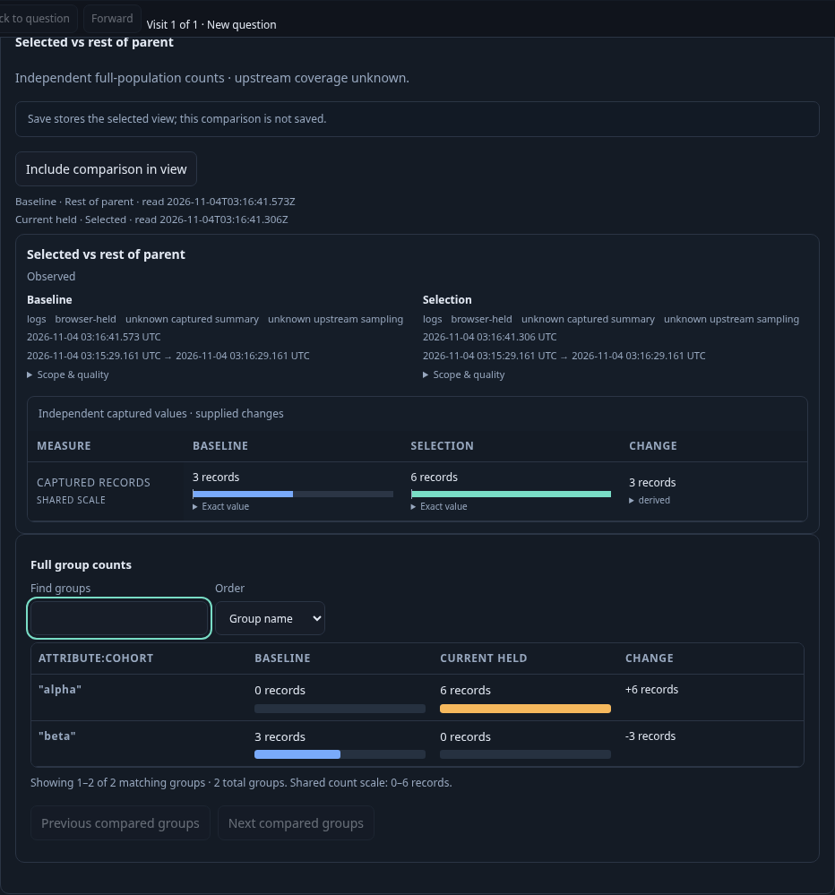
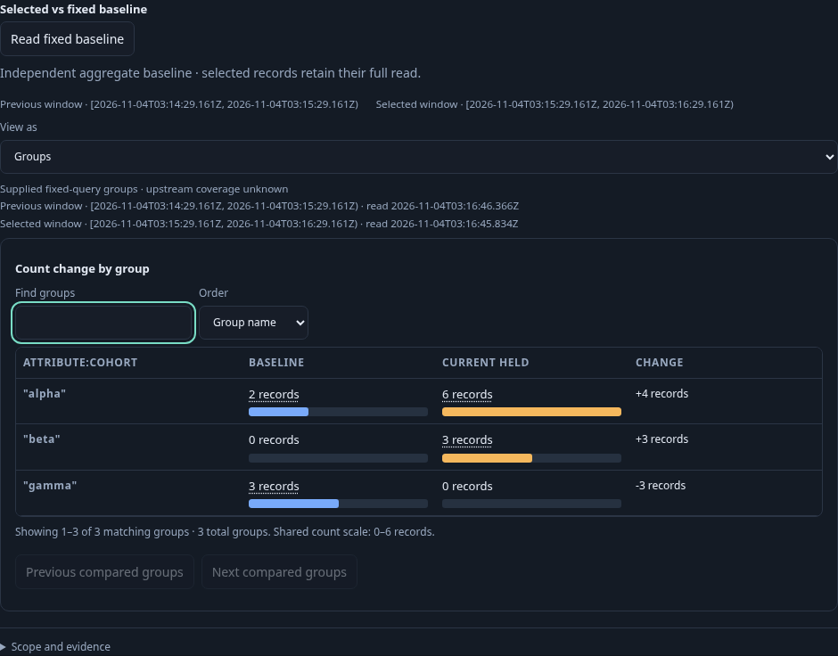
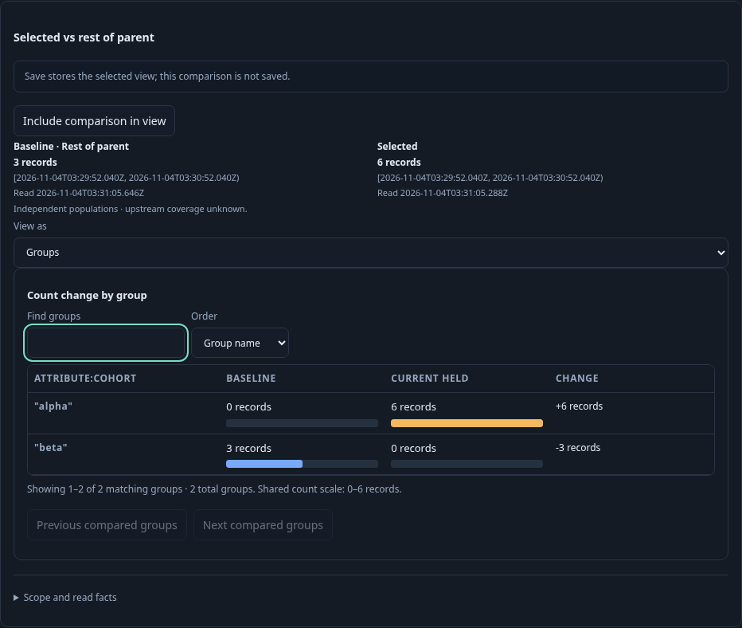
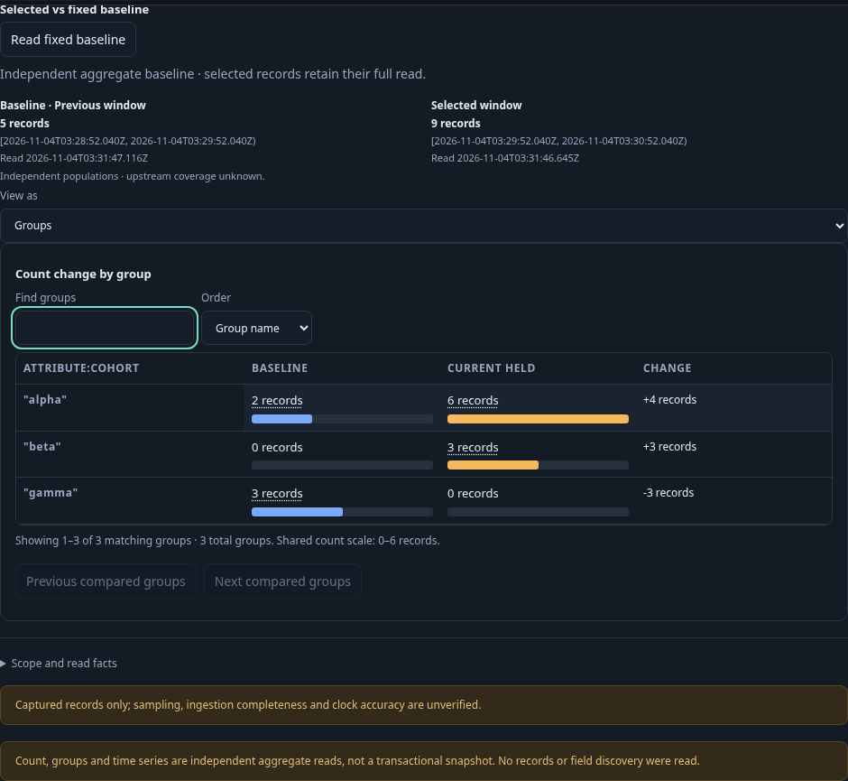

# Count-pair presentation consolidation

This bounded task compares the same three count relationships through temporary and saved views. Real OTel logs give the parent nine records (alpha six, beta three), an alpha selection six and its complementary rest three. The preceding adjacent minute has five records (alpha two, gamma three). All questions retain a typed effective-named environment, exact resource namespace and tenant predicate; inspection is limited to two rows.

The before run uses an immutable Go binary compiled from `2025a17` before frontend edits. It authors the ordinary count display through the existing interface, compares alpha to its overlapping held parent, returns without rereading the parent, then compares alpha to the independently read rest. It checks exact operand counts and queries, local group filtering/order with no reads, stale controls and held-snapshot retention. Two before frames record temporary rest and fixed previous-window presentation.

The same task then stages the previous-window comparison without source access, explicitly runs both fixed questions, and stages a baseline gamma side question. Only explicit Run reads its three historical records. Returning keeps the prepared pair and adds no source read. Saved definitions are authored through UI controls; no configuration is seeded through APIs.

Run with `GOO_COUNT_PAIR_PHASE=before GOO_COUNT_PAIR_BINARY=/path/to/frozen/goo bash scripts/run_journeys.sh journeys/323-count-pair-presentation.spec.js` for a frozen baseline. The default phase is after and builds the current source. The standard wrapper pauses and restores its traffic generator. Before/after metadata and raw temporary outputs are kept separate.

The frozen before run passed on its first attempt: 24.4 seconds for the test and 27.3 seconds including the runner, with no page errors. It made ten source HTTP attempts (nine explorations and one aggregate-baseline read), three supplied-operand comparisons and two UI-authored saved views. Those counts include the setup and explicit three-record side read, not physical SQL statements. Local display changes, staging and returns read nothing.

| Before frame | Width | Height | Presentation |
| --- | ---: | ---: | --- |
| Temporary selected/rest | 932 px | 997.31 px | Summary and groups visible together |
| Saved fixed previous | 940 px | 734.5 px | Selected groups view |

The final after run passed in 101.723 seconds (105.346 seconds including the runner), with the same ten source HTTP attempts, three supplied comparisons and two UI-authored saved views. No page errors occurred. Summary and Groups are exclusive for both temporary and saved callers. Local Find/order changes and staged group drilldowns preserve held data; the explicit historical side Run returns three records.

| Final frame | Width | Height | Change from before |
| --- | ---: | ---: | ---: |
| Temporary selected/rest | 932 px | 786.22 px | −211.09 px |
| Saved fixed previous | 940 px | 864 px | +129.5 px |

The temporary panel is shorter and removes repeated ready-status text and the duplicate Selected prefix. The fixed panel remains taller than its before version: it now keeps both full operand counts, exact UTC bounds and read clocks visible. Its two material warnings remain visible, measuring 44 px each: upstream sampling/completeness/clock uncertainty, and independent aggregate reads without record inspection or transactional consistency. The shared operand block is 75 px, its compact uncertainty notice 16.5 px and the closed facts disclosure 45 px. These are component dimensions at the measured desktop viewport, not claims about whole-screen visibility.

`GOO_COUNT_PAIR_BOMBADIL=1` opens the genuinely UI-saved fixed view in a separate 30-second campaign. The final campaign passed with 380 snapshots across phases 0–8, exit zero and 30.201 seconds wall time. It acquired the pair with two source requests and one derived comparison, then exercised exclusive Summary/Groups, Find/order, facts, side-question staging and held return without additional source access or writes. Main and actor counters are separate.

The first after implementation also passed semantically (447 actor snapshots), but its fixed panel was 938 px tall. Its compact summary is retained separately. A single bounded neutral-wrapper/copy correction produced the final measurements above; no further layout loop was run. Reviewed raw output has been removed, retaining compact before/first-after/final summaries and these four maintained frames. The standard wrapper restored its traffic generator after the final run.
