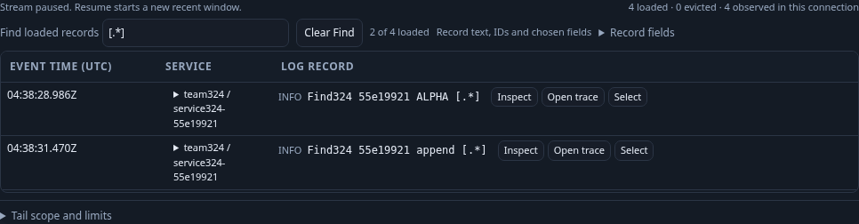
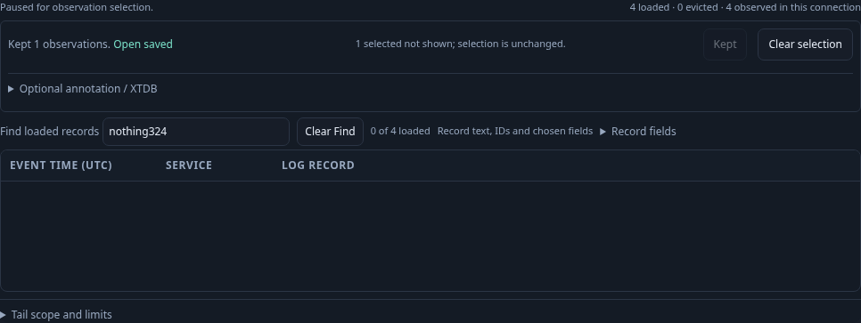
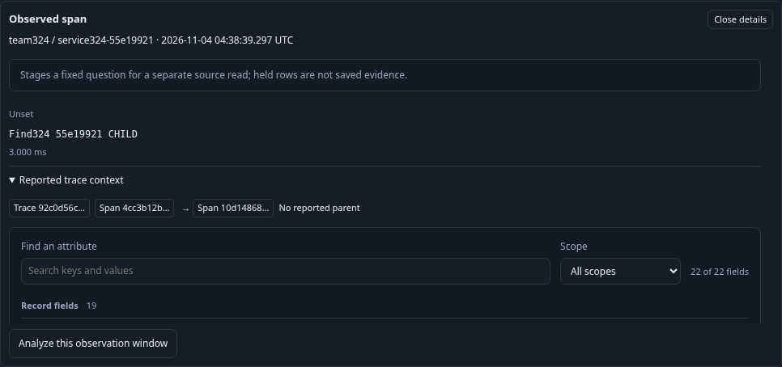

# Find within loaded Activity observations

Find is a local literal, case-insensitive projection over loaded records. It searches record text, displayed UTC/duration values, reported trace/span IDs and chosen qualified field columns. Hidden raw attributes, source query predicates and population totals are outside this operation. The same buffered record nodes, original observation windows and parent-context records remain available when a row is hidden.

The real OTel task starts three logs and uses a short narrow viewport with actual overflow. Setting the viewport at its end then finding literal `[.*]` causes a real scroll clamp. The stream must stay connected. A fourth matching log arrives through the same stream; two of four loaded rows match. Existing scheduled polls continue independently of Find.

After pausing, case-folding and zero-match checks perform no API requests. An attribute value and a resource value become searchable only when their columns are shown. Include callbacks from a hidden row or removed field cannot change the draft, filters or requests. Programmatic Find that hides the focused selected row returns focus to Find and keeps selection explicit. Keep saves the original server-observed key, record and per-row read window, including when that row is hidden; no annotation or source reread is required.

The span task checks trace IDs, a human duration, full and visible compact UTC, and a child span whose reported parent is hidden by Find. Inspection still resolves the parent from all held records. Staging the original observation window and returning preserve the query, row nodes, paused observations and focus without a subscription or query read. An explicit signal change and an explicitly applied different named environment with empty results clear Find for their new connections. Same-scope Resume and automatic reconnect preservation were source-reviewed and covered by focused tests.

Run `bash scripts/run_journeys.sh journeys/324-held-find.spec.js`. The standard wrapper pauses and restores its traffic generator. `GOO_HELD_FIND_BOMBADIL=1` additionally opens a genuinely UI-saved Activity view with three fresh real actor logs. A separate actor makes one explicit stream read, pauses and exercises only local Find/field controls with zero writes. Fixture-readiness requests and actor counters remain separate from the main UI.

The final native-plus-actor run passed in 50.983 seconds (53.280 seconds including the runner), with no page errors. Main UI POSTs were exactly three explicit tail subscriptions, one Keep and one UI-authored Activity view save. No Explore, population-plan or annotation request occurred. Twelve Find queries, chosen-field projection, Clear, hidden-action negative controls and inspection added no API requests. Existing live-tail polls continued within the first subscription during the append check; these HTTP counts are not physical source-statement counts.

At the actual 390×360 viewport, the retained table had 241 px of content and 232 px of client height. Find clamped its real 9 px scroll position to zero without pausing or starting a connection. The matching append changed one of three to two of four while preserving prior row nodes. Paused cases verified selection/focus recovery, original server-observed Keep membership, exact row/window inspection, readable duration and both full/compact UTC, hidden-parent resolution and return to the actual analysis opener. Buffer, snapshot, selection and eviction behavior have additional state-property coverage; same-scope Resume/reconnect preservation was source-reviewed and focused-tested.

The authoritative 30-second actor campaign exited zero after 30.067 seconds, with 480 snapshots across phases 0–8. It used one explicit tail and zero writes, retained stable keys/windows/records and ended paused with verified local results. It used three fresh real logs in the genuine UI-saved view; older rows were allowed and the loaded population was derived from actual observations. Fixture ingestion/readiness and actor counters are separate from the main UI. The native hook requires final-phase completion and actual source use, so an empty action campaign cannot count as a pass merely because the driver exits zero.

Reviewed raw browser/campaign output, temporary stores and owned binaries were removed after review; compact summaries and these three maintained frames remain. The wrapper restored its traffic generator after the run.
