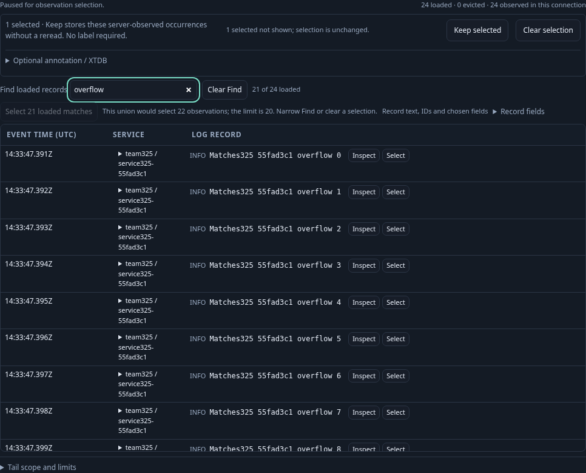
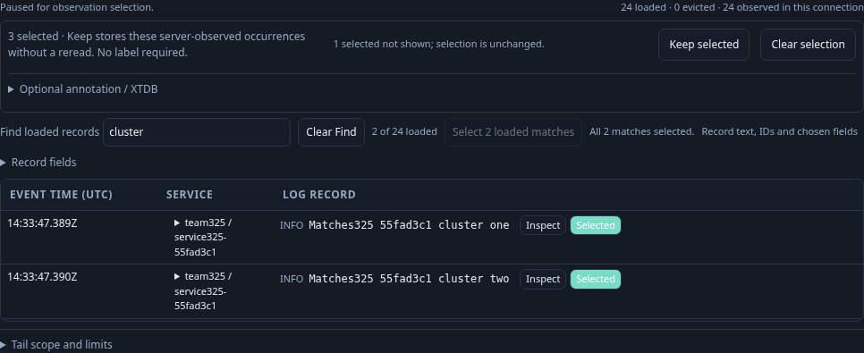
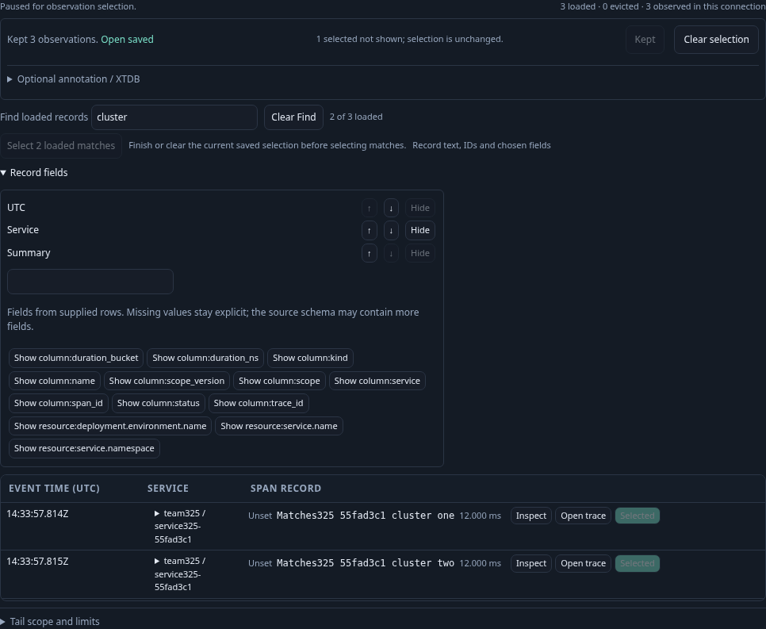

# Select loaded matches, then preserve the exact union

Executable task: `journeys/325-select-loaded-matches.spec.js`. Run it with the standard traffic-pausing wrapper; set `GOO_MATCH_SELECTION_BOMBADIL=1` to include the separate bounded actor.

A responder has loaded logs into Activity and uses local Find to isolate a small cluster. The batch action is unavailable while streaming; it does not pause or create a connection. After an explicit pause, Select loaded matches unions the visible matches with an already selected hidden occurrence. Selection remains local. Explicit Keep preserves the original server-observed keys, records and per-occurrence windows.

One real fixture contains a hidden singleton, two cluster logs and 21 overflow logs. Finding the overflow population must refuse the entire union without truncation or changing the hidden selection. Refining to the cluster admits exactly three selected occurrences. Zero matches and already-selected matches do not produce an extra mutation. Retired controls from older Find, layout, selection and signal states must not operate on a newer state.

A second explicit span connection exercises the same selection operation over three spans. Signal changes retire prior controls and observations. The fixture is delivered through OTLP; definitions, selection and saved Activity configuration are authored through the UI. Source reads, explicit Keep writes and local commands are counted separately. A genuine UI-saved Activity view supplies a separate bounded actor campaign with fresh real records and zero preservation writes.

The native-plus-actor test passed in 48.544 seconds (52.6 seconds including the runner), with no page errors. Main UI POSTs were exactly two explicit tail subscriptions, two explicit Keeps and one UI-authored Activity view save. Sixteen local checkpoints—including Find, overflow refusal, union selection and retired commands—added zero API requests. No Explore, population-plan or annotation call occurred. Existing polls inside a live subscription are separate from these HTTP subscription counts; this does not measure physical source statements.

The first signal loaded all 24 real logs. While live, the action was disabled with “Pause to select matches.” After pausing, an existing hidden selection remained unchanged when 21 matches exceeded the atomic union cap. Refining to two admitted matches produced exactly three selected occurrences and focused Keep without writing. All-selected and zero-match states refused further selection. Programmatic old commands after Find, layout, selection and signal changes made no selection or API change. A second connection loaded three real spans and preserved their exact union. Both explicit Keep responses matched the original keys, records and per-occurrence read windows.

The separate actor used a genuine UI-saved Activity view and three fresh OTLP logs. It passed after 30.100 seconds (30 seconds configured), with 443 snapshots across phases 0–8. Its one explicit tail ended paused; the hidden-singleton plus two-match union stayed at three, with verified stable records/windows, zero writes and no overflow. It also reattached a retired batch control to check that stale connected controls cannot operate on the current owner. Fixture ingestion/readiness and actor counters remain separate from the main UI.

No completeness, source-search or bulk-query claim follows from selecting the loaded matches. The independently reviewed raw campaign/browser artifacts and temporary stores were removed. Compact summaries and these three maintained frames remain; the wrapper restored its traffic generator.

The 326 ownership/performance consolidation reran this unchanged real OTel task and regenerated the same three frames. It passed in 52.527 seconds (54.758 seconds including the runner). The main ledger remained two tails, two Keeps and one UI Activity save, with 16 local zero-API checkpoints and no page errors. Its separate 30-second actor exited zero after 30.126 seconds, with 402 snapshots across phases 0–8, one tail, zero writes and the same verified paused three-occurrence union. This is a correctness regression; these task durations do not establish a latency improvement. The separate bounded performance comparison measures clone work, not a universal browser-speed claim.
