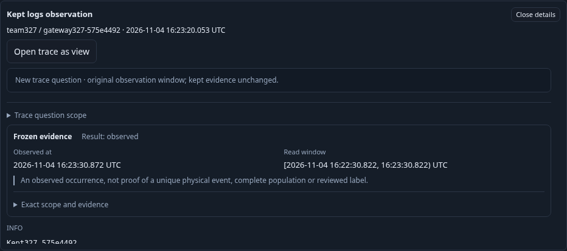
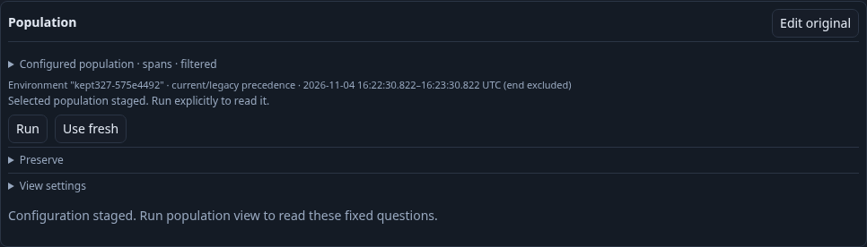
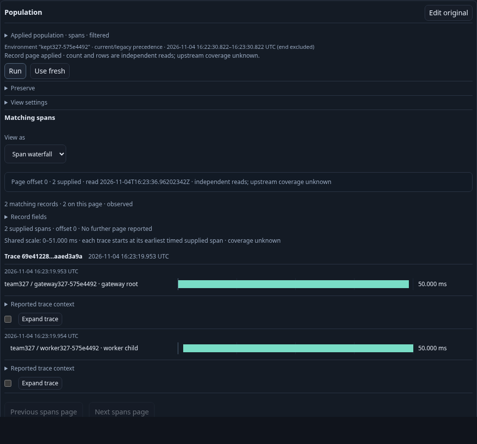

# Continue from kept observations into a live trace

Executable task: `journeys/327-kept-trace-continuation.spec.js`. Use the standard traffic-pausing wrapper; `GOO_KEPT_TRACE_BOMBADIL=1` adds the separate 30-second actor.

An investigator keeps a real log and span from Activity, then discovers the immutable selections through the server catalog. Inspection shows the original observation and its own read window. Opening the trace stages a new trace-only question without reading telemetry or stored evidence: the saved member window and typed environment policy remain, while Activity predicates are explicitly omitted so other services in the trace can appear.

A newly mounted hidden Activity owner may read `/api/retained-evidence/status` and `/api/recipes` configuration metadata; the stage ledger permits only those GETs and counts each path separately. This is not a telemetry or custody read.

Explicit Run acquires the live trace in that fixed scope. Returning restores the same kept inspector and stored receipt without a reread or custody mutation. A cross-service trace distinguishes successful continuation from accidentally retaining the original service predicate. A pending read is canceled on return; stale or hidden continuation commands cannot replace the current owner. Counts distinguish requests attempted, completed and canceled rather than treating an abort as an absent request. Returning during a pending read sends one query-cancellation control POST; this is distinct from a source or custody reread.

The final native-plus-actor run passed in 64.512 seconds (69.995 seconds including the runner), with no page errors. Real OTLP supplied a current-key gateway root/log and legacy-key worker child under the same effective named policy. Two UI Keeps produced genuine log/span receipts, both reopened through explicit server discovery. Both trace reads retained the exact member window and typed policy, used only trace-ID predicates, and returned both services. Completed-read Back restored the exact same inspector/action nodes, action focus, local scroll and unchanged receipt JSON with zero API requests. Closing and reinspecting the same original member produced a working continuation; a reattached action from a different retired receipt had no effect.

The main source ledger contains seven HTTP attempts: environment-scope discovery and preview once each, two explicit tails and three trace-page reads. Two trace pages were adopted. The third completed at the underlying source but its browser response was deliberately held: Back aborted it, sent exactly one `/api/queries/<original X-Goo-Query-ID>/cancel` POST with `{}` and received 202, and ignored the released late response. This control request is not a reread. The only custody writes were the two explicit Keeps. Each staged exploration mount made one GET each to `/api/recipes` and `/api/retained-evidence/status`; no telemetry, kept-content, saved-capture catalog or write request was caused by staging. Direct fixture/custody verification requests are counted separately from browser actions; HTTP totals do not assert physical source-statement counts.

The genuine kept-link actor exited zero after 30.149 seconds (30 seconds configured). Its 408 snapshots reached every phase 0–6; the final state verified exactly one explicit source/page read, zero kept-content/catalog reads after initial load, zero writes and no horizontal overflow. It exercised inspection, source-free staging, explicit Run, retained return and retired inspector action refusal. Native and actor counters remain separate.

Saved evidence remains frozen; a later live trace read is independent evidence, not an update to the kept receipt. The independently reviewed raw actor/browser artifacts, temporary stores and owned binaries were removed. Compact summaries and the three maintained frames document the task; the standard wrapper restored its traffic generator.
