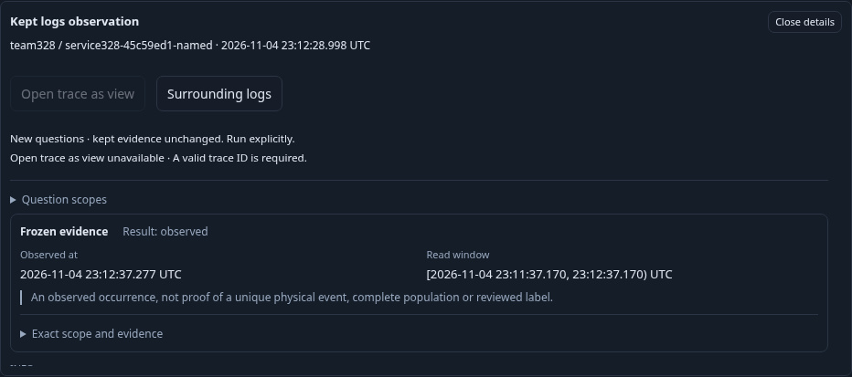
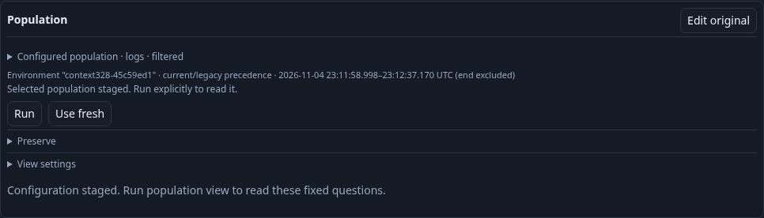
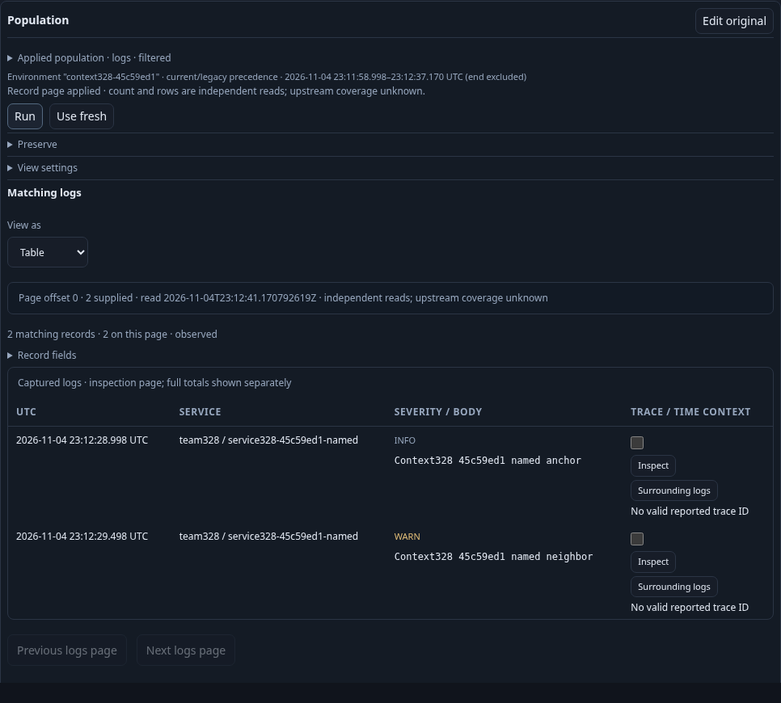

# Read surrounding logs from a kept observation

Executable task: `journeys/328-kept-log-context.spec.js`. The standard traffic-pausing wrapper runs the native task; `GOO_KEPT_CONTEXT_BOMBADIL=1` adds its separate actor. `GOO_KEPT_CONTEXT_ACTOR_ONLY=1` reuses the genuinely UI-kept receipt and fixed source window from a prior native run without creating another keep.

A kept log need not report a trace ID. Its inspector can stage a temporal surrounding-log question, clipped to that occurrence’s original read window and fixed radius. The question retains the typed environment policy, reported service and exact resource namespace state. Original body/severity filters are omitted so neighboring messages can appear; temporal proximity is not a causal relationship.

The bounded real OTel task keeps an anchor through Activity, reopens it through server discovery, stages without source or kept-content reads, explicitly runs and verifies exact anchor/neighbor membership. Same-service logs in another, missing or empty namespace act as distinct populations. A present-empty namespace case also offers a real trace continuation in the same inspector, checking that both actions retain their own intent and return owner.

Back restores the exact kept inspector and action focus without a reread or receipt mutation. Configuration GETs for recipes and retention capability, if caused by a new exploration mount, are reported separately. A pending read’s query-cancel control is distinct from source/custody reads. Three maintained frames and actual request/actor results will be added after acceptance; no seeded definitions or synthetic custody are used.

The final fresh native-plus-actor invocation passed in 60.633 seconds (63.450 seconds including the runner), with no page errors. Reported named and present-empty namespaces each returned exactly the original INFO anchor plus a WARN neighbor, including the effective environment's legacy-key resource. Missing/different namespaces, another service and a different environment were excluded. Each namespace case used its own service to prevent time-overlapping fixtures from contaminating the other's context. The empty namespace request explicitly contained `eq` with `value: ""`; the Go response omitted the zero-valued member while preserving its equality semantics. Both returned rows reported their own empty resource namespace.

The configured ±30-second window used the event timestamp, a one-millisecond exclusive upper increment and clipping to the original occurrence window. The visible Origin scope disclosure retained the original parent bounds rather than the clipped child bounds. Original Body/severity predicates were omitted, allowing the WARN neighbor. The empty-namespace inspector also staged and read a two-service trace through its independent trace action. Back retained the exact inspector node, originating action focus and immutable receipt JSON with zero API calls.

The main source ledger recorded ten HTTP attempts: environment-scope discovery twice, preview twice, two tails and four page reads. Three pages were adopted (two surrounding-log questions and one trace). The fourth completed underneath a held response, then Back aborted the browser read and issued exactly one matching original-query-ID cancel POST with `{}` and 202; its late response was ignored. The only custody writes were two explicit UI Keeps. Stage permitted only recipe/capability configuration GETs, counted separately; no telemetry, kept-content or saved-capture catalog read was caused by staging. Fixture ingestion and direct immutable-receipt checks are separate from browser counters; these HTTP totals are not physical source-statement totals.

An initial actor exposed a driver-only row-count mistake: generic table rows included each hidden record-detail row. The native final-phase guard rejected that exit-zero campaign at phase 3. The corrected driver requires a visible applied owner, exactly two actual record rows and a successful DTO containing count/rows of two. A separate actor-only diagnostic retry passed before the final fresh combined run. The final combined campaign exited zero after 30.782 seconds (30 seconds configured), with 289 snapshots across phases 0–6, one source/page read, zero kept-content/catalog reads after initial load, zero writes and no overflow. Native and actor counters remain separate.

This same fresh task regenerated the three shared trace-continuation frames referenced by the 327 storyboard from the trace-enabled present-empty-namespace kept log. It refreshed the shared two-action inspector, trace staging and applied two-service waterfall without inventing evidence or rerunning the historical 327 span-Keep matrix.

Two earlier attempts stopped before any browser: an unavailable Redis drain prerequisite, then a missing disposable artifact-symlink target. The wrapper restored services, and the expected target directory was recreated. Neither is a source/application test result. The independently reviewed diagnostic/final raw output, browser reports, temporary stores and owned binaries were removed. Compact joined main/campaign summaries and six current shared/context frames remain. The wrapper restored traffic.
