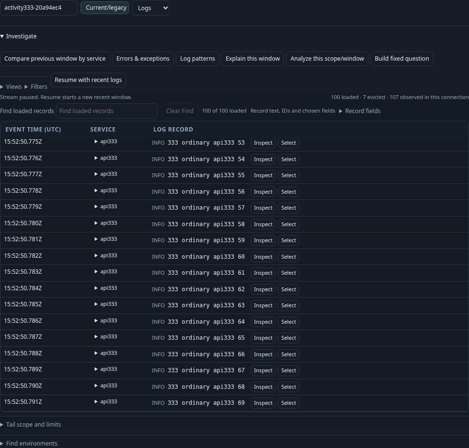
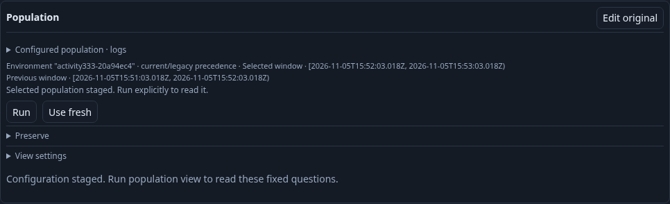
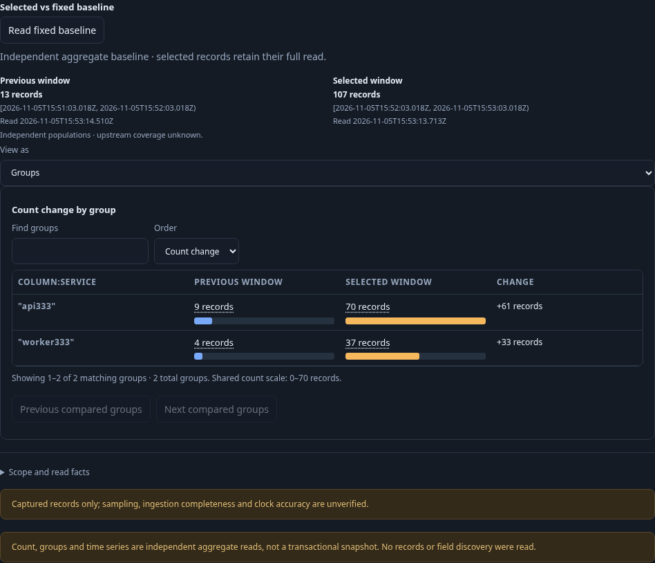

# Activity completed-window comparison — 333

Executable: [`333-activity-window-comparison.spec.js`](../../journeys/333-activity-window-comparison.spec.js). Actor: [`activity-window-comparison.ts`](../../verification/bombadil/activity-window-comparison.ts). Final native validation passes in 1.6 minutes against the rebuilt local app. Ordinary OTLP logs and spans each produce selected 107 / previous 13, independently of the held 100-row Activity page. The thirty second actor admits 320 snapshots through phases 0–8 with exact two-source-read/one-comparison budget, immutable observations and no horizontal overflow.

1. In Activity, adopt an effective named OTLP environment and Logs through the real scope preview. API records report the current environment key; worker records report the legacy key. Complete a recent read with 107 matching records, retain its bounded 100 rows, and Pause.
2. Open Investigate. Adding an unapplied filter condition makes **Compare previous window by service** unavailable. Remove the draft condition to restore the applied selector and stage the comparison. Staging reads no telemetry.
3. Inspect the fixed selected and adjacent equal-duration previous questions, both grouped by reported service name. Explicit Run independently reads the full selected population (107; page 100) and previous population (13), then compares supplied observations. No companion signal is read.
4. Switch Summary and Groups locally. Both views preserve Previous/Selected roles and exact UTC boundaries; descriptive counts do not assert completeness or a rate.
5. Save the composition through the ordinary UI. Return to the retained paused Activity rows without source IO. Reopen the saved configuration, observe staged state without a read, and Run explicitly.
6. Repeat the Activity action for ordinary OTLP spans. Capture the narrow comparison view without horizontal overflow.
7. The bounded actor reopens the genuinely saved log composition, runs once, checks the 107/13 population and exact adjacent scope, switches and searches supplied groups, then stages fresh windows without source IO. Its completion requires the expected extractor/model, phase eight, exact two-read/one-compare budget and verified DTOs.

Baseline observation against deployed 332: Analyze stages fixed records without a telemetry read; fixed Run issues one exploration read; Explore linked population requests a plan and reads both logs and spans. Customize logs, explicit service grouping and View settings → Add breakdown all stage locally. The next comparison disclosure was inside a newly collapsed ancestor and the baseline harness stopped on its hidden summary; baseline evidence does not claim a completed comparison Run. An attempted older Reusable-display path was inapplicable after Customize logs created a record-only composition. Actual compact ledger: `artifacts/activity333/baseline.json`.

Maintained running-app frames: `333-activity-comparison-entry.png`, `333-staged-previous-window.png`, `333-previous-service-groups.png`, `333-reopened-comparison.png`, and `333-comparison-narrow.png`, all generated from the running native app.

The reopened and narrow frames include the full bounded record page: [reopened composition](screenshots/333-reopened-comparison.png), [narrow composition](screenshots/333-comparison-narrow.png). The native viewport assertion independently checks that the 390px viewport has no horizontal overflow.

The actual browser ledger records zero new source requests for dirty refusal, comparison staging, local Summary/Groups switches, Save, paused Activity return and saved-view Open. Each explicit pair Run sends one exploration request and one aggregate request, followed by one supplied comparison. Environment scope discovery/preview are separate source operations before the staged-action budget; definitions, recipe and saved-view GETs are metadata. These are application requests, not physical SQL query counts. Source read timestamps are checked separately from fixed event-time question boundaries and the Activity completed read clock. No custody capture or document is written.
