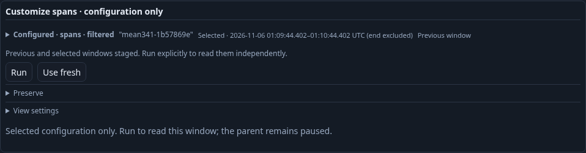
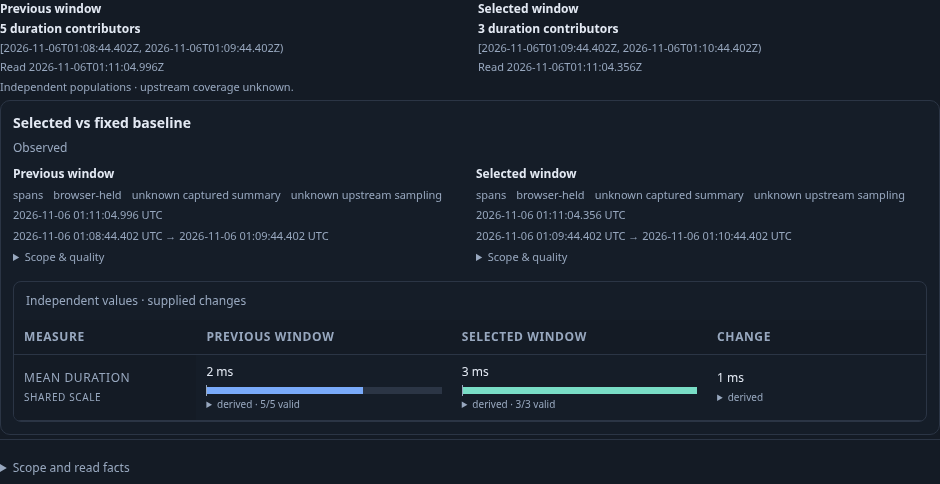
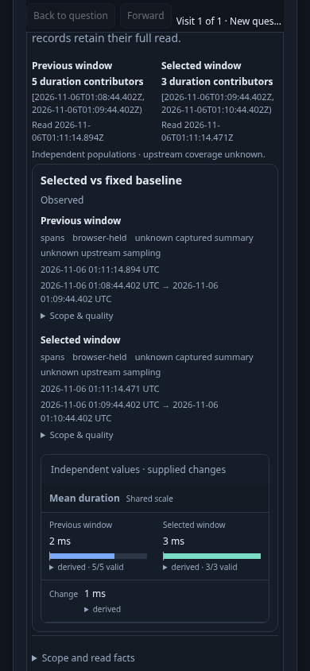
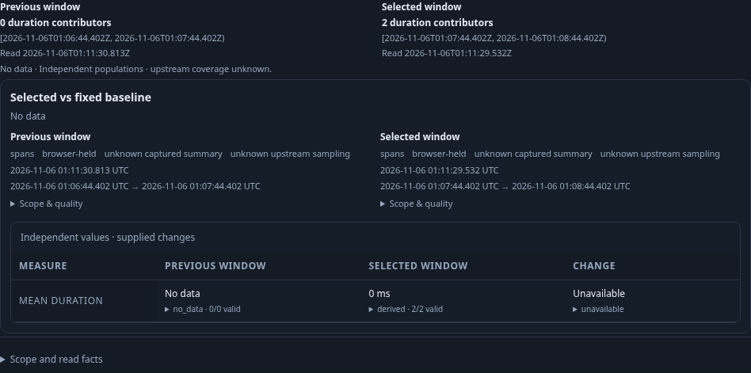

# Compare ordinary span mean duration across adjacent windows

Executable storyboard: [341-mean-comparison.spec.js](../../journeys/341-mean-comparison.spec.js).
Actor: [mean-comparison.ts](../../verification/bombadil/mean-comparison.ts).

This bounded journey starts from an ordinary linked span question, opens its
population, and uses Customize spans. It does not claim to test an Activity or
Services entry. Real OTLP spans are ingested through the collector. A checked
effective environment policy includes legacy environment reporting; the question
also retains service, resource namespace and tenant predicates.

1. In Measures, turn off the separately enabled Span status and errors profile;
   mean comparison supports the ordinary span-duration profile. Run, then open
   Chart settings and choose Mean duration. Compare windows → Compare
   previous window stages an adjacent equal-duration question. Staging performs
   no telemetry read; Run remains explicit.
2. Run reads selected spans and previous-window aggregates independently.
   Selected contributors have durations 0, 1 and 8 ms: sum 9 ms, count 3, mean
   3 ms. Previous contributors have durations 1, 1, 1, 1 and 6 ms: sum 10 ms,
   count 5, mean 2 ms. The exact difference is 1 ms. Unequal category weights
   make averaging category means incorrect. Only two selected inspection rows
   are returned; those rows do not determine the mean.
3. Inspect the summary's contributing counts and independent UTC read facts.
   Save and Export YAML preserve both whole questions and the mean display
   declaration. They retain no observations. Open stages the saved question;
   another explicit Run obtains new independent observations.
4. Use the existing selected aggregate group gesture to stage supporting
   records, then Run. Its exact selected window, checked environment and
   original predicates remain. Back restores the retained parent comparison
   without a read. Clear selection must work after Back, also without a read;
   the restored selection and fixed-window controls receive fresh interaction
   owners while the comparison observations stay retained.
   This is selected-population support; baseline summary-side
   record navigation is outside this cut.
5. Stage an earlier window containing two measured zero-duration spans, against
   an empty preceding window. Zero with contributors is a known 0 ms mean;
   no contributors means No data and an unavailable difference.
6. Cancel a genuinely acquired response held in transit. Releasing the late
   response cannot restore the retired comparison.

`GOO_MEAN_COMPARISON_BOMBADIL=1` runs a separate campaign from the genuinely
UI-saved declaration. It independently verifies the whole sum/count means,
exact difference, scopes and read clocks, inspects facts locally, then stages a
fresh window. The source budget is two requests plus one source-free comparison;
there are no capture writes. Driver captures are not assumed to prove terminal
appearance; maintained frames come from Playwright viewports.

Run with the reviewed binary:

```sh
GOO_GENERIC_BINARY=/tmp/goo-341-reviewed-goo \
GOO_MEAN_COMPARISON_BOMBADIL=1 \
bash scripts/run_journeys.sh journeys/341-mean-comparison.spec.js
```









The final reviewed build passes this complete journey in 2.1 minutes (2.2 minutes
including the runner), with no browser errors or seeded definitions. All three
pair Runs use independent selected/full and baseline/aggregate reads: 3/5
contributors with means 3/2 ms twice, then 2/0 contributors with a known zero mean
versus No data. The selected supporting question returns one real record and
retains the exact original scope. Back restores the held comparison, focuses the
renewed opener, and allows Clear selection and subsequent fixed-window staging
without source reads. Cancel retires a genuinely acquired response held in
transit; releasing it publishes no stale pair.

The existing population lifecycle Quint model accepts the observed 15-event,
seven-source-read projection in 29.79 seconds, with zero skips. An independent
Go `math/big` oracle checks the actual sum/count means, exact changes, whole
queries and per-side source receipts. Six controls reject corrupted sums,
predicates, Back reads, coherence, contributor counts and an unfinished prefix.
The model projection excludes four setup reads and the one-request cancellation
supplement; the main page totals twelve source HTTP requests. Those are HTTP
counts, not physical SQL counts. A separate earlier observed fixture replay
passes in 28.01 seconds. The helper allows a bounded 120 seconds for cold
compilation plus semantic checking.

The 35-second Bombadil campaign passes with 421 snapshots across phases 0–5,
two source requests, one source-free comparison, zero capture writes, immutable
observations and no horizontal overflow. Its terminal screenshot matches the
independently observed phase-5 Configured/fresh-staged state. The image audit has
three unique JPEG hashes, with 413 captures repeating that terminal state; this
campaign does not exhibit the stale-loading terminal capture seen in some older
campaigns. The four maintained Playwright frames above supply the applied and
zero/no-data visual record. Genuine lab telemetry, stored views, volumes and the
51 pre-existing stale pending stream entries remain intact.

Reviewed raw campaign images/trace, temporary stores and the copied report are
removed. Compact main/campaign receipts, the final executable model input and
passing log, runtime receipt, visual audit and one terminal sample remain.
