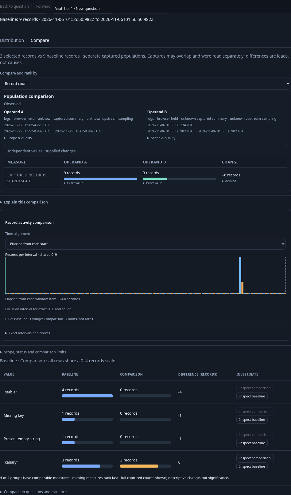
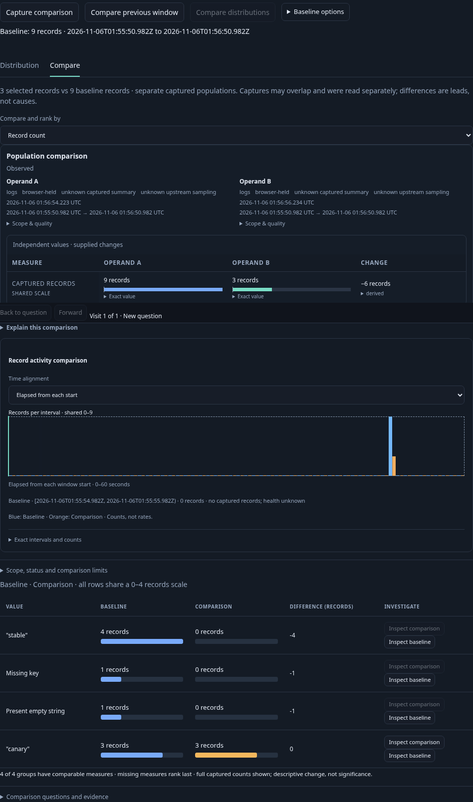
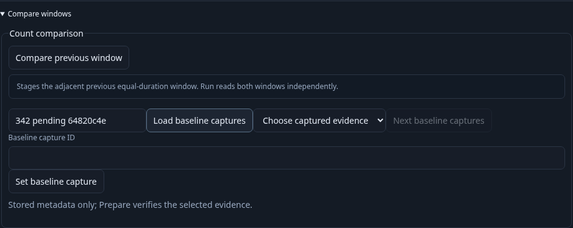
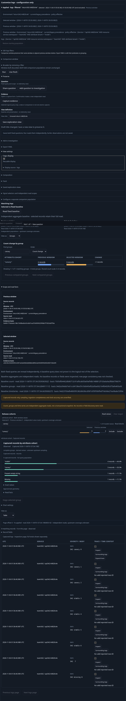
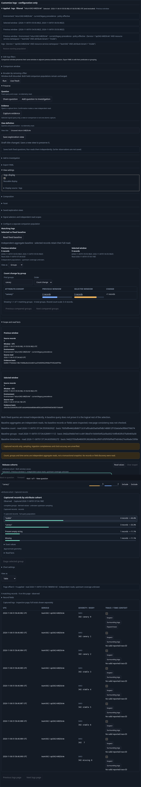

# Return to a retained investigation

Executable journey: [342-parent-return.spec.js](../../journeys/342-parent-return.spec.js).
Actor: [parent-return.ts](../../verification/bombadil/parent-return.ts).

One real OTLP fixture supplies nine current logs, five previous logs and a
reported trace with two cross-service spans. Questions retain the checked
effective environment policy, resource namespace, service and tenant predicates.
No definitions are seeded through an API.

1. In the ordinary linked population, pin the nine-log distribution and filter
   to three canary logs. Open a reported trace as a records view, then Back.
   The original comparison element, baseline aggregates and read clocks must
   remain. A retired group callback must change neither the active question nor
   local state; the current group action must work and explicitly read its new
   question.
2. Open a fresh route visit and Customize logs. Start a real baseline-catalogue
   metadata request, hold its response, and open/return from the same selected
   population twice. Keep the held chart, search title and disclosure state.
   Releasing the departed response cannot replace current metadata or leave the
   new controls pending. Old callbacks refuse; a fresh explicit metadata lookup
   remains usable. Back and local gestures read no telemetry.
3. Compare a selected cohort with the rest. While its real baseline response is
   held, use the admitted expanded-window child, return and release the response.
   It must not publish a late comparison. A new explicit Run rereads both sides.
   After another records child returns, the current Include comparison in view
   action must stage the fixed comparison; its retired callback must refuse.
4. Add a categorical facet and an adjacent previous-window comparison. Unapplied
   facet/window definition edits keep the existing clean-action guard: a child
   action stays unavailable until explicit discard. These blocked drafts do not
   traverse a real child. Permitted local Find values, unsaved view title and
   exact open/closed disclosures do traverse a records child. Back must retain
   the independent comparison/facet receipts and focus the current record opener.
5. The old fresh-window callback cannot stage a question after return. The
   current control must stage one without a source read. A genuine UI-saved
   definition supplies the optional separate actor's entry.

The actor focuses on the same ownership boundary: explicit 9/5 pair Run and
independent facet values, two staged group children and Back, a retired callback
that cannot change local state, and a working current local Find. Its budget is
four source requests, one source-free comparison and no capture writes.

```sh
GOO_GENERIC_BINARY=/tmp/goo-342-reviewed-goo \
GOO_PARENT_RETURN_BOMBADIL=1 \
bash scripts/run_journeys.sh journeys/342-parent-return.spec.js
```











The final reviewed build passes the complete native/model/actor journey in
2.2 minutes, with no browser errors or seeded definitions. The main page issues
30 source HTTP requests; three initial reads precede the model projection.
The projected 27 reads cover explicit filtering, child reads, independent
comparison operands and facet values. Back, retired callbacks, local inspection,
discard and staging add no replacement telemetry reads. These are HTTP budgets,
not physical SQL counts or a performance benchmark.

All seven native returns preserve the required raw question/display state and
receipts. Each restored focus target is connected, its center lies in the viewport,
and `elementFromPoint` confirms that center is unobstructed. The nonauthored
comparison keeps the exact existing comparison node and supplied snapshot;
its fresh group action reads explicitly while retaining the original baseline.
The genuine held catalogue and rest responses cannot publish after departure.
The latter leaves an explicit Run available, which rereads both operands before
the selected/rest promotion is exercised.

The existing population lifecycle Quint model passes the observed 57-event
ledger in 6.67 seconds, with zero skips. Sixteen distinct facts compare actual
before/after inputs, disclosures, supplied chart/comparison/facet receipts and
independently captured source/comparison/metadata counters. Eight negative
controls reject extra reads, altered local state, Back effects, late metadata,
an unfinished prefix, changed receipt authority and a changed raw draft.

The 35-second actor passes with 548 snapshots across phases 0–8, two staged-child
returns, four source requests, one source-free comparison and zero capture writes.
Its old callback changes neither local state nor acquisition; the current second
child and subsequent local Find work. Observations stay immutable and horizontal
overflow is absent. The terminal JPEG matches its independently checked applied
state: Groups, Find `stable`, previous 3 and selected 4. The audit has five unique
hashes; 537 images repeat that settled terminal state. This campaign does not show
a stale-loading terminal capture. The Playwright frames above show the broader
before/after state, rather than relying on driver screenshots alone.

The existing 341 mean-duration journey also passes against this same reviewed
binary in 34.1 seconds (36.6 seconds including the runner), including its
13.45-second observed replay. Its three pairs and supporting-record Back remain
valid. This bounded regression does not run another actor campaign.

Reviewed raw driver images/trace, temporary stores and copied report are removed.
Compact main/campaign receipts, the final model input and passing log, runtime
receipt, image audit and one terminal sample remain. Genuine lab telemetry,
stored views, volumes and the 51 pre-existing stale pending entries are retained.
