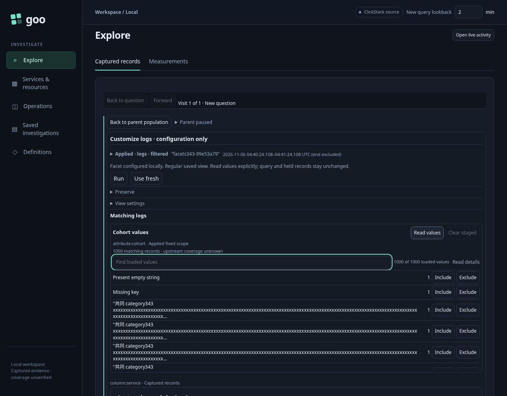
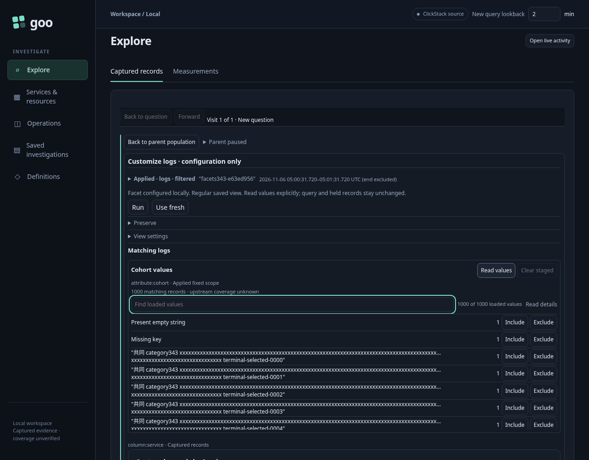
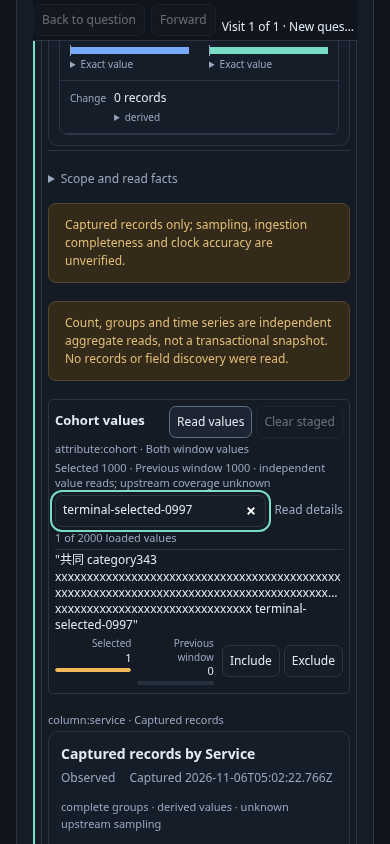

# Find an exact value in a large facet

Live journey: [343-large-facets.spec.js](../../journeys/343-large-facets.spec.js).
Supplied diagnostic: [343-facet-benchmark.spec.js](../../journeys/343-facet-benchmark.spec.js).

The live fixture contains 1,000 selected logs and 1,000 previous-window logs.
Selected categories include a missing key, an empty string and 998 distinct long
strings; the previous window supplies 1,000 different long strings. The paired
union therefore has 2,000 exact categories. Every nonempty fixture value is
384 UTF-8 bytes. Their first 157 characters are identical; the unique terminal
suffix occurs beyond the old 160-character preview.

The ordinary count chart groups by service, while the facet groups by the cohort
attribute. That keeps unrelated chart/group-comparison DOM size constant. Each
question retains the effective environment policy, service, resource namespace
and tenant predicate. This is real OTLP ingestion and normal UI authoring, without
seeded view definitions or substituted source responses.

1. Customize logs, add the cohort facet and explicitly read its 1,000 values.
2. At desktop and narrow widths, repeatedly Find no matches, a unique terminal
   suffix, broad selected values, missing, empty and all loaded values. Exact
   counts, full read receipts, focus and caret must remain stable without reads.
3. Stage the adjacent previous window and Run. Explicit Read values now acquires
   two independent 1,000-category populations and displays their 2,000-value union.
   Repeat the probes, including previous-only suffixes and categories.
4. Use Tab to reach the loaded result's Include action. Final acceptance requires
   a visible preview that distinguishes its suffix, while title, accessible name, key and intent retain the
   complete literal. Missing/empty and known partition absence remain distinct.
5. Include a previous-only long value, Filter both windows, then Save its staged
   configuration. Both queries must contain the exact 384-byte value, never the
   preview. Back retains the loaded parent and Find without replacement reads.

Viewport screenshots are bounded to the actual screen; no full-page image of
2,000 rows is created. The measurement separates source-read wall time from
component render work, DOM size and local input work. Input-to-two-animation-frame
time represents a paint opportunity, not a compositor-presentation timestamp or
a portable latency guarantee. Stable direct input selectors keep automation's
accessibility-tree lookup cost outside the intended component measurement.

The supplied diagnostic separately mounts the real passive component with 1,000
or 2,000 supplied categories, at 384 or 2,048 bytes per nonempty label, on desktop
and narrow viewports. Its synthetic input and data are explicitly identified;
it does not replace the live source journey. It performs zero API requests.

```sh
GOO_FACET_PHASE=final bash scripts/run_journeys.sh journeys/343-facet-benchmark.spec.js
GOO_GENERIC_BINARY=/tmp/goo-343-reviewed-goo GOO_LARGE_FACET_PHASE=final \
  bash scripts/run_journeys.sh journeys/343-large-facets.spec.js
```

The immutable b7adf8d baseline passes the live journey in 4.1 minutes
(4.2 including the runner). The live source budget is twelve HTTP requests;
all local probes, literal staging/Save and Back add no source reads. Its comparison
request is 1,574 bytes because its count grouping is one service. A different
comparison containing 2,000 long aggregate-group labels can reach the existing
1 MiB comparison-body limit; this fixture does not establish support beyond that
wire budget or change it.

An initial supplied diagnostic mounted real components on a 404 document without
their CSS. Its timing/layout measurements are invalid and are retained only as
an explicitly labelled diagnostic. Its structural DOM counts and two-refresh
observation remain valid. A styled replacement must use `/ui-components`, assert
HTTP 200, and verify the component stylesheet before measurement.
Baseline DOM size is 6,015 elements for 1,000 categories and 32,025 for
the paired union; the live journey independently measures the same sizes.
For the live paired facet, final ready-render work takes 1,184.6 ms desktop and
1,114.3 ms narrow; the two-frame opportunities take 1,566.5 and 1,404.8 ms.
The baseline live probe's capture-listener microtask ran before the target input
handler, so its near-zero synchronous-input/refresh fields are invalid and excluded
from comparisons. Its render, DOM, focus, receipt and two-frame measurements remain
valid; the styled supplied diagnostic separately measures synchronous input work.
The corrected final probe wraps the actual installed input handler. Both live
phases use the same traced Playwright profile; its per-action DOM snapshots can
contribute to the integration paint-opportunity measurement. Synchronous input
comparisons below use the supplied diagnostic's consistent inner-browser method.

The corrected styled baseline passes in 33.2 seconds (36.7 with the runner), and
the final eight-case diagnostic passes in 27.1 seconds (28.9 with the runner).
Both require `/ui-components` to return HTTP 200, verify its loaded stylesheet and
actual grid/font styles, and use the same page-load/import setup. API calls remain
zero. Every final input performs one refresh rather than two, with row/action
identity and complete-data search semantics preserved.

Observed median synchronous input work in the styled supplied diagnostic:

| Categories | Label bytes | Desktop, baseline → final | Narrow, baseline → final |
| --- | --- | --- | --- |
| 1,000 | 384 | 6.75 → 2.50 ms | 4.55 → 3.45 ms |
| 2,000 | 384 | 18.20 → 7.55 ms | 13.40 → 9.20 ms |
| 1,000 | 2,048 | 7.80 → 4.80 ms | 8.20 → 7.10 ms |
| 2,000 | 2,048 | 20.30 → 8.85 ms | 16.95 → 8.75 ms |

The final live journey passes in 4.0 minutes, with twelve source requests, no
browser errors, all 92 repeated input samples focused with the correct caret,
one refresh per sample, and unchanged source receipts. Desktop/narrow identity
and exact 384-byte predicate admission pass. The final comparison request is
1,573 bytes; independent read-clock serialization can vary its length slightly.

The large DOM remains: 6,015/32,025 elements. Mount and frame times do not improve
uniformly: the live paired narrow ready render takes 1,296.9 ms versus 1,114.3 ms
in the baseline. This cut removes redundant filtering and makes long values
distinguishable; it does not solve large-list mount cost or introduce paging or
virtualization. The recorded measurements support a later explicit DOM/rendering
budget decision, rather than a universal latency claim.







The existing 338 paired-facet regression passes in 2.8 minutes, including observed
model replay in 15.41 seconds with zero skips. Logs and spans retain 107/13 →
0/2 → 32/8 → 27/4, reopen at 27/4, and return three exact supporting records.
Failed-side retry, unknown rather than zero, Find, retained return and retired
controls remain valid. The 35-second actor campaign exits successfully after
42.028 seconds wall time, with 91 snapshots across phases 0–7, six source requests
including two value lookups, two comparisons, four verified transitions, no
writes, immutable parent data and no overflow. Its terminal JPEG matches the
applied 0/2 child with values explicitly unloaded; no stale-loading claim is made.
No new lifecycle model or actor is introduced for this local display change.

Reviewed raw reports, temporary stores and driver bulk are removed after review.
Styled baseline/final measurements, actual source inputs/receipts, the labelled
invalid diagnostic summary, current frames and the reused model/campaign evidence
remain. Genuine lab telemetry, stored views, volumes and the 51 pre-existing stale
pending stream entries are preserved.
