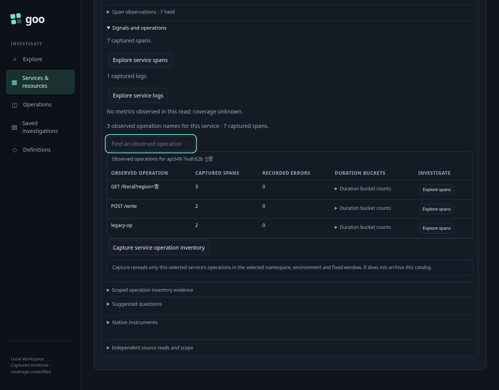
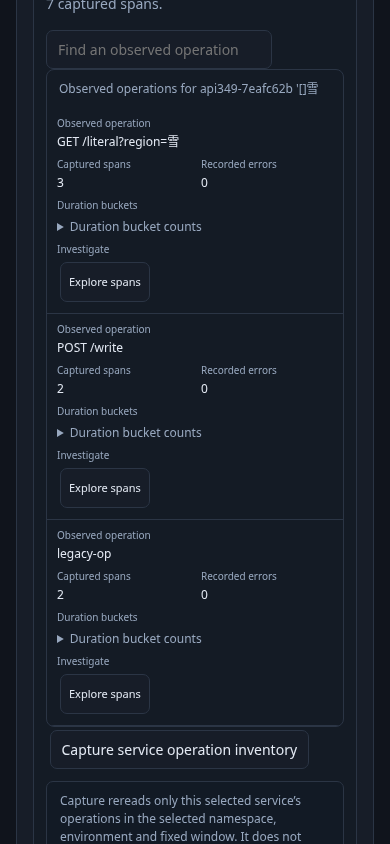
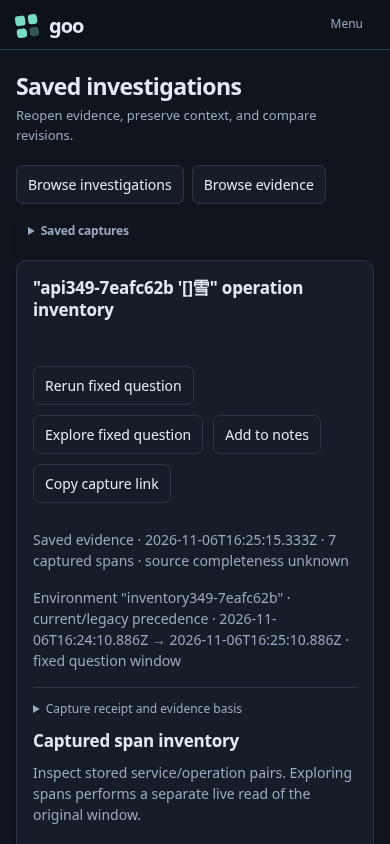

# Selected-service operation inventory

349 native passed: **9.2 seconds** for the test, **11.6 seconds** for the runner. It used the reviewed Go binary, genuine OTLP ingestion and ClickHouse, with no seeded UI definitions or substituted successful telemetry.

The fixture supplies 50 unrelated services with 21 operation names each, plus a literal service name containing an apostrophe, brackets and Unicode. All 1,050 unrelated pairs share the selected environment and named namespace. This exceeds the whole-environment inventory budget without exceeding the distinct-service discovery budget.

An independent ClickHouse query checks the target's **seven effective-environment spans across three operation names**. Current-key-only scope selects **five spans across two operations**. Namespace collisions separately select missing namespace **2** and present empty namespace **3**. A conflicting current environment does not fall back to its legacy environment key. The unscoped inventory refuses the 1,001st pair with a typed budget refusal; the selected-service inventory succeeds with its service predicate before grouping and the sentinel limit. An absent service returns `no_data`, not a healthy population. Actual OTLP ingestion retained an empty service name; exact `service: ""` returned its single span.

The user adopts the observed named environment through **Find environments → Read environment scopes → Preview named logs → Stage in Activity**, then starts and pauses Activity. This creates an explicit effective policy. Opening the observed service stages without reading. Reading the overview requests the exact service inventory while Discovery and dashboard scope retain their existing contracts. Local operation search reads nothing. Opening `GET /literal?region=雪` adds its exact name to the service/namespace predicate, retains the typed environment and fixed row window, and returns **3** spans. Back returns to the paused Activity rows with no source read and a connected, visible, unobstructed focused control.

Capture explicitly rereads only that selected service inventory, stores **7** spans, and retains the admitted source question. Reopening its stored receipt performs no telemetry read and leaves the stored file byte-for-byte unchanged. A real upstream 503 separately exercises the sanitized typed unavailable boundary.

The browser recorded **16 source requests / 31 API requests**. The scoped proxy recorded **52 SQL requests**, including real API ingestion preflights; these are separate accounting scopes. Browser errors: **0**. Compact receipts retain complete questions, returned rows, clocks, source plans, independent SQL and capture contents.

The narrow table uses the shared stacked layout: its caption is `display: block`, **296px** wide like the table, with its actual bounds **47–343px** inside a **390px** viewport. Its full literal service name remains readable.

The first native attempt exposed an untyped inventory sentinel error; production now returns the truthful typed budget refusal. Subsequent harness corrections used the existing typed-adoption gesture rather than assuming a scalar environment input emitted a selector, waited for the exact new OTLP log to become queryable, removed an invalid top-level namespace from a record-query preflight, and compared repeated wire requests separately from admitted source echoes. Capture assertions use the admitted inventory question. The successful run retained every scope and count assertion.

The existing **316 Activity/service handoff** regression passed in **37.6s** (**39.3s** runner). Its 25s Bombadil campaign produced **446** snapshots and positively reached phase 4 with 13 paused rows, returned scope, `passive` and `pausedExact` true, and exactly one source/API attempt: the explicit tail. The actual final image shows that paused Activity state. Its counters are separate from the main journey.

The historical **31 inventory** regression also passed in **34.5s** (**36.6s** runner) on the final build. The selected service now truthfully contains **113** spans in one service/operation row, while the global discovery fixture still contains **116** spans across two services. Its independent SQL applies the same exact service selector. All four maintained 31 frames were regenerated. The existing reusable-package disclosure is explicitly opened before its real button; the package build, preview and scope assertions remain unchanged. The required existing Quint checker passed in **5.82s**, with four observed steps and all three negative controls, **zero skips**. The first historical run stopped at the collapsed package disclosure; it did not indicate a product failure.

No new model was introduced for the optional inventory selector. Compact artifacts retain actual source/capture receipts, failed-attempt provenance, model input and verdicts, the compressed Bombadil trace, campaign summary, visual audit and one genuine terminal sample. Reviewed raw actor screenshot bulk was removed; genuine lab telemetry and stores were preserved.
