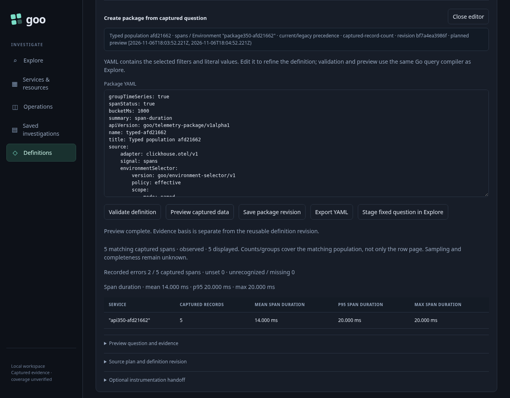
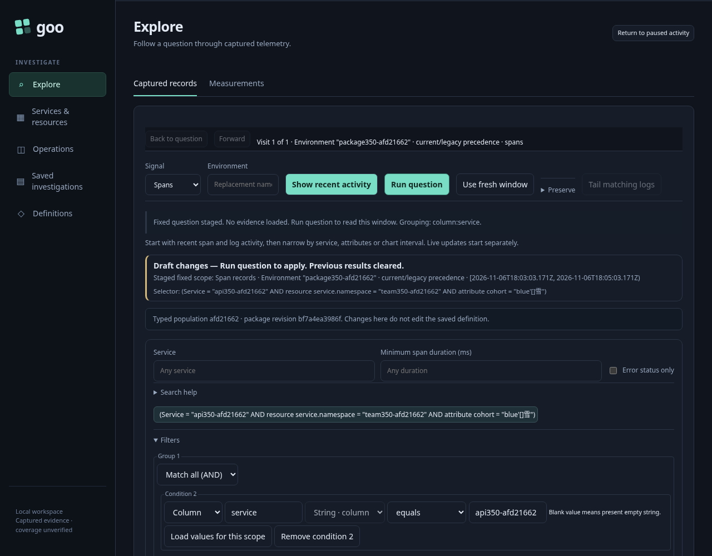
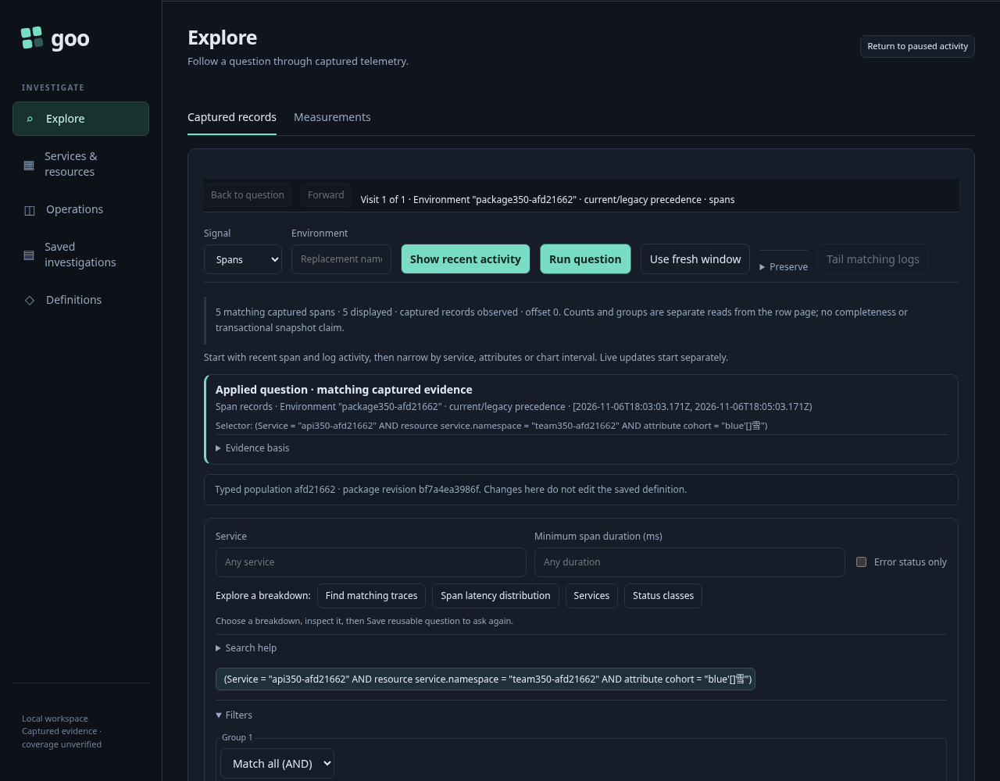
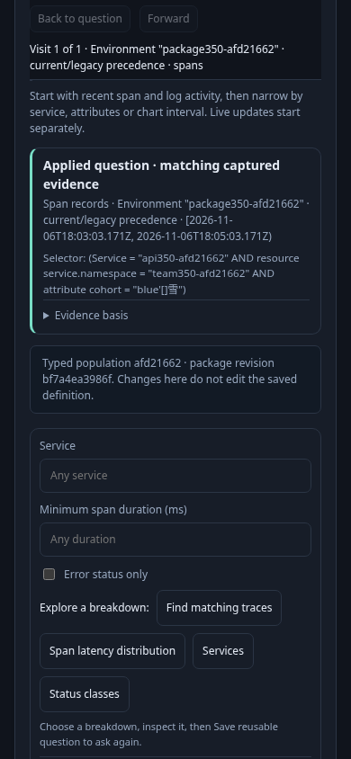

# Typed scopes in reusable record definitions

The final reviewed 350 journey passed in **78.532s** (**81.356s** runner), including its required observed Quint check (**21.95s**, zero skips). The first semantic run also passed; final frames include the neutral package-origin label and the stronger ready-control ABA proof.

This journey uses genuine OTLP spans and ClickHouse. Its primary population contains three current-key and two legacy-only spans in one named effective environment, with a literal attribute value containing punctuation and Unicode. Four conflicting-current spans must remain excluded. Separate empty-environment and unreported-environment populations contain three and two spans. The namespace, service, literal predicate and source profile travel together.

The user discovers and previews the named environment, stages it in Activity, adds exact service/namespace/attribute filters, starts and pauses spans, and analyzes the completed window. Through **Edit question → Measures and chart**, the user enables duration, recorded status, a one-second chart and a service breakdown. A completed record query supplies the package through the existing **Reusable question package** disclosure.

Building and validating JSON/YAML plans perform no telemetry reads. **Preview** explicitly reads the original fixed question. A second genuine preview response is held after the source completes; editing the YAML withdraws that intent, and the late response must not publish. Invalid selector unions must fail before source access.

Saving stores an immutable configuration revision. Staging the original draft keeps its original fixed preview window and reads nothing; **Run** then reads that exact staged question. Reopening the saved configuration discards unsaved edits without modifying the stored bytes. Staging from saved configuration resolves a new relative-lookback window through a metadata-only plan; its later explicit Run must use those returned fixed bounds unchanged. A definition revision does not include preview timestamps.

JSON and YAML compiler checks cover current-only named, effective named, effective empty and effective unreported selectors. Their explicit source reads check the actual 3/5/3/2 populations. Null, mixed and absent source selectors are rejected without telemetry access.

The native ledger reuses the existing `telemetry_packages` Quint lifecycle (`draft`, `save`, `edit`, `reopen`, `apply`). Here `apply` means staging, with no hidden source read. An independent Go admission check validates full questions, profile preservation, selector identity, JSON/YAML equality, immutable revisions and stored bytes, fixed and relative clocks, genuine source counts, withdrawal and operation-level source budgets. The model covers the lifecycle; it is not presented as a model of the complete source protocol. Negative controls mutate policy, selector, predicate, profile, window, stored definition, staging I/O and late output.

The actual results and current desktop/narrow frames below come from the running application; no successful telemetry or UI response is fabricated.

The shared test driver for record-package staging waits for the visible current staged question and verifies that no POST other than a pure package plan occurred. Existing numeric, histogram, grouped-series, discovery, workflow, imported-package and basic-library journeys now use that gesture before their explicit Run; their source/profile/model oracles remain unchanged. The existing discovery Bombadil driver separates staging from Run and retains every definition field except preview clocks and paging in its reusable-definition projection. Its staged intent comes from observing the real flat package event, rather than constructing a substitute query.

A separate final parity scene captures the already applied typed result through the real capture API, then creates a package from the actual saved record page. Capture is an explicit source reread; drafting and building the package perform no source access. This secondary oracle checks the stored page's complete profile and fixed bounds and unchanged capture bytes. It is recorded separately from the five-action package model and its primary source-budget facts.

The actual population checks returned **3 current-only named / 5 effective named / 3 effective empty / 2 effective unreported** spans. The primary full profile retained **70,000,000 ns summed duration**, two recorded errors, a service breakdown and a one-second split chart. The original preview window is 60 seconds; saved reuse resolves the configured 120-second lookback with a later end clock, which intentionally also extends the start backwards. Both explicit Runs used their respective staged bounds unchanged.

Drafting, JSON/YAML validation, saving, editing, reopening and staging read no telemetry. Original fixed staging performed **zero metadata plans**; fresh saved staging performed **one metadata plan**. The retired callback was invoked again after identical YAML was revalidated and the current Preview button was enabled: the old function changed neither local state nor source I/O. The completed withdrawn source response likewise published nothing.

The browser recorded **33 API requests**: nine in the primary source class (environment discovery, preview, tail and record queries) and one separate explicit capture reread. The scoped proxy recorded **90 SQL requests**, including real ingestion preflights, the separate API selector matrix and the focused actor; this is a different accounting scope. The secondary capture reread used six SQL operations, retained five spans and its full profile, and creating/building a package from its saved page added **zero source or SQL reads**. Both stored definition and capture files remained byte-for-byte unchanged. Browser errors: **0**.

The existing five-action package lifecycle accepted the actual ledger and rejected all **nine** independently mutated negative controls. It covers lifecycle order; the independent admission check covers the source and definition semantics described above.

The grouped-series regression passed in **37.5s** (**40.0s** runner), including its required existing Quint check (**19.15s**, zero skips). Its 124-record, four-series, 2.5-billion-nanosecond duration and immutable capture oracles remain unchanged; all three 43 frames were refreshed. This regression preceded the text-only neutral package-origin adjustment, which the final 350 run validates.

The final bounded historical Discovery regression stopped after **26.9s** at its surrounding-context request gate: the old route predicate did not hold the read, so the UI already reported 108 captured logs while the test expected Reading. Its package branch, model and actor were not reached. Entry, component and keyboard assertions have been maintained for the current UI, but this older full regression is **not claimed green**. No unrelated legacy behavior was restored.

The focused **30-second package-scope Bombadil campaign passed** over the actual saved typed capture created by the secondary scene. It produced **455** snapshots and positively observed all phases through `complete`, rather than treating exit code zero or a conforming prefix as completion. Its real fetch observer delegated the original promise, arguments and response unchanged. The actor observed exactly **one metadata build** and **two source reads**: Preview and Run. Drafting, building and staging added no source read; fixed staging added no metadata plan. It retained the entire captured selector, predicate, measures, grouped chart and fixed bounds through the actual flat package event. The completed run independently matched **5** spans, **70,000,000 ns** summed duration and **2** recorded errors. There were no save, export, weave or other forbidden writes, and the capture bytes remained unchanged. The actor is separate from the five-action Quint ledger.

The final positive completion also requires actual applied phase, an enabled Run control, a viewport-visible Applied heading and no visible Reading marker. The complete action scrolls the real heading into view and waits two animation frames.

Actor visual audit: the latest JPEG still shows the prior staged/draft view despite those independently observed visible DOM conditions. There were **455 JPEGs**, six distinct image hashes and 445 copies of the dominant frame. It is retained as a **stale diagnostic**, not proof of settled visual state. The four current Playwright frames above provide accepted visual documentation. This recording limitation does not change the positive action/response/visible-DOM verdict.
