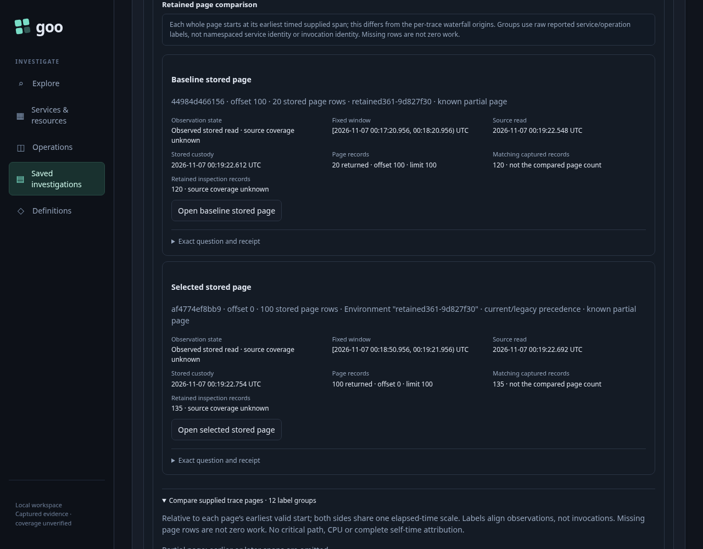
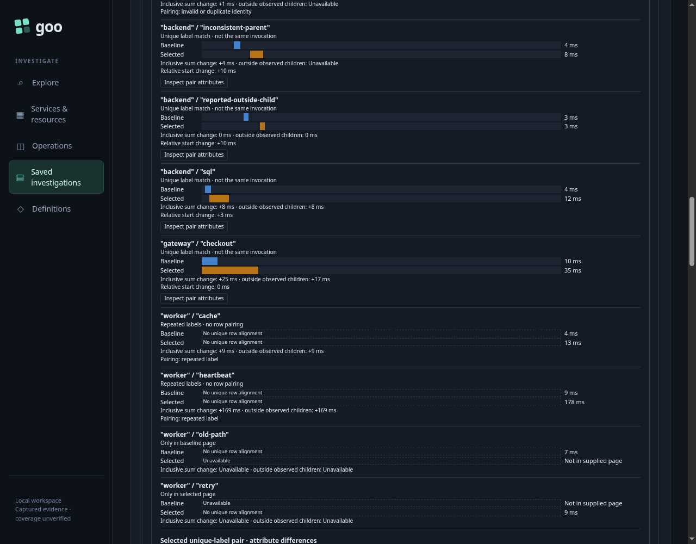
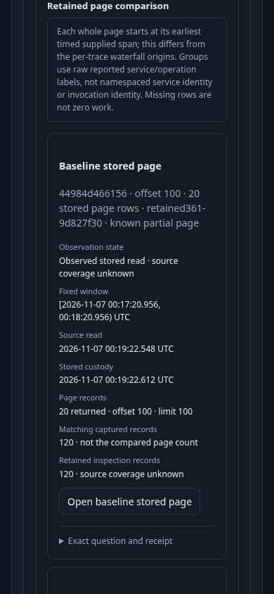
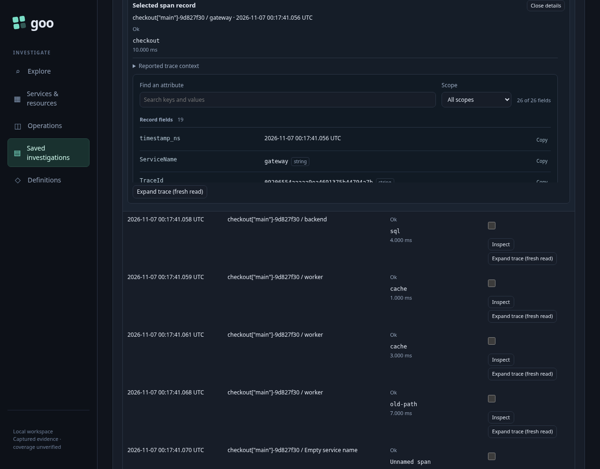

# 361 — Compare retained span pages

Two immutable captured pages can be pinned and compared without rereading telemetry. Each operand is its entire current stored page. Labels align observations; they do not establish invocation identity or reconstruct a complete trace.

The genuine OTLP fixture has a scalar reference capture with 120 records and an effective-policy capture with 135. The reference operand is its final 20 records at offset 100, reached with the server's opaque cursor. The selected operand is its first 100 records. Both have known omitted records. Their original questions, independent fixed windows, receipts, source-read clocks, custody clocks and page limits remain visible.

Checkout changes from 10 to 35 ms; its time outside its reported direct child changes by 17 ms. SQL changes from 4 to 12 ms. Both sides use one elapsed-time scale with independent page origins. Repeated cache labels remain ambiguous, one-sided work remains absent rather than zero, and duplicate identities withhold row pairing. A reported child extending outside its parent's interval leaves that parent's outside subtotal unavailable.

The timing image is the actual focused actor's terminal screenshot, independently reviewed at original resolution. The three PNG images are genuine Playwright frames. Provenance currently precedes the plot and can push timing below the first viewport; this remains presentation debt rather than an above-the-fold claim.

Opening either operand uses the exact original capture ID and opaque cursor, then the existing local occurrence inspector. It does not reread telemetry. Returning keeps the same comparison element and identical public data and provenance. Opening another candidate page does not silently compare it. Explicit replacement and clearing retire the previous pair's controls, including after the same logical pair is recreated.

The canonical first run passes in **70.213 seconds** (runner **72.390 seconds**). All 18 recorded boundaries make zero telemetry API calls and zero upstream SQL attempts. Ten capture-page GETs are counted separately among 26 browser API calls; seven upstream attempts belong to capture setup and the deliberate refusal probe. Every telemetry request is refused after setup. Both stored capture files remain byte-for-byte unchanged.

The required observed Go/Quint check passes in **15.22 seconds**, zero skips: actual public comparison data matches normative Go comparison and an independent timing/group oracle; the actual 18-step lifecycle is accepted and six corrupted receipts, cursors, operands, clocks, read budgets or stored bytes are rejected. Generated boundary tests separately cover mixed traces and malformed timing rather than claiming those are valid OTLP observations.

The focused actor passes in **35.689 seconds**, with **574 snapshots across 12 stages** and positive visible completion. It verifies the original 20/100 rows, full questions and clocks, unchanged comparison DOM/data, exact opaque-cursor navigation, pair attributes and original stored-row inspection. Its completed gateway bars are visible; it makes zero telemetry calls and writes, with three capture-page and three catalog GETs. Compact raw receipts, actual capture files, model inputs/results, compressed actor trace and the reviewed terminal image remain in `artifacts/retained-comparison361`. The lab and its 51 pre-existing stale pending entries are preserved.

Run with the reviewed binary, `GOO_RETAINED_PAGE_BOMBADIL=1` and `GOO_VERIFY_QUINT=1` through `npm run test:journeys -- journeys/361-retained-page-comparison.spec.js`.
