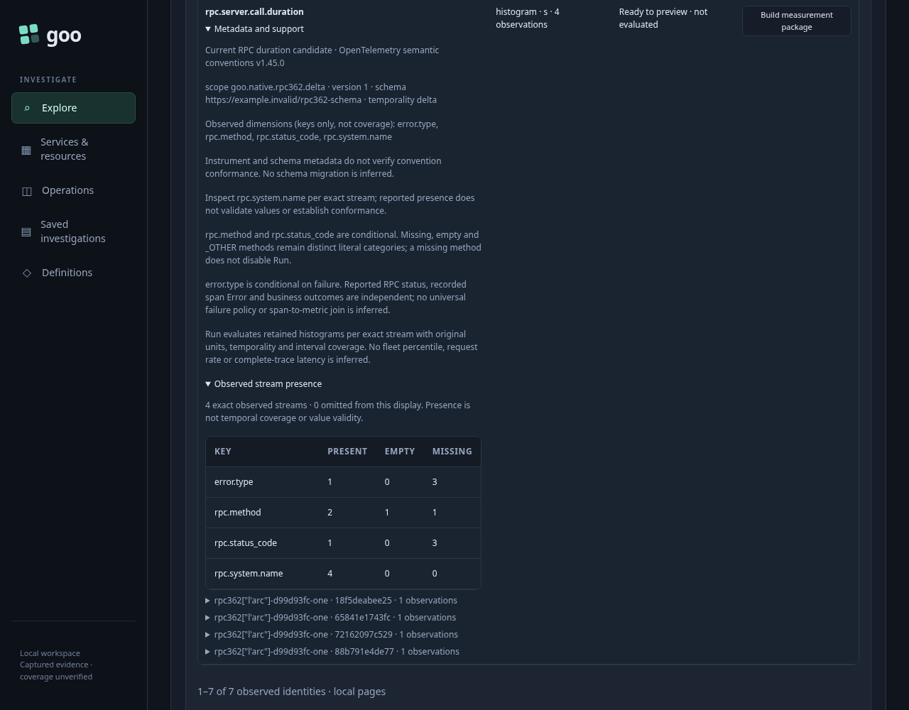
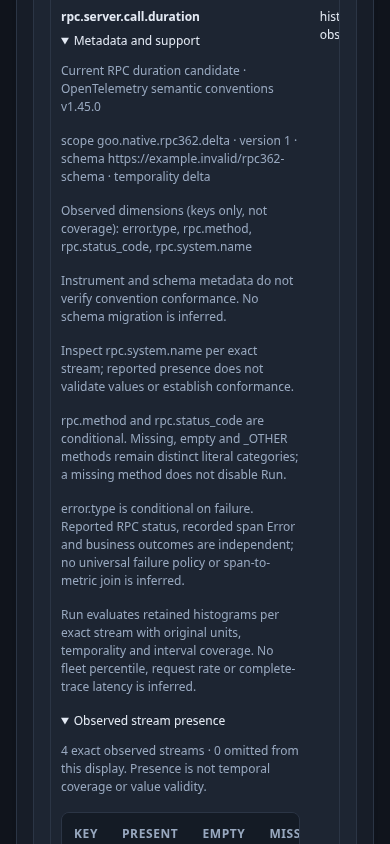
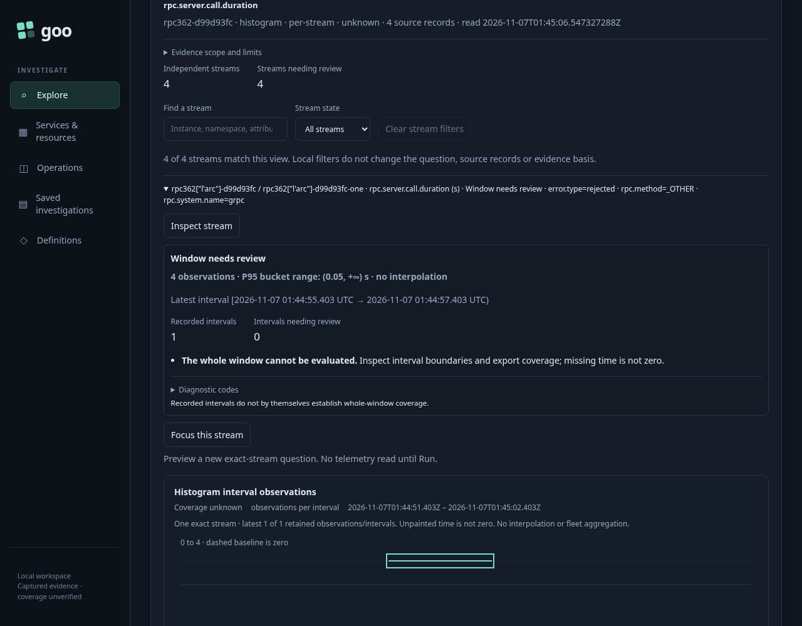
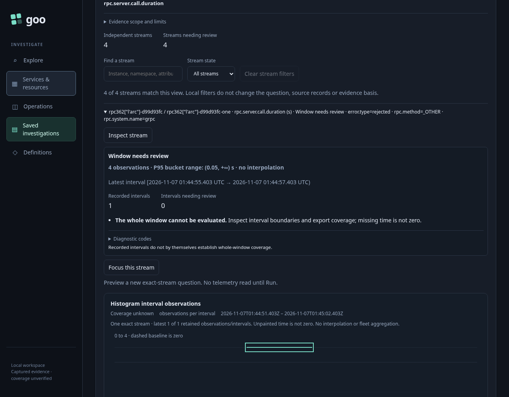

# 362 — Current RPC duration capability parity

The current RPC duration instrument uses the same pinned name/type/unit shape in the Services planner and Measurements discovery. It is a candidate, not a declaration of conformance: schema URLs do not trigger migration, optional method/status labels do not disable an otherwise eligible binding, and reported RPC status does not infer a universal failure policy.

The genuine OTLP fixture supplies seven isolated instrument identities: current delta/cumulative histograms, wrong-unit/wrong-type/unsupported-temporality observations, an older instrument and a custom instrument. The valid delta instrument reports four independent streams with missing, empty, `_OTHER` and qualified method values. Its arbitrary schema URL is retained literally. Wrong milliseconds remain generically runnable without matching the current seconds convention; older/custom names remain independent generic instruments.

The parent service retains its typed current-only environment policy, literal namespace and fixed bounds. Its existing supported native-metric boundary uses the equivalent admitted scalar environment; this does not establish native support for effective or unreported policies. Actual Services and Measurements discovery responses agree. Discover staging, metadata inspection and package building do not evaluate telemetry. Discovery and Run each require an explicit gesture.

Run preserves the selected service, namespace, instrumentation scope, schema, metric, original seconds and fixed window. Each stream has one valid delta interval with four observations and bucket counts `1, 2, 1` at bounds `0.01, 0.05` seconds. The larger question window remains unknown where coverage is missing. No whole-window health, fleet percentile or universal failure rate is inferred. Returning to Services preserves healthy widget DOM, results and read clocks without another source read.

Capture evidence performs its own explicit fixed-question reread. Its source-read clock and custody receipt belong to that capture, rather than the previous live Run. With all upstream source requests subsequently refused, a fresh stored-page GET reopens the complete frozen measurement unchanged, with zero telemetry API calls or upstream SQL attempts. Stored bytes, question, streams and capture clocks remain exact.

The corrected canonical journey passes in **47.995 seconds** (runner **49.729 seconds**). All six recorded boundaries pass their explicit source/metadata budgets. The complete run records 34 browser API calls and 40 proxy source attempts, including setup, service overview, the separate actor and the deliberate refusal probe. Frozen reopening adds one stored capture GET, with source and SQL counters unchanged. The first attempt stopped before the dashboard because the fixture incorrectly passed a service-filtered inventory scope into global service discovery; the fixture now follows the existing scope-only catalog entry and selects the exact service explicitly. No product behavior or timeout was changed for that correction.

The required observed check passes in **1.50 seconds**, zero skips. It reuses the existing instrument-presence model for the actual discover/inspect lifecycle. Independent Go admission checks all six boundaries, full bindings, retained distribution and frozen-capture custody; six corrupted coverage, verification, read-budget, question, unit or clock receipts are rejected.

The focused actor passes in **35.110 seconds** with **605 snapshots across nine stages** and positive visible, settled completion. After the service overview is settled, its only two source reads are explicit discovery and Run. It verifies the full request/response question and exact four stream distributions, with zero writes. The actual terminal image was independently reviewed: the result is settled, the `_OTHER` stream and interval timeline are visible, and missing whole-window coverage remains unknown. All four PNG documentation frames are genuine Playwright captures.

Compact fixtures, all actual capture files, the first fixture-failure receipt, model input/results, compressed actor trace and reviewed terminal sample remain in `artifacts/rpc-capability362`. The lab and its 51 pre-existing stale pending entries are preserved.

Run with the reviewed binary, `GOO_RPC_CAPABILITY_BOMBADIL=1` and `GOO_VERIFY_QUINT=1` through `npm run test:journeys -- journeys/362-current-rpc-capability.spec.js`.
