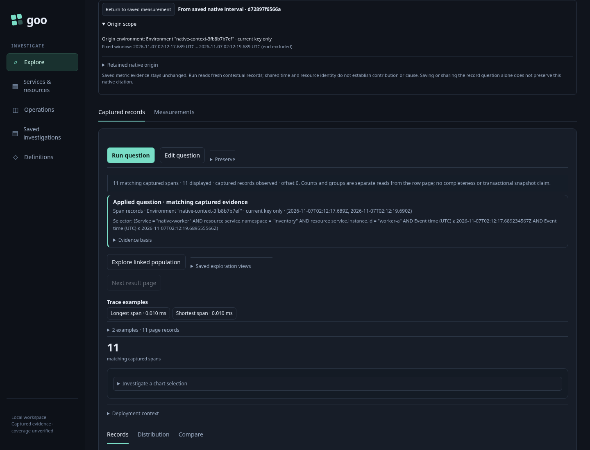
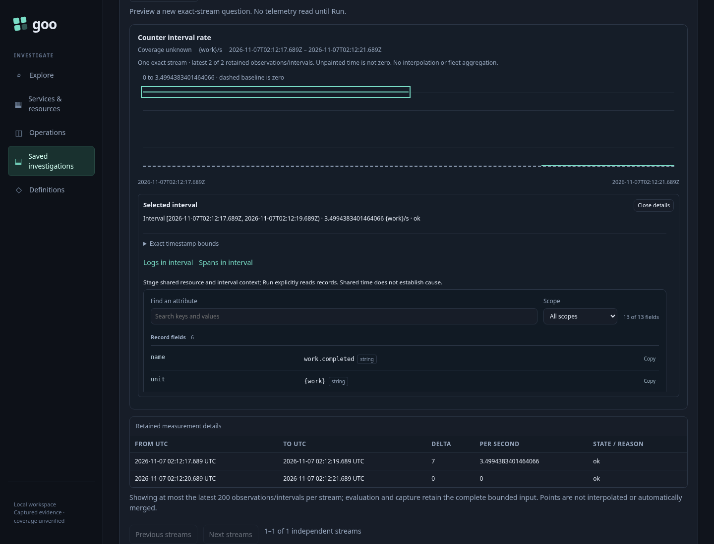
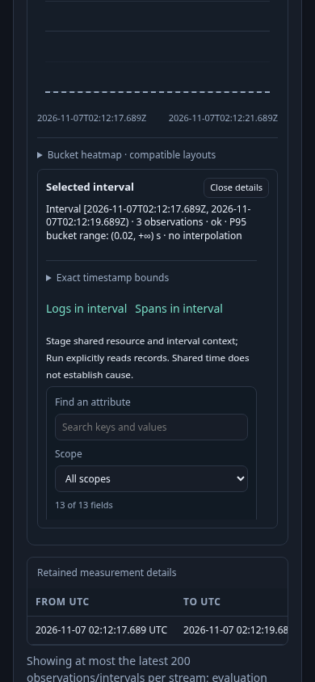

# 364 — Return to a saved native export interval

A selected interval in a captured counter or histogram can stage a fixed logs or spans question. The record question shares the reported service, namespace, instance and exact interval. It does not claim that those records caused or contributed to the metric, and metric dimensions do not become record filters.

The genuine OTLP fixture uses sub-millisecond half-open boundaries, records exactly at either edge, wrong namespaces and instances, legacy-only environment values and conflicting current environment values. The counter case retains a current-only named policy and finds 11 matching spans. The histogram case retains an effective named policy and finds 12 matching logs. Independent read-only ClickHouse counts and bounded raw-ID queries establish those memberships.

Opening and selecting the saved interval, staging records and returning read no telemetry and do not refresh the stored capture. The return bar carries the original capture ID, complete measurement question, exact stream and interval, original basis and source-read clock. The capture custody receipt remains separate from the newly read contextual records. Whole-window metric coverage remains unknown despite the selected interval being valid.

Return restores the same native DOM, selected interval, timeline data, original receipt and focused, unobstructed opener. The saved result is retained rather than rebuilt from a live measurement. After a real upstream 503 refusal, Return still restores that result. A held successful contextual response is then returned from before delivery: its actual browser signal aborts, the late response cannot publish, and old captured Stage/Return callbacks remain inert across repeated visits.

The corrected canonical journey passes in **58.811 seconds** (runner **60.728 seconds**). Both cases pass all ten recorded boundaries. Each makes three explicit contextual record requests: successful, refused and pending; Stage and every Return make zero source reads and zero capture-page GETs. The complete run records 36 browser API calls and 21 proxy attempts covering setup, captures, contextual reads and the actor; independent raw ClickHouse oracle queries are separate. Both pending browser signals increase from zero to one on Return. All stored capture bytes remain unchanged, with no metric rereads during navigation.

The required observed check passes in **5.46 seconds**, zero skips. It independently checks raw environment/resource/half-open membership, whole questions, custody bytes, retained source identity, abort counters and all ten boundary budgets per case. It reuses the existing population drilldown model for the admitted stage/read/return paths and rejects altered record questions, capture bytes and saved origins for both cases.

A final offline audit strengthens that model gate: the original **5.46-second** check admitted the actual evidence before replaying a fixed lifecycle script; the final check replays the actual recorded fact labels and source counters for both cases in **9.67 seconds** (package **9.700 seconds**), zero skips. Four direct model counter/order mutations are rejected independently of Go admission, alongside six Go admission controls. The combined pending-stage/read fact projects its recorded before-source count into a logical Stage and its after-source count into Read; it does not claim an observed intermediate snapshot. The model checks source/depth lifecycle only. Twelve compact replay inputs/results are retained. The canonical **58.811-second** browser run, product binary and data are unchanged.

The focused actor passes in **35.156 seconds**, with **492 snapshots across seven stages** and positive visible completion. It opens the actual effective-policy histogram capture, selects its export interval, explicitly runs the 12-record context and returns to the same saved result and focused context action. It makes one contextual source request, zero metric reads, zero capture GETs after observation begins and zero writes. Its full query and raw ID oracle are checked in the browser without repeating full captured rows in every snapshot.

The first attempt stopped in a test observation helper that waited for a child status element after the retained child had intentionally been removed. The helper now records the real optional status and all actual question-state elements; source, abort, late-adoption and ownership assertions remain unchanged. No product behavior or timeout was changed for that correction.

The actual terminal image was independently reviewed at original resolution: the saved histogram interval and its focused Logs in interval action are settled and visible, with the retained interval table and contextual-causality disclaimer. The three PNG documentation frames are genuine Playwright captures.

Compact fixtures, all actual capture files, the first helper-failure receipt, model results, compressed actor trace and terminal sample are retained in `artifacts/saved-native-context364`. The lab and its 51 pre-existing stale pending entries are preserved.

Run with the reviewed binary, `GOO_SAVED_NATIVE_CONTEXT_BOMBADIL=1` and `GOO_VERIFY_QUINT=1` through `npm run test:journeys -- journeys/364-saved-native-context.spec.js`.
