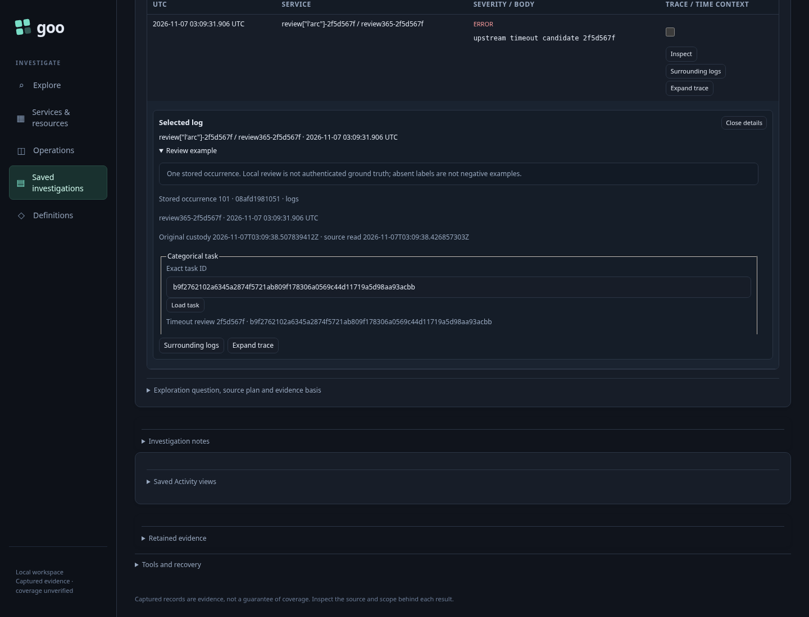
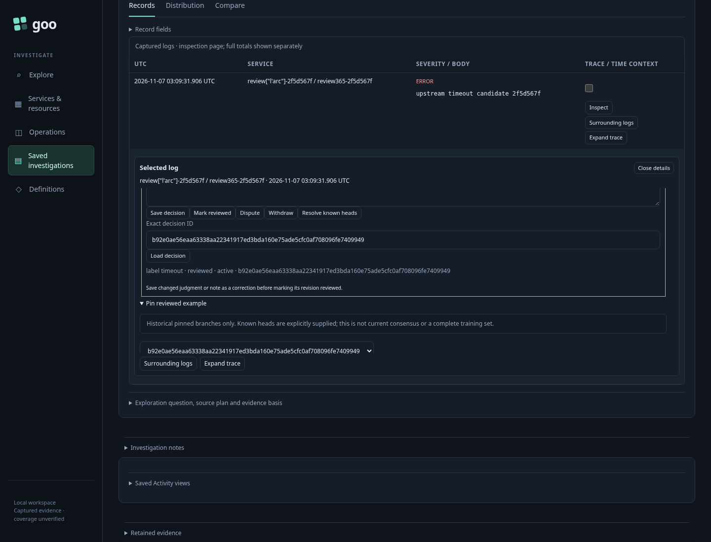
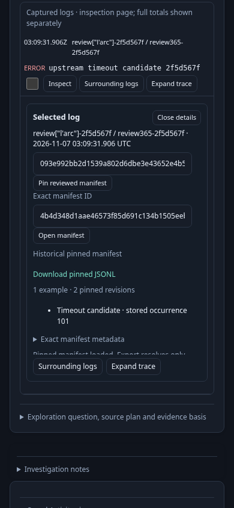

# 365 — Review an exact captured record occurrence

A categorical task and append-only local decisions refer to one server-resolved stored occurrence, not a trace, reported ID, visual row or all matching records. The genuine OTLP fixture has 101 identical log payloads. Absolute zero-based position 100 is reviewed from the second stored page; identical position zero remains unlabeled. A separate genuine span capture exercises cross-capture refusal.

The task declares explicit `timeout` and `not-timeout` classes. A new task starts with Choose judgment; Save requires an explicit choice and creates an unreviewed decision. Mark reviewed, correction, Dispute and Withdraw append revisions. Editing a judgment or note requires saving a correction before marking it reviewed. Local review is not authenticated ground truth.

The pilot pins and downloads a reviewed historical manifest, then corrects, disputes and withdraws that branch. It loads an explicit competing branch, blocks pinning multiple known heads, resolves those heads and pins a new reviewed negative label. Reopening and exporting the original manifest still returns the original bytes and label. A manifest is an explicit historical branch snapshot, never current consensus or an exhaustive training set.

Unreviewed, uncertain, abstaining, disputed and withdrawn decisions are refused as export selections. Foreign tasks, cross-occurrence parents and mixed-capture manifests are rejected. Loading position 100's decision into the identical position-zero inspector is refused without changing its draft or creating a label there.

After capture setup every upstream telemetry request is refused. Review task/decision/manifest requests remain explicit local metadata effects, with zero telemetry reads and unchanged capture bytes. The first unreviewed save is really committed by Go, then its browser acknowledgment is deliberately lost. Retry sends identical request bytes and request ID and recovers the same immutable decision. Two HTTP attempts are distinguished from one authored revision.

The corrected final canonical run passes in **57.914 seconds** (runner **59.813 seconds**). All 15 recorded boundaries preserve zero telemetry calls and zero additional proxy attempts. The final fact records 11 review POST attempts, including the lost-ack retry. The complete browser records 29 API calls; 17 direct setup/metadata API calls are recorded separately. Seven proxy attempts belong to capture setup and the refusal probe. Capture bytes, original fixed questions, read clocks, custody and server-resolved occurrence hashes remain unchanged. The lab's 51 pre-existing stale pending entries are preserved.

The required observed check passes in **7.05 seconds**, zero skips. It projects the actual 15 fact names and public source counters into the review lifecycle model and rejects direct source-counter/order mutations. Independent Go admission checks task/decision/manifest joins and raw evidence authority. Evidence digests use the exact original stored row bytes; report-object comparison permits JSON whitespace differences using `UseNumber`, without a float conversion. Downloaded JSONL remains checked against the authoritative stored record. Actual ordinary-record timestamps and the OTLP integer attribute preserve large digits as strings; separate Go HTTP boundary tests cover unquoted large JSON number tokens.

The focused actor passes in **35.230 seconds**, with **594 snapshots across 14 stages** and positive visible completion. It opens the actual second page, declares its own task, explicitly saves/reviews/pins, withdraws, reopens and reads the original export unchanged. It makes zero telemetry calls, five review metadata writes and zero other writes. The independently reviewed current terminal image shows the compact historical manifest, active Download pinned JSONL link, one example/two pinned revisions and stored occurrence 101. All three documentation PNGs are genuine Playwright frames and were reviewed at original resolution.

An initial core run passed the UI lifecycle and actor but exposed a verifier that incorrectly treated pretty-printed report whitespace as raw evidence bytes. The verifier now hashes authoritative stored bytes; an offline replay passed before the final canonical rerun. The manifest presenter was also improved to put Download before a compact summary, with raw JSON behind Exact manifest metadata. Task declaration is collapsed and the actual reviewed status/export are brought into view for these frames. No source scope or timeout was relaxed.

Compact actual inputs, all genuine capture/review store files, final exports, observed model steps/results, compressed actor trace and reviewed terminal sample remain in `artifacts/capture-review365`. Intermediate browser bulk was pruned; lab stores and volumes were preserved.

Run with the reviewed binary, `GOO_CAPTURE_REVIEW_BOMBADIL=1` and `GOO_VERIFY_QUINT=1` through `npm run test:journeys -- journeys/365-capture-review.spec.js`.
