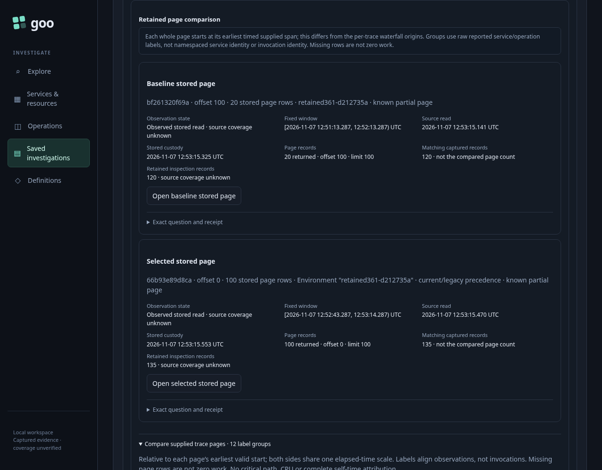
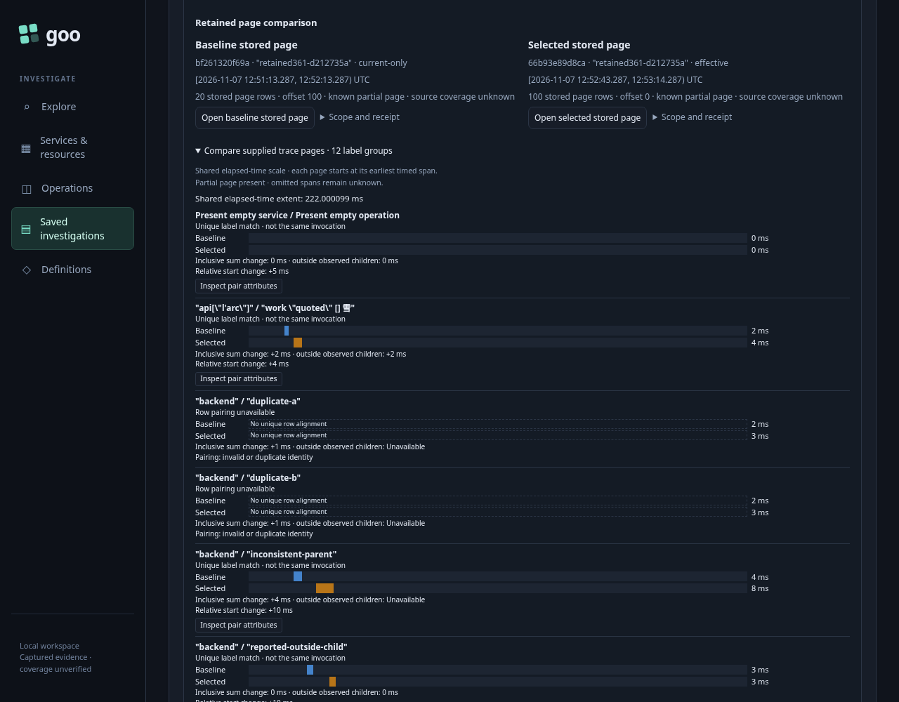
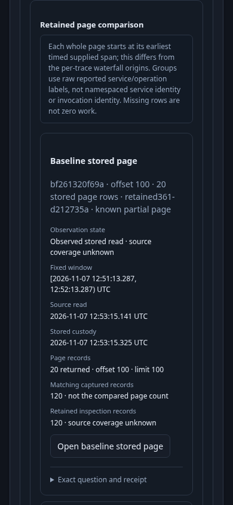
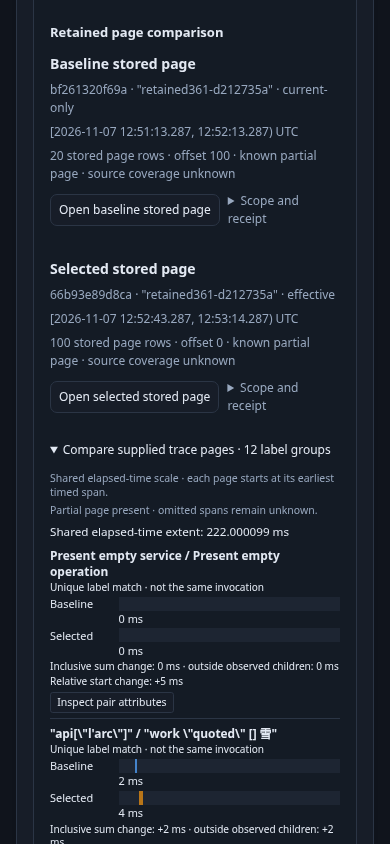

# 366 — Compact independent comparison headers

This consolidation reuses journey 361's genuine OTLP fixture, immutable captures, independent raw ClickHouse oracle, exact page/cursor lifecycle and final actor/model checks. It changes presentation rather than comparison scope or arithmetic.

Both phases use the same 20-row reference page at offset 100 and 100-row selected page at offset zero: identical capture IDs, payload bytes, questions, raw rows, independent source/custody clocks and opaque cursors. Each measurement begins with a fresh explicit Compare: desktop first, then a recreated comparison at narrow width. Geometry is sampled before test scrolling, pair-attribute inspection or disclosure focus. The application's own comparison-entry scroll is part of the observed behavior.

| Viewport | Chart Y before → after | First positive timing-bar Y before → after | Timing bar moved up |
| --- | --- | --- | --- |
| 1280×1000 | 908.188 → 201.750 | 1254.328 → 464.234 | 790.094 px |
| 390×844 | 1495.328 → 436.891 | 2023.094 → 759.078 | 1264.016 px |

The actual first positive timing bar is fully visible horizontally and vertically in both final entry viewports. Neither viewport overflows horizontally. These are matched task-position measurements, not statistical performance results or a claim that every comparison group fits above the fold.

The two headers retain independent environment policies, fixed windows, page positions and partial/unknown coverage. Keyboard Enter opens both sides' disclosures and reveals all seven human-readable facts plus the exact question/receipt. Those values and full metadata match the baseline, with zero additional API calls, stored-page reads or telemetry attempts. The source result and comparison DOM/data remain unchanged through exact side opening, local inspection, Return, candidate paging and retired-callback/ABA checks.

The baseline reviewed-365 run passes all 18 reused lifecycle facts in **28.885 seconds** (runner **31.940 seconds**), intentionally without repeating actor/model checks. The final reviewed-366 canonical run passes in **77.617 seconds** (runner **80.324 seconds**). It passes the same 18 facts, with zero telemetry reads and ten stored-page GETs among 26 browser API calls. Its sole proxy attempt is the deliberate source-refusal probe; no new observation is acquired for the replayed operands.

The reused observed Go/Quint gate passes in **15.99 seconds**, zero skips, including normative comparison/independent timing admission and six corrupted-receipt controls. The focused actor passes in **35.128 seconds**, with **588 snapshots across 12 stages** and positive visible completion, zero telemetry calls and zero writes. Its actual terminal image was independently reviewed: settled checkout 10→35 ms with +25 ms inclusive/+17 ms outside-child change, SQL 4→12 ms, ambiguous repeated labels and honest one-sided absence. All four documentation PNGs are genuine native browser entry frames.

One replay setup attempt correctly hit the catalog's copied-file modification-time guard. Replay now uses the existing prelaunch capture-store option and one explicit reviewed `rebuild-capture-catalog` command to validate/rebuild only derived catalog metadata. The command indexed two payloads totaling 227,859 bytes; every original capture payload is rechecked byte-for-byte afterward. This does not acquire telemetry or change custody. The first UI candidate passed desktop but left the narrow positive bar below the viewport; bounded header/action-row compaction fixed that failure without relaxing the visibility requirement.

Four actual served asset hashes are retained for each phase. The baseline's shared-view hashes were read from the still-running reviewed-365 main server only after its owner/product-CSS hashes matched the original private baseline runtime. Compact baseline/final fixtures, payloads, catalog receipts, raw oracles, layout measurements, model inputs/results, compressed actor trace and reviewed terminal sample remain in `artifacts/paired-headers366`. The lab and its 51 pre-existing stale pending entries are preserved.

Run the existing `journeys/361-retained-page-comparison.spec.js` with `GOO_PAIRED_HEADER_LAYOUT=1` and `GOO_PAIRED_HEADER_PHASE=baseline|final`. The final phase supplies `GOO_PAIRED_HEADER_REPLAY=artifacts/paired-headers366/baseline`, `GOO_RETAINED_PAGE_BOMBADIL=1`, `GOO_VERIFY_QUINT=1` and the reviewed binary. No second test-file wrapper or new fixture framework is registered.
