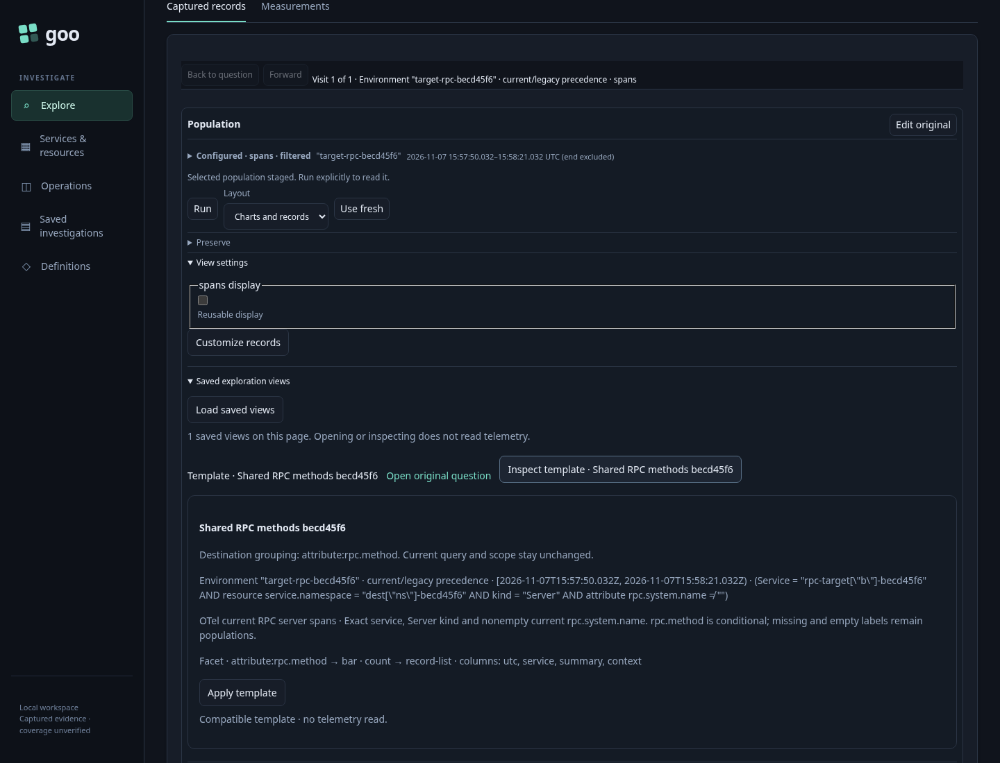
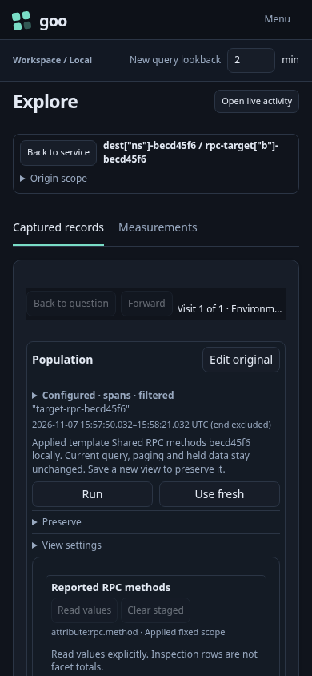
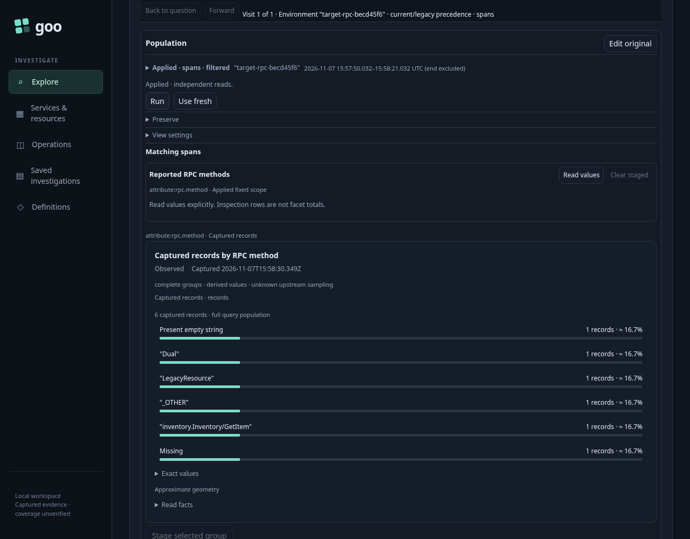

# 367 — Reuse a current RPC server-method view

An observed current RPC server role can be customized into a reusable view, then applied to another service's exact fixed population. The shipped `otel.rpc-server-current-methods` preset uses `Server` plus nonempty `rpc.system.name`, with family `rpc-server-current`, grain `server-span-record` and template profile `otel.rpc-server-current`. It does not require a reported method. Missing, empty, `_OTHER` and qualified values remain distinct categories; no `rpc.service` or business-failure interpretation is invented.

The genuine OTLP fixture separates a current-only source service/namespace/older window from an effective-policy destination with another environment, service, namespace and window. Customize reads metadata only. The source presentation is edited through the standard Records view control and saved as a reusable List view, without another telemetry read. The saved template is unchanged after reuse.

Template inspection and Apply transfer the saved presentation and checked RPC profile without importing the source specimen's filters or observations. The destination remains staged until explicit Run.

The independent raw ClickHouse oracle finds six destination server-span records totaling **210 ms**, including a legacy-resource-environment record admitted by the effective policy. Client spans, legacy-only RPC attributes, empty current system names, conflicting environment keys, another namespace and out-of-window records are excluded. The complete destination question, policy, namespace, bounds, role predicates and `rpc.method` grouping are preserved. All six categories, including missing and empty, survive the reusable List presentation.

The canonical journey passes in **60.521 seconds** (runner **63.634 seconds**). All six recorded lifecycle facts pass: service context, template entry, inspection, local staging, explicit Run and retained service return. Only Run acquires the destination population within that sequence. Customize, editing, saving, expansion and staging remain metadata/local operations. Returning preserves the original service widget DOM, evidence and read clocks.

Three actual Go metadata requests reject Client, legacy-key and missing-current-role counterfactuals with HTTP 400 and no source reads. A visible client-role destination also refuses Apply. A genuine successful factory response is held while the service owner changes; neither its late completion nor a captured old Apply callback can replace the current incompatible destination state, including its genuinely absent composition.

The required observed Go/Quint check passes in **4.85 seconds**, zero skips. It reuses the existing service-template model with the six actual fact names and recorded source counters. Direct counter/order mutations are rejected, alongside independent full-query, RPC membership, saved-presentation, refusal and stale-owner admission checks.

The focused actor passes in **35.144 seconds**, with **602 snapshots across ten phases** and positive visible completion. It records a real staged List configuration separately from the returned service state, explicitly runs the six-record/210-ms destination and returns to the same visible current-RPC method widget. Its source counter moves from seven settled service reads to eight only for explicit population Run; it makes no preservation writes. The complete run records 56 browser API calls, 21 source calls and 64 proxy attempts, including independent source acquisition outside the passive template sequence.

The actual terminal image was independently reviewed at original resolution: the returned current-RPC method widget is settled, with present-empty, `_OTHER`, dual-key, legacy-resource and qualified methods visible. The missing-method category is independently checked in the full API/native group oracle and applied frame. All three documentation PNGs are genuine browser captures; their task-positioned layouts do not imply an above-the-fold density improvement.

The first native run exposed a product witness bug: a typed request omitted inert scalar `environment`, while the Go echo included `environment: ""`, suppressing valid observed RPC-role witnesses. A bounded record-query comparison fix now preserves exact selector/query identity without weakening invalid-selector guards or native measurement matching. Later test-only corrections recorded an incompatible destination's absent composition as `null`, and checked List configuration in the actual staging snapshot rather than after Return removes the authoring DOM. No timeout or membership assertion was relaxed.

Compact actual fixtures, source/destination captures, saved view definitions, raw oracle, model inputs/results, brief failure receipts, compressed actor traces and the reviewed terminal sample remain in `artifacts/current-rpc-template367`. The lab and its 51 pre-existing stale pending entries are preserved.

Run with the reviewed binary, `GOO_RPC_ROLE_TEMPLATE_BOMBADIL=1` and `GOO_VERIFY_QUINT=1` through `npm run test:journeys -- journeys/367-current-rpc-template.spec.js`.
