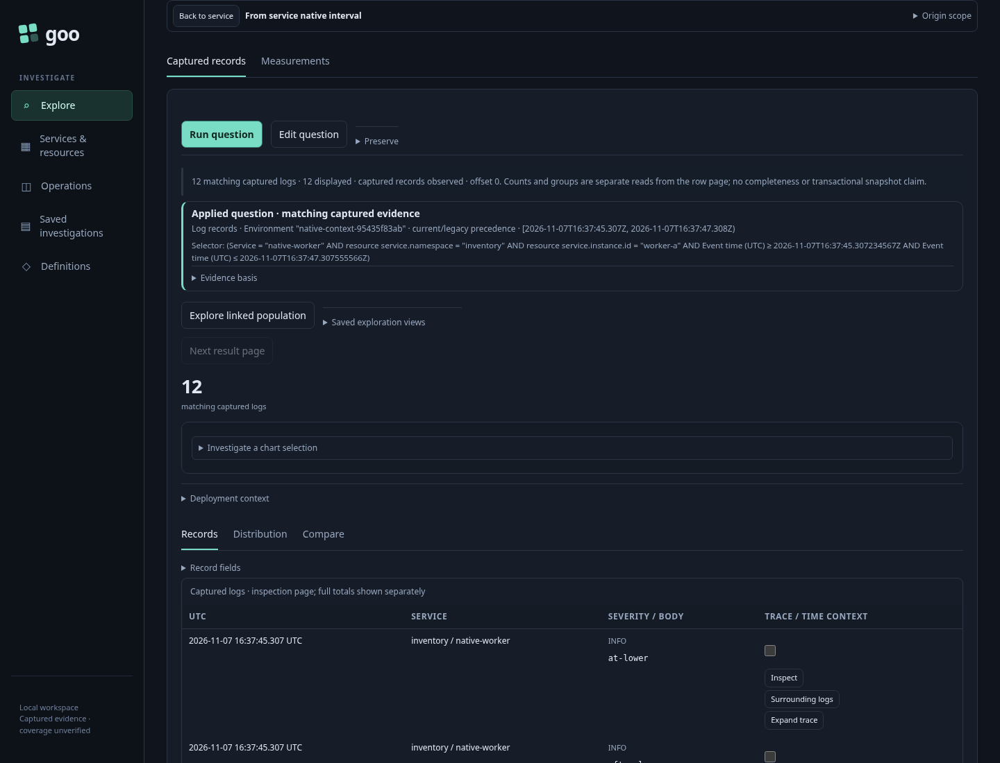
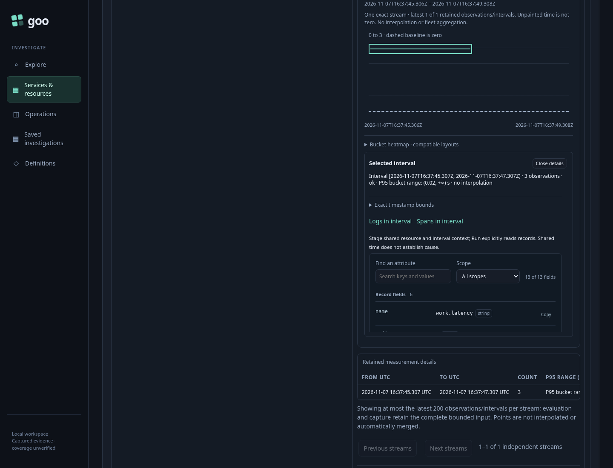
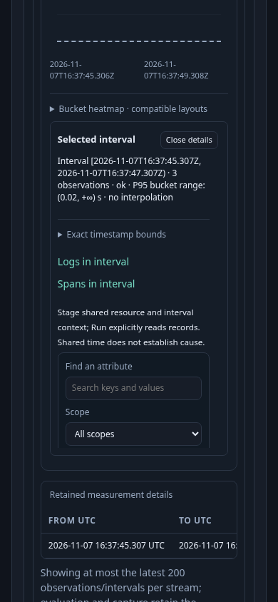

# Service interval to contextual records — 368

Native, observed-model and positive actor acceptance pass. Executable storyboard:
[`368-service-native-context.spec.js`](../../journeys/368-service-native-context.spec.js).

1. Open discovered `inventory / native-worker` with an effective environment
   selector and an exact namespace. Let the bounded service overview finish.
2. Open the held histogram's **Native result · exact streams**, expand its
   exact stream and select one export interval. Inspect its UTC endpoints and
   stream identity. Selection reads nothing.
3. Choose **Logs in interval**. The record workspace stages exact nanosecond
   bounds and service/namespace/instance context. Its origin is **From service
   native interval**. Staging reads nothing.
4. Press **Run question**. Compare actual returned IDs against an independent
   raw source predicate, including excluded endpoint and foreign-resource rows.
5. Choose **Back to service**. Restore the same held widget, selected interval,
   disclosure and focused opener without a native or stored-capture read.
6. Repeat with a refused child read and with a genuine successful response held
   until after Return. Verify that cancellation retires publication, then invoke
   saved old callbacks and confirm they remain inert.
7. Repeat the return interaction at a narrow viewport. A separate Bombadil
   campaign must visibly finish the staged/Run/Return journey within its source
   budget; process exit alone is insufficient.

The fixture uses real OTLP ingestion and the running Go application. Its inventory
capture is a reproducible entry into discovery, not custody of the subsequent
service-native result. Contextual records do not establish metric contribution,
exemplars or causality. See [feature contract](../SERVICE_NATIVE_RECORD_CONTEXT.md).

## Current frames

These are task-positioned frames. They establish interval-action readability and
return context, not compactness of the whole service overview. The genuine run
returns 12 independently checked logs; the separate 45-second actor visibly
completes discovery, selection, staging, Run and Return.
