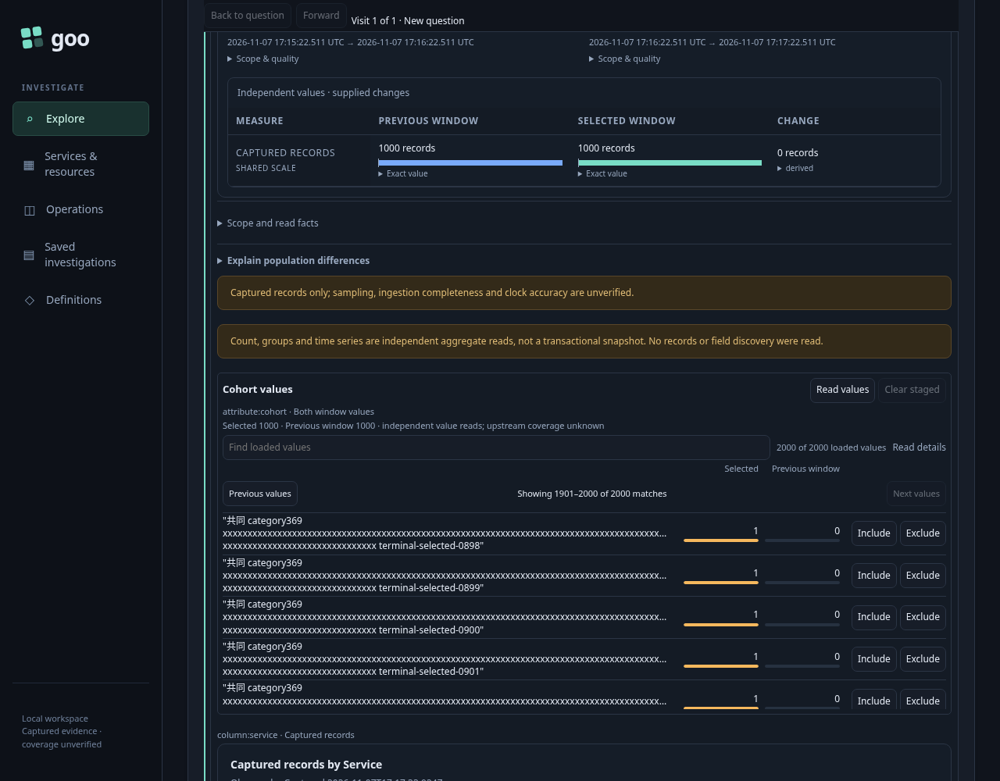
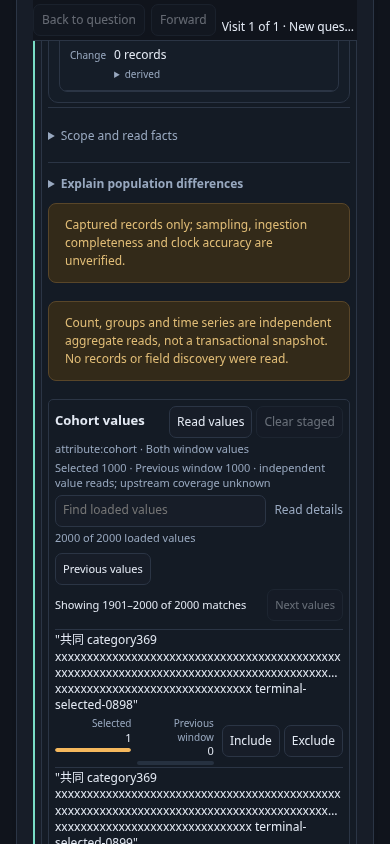
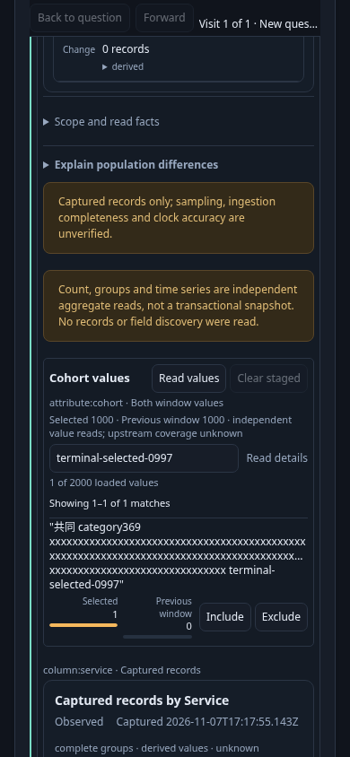

# Find and narrow a large categorical population — 369

Bounded rendering and repeated native acceptance pass. The executable task is
[`369-facet-interactions.spec.js`](../../journeys/369-facet-interactions.spec.js).

1. Open real ingested logs with an effective environment selector and applied
   service/tenant predicates. Customize the population with an attribute facet.
2. Explicitly read 1,000 counted values. Search a terminal suffix beyond the
   visible preview, a missing key, a present-empty string, zero matches and all
   loaded values. Repeat searches and edit the query at a nonterminal caret.
3. Follow actual keyboard Tab stops to the exact matching Include control.
   Stage Include, open its child question and Back. Verify exact literal scope,
   visible focused return, held values/receipts and zero local API activity.
4. Repeat with Exclude. The child retains missing values while excluding the
   selected literal. Check both complete original predicates and their nesting.
5. Compare the previous window, read independent values for both sides, and
   repeat the task over a disjoint union of 2,000 categories. Preserve one-sided
   counts and independent receipts.
6. Repeat ordinary and paired cases at a 390-pixel viewport. Record actual event
   and render timings separately from browser-driver/source wait.

The baseline distinguished middle-caret editing from retaining that caret across
publication/Back: position 3 jumped to 22. Current native checks explicitly retain
position 3 through both Include/Exclude and Back. Screenshots establish readability; recorded native event
probes establish timings. See [measurement contract](../LARGE_FACET_INTERACTIONS.md).

## Current frames

These are task-positioned frames, not proof that the whole population workspace
fits above the fold. The last page shows 1,901–2,000 matching values while the
loaded-value status remains 2,000. Previous stays current/focused; Next is disabled.
