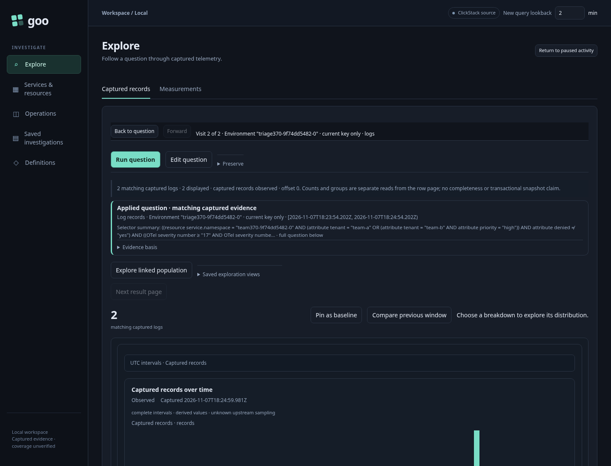
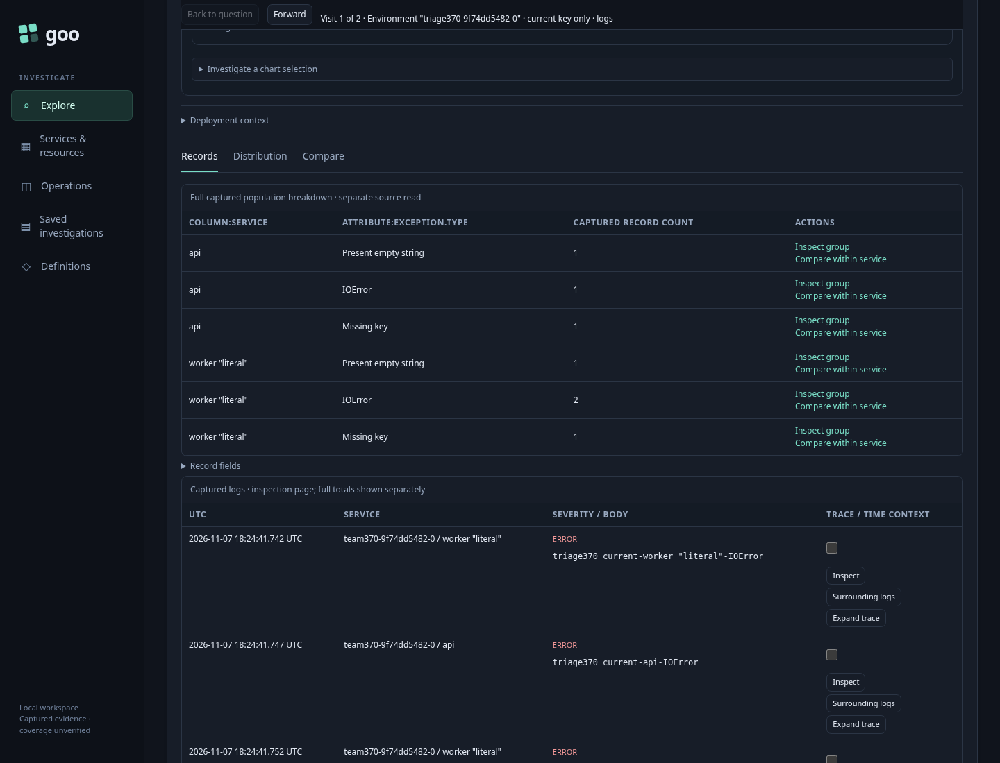
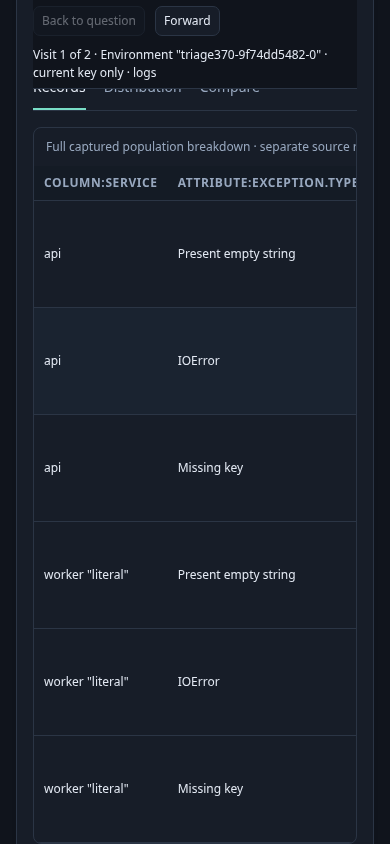

# Typed Activity to exact error populations — 370

Genuine runs, observed model replay and positive actor completion pass, including
final detached-link and narrow-action assertions. Executable
storyboard: [`370-typed-error-triage.spec.js`](../../journeys/370-typed-error-triage.spec.js).

1. Start a saved typed Activity scope over ordinary ingested logs or spans.
   Namespace and nested tenant/priority/denial predicates isolate the population.
2. Open **Errors & exceptions**, then **Open fixed triage**. The fixed session
   holds a draft checked question and waits for **Run analysis**.
3. Run once and inspect actual service/type groups. Distinguish literal `IOError`,
   present-empty and missing types; keep the exact original scope and read basis.
4. Choose **Inspect group** for each type. Each child stages without source reads;
   Run acquires its exact independent population. **Back to question** restores
   the same held group table, clocks and current focused link.
5. Choose **Compare within service**. The child retains the original evidence
   rule and namespace/predicates, adds the exact service and groups by type.
   It is not a comparison against healthy requests or an error-rate calculation.
6. Invoke an old callback after repeated Back cycles. It must prevent navigation
   without reading source. Also invoke the detached source link while its child
   is active; that cannot change the current child or acquire data.
7. Hold a genuine successful child response, Back before releasing it, and confirm
   cancellation retires publication. The released response cannot change the
   restored parent.
8. Repeat with current-only named logs, effective named spans, effective empty
   environment logs and unreported-environment spans. Independent fixture/raw
   membership checks distinguish current/legacy precedence and excluded resources.
9. At a narrow viewport, inspect identities and use the table's horizontal surface
   to reach the current action. This proves action access, not a compact layout
   showing every column simultaneously.

A separate fresh-fixture Bombadil run positively completes Activity → triage →
Inspect → Back → Compare → Back. It records three acquisitions and one stream,
with zero writes or capture-store reads. Process exit alone is insufficient.

See [feature contract](../TYPED_ERROR_TRIAGE.md) and [validation](../../VALIDATION.md).

## Current frames

The two narrow frames show different horizontal positions of the same table.
They establish exact identities and reachable current actions, not simultaneous
visibility of all columns or above-the-fold compactness. Native counters and
recorded owner state establish source/read/focus facts; image similarity alone
does not prove them.
