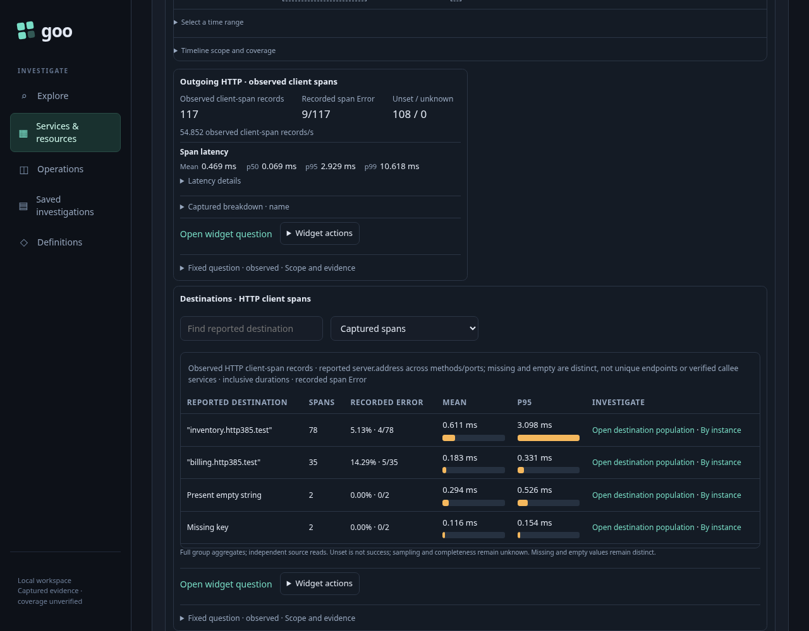
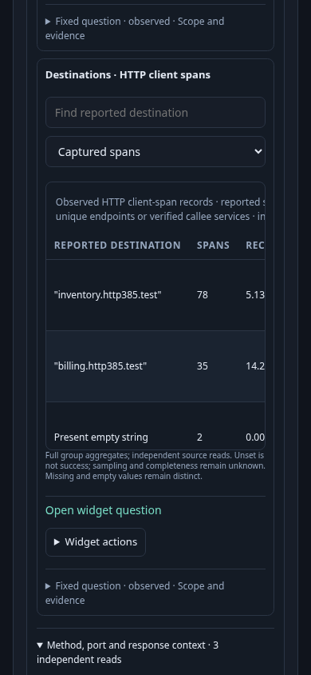
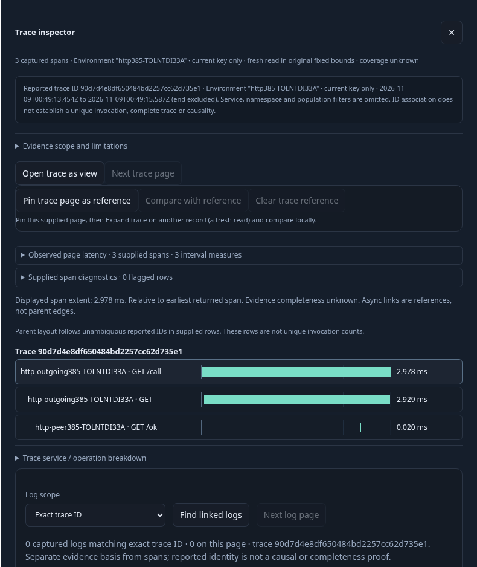
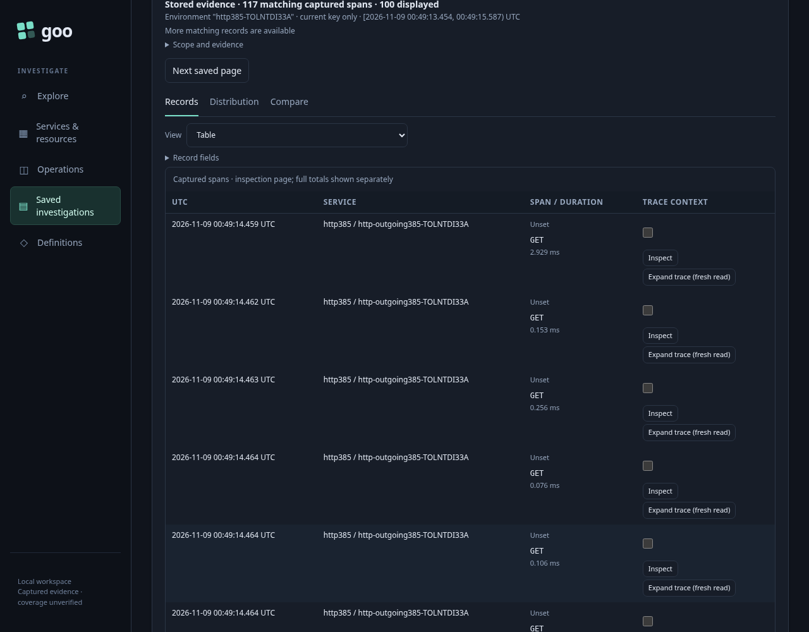

# Outgoing HTTP from a discovered service

A service owner has traces but no goo manifest. They want to find which reported HTTP destinations account for the service's outgoing work, inspect actual records, and preserve a reproducible question.

The acceptance workload performs real local HTTP calls with the Go OpenTelemetry SDK, W3C context propagation and an OTLP collector. Caller Server → Client → dependency Server spans share a reported trace ID. The dependency uses a different resource namespace. Logical test hostnames resolve through a journey-owned transport to the local HTTP server. Returned 200, 404 and 500 codes are actual HTTP responses. The workload intentionally includes partially instrumented records with missing/empty current method, destination and port attributes; those records are controls, not examples of convention-compliant HTTP instrumentation.

| Moment | User action | Visible result and read boundary |
| --- | --- | --- |
| Find the service | Open a fixed inventory capture, browse its environment, select the service | Discovery retains the exact current environment selector, namespace and UTC interval. Automatic profile selection does not silently choose outgoing HTTP. |
| Inspect outgoing work | Choose **Outgoing HTTP** | Five independent span queries: activity, destination, current method, reported port and response status. A planted upstream failure leaves activity unavailable while the other four remain usable. |
| Recover one widget | Retry activity | One fresh widget read; sibling DOM and read evidence stay intact. Opening method/port/status context merely reveals existing results. Missing and empty destination values remain separate populations. |
| Inspect records | Open the activity widget question, then **Run question** | Staging reads nothing. Run counts 117 matching current Client records and shows a bounded 100-record inspection page. Server records, absent/empty current methods, legacy-only methods and foreign resource scopes are excluded independently against raw source rows. |
| Expand the reported trace | Expand a selected Client's trace | Fresh spans and logs reads retain the checked environment/window and reported trace ID. They intentionally drop the parent service, namespace and Client filters; the peer namespace becomes visible. This is reported-ID correlation, not a completeness or causal-topology proof. |
| Return | Close trace details and choose **Services** | The original dashboard, independent widget evidence and DOM are retained without a telemetry read. |
| Reuse the question | Add the widget question and save an investigation revision | The saved record question retains Client/current-method guards, exact resource namespace, environment policy and fixed interval. Saving a definition does not read telemetry. |
| Preserve evidence | **Run and capture** | A fresh capture retains full count/groups and 117 inspection records; the initial stored page remains bounded to 100. A linked investigation revision references the capture. |
| Reopen later | Reopen the stored capture while ClickHouse refuses reads | A store GET renders the preserved evidence without SQL. Physical capture bytes stay unchanged. A separate real negative probe establishes source unavailability. |

`journeys/385-http-client.spec.js` records actual requests, responses, SQL, raw rows and action counters in its runtime artifact summary. `verification/bombadil/http-client385.ts` independently explores the positive profile → explicit records → retained Services-return journey and judges observed responses rather than clicks. Generated/model checks complement this actual browser journey; neither substitutes for it.

The real workload is ephemeral: the lab's configured 24-hour TTL rounds expiration to a UTC calendar boundary, so a bank can disappear at the next UTC midnight. Re-run the journey-owned workload and independent source-bank adapter rather than reusing expired evidence or substituting synthetic successful responses. The retained capture is a separate local artifact and can reopen without live telemetry.

Screenshots are produced by the successful journey run at desktop and 390-pixel widths. The destination widget is intentionally scrolled into view for inspection; those images do not assert that every dashboard control fits above the fold.

## Reproduce

Use the repository's configured Go toolchain/cache and already running local lab collector/ClickHouse. Run heavy build, browser and verification jobs serially. No store reset or existing-data deletion is needed.

```sh
(cd examples/report-app && go build -mod=readonly -o /tmp/goo-http-client385-workload ../../journeys/support/http-client385-workload.go)
NO_PROXY=127.0.0.1,localhost /tmp/goo-http-client385-workload > /tmp/goo-385-workload.json
NO_PROXY=127.0.0.1,localhost node journeys/support/http-client385-bank.js /tmp/goo-385-workload.json /tmp/goo-385-bank.json
GOO_BUILD_CA_BUNDLE=/etc/ssl/certs/ca-certificates.crt docker --host unix:///var/run/docker.sock compose -f compose.yaml -f compose.build-ca.yaml build packages
```

Copy the built binary using a temporary, unstarted container, then remove only that container. Do not replace the retained lab services or their volumes.

```sh
docker --host unix:///var/run/docker.sock create --name goo-385-binary-copy grammar-observability-packages
docker --host unix:///var/run/docker.sock cp goo-385-binary-copy:/usr/local/bin/goo /tmp/goo-385-reviewed-goo
docker --host unix:///var/run/docker.sock rm goo-385-binary-copy
```

```sh
GOO_GENERIC_BINARY=/tmp/goo-385-reviewed-goo GOO_HTTP_CLIENT_385_BANK=/tmp/goo-385-bank.json GOO_HTTP_CLIENT_385_BOMBADIL=1 NO_PROXY=127.0.0.1,localhost npx playwright test journeys/385-http-client.spec.js --workers=1
```

The bank adapter queries physical ClickHouse rows, checks all three reported spans against each actual HTTP call's IDs and response, and refuses a missing/expired/incomplete bank. Keep its workload JSON and bank JSON together. The browser's isolated runtime is stopped and its temporary directory removed in `finally`; its captures and summary are copied into `artifacts/http-client385` for the verification ledger.

Ordinary widget and diagnosis links use the existing **Services** navigation to return to the held dashboard. The dedicated **Back to service** affordance currently belongs to customization and native-instrument contexts. Consolidating those return gestures is a future usability opportunity, not behavior implied by this journey.

## Actual journey frames

Desktop destination diagnosis and independently read HTTP context:



The same destination evidence at 390 pixels:



A fresh whole-reported-trace expansion, with its scope-broadening notice:



The frozen Client population reopened while the source refuses reads:



Actual acceptance completed against the final SDK workload: 126 real HTTP calls exported 378 independently correlated spans; the exact main scope contained 117 eligible Client records (9 recorded Error, 108 Unset). The browser checked 13 measured interaction boundaries. Bombadil admitted 552 snapshots through an independently observed Services return, requiring the selected outgoing profile, same widget nodes and exact retained evidence. The final actual paint also shows the returned Services dashboard. A preliminary campaign's click-only completion check was strengthened after its screenshot revealed that the return had not been independently established.

The actual wire adapter uses the existing OpenAPI validator:

```sh
/workspace/.venvs/goo-api/bin/python journeys/support/http-client385-wire.py artifacts/http-client385/summary.json
```

It admitted 44 real handler responses and 24 request bodies, including the planted source refusal and offline stored-capture reopen. It does not generate successful API responses.

Finished campaign traces are archived losslessly as `bombadil/trace.jsonl.gz`; `gzip -dk trace.jsonl.gz` restores the path expected by Bombadil inspection/reproduction. `archive-index.json` records the uncompressed trace hash and frame mapping. Exact duplicate JPEG bytes are replaced with symlinks to retained representative frames, preserving all original screenshot paths. The final campaign has eight distinct rendered frames. Live replay still depends on source retention and the original isolated runtime; the SDK workload/bank commands above produce a fresh acceptance run after expiration.
