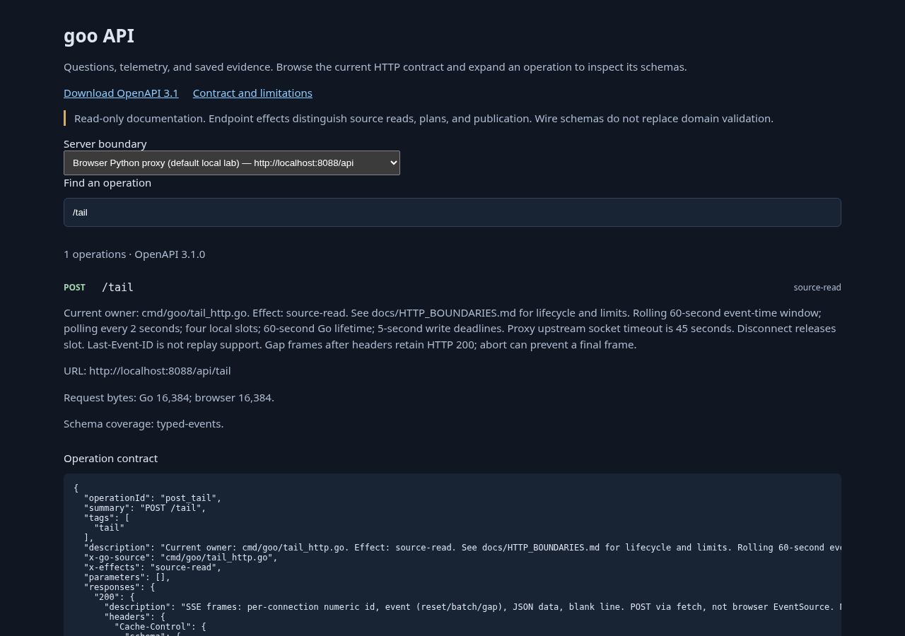

# API contract discovery journey

Implemented documentation surface; no telemetry or publication is executed.
Run `node scripts/check_api_docs.cjs` after installing the project's npm tools and
Chromium. It serves the actual checkout's Python handler on an ephemeral loopback
port and closes that server afterward, leaving the running lab untouched.

1. Open `/api-docs`: see 64 operations and choose browser versus direct-Go boundary.
2. Search `/tail`: expand the operation and its contract, inspect SSE media type,
   effect, request limits and event schemas. No Execute button or network source read.
3. Search `/measurements`: see the source/custody effect and 65,536-byte body limits.
4. At 390 px width, search `/compare`: distinguish supplied-summary comparison from
   saved comparison without horizontal page overflow. Browser errors must be absent.

The screenshot comes from the executable journey, not a mock. API behavior is
verified separately by the [OpenAPI contract checks](../API.md#updating-and-checking)
and Go wire/SSE tests. The main observability UI and its running image are unchanged.
