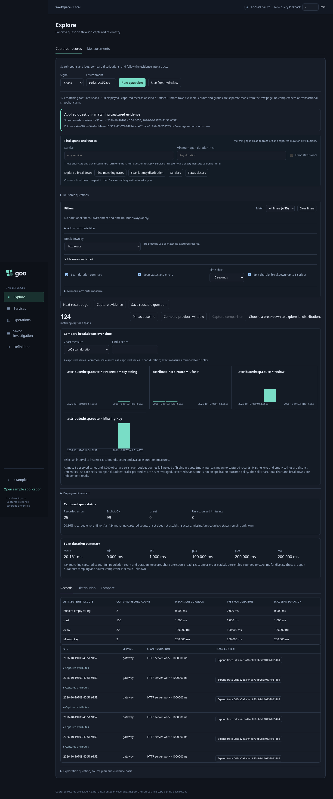
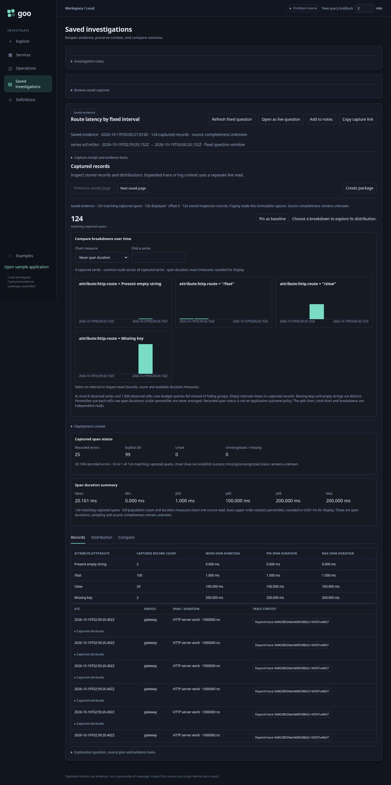
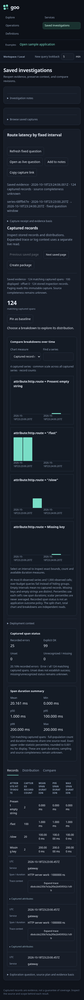

# User journeys and storyboards

These stories explain the current prototype and guide the intended product.
Screenshots are generated by real Playwright interactions with the running
sample app and investigation UI; backend responses are not mocked.

Run the default Compose stack, then `npm ci` and `npm run test:journeys`.
The wrapper pauses only the demo traffic generator, drains queued work without
deleting data, runs Chromium, and restores the generator if it was running.
Existing stale pending entries from prior crashes are retained and reported.
The sample does not reclaim those entries; the wrapper does not pretend to fix it.
The cloud environment uses the installed `/usr/bin/chromium`; set `CHROMIUM_PATH`
for another local binary. Test endpoints can be changed with `GOO_SAMPLE_URL` and
`GOO_QUERY_URL`, but the default wrapper manages the local Compose demo only.

The live app labels evidence `demo-unverified`, SLO/alarm results as previews,
and native metrics as points. These are visible limitations, not hidden test
exceptions. Examples uses the original bounded Python SQL templates; Explore and
operation packages use Go.
The new Go lifecycle accounting has separate fixtures and is not wired into it.

For the source/build, telemetry and investigation paths behind these journeys, see
[architecture and process diagrams](../ARCHITECTURE_DIAGRAMS.md). Production patterns
and unimplemented portability steps are labelled separately.

## 1. A request retries, succeeds, and crosses an async trace boundary

**Question:** Did a transient attempt fail the reservation, or did the eventual
business operation succeed?

| Frame | User action and evidence | Executable check |
| --- | --- | --- |
| [Create retry](screenshots/01a-create-retry.png) | Submit retry scenario through the actual sample page; retain the returned ID | Real HTTP → gRPC acceptance returns an ID |
| [Completion](screenshots/01b-retry-completion.png) | Open the investigation UI for that reservation | One subject matures to good; evidence remains unverified |
| [Async spans](screenshots/01c-linked-consumer-spans.png) | Click the subject's spans link | Consumer work is present, with a nonempty cross-trace link |
| [Attempt evidence](screenshots/01d-retry-log-evidence.png) | Inspect related logs | Retry and terminal events exist for the same reservation |

This teaches the distinction between attempts, subjects and trace identities.
A later UI should expose explicit scoped relations rather than correlating on
reservation ID alone; that is a planned improvement, not current coverage.

## 2. Fast acceptance does not establish eventual completion

**Question:** Why can a synchronous endpoint look healthy while its asynchronous
outcome is late, absent, or rejected?

The test creates all four scenarios through the sample page, waits for mature
outcomes, then inspects each selected subject. Frames: [good](screenshots/02-good.png),
[late](screenshots/02-late.png), [missing](screenshots/02-missing.png),
[rejected](screenshots/02-reject.png), and [synchronous latency](screenshots/02-synchronous-latency.png).
Good is asserted good; the others are asserted bad under the **demo's** missing
completion assumption. The latency view contains real synchronous observations,
but the story does not equate a low latency number with business success.

Under background traffic, even nominal good/retry requests can miss the demo
deadline while queued behind slow work. That observed behavior motivated isolating
the documentation workload; it was not fixed by weakening the assertions or
clearing the stream. Capacity/queue latency remains a useful future investigation.

## 3. Understand what the definition and query can claim

**Question:** Which definition did I use, what SQL ran, and are these numbers rates
or exported points?

Frames: [owned package](screenshots/03a-owned-definition.png),
[invalid expression](screenshots/03b-rejected-expression.png), and
[metric points/explain](screenshots/03c-metric-points-and-explain.png).
The test opens the actual package, submits an unsupported query and sees an
error, then successfully queries metric points and opens generated SQL. The UI
must retain its warning that the points are not derived rates.

## 4. From a latency distribution to linked asynchronous work

**Question:** Which calls make up this latency band, and what happened after
synchronous acceptance?

| Frame | User action and evidence | Executable check |
| --- | --- | --- |
| [Raw-duration heatmap](screenshots/04a-duration-heatmap.png) | Create a retry reservation, then inspect its gRPC duration distribution | Full matching span count, no percentile reconstruction |
| [Selected cell](screenshots/04b-cell-span-details.png) | Click a populated cell and select a matching span | Returned count matches the cell; exact timestamp lies inside its half-open bounds |
| [Reservation waterfall](screenshots/04c-reservation-waterfall.png) | Open the span's reservation to widen the investigation | Consumer work appears under its own trace; parent edges stay within each trace |
| [Follow async link](screenshots/04d-follow-async-link.png) | Select the consumer and follow its producer reference | The referenced span's exact ID appears in the details |

All four steps use real collector ingestion and ClickHouse queries. Cell queries
preserve fixed time bounds, but are not historical evidence snapshots. Trace
inspection remains capped at 200 spans and explicitly labels unknown completeness.
See [visualization contracts](../VISUALIZATIONS.md).

## 5. Discover the next question without losing the evidence scope

**Question:** How do I choose a useful next step, and what measurements are missing?

| Frame | User action and evidence | Executable check |
| --- | --- | --- |
| [Retry guide](screenshots/05a-guided-retry-evidence.png) | Select the retry-recovery question and inspect lifecycle evidence | The selected reservation survives the guided step into logs |
| [USE evidence inventory](screenshots/05b-use-coverage-gaps.png) | Choose resource pressure and inspect queue/worker evidence | Queue/worker telemetry is available; CPU/memory/pool measurements remain absent; resource scope clears unsupported subject filters |
| [RED exploration](screenshots/05c-red-volume-and-duration.png) | Choose service latency and open volume/duration | The same live raw-span heatmap opens; missing error-rate support is stated |

These are navigable query templates with explanations, not automated root-cause
diagnoses or a complete USE/RED implementation. See [workflow contracts and
follow-on instrumentation](../INVESTIGATION_WORKFLOWS.md).

## 6. Exercise a concrete adapter and discover reusable semantic packages

| Frame | User action and evidence | Executable check |
| --- | --- | --- |
| [Live worker/queue evidence](screenshots/06a-live-queue-and-workers.png) | Create a slow reservation and inspect USE resource evidence | Actual active-worker observation, all six metric rows, explicit instance identity and four plotted panels |
| [Semantic package library](screenshots/06b-semantic-package-library.png) | Open the prebuilt library and database-pool profile | Requirements include pool wait telemetry; outputs remain labelled proposed |

The Go `goo discover` command independently recognizes contract shapes from an
explicit inventory. The UI library is a catalog, not an automatic live discovery
scan. Hegel checks that wrong units, unknown versions, absent requirements or
separate scopes cannot activate the incomplete scope's profile. See
[semantic packages](../SEMANTIC_PACKAGES.md) and [queue contracts](../QUEUE_TELEMETRY.md).

## 7. Evaluate a bound package over live OTel spans

| Frame | User action and evidence | Executable check |
| --- | --- | --- |
| [Shared HTTP view](screenshots/07a-live-http-package-view.png) | Create a reservation and request the controlled failing HTTP endpoint; evaluate the Go package | Real ingested success/failure routes, columns from the expansion descriptor, visible sampling/completeness warnings |
| [Source and policy](screenshots/07b-http-source-and-policy.png) | Open the source/revision panel | Actual library binding, query parameters, content revision and explicit failure-status policy |

This executes HTTP → collector → ClickHouse → Go preparation/evaluation → shared
view rendering. It does not create a custody snapshot, materialize prepared export
tables or deploy Databricks objects. See [source contracts](../LIVE_HTTP_PACKAGE.md).

## 8. What did we know then, and what changed? — partly implemented

This is the next investigation-UI storyboard, not a fabricated browser journey:

1. Select a fixed cohort, definition revision, custody clock and evidence basis.
2. Inspect an original evaluation: a mature subject has no visible completion.
3. Advance only the evidence basis; an on-time terminal delivered later appears.
4. Show a new generation linked to the original, with changed outcome and counts.
5. Reopen the original receipt and reproduce its original answer.
6. Export the same definition/facts to the longer-term platform without combining
   generations or erasing evidence quality.

The Go CLI fixtures, Hegel properties and Quint replay execute the semantic
parts of this story, including strict cutoff boundaries and old/new snapshot
coexistence. The live UI has no basis selector, generation comparison or Databricks
deployment yet; no screenshots or browser-test claims are made for those steps.

See [lifecycle preparation](../LIFECYCLE_PREPARATION.md),
[bitemporal design](../BITEMPORALITY.md), and
[verification](../../verification/README.md) for the executable lower layers.

## Package-binding CLI journey

The [HTTP binding storyboard](../PACKAGE_EXPANSION.md) executes a separate
Go package workflow: recognize/bind → expand shared artifacts → prepare normalized
server requests → evaluate/reference-SQL parity. It uses fixed fixtures and
actual CLI/embedded ClickHouse execution. The separate live HTTP journey now renders its aggregate view descriptor. The
fixed CLI fixture remains distinct from that real-ingestion evidence.

## Annotation/weaving developer journey

The [annotation storyboard](../GOO_ANNOTATIONS.md) executes real Go weaving and
captures actual OTel SDK spans/events/metrics, checks application error/panic
behavior and compares emitted signal contracts with the source manifest. It is
a developer conformance journey rather than a new browser/collector journey;
no UI mockups or additional screenshots are claimed.

## Captured artifacts

Named documentation PNGs live in `screenshots/`. Playwright HTML reports,
failure screenshots and traces are generated under `artifacts/`. Screenshots
contain synthetic demo IDs and timestamps and change on recapture. They document
asserted behavior rather than serving as fragile pixel-perfect golden tests.

## Live woven operation journey

Journey 08 runs real Go success/error/panic paths through the collector and
ClickHouse, then inspects the operation overview and evidence binding. See
[the storyboard and captured frames](../LIVE_OPERATIONS.md).

## Operation duration and trace drilldown

Journey 09 follows a failed woven Go checkout through its operation error count,
raw duration heatmap cell, exact contributing spans and parent/child trace
waterfall. It verifies retained resource/window/basis without an additional
operation query. See [the storyboard](../OPERATION_DRILLDOWN.md).

## Scoped subject journey

Journey 10 creates related Go invocations plus an identical ID in another tenant,
then navigates trace → subject events → related traces without a new query.
[Storyboard and captured frames](../SUBJECT_NAVIGATION.md).

## Reusable package onboarding

Journey 11 generates a real report in a second Go app and explores its YAML-backed
operation/subject views. Journey 12 holds a real response to verify package
switching discards stale evidence. [Storyboards](../OPERATION_PACKAGES.md).

## Native counter rate journey

Journey 13 uses actual exported cumulative counter points, inspects supported
interval rates and their separate basis, then opens contextual spans.
[Storyboard](../NATIVE_COUNTERS.md).

## 14. Native duration histograms

**Question:** What can collected metric distributions tell us without pretending
that a percentile is an exact duration or that a metric bucket identifies spans?

| Frame | User action and evidence | Executable check |
| --- | --- | --- |
| [Native heatmap](screenshots/14a-native-histogram-heatmap.png) | Invoke the real woven app; inspect checkout over two minutes and expand native histograms | OTLP → collector → ClickHouse → Go returns exact bucket totals; unknown intervals have no distribution |
| [Bucket bounds](screenshots/14b-histogram-bucket-bounds.png) | Select a populated duration bucket | Exact population and whole-interval P95 bucket bounds; no interpolation or contributor claim |
| [Context](screenshots/14c-histogram-contextual-spans.png) | Inspect histogram context | Operation/time selection uses captured spans, retaining separate metric evidence |

Implemented by test `14 native histogram…` in `journeys/investigation.spec.js`.
The live source is cumulative; delta, resets, late repair and explicit aligned
merging have separate Go/Hegel/Quint checks. Fleet discovery and merged UI views
remain planned. See [native histogram semantics](../NATIVE_HISTOGRAMS.md).

## 15. From operation error ratios to traces

**Question:** Which observed error interval deserves inspection, and what can its
captured spans explain without claiming exact metric attribution?

| Frame | User action and evidence | Executable check |
| --- | --- | --- |
| [Calls/errors/ratio](screenshots/15a-operation-error-ratios.png) | Run real successful and failing checkout calls; expand operation ratios | Calls/errors share one counter basis; supported percentages stay within 0–100; unknown/idle intervals have no percentage |
| [Guided investigation](screenshots/15b-guided-error-investigation.png) | Choose “Why did errors rise?” on a populated error interval | Explicit counts and outcome choices, with no automatic cause/change claim |
| [Contextual spans](screenshots/15c-contextual-error-spans.png) | Inspect error context | Captured checkout/server/error spans selected by interval, retaining separate evidence |
| [Trace waterfall](screenshots/15d-error-trace-waterfall.png) | Open an available matching trace | Existing scoped waterfall contains checkout operation; switching packages clears ratio evidence |

Implemented by test `15 operation error ratios…`. The live source is cumulative;
missing/reset/gap/idle/delta semantics have independent Go/Hegel/Quint checks.
See [error-ratio semantics](../OPERATION_ERROR_RATIOS.md). Fleet views and change
detection are planned, not depicted as implemented.

## 16. Declared fleet membership and interval coverage

**Question:** Does observing both instances establish a common fleet population?

| Frame | User action and evidence | Executable check |
| --- | --- | --- |
| [Declared members](screenshots/16a-declared-fleet-members.png) | Invoke both live checkout instances; expand fleet coverage | Both declared instances observed through actual OTLP/source queries |
| [Unknown exact total](screenshots/16b-unsupported-fleet-total.png) | Inspect an unsupported interval | Differing SDK windows leave exact fleet calls/errors/percentage unknown |
| [Coverage explanation](screenshots/16c-fleet-coverage-explanation.png) | Explain that interval | Per-member states distinguish observation from exact alignment |

Test `16 declared fleet…` checks package clearing and separate member evidence.
Missing-member and failed-source cases retain Go/Hegel/Quint fixtures. See
[fleet coverage](../FLEET_COVERAGE.md) and the bounded comparison journey below.

## 17. Two live instances, imbalance, loss and restart

**Question:** How can an operator compare independently timed telemetry and still
recognize loss and reset without constructing an unsupported fleet percentage?

| Frame | User action and evidence | Executable check |
| --- | --- | --- |
| [Actual windows and imbalance](screenshots/17a-actual-member-windows-and-imbalance.png) | Send more successful traffic to woven-demo and errors to woven-peer; explain a supported comparison | Actual windows/counts retained, endpoint spreads within policy, no combined percentage |
| [Requests during metric loss](screenshots/17b-peer-serves-requests-with-metric-loss.png) | Pause peer metric exports through the sample app, then make a successful checkout | Real HTTP200 while explicit lab metric gate is off |
| [Unknown during loss](screenshots/17c-peer-loss-stays-unknown.png) | Investigate after more than the maximum counter gap | Main has a supported interval; unmatched peer has no invented counts/percentage |
| [Restart epoch](screenshots/17d-restart-epoch-is-not-a-comparison.png) | Resume metrics, observe the excessive gap, then restart only the local peer | Gap and new counter epoch remain unknown; raw counter cause is explained |

Test `17 live peer…` restores metric export in `finally`. Restart control manages
only the owned local Compose peer; volumes, pending entries and other services
remain. The default stack now has twelve services and loopback8092 for the peer.
No automatic clock correction or common-window aggregation is depicted.
See [comparison semantics](../FLEET_COMPARISONS.md) and diagram8.

## 18. A late initial response preserves an edited lookback

**Question:** Can startup work silently replace an operator's chosen query window?

| Frame | User action and evidence | Executable check |
| --- | --- | --- |
| [Edited lookback retained](screenshots/18a-edited-lookback-survives-late-response.png) | Delay the actual initial query response; edit lookback to two minutes, release it, then inspect operations | Edited input stays2 and the operation request/result spans exactly120 seconds |

Test `18 late initial…` delays delivery of a real upstream response, not its data.
This guards the shared control race found by the loss journey; source limits stay
unchanged and excess rows still reject rather than becoming partial success.

## 19. Save, reopen, refresh and compare

An investigator selects checkout errors and a trace, captures a fixed window,
and retains the receipt for handoff. The packages process restarts to demonstrate
volume persistence. The journey ingests a labelled late fixture span via real
OTLP in the old event window; reopening still shows the original capture/trace.
Refreshing makes a successor with the same question and selection, includes the
late observation and compares separate bases. The old receipt stays unchanged.
No browser operation/metric fetches are permitted during reopen.

- [Saved receipt](screenshots/19a-saved-fixed-evidence-receipt.png)
- [Reopened trace context](screenshots/19b-reopened-trace-context.png)
- [Late-evidence revision comparison](screenshots/19c-late-evidence-successor-comparison.png)

This test controls only the local Compose packages service and collector. It
adds explicitly labelled test telemetry; no real business completion is invented.
See [capture contract and limitations](../SAVED_INVESTIGATIONS.md).

## 20. General exploration and population-safe paging

A labelled collector fixture emits 123 spans across two synthetic resource names.
The investigator discovers arbitrary keys, filters a cohort and groups a key with
61 present-empty values and 62 missing values. A 100-row page and its 23-row
successor keep the same full captured-record count/group results. The fixture
also exercises an SQL-looking key as a literal, AND/OR, consistent no-data and a
delayed genuine response discarded after a signal change. These are controlled
telemetry records, not real service executions.

- [Independent counts and missing/empty grouping](screenshots/20a-full-counts-and-missing-key-groups.png)
- [Bounded next page](screenshots/20b-bounded-next-page.png)
- [Trace page with parents outside the page](screenshots/20c-trace-paging-keeps-partial-context-visible.png)

## 21. Real distributed trace and exact linked logs

A real reservation request passes through web and gRPC. Starting with a gRPC-only
attribute search, the investigator expands its exact trace to include the web
parent in the same environment/time bounds. Original filters/basis remain
separate. The UI shows the cross-service waterfall and trace-linked acceptance
logs; clicking a span narrows logs to exact trace AND span IDs. Async consumer
trace links are retained as references, not silently joined as parent edges.

- [Cross-service waterfall and trace logs](screenshots/21a-cross-service-waterfall-and-linked-logs.png)
- [Exact selected-span log scope](screenshots/21b-exact-span-log-scope.png)

See [the query and expansion contract](../EXPLORATION_DESIGN.md).

## 22. A saved operation expands independent live context

The investigator reopens an immutable Go checkout capture, then explicitly
expands its trace to live cross-service context and exact log lookup. The original
fixed environment/time bounds and origin basis remain visible. The saved receipt
is checked before/after and stays equal; expanded evidence has separate questions
and bases and is not silently archived with the operation capture.

- [Saved origin and independent live context](screenshots/22a-saved-question-and-independent-live-context.png)

## 23. One investigation workspace from distribution to trace

A labelled search-index refresh OTLP fixture supplies 12 captured records with region and outcome
attributes, including missing and present-empty regions. The investigator groups
by region, pins the baseline, filters to four error records and sees east rise
from 3/12 (25%) to 3/4 (75%), a +50 percentage-point difference. Both questions
retain identical time bounds. This is a controlled documentation population,
not a claim about real production errors or causality.

| Frame | User action and evidence |
| --- | --- |
| [Distribution](screenshots/23a-distribution-workspace.png) | Explore complete captured groups inside the shared product shell. |
| [Comparison](screenshots/23b-pinned-baseline-comparison.png) | Compare two explicitly sized populations within a fixed window. |
| [Definitions](screenshots/23c-definition-workspace.png) | Inspect contracts, then return without losing comparison state. |
| [Mobile comparison](screenshots/23d-mobile-comparison.png) | Use the same navigation/result tabs on a 390px viewport without document overflow. |
| [Mobile inspector](screenshots/23e-mobile-trace-inspector.png) | Open a selected trace and close with Escape. |

The executable journey also checks keyboard tab navigation, distribution-value
refinement within the pinned window, an empty selection
without invented percentages, baseline clearing after a signal change and no
uncaught browser errors. Earlier journeys now navigate actual workspace destinations;
reference workflows live under Examples. See [workspace contract](../PRODUCT_WORKSPACE.md).

Journey 11 also expands the real report application into the generic trace inspector,
with report-specific attributes and no reservation-specific action.

## 24. Build a package over existing Python telemetry

A small real Python OTel SDK process emits six `index.refresh` spans through the
collector. Set `GOO_PYTHON` to a Python interpreter with the project requirements
installed; the managed-cloud default is `/workspace/.venvs/goo/bin/python`. It has no goo attributes, annotation or source manifest. This is a
controlled SDK documentation workload, not a production business outcome. The user
filters its cohort, groups region (including one missing key), creates a package
and previews the same six records in the original fixed window. The saved package
has a reusable lookback and no page offset or absolute evaluation timestamp.

| Frame | Action and evidence |
| --- | --- |
| [Author and preview](screenshots/24a-author-existing-python-telemetry.png) | Build a definition from captured data; preview counts/groups with separate basis. |
| [Instrumentation handoff](screenshots/24b-optional-instrumentation-handoff.png) | Choose an explicit Go operation name/role and review the optional template. |
| [Reuse in place](screenshots/24c-reuse-package-without-source-manifest.png) | Restart the Go packages process, reopen the persisted package and explore the unchanged Python telemetry in a fresh window. |
| [Import and revise](screenshots/24d-import-and-revise-definition.png) | Export/import YAML and save an edited revision while retaining the original. |
| [Mobile authoring](screenshots/24e-mobile-package-authoring.png) | Author the same definition on a 390px viewport without document overflow. |

The executable journey also verifies that local query refinements preserve the
base selector without mutating the saved revision, and that delayed genuine draft/validation
responses cannot replace edited metadata or enable saving newer, unvalidated YAML.
The Create action reveals the editor and focuses its name field. Generated Go source is
separately passed through the actual annotation scanner in Go tests; the browser
does not modify the application. See [package contract](../TELEMETRY_PACKAGES.md).

## 25. Import a nested log package without a source manifest

A labelled OTLP log fixture represents a Node-style job logger with four records,
ERROR/INFO severities and present/missing queue attributes. These are controlled
collector records, not a claim that a Node SDK/service was executed. The user
imports nested AND/OR YAML directly in Definitions, applies it to logs, and adds
a severity refinement. Both imported breakdowns and the original selector remain
intact; records without valid trace IDs remain unlinked. A preview of an absent
selection returns `no_data`, without invented successes. A delayed genuine package
apply response cannot replace a newer environment selection after leaving Definitions.

- [Nested log package and two breakdowns](screenshots/25a-nested-log-package-and-two-breakdowns.png)

## 26. Correlate a real application with goo during generated UI exploration

Run `npm run test:cross-app`, optionally with `GOO_CROSS_APP_QUINT=1` to check the
actual event ledger against a Quint model using the sibling quint-go tools.

| Frame | User action and independently checked evidence |
| --- | --- |
| [Generate a real report](screenshots/26a-correlated-real-report.png) | A user submits the report app while a separate Bombadil browser explores goo navigation. The returned report ID is recorded; this is a reported outcome, not a durable job guarantee. |
| [Find the captured trace](screenshots/26b-correlated-goo-trace.png) | A direct ClickHouse read finds its emitted subject/trace. The observer filters Explore by that trace and compares rendered IDs/counts with an independent source read over exactly the UI's frozen window, then opens the waterfall. |

The coordinator retains run identity, actual source SQL/results, question/basis,
causally ordered checkpoints and Bombadil artifacts under ignored Playwright output.
Quint optionally checks matching identity/scope/window/count/membership and checkpoint
order; its protocol fixture tests reject twelve mutations and incomplete runs.
Bombadil's bounded action vocabulary currently covers navigation only. It does not
generate application requests or check the selected trace itself; the Playwright
observer does those checks. This exercises concurrent independent browsers, not a
claim of deterministic distributed scheduling or complete telemetry capture.

## 27. Follow a generated workload and revisit captured evidence

Run `npm run test:generated-campaign` with the lab and Go/quint-go available.
`GOO_CAMPAIGN_SEED=99` chooses another recorded schedule;
`GOO_CROSS_APP_QUINT=1` additionally checks every evidence ledger with qobs.
The ordinary browser suite skips this opt-in journey.

The model schedules three actual report submissions, an inspection for each,
two revisits of already inspected results, and completion. Bombadil submits through
the app button in fresh browser profiles while another Bombadil actor explores goo.
Returned IDs come from actual captured DOM states. The Playwright observer then
selects the corresponding trace and compares rendered members/counts against an
independent ClickHouse query over exactly the UI's frozen time bounds.

| Frame | Action and evidence |
| --- | --- |
| [Bombadil's application frame](screenshots/27c-bombadil-application.jpeg) | Unchanged screenshot captured by the app actor after its real request. No second request was staged for documentation. |
| [Generated inspection](screenshots/27a-generated-inspection.png) | A model-selected report index resolves to its actual returned identity and captured trace. |
| [Generated revisit](screenshots/27b-generated-revisit.png) | Close the prior inspector, clear filters, and inspect a previously checked report in a fresh read. The generated seed determines ordering and target. |

The driver records effects only after real handlers succeed, then quint-go
`connect.Driver` compares all nine observed checkpoints with the generated ITF
poststates. A complete schedule and positive workload/source/UI exercise are
required. The artifact reader rejects missing/duplicate submissions and unstable
identities; projection tests reject changed counts/targets, reordered and truncated
campaigns. Plans, seed, partial observations, actor traces and evidence checks stay
in ignored runtime artifacts. The model does not infer business outcomes, verify
durability or claim deterministic scheduling. This report campaign remains
success-only; the separate Python fault campaign follows below.

## 28. Investigate retry, rejection and stalled work

Run `npm run test:fault-campaign` with the local Compose lab and Go/quint-go.
The wrapper pauses/restores owned background traffic and drains active work without
deleting pre-existing stale stream entries. This opt-in journey uses the same seeded
Quint schedule as journey 27, with three fixed fault coverage cases and two revisits.

Bombadil selects a scenario and clicks the real Python app button in a fresh
browser. The returned ID scopes independent ClickHouse reads and ordinary Explore
span/log queries; no source annotations, backend responses or telemetry are mocked.
Another Bombadil actor explores goo navigation concurrently. Counts, record
identities and attributes are checked against each UI query's exact fixed window.

| Frame | Question and captured evidence |
| --- | --- |
| [Retry then confirmation](screenshots/28-retry-captured-evidence.png) | An error attempt and retry are visible alongside the later confirmed terminal; an attempt error is not itself terminal failure. |
| [Business rejection](screenshots/28-reject-captured-evidence.png) | A terminal log carries `rejected` even though the spans are non-error. Transport/attempt status and business outcome remain distinct. |
| [Stalled work](screenshots/28-missing-captured-evidence.png) | A positive stalled event is present, while no terminal is captured in the bounded question. The test records `unknown-no-terminal`, without inventing success or rejection. |

These labels are the test observer's interpretation of raw displayed records,
not new goo health badges or durability claims. The Quint fault model checks each
inspection, including explicit terminal-presence flags and question/record
fingerprints. Hegel state/swarm checks over the actual test projection cover
duplicates, ordering, conflicting outcomes and missing terminals. A present empty
terminal is distinguished from absence. Missing required source evidence fails
readiness instead of satisfying a fault case. Seed, partial observations, actor
traces, raw source reads, UI evidence and model reports remain archived under
`artifacts/bombadil/fault-campaigns/<run-id>/`.

## 29. Structured inspection and filter composition

`journeys/ui-polish.spec.js` publishes a controlled documentation fixture through
the real OTel collector and reads it back through ClickHouse and the Go query API.
It does not claim SDK instrumentation coverage. Six spans and a correlated log
exercise duplicate resource/span keys, large numeric-looking strings, exact
whitespace, Unicode, long values and HTML-like captured text.

| Frame | User journey |
| --- | --- |
| [Structured attributes](screenshots/29a-structured-attribute-inspection.png) | Open a record, search by key/value and scope, copy exact values, expand long values and retain raw evidence as a secondary disclosure. |
| [Facets](screenshots/29b-facets-and-explicit-empty-values.png) | Break down from an attribute, search categories without changing denominators, distinguish empty from missing and remove a filter chip. |
| [Trace context](screenshots/29c-selected-trace-and-structured-context.png) | Expand the six captured spans across services, select a span and inspect structured fields; detailed evidence limitations remain available. |
| [Mobile](screenshots/29d-mobile-attribute-inspection.png) | Read and search an attribute on a narrow screen without horizontal page overflow. |

Assertions cover exact clipboard content, escaped text, local-search query counts,
ALL/ANY populations, missing-value controls, duration-only ordering, selected-span
state, Escape focus restoration and mobile layout. Pure helper tests additionally
cover nested value types and literal searches. Counts always describe captured
records; the fixture does not establish production completeness or sampling guarantees.

## 30. From log search to reusable span distributions

`journeys/discovery.spec.js` publishes a labelled OTLP documentation fixture to the
real collector: 13 spans with exact bucket-boundary durations, 108 same-service
logs, plus other-service/environment controls. This proves the captured query/UI
path, not SDK instrumentation or production completeness.

| Frame | User journey |
| --- | --- |
| [Literal log search](screenshots/30a-literal-log-search.png) | Find exact service/severity and a literal message containing regex punctuation; inspect readable messages and visible filter chips. |
| [Surrounding logs](screenshots/30b-independent-surrounding-logs.png) | Read nearby same-service logs with different messages/severities/trace IDs in a separate bounded time context. |
| [Matching traces](screenshots/30c-matching-traces-and-expanded-evidence.png) | Four matching error spans lead to seven captured spans across services; original filters do not silently constrain expanded context. |
| [Duration distribution](screenshots/30d-full-population-span-duration-buckets.png) | Inspect complete matching-span counts in fixed half-open duration intervals. |
| [Reusable package](screenshots/30e-reusable-discovery-package.png) | Build, preview, save and reuse the selected filters/duration grouping without a source manifest. |
| [Mobile discovery](screenshots/30f-mobile-log-discovery.png) | Search logs with narrow-screen controls and no horizontal page overflow. |

Assertions cover literal search, severity, full context count versus its 100-row
page, next-page count stability, service/environment exclusion, exact anchor fields,
escaped multiline/long messages, focus return and late-read isolation. An independent
fixture expectation checks all eight duration intervals, including exact boundaries.
The package retains filters/grouping across fresh reuse; it saves configuration,
not evidence. Time context is not causal correlation, and matching-span counts
are not complete trace/root-latency measures.

With `GOO_DISCOVERY_QUINT=1`, the journey writes a permanent ignored ledger under
`artifacts/discovery/` and checks its actual context, trace and package questions
against Go references through qobs/quint-go. Three negative controls reject widened
context, a different trace environment and lost package grouping. Hegel state/swarm
separately explores context anchors/radii/pages; partition properties and Go unit
checks cover half-open buckets and UInt64 limits.

`npm run test:discovery-campaign` also adds 100 worker spans in this isolated
fixture after the deterministic assertions, then runs the dedicated Bombadil
actor. It must reach every prefix stage and observe 113 matching duration-group
members while the row page displays 100. Its actions include quick search from
an empty OR composer, trace/context paging, radius changes, re-anchoring, duration
breakdowns and package draft/edit/validate/preview/use. Data invariants and a
second actor-derived Quint ledger complement the deterministic journey. The actor
publishes no definitions; its fixture driver retains the earlier saved package.

## 31. From observed services to a reusable question

`journeys/inventory.spec.js` sends labelled OTLP fixture spans through the real
collector: 113 edge spans, three worker spans and an excluded environment control.
An independent ClickHouse query checks source counts and Error statuses. This
validates the captured discovery path, not SDK instrumentation completeness.

| Frame | User journey |
| --- | --- |
| [Observed services](screenshots/31a-observed-service-inventory.png) | Discover two services, full captured counts, error statuses and span-duration buckets without a manifest. |
| [Fixed-window exploration](screenshots/31b-inventory-fixed-window-exploration.png) | Open one exact service/name pair; 113 matching spans remain distinct from the 100 displayed records. |
| [Reusable preview](screenshots/31c-inventory-reusable-package-preview.png) | Build and independently preview a reusable package from the selected question. |
| [Mobile inventory](screenshots/31d-mobile-service-inventory.png) | Use the same discovery surface on a narrow screen with readable stacked cards. |

Local filtering retains capture totals/basis. Scope edits invalidate pending reads;
no-data results retain unknown health. The actual capture/search/open/package
ledger is always checked with quint-go and three rejecting controls (changed local
total, widened open window, changed package environment). Hegel state/swarm checks
observe/reset accounting. `npm run test:inventory-campaign` adds a read-only
Bombadil actor with a required discovery/filter/clear/open prefix and independent
accounting/rendered-count/scope/stale-evidence invariants; it saves no definitions.
Permanent ignored ledgers, coverage and actor traces live under `artifacts/inventory/`.

## 32. Preserve general evidence and page a stored record bank

`journeys/captures.spec.js` sends a labelled OTLP fixture through the real collector
and ClickHouse: 1,205 edge spans, five worker spans and 107 ordinary log records.
An independent source query checks the edge count. The test then inserts a late
span before the existing sort position. This is a captured-path fixture, not a
claim about SDK completeness, unique invocations or production custody.

| Frame | User journey |
| --- | --- |
| [Saved full population](screenshots/32a-saved-question-full-population.png) | Capture a named question with 1,205 matching spans, complete groups and 1,000 stored inspection records. |
| [Stable record page](screenshots/32b-stable-stored-record-page.png) | Page within immutable stored evidence while preserving count and basis. |
| [Successor revision](screenshots/32c-fixed-question-successor.png) | Refresh the same fixed question to see the late span without altering the predecessor. |
| [Saved inventory](screenshots/32d-saved-inventory-local-search.png) | Preserve the bounded inventory and locally search without changing its totals. |
| [Saved logs](screenshots/32e-saved-log-inspection.png) | Inspect structured log attributes on the second stored page. |
| [Mobile capture](screenshots/32f-mobile-saved-investigation.png) | Read the receipt and captured evidence on a narrow screen. |

Assertions cover exact row replay after late insertion, cross-revision cursor
rejection, actual volume persistence across a packages-service restart, a fresh
browser reopening/paging without live-query requests, copied deep link, explicit
fresh live branch, span/log/inventory component isolation, stale open guards,
full-count versus retained/page accounting and mobile containment. Go HTTP tests
also close the source entirely before reopening and paging, and reject attempts
to submit evidence or change refresh scope. Source-plan changes block refresh.

The actual save/page/refresh/reopen ledger is always checked through quint-go,
with four rejecting controls: changed old counts, changed page basis, changed
refresh scope and acceptance of a cross-revision cursor. Hegel state/swarm explores
arrivals, source changes, captures, branching refreshes and stable row banks.
`npm run test:captures-campaign` adds a read-only Bombadil actor with a required
page-forward/back, distribution and attribute-inspection prefix. It checks count,
retention, scope, basis, replay, read-only controls and unique component identities;
it never saves, refreshes or emits workload. Evidence lives in ignored
`artifacts/captures/<fixture environment>/` directories.

## 33. Core measures, reuse and service discovery

Executable: `journeys/core-basics.spec.js`. Real OTLP spans/logs verify 205 matching
spans versus 100 records displayed, exact upper p95 195 ms, saved-page stability,
empty intervals/no-data, reusable YAML question with a fresh window, log-only
services, reported `api → worker`, ambiguous/unresolved parents, source cancellation
request and mobile containment. Native cancellation tests separately establish Go
context propagation/admission. Optional `GOO_CORE_BOMBADIL=1` runs saved-measure/time-bar and live reuse/discovery/cancellation actors without changing source data. Quint validates the live ledger
and rejects five corrupted variants; Hegel exercises duration state/swarm.

| Frame | User action / asserted meaning |
| --- | --- |
| [33a](screenshots/33a-full-population-measures-and-time.png) | Inspect full-population duration measures and fixed count intervals. |
| [33b](screenshots/33b-reusable-question-fresh-window.png) | Run a saved package question in a fresh source window. |
| [33c](screenshots/33c-service-signals-and-reported-dependencies.png) | Discover span/log services and parent-link diagnostics; event age is not ingestion lag. |
| [33d](screenshots/33d-mobile-saved-measures.png) | Reopen archived measures/chart on a narrow screen with stable values. |

## 34. Duration breakdowns and saved measures

`journeys/grouped-measures.spec.js` uses 124 real OTLP spans with fast/slow/missing/
empty route groups. It verifies full-population p95 versus 100 displayed records,
one/two-field group summaries, exact ranking/search/refinement, cohort measure
accounting, retained pages, package preview and mobile containment. The live
ledger is checked by Quint with three rejecting controls; the optional
`GOO_GROUPS_BOMBADIL=1` campaign explores saved-only ranks/search/pages.

| Frame | User journey |
| --- | --- |
| [34a](screenshots/34a-duration-breakdown-ranking.png) | Rank complete route groups by p95 while keeping the overall measure separate. |
| [34b](screenshots/34b-saved-mean-breakdowns.png) | Compare exact means from an immutable capture. |
| [34c](screenshots/34c-mobile-duration-breakdown.png) | Inspect the same stored breakdown on a narrow screen. |
| [34d](screenshots/34d-grouped-package-preview.png) | Preview total and grouped duration measures from reusable YAML. |

## 35. Error and latency comparison

`journeys/error-comparison.spec.js` ingests 80 prior and 124 current OTel spans.
The user ranks recorded errors, compares prior-window errors and latency,
saves both populations, reopens the pair and follows a changed route into a
cross-service trace and linked logs. Missing/empty groups remain distinct;
only 100 current inspection rows are displayed. Quint checks the actual ledger
with four rejecting controls. `GOO_ERROR_COMPARISON_BOMBADIL=1` explores saved
measure changes with immutable evidence and exact known-result invariants.

| Frame | User journey |
| --- | --- |
| [35a](screenshots/35a-error-rate-change.png) | Compare recorded errors with the previous fixed window. |
| [35b](screenshots/35b-latency-change-and-missing-groups.png) | Rank p95 changes; absent baseline groups have unavailable differences. |
| [35c](screenshots/35c-saved-population-comparison.png) | Reopen the server-reread pair with links to both record captures. |
| [35d](screenshots/35d-mobile-comparison.png) | Inspect the same comparison on a narrow screen. |
| [35e](screenshots/35e-changed-route-to-trace-and-logs.png) | Follow a changed route to explicit trace and log context. |

## 36. Deployment context and ordered notes

`journeys/context-notes.spec.js` generates a real report in the Go sample, finds
its OTel trace through independent ClickHouse evidence, and opens a fixed Explore
question. The user records a manual deployment claim, pins it with frozen evidence,
edits/reorders hypotheses, saves immutable successor/branch revisions, retains an
unapplied draft and opens exact stored evidence without telemetry execution.
The deployment marker is authored context; the test does not deploy a new sample
version. Quint checks actual observations with six rejecting controls.
`GOO_CONTEXT_BOMBADIL=1` explores local draft operations without publishing them.

| Frame | User journey |
| --- | --- |
| [36a](screenshots/36a-deployment-context-on-captured-time.png) | Read separate event/custody times alongside the captured time chart. |
| [36b](screenshots/36b-ordered-hypothesis-and-frozen-references.png) | Preserve ordered hypotheses with exact capture and deployment references. |
| [36c](screenshots/36c-narrative-revision-and-preserved-parent.png) | Save findings as a new narrative revision with an exact parent. |
| [36d](screenshots/36d-follow-frozen-evidence-without-rerunning.png) | Open a cited capture without rerunning telemetry. |
| [36e](screenshots/36e-mobile-investigation-notes.png) | Continue the same ordered investigation on a narrow screen. |

## 37. Shared examples and scoped investigation recipes

`journeys/recipes.spec.js` generates real report work and independently locates its
scoped ready event in ClickHouse. The primary example gallery runs ordinary
packages through Explore. A trace-scoped recipe preserves fixed bounds/selectors;
preview and narrative actions do not read telemetry. The journey freezes evidence,
saves an exact narrative reference, then derives/reuses a package; wrong-signal and delayed
preview guards and mobile containment are checked. Quint has six rejecting
controls. `GOO_RECIPES_BOMBADIL=1` exercises source-free preview guards.

| Frame | User journey |
| --- | --- |
| [37a](screenshots/37a-shared-example-packages.png) | Choose a sample application package in the shared product workflow. |
| [37b](screenshots/37b-fixed-scope-recipe-preview.png) | Review prerequisites, retained population and limits before a source read. |
| [37c](screenshots/37c-recipe-operation-distribution.png) | Inspect complete operation duration groups from the recipe. |
| [37d](screenshots/37d-recipe-hypothesis-and-evidence.png) | Keep the hypothesis separate from an exact frozen evidence citation. |
| [37e](screenshots/37e-mobile-log-recipe.png) | Preview the same generic log recipe on a narrow screen. |

## 38. Shared resource and lifecycle measurements

`journeys/measurements.spec.js` generates ordinary good/retry/missing/rejected/late
reservation work, a Go checkout and a Go report. Independent ClickHouse queries
locate actual trace-correlated Go log records and check the gauge source count.
The user opens a declarative USE step without reading telemetry, then executes
fixed questions across all four measurement families. Mature lifecycle subjects
preserve missing→unknown; typed subject drilldown retains exact tenant/event scope.
A gauge capture refreshes without changing the question, reopens without source
execution, is cited in notes, and becomes a reusable saved package. Independent
Go lifecycle definitions exercise a different app/event vocabulary. Quint validates
the actual live ledger and rejects seven altered ledgers; Hegel runs measurement
state/swarm sequences. Optional `GOO_MEASUREMENTS_BOMBADIL=1` explores preview/edit
invariants without creating evidence. This is bounded local verification, not a
production delivery or completeness guarantee.

| Frame | User journey |
| --- | --- |
| [38a](screenshots/38a-guided-resource-investigation.png) | Choose a data-only USE flow and inspect its requirements and shared window. |
| [38b](screenshots/38b-resource-gauge-observations.png) | Inspect independent gauge samples with full stream identity. |
| [38c](screenshots/38c-native-duration-intervals.png) | Inspect native histogram intervals, bucket ranges and exact counts. |
| [38d](screenshots/38d-scoped-lifecycle-evidence.png) | Distinguish mature observed outcomes, pending work and missing evidence. |
| [38e](screenshots/38e-measurement-capture-in-notes.png) | Cite a frozen typed capture in the common investigation narrative. |
| [38f](screenshots/38f-mobile-measurement-editor.png) | Edit and validate a reusable definition on a narrow screen. |
| [38g](screenshots/38g-fixed-record-package-workflow.png) | Preview a record package without a read, then explicitly run its fixed workflow window. |

### 39 · Ordinary OTel metric discovery

An engineer starts with an independently instrumented application with no goo
manifest. They discover its `jobs.completed` instrument and dimensions, build and
save an editable package, run it, distinguish outcomes in stream labels, capture
it, reopen the retained evidence and cite it in notes.

- [Discover observed instrument metadata](screenshots/39a-metric-discovery.png)
- [Evaluate independent metric streams](screenshots/39b-discovered-measurement.png)
- Executable: `journeys/metric-discovery.spec.js`; optional exploration invariants:
  `GOO_METRIC_DISCOVERY_BOMBADIL=1`.

### 40 · One investigation loop

An engineer finds a reusable measurement in Definitions, previews it without a
source read, selects a service in inventory and carries its scope into metric
discovery. They abandon a delayed actual discovery response by switching modes,
confirm that it cannot publish stale results, then explicitly discover and run an
ordinary OTel metric package. The authoring surface shows canonical YAML and a
three-stage flow that fits the mobile viewport.

- [Shared searchable definitions](screenshots/40a-shared-definitions.png)
- [Question to evidence](screenshots/40b-question-to-evidence.png)
- [Mobile measurement flow](screenshots/40c-mobile-measurement-flow.png)
- Executable: `journeys/coherence.spec.js`.

### 41 · A cross-service, cross-signal investigation handoff

An engineer starts with a question before evidence exists. They gather checkout
and report spans, report logs and an independent OTel job counter. Capture-dialog
destinations attach evidence to the current draft or an exact saved revision.
The handoff preserves findings, uncertainty, time/population scope and reusable
metric identity. It reopens without telemetry reads; fresh metric execution creates
new evidence and a child investigation while the earlier handoff remains unchanged.

- [Question, findings and evidence](screenshots/41a-cross-signal-investigation.png)
- [Fresh reuse with preserved citations](screenshots/41b-reuse-with-preserved-evidence.png)
- [Mobile investigation handoff](screenshots/41c-mobile-investigation-handoff.png)
- Executable: `journeys/investigation-workspace.spec.js`; optional draft exploration:
  `GOO_INVESTIGATION_BOMBADIL=1`.

### 42 · From a slow operation to a supported finding

A real delayed operation raises competing error-path, delayed-work and resource
hypotheses. An engineer previews scope changes without a source read, compares
recorded duration/status in the original population, follows a reported trace and
its exact logs, then discovers worker instruments in the same fixed window. They
capture supporting evidence, record a missing-instrumentation question and save
a finding that distinguishes reproduced delay from production causal attribution.

- [Explicit preserved and changed scope](screenshots/42a-explicit-follow-up-scope.png)
- [Trace and exact log inspection](screenshots/42b-trace-and-exact-log-context.png)
- [Evidence gap and supported finding](screenshots/42c-evidence-gap-and-supported-finding.png)
- [Mobile investigation handoff](screenshots/42d-mobile-guided-investigation.png)
- Executable: `journeys/followups.spec.js`; optional source-free browser exploration:
  `GOO_FOLLOWUPS_BOMBADIL=1`.

Scope consolidation: journeys 37 and 42 now assert the shared checked transform
relationship and render computed population/grain changes. Their refreshed frames
include progressive disclosure for source binding and unbound OTel semantics.
The source reads remain explicit; this does not demonstrate automatic convention
profile resolution. See [the shared contract](../QUESTION_SCOPE.md).

### 43 · Compare HTTP route measures over time

Implemented in `journeys/grouped-time-series.spec.js`. A controlled ordinary OTLP
producer sends 124 server-shaped spans through the real collector/exporter into
ClickHouse. The engineer compares route-specific duration/status over fixed time
cells, distinguishes missing and empty routes, and searches locally without
changing chart scale or querying again. A 100-row page does not limit the measures.
The engineer captures the chart, derives/saves/reuses its package in a fresh window,
then reopens the original evidence without source reads. Typed planning identifies
span-record grain and raw-value percentile requirements. This does not certify
HTTP semantic-convention coverage, unique requests or production health.

### 44 · Measure numeric attributes with explicit coverage

A database engineer selects a numeric attribute from ordinary OTel spans, declares
integer type and unit in Explore, and sees exact arithmetic beside missing, empty
and malformed-value counts. A controlled producer sends 128 spans and 128 logs
through OTLP and the real exporter; a 100-row inspection page cannot define totals.
The engineer explores route/time breakdowns locally, captures evidence, saves and
reuses its YAML in a fresh window, then reopens the original immutable capture.
Unsigned, signed and resource bindings, including overflow strings, are compared
to the Go reference for every total/group/cell. No manifests or convention/type
inference are required. Controlled data does not certify completeness or health.

- [Declared measure and coverage](screenshots/44a-numeric-coverage-and-series.png)
- [Frozen numeric evidence](screenshots/44b-frozen-numeric-evidence.png)
- [Mobile numeric evidence](screenshots/44c-mobile-numeric-evidence.png)
- Executable: `journeys/numeric-measures.spec.js`; optional local exploration:
  `GOO_NUMERIC_BOMBADIL=1`. The live Quint ledger reuses the existing six-stage
  custody model with numeric reference projections and eleven rejecting mutations.

### 45 · One question from entry to frozen evidence

An engineer arrives at a compact Explore entry, composes service/duration shortcuts
and an advanced filter without a source read, then runs once. A route attribute
narrows the fixed question in one gesture. Trace context and return preserve the
main result; returning issues no query. An edit supersedes a delayed real response,
which cannot publish stale results. From Services the engineer explicitly discovers
a native worker instrument in the inventory's incident window, then captures the
main record question and reopens frozen evidence without rereading telemetry.
The controlled producer uses ordinary OTLP spans and a gauge, not mocked evidence.

- [One primary entry](screenshots/45a-one-question-entry.png)
- [Applied scope and contextual narrowing](screenshots/45b-applied-scope-and-drilldown.png)
- [Metric discovery retains incident bounds](screenshots/45c-service-metric-window.png)
- [Mobile frozen evidence](screenshots/45d-mobile-frozen-scope.png)
- Executable: `journeys/question-workbench.spec.js`; optional source-free draft
  exploration: `GOO_QUESTION_BOMBADIL=1`. The observed Quint lifecycle validates
  generations/phases and rejects mutated publication, scope, read and custody facts.

### 46 · Browse a service and follow observed conventions

Run `journeys/service-browser.spec.js` through the normal journey wrapper. An
ordinary catalog service emits HTTP/database spans, a log, a process utilization
gauge and an unsupported nonmonotonic sum; another service emits only logs. Open
service detail, choose an observed HTTP breakdown, return locally, preview a native
measurement without execution, then inspect the log-only service. The journey also
delays a real metadata response and changes environment to check stale publication.

- [Service signals, questions and instruments](screenshots/46a-service-signals-questions-instruments.png)
- [Fixed service route question](screenshots/46b-fixed-service-route-question.png)
- [Native instrument preview](screenshots/46c-fixed-native-instrument-preview.png)
- [Mobile service detail](screenshots/46d-mobile-service-detail.png)

`GOO_SERVICE_BROWSER_BOMBADIL=1` enables the matching 30-second exploration campaign.
The actual ledger is validated by quint-go with six rejecting mutations. See
[service browsing](../SERVICE_BROWSING.md) for scope and semantic boundaries.

### 47 · Discover metric-only services

`journeys/metric-services.spec.js` ingests an ordinary metric-only worker with
gauge, counter and histogram points, plus an unsupported-only worker. Discover
services directly from native points, open the original window, preview a gauge
without reading telemetry, run it explicitly and return locally. Boundary fixtures
prove inclusion at the start and exclusion at the end using independent SQL.
Counts are records, not the histogram's 5000 observations or metric values.

- [All-signal catalog](screenshots/47a-metric-only-service-discovery.png)
- [Metric-only instrument detail](screenshots/47b-metric-service-instruments.png)
- [Fixed native execution](screenshots/47c-fixed-native-measurement.png)
- [Mobile metric service](screenshots/47d-mobile-metric-service.png)

`GOO_METRIC_SERVICES_BOMBADIL=1` enables its 30-second actor. The observed ledger
is validated by quint-go with seven rejecting mutations.

### 48 · One Services catalog

Executed by `journeys/service-browser.spec.js` alongside storyboard 46. Discover
once, see one row per service with distinct signal counts, search locally, follow
a service question, return to the retained detail and then the filtered catalog.
The journey checks no implicit return reads, empty-filter keyboard focus, mobile
containment and rejection of an intentionally tampered real response scope.

- [One catalog entry](screenshots/48a-one-services-catalog.png)
- [Retained local filter and return](screenshots/48b-local-filtered-return.png)
- [Mobile catalog](screenshots/48c-mobile-services-catalog.png)

See [the catalog contract](../UNIFIED_SERVICE_CATALOG.md) for capture scope and
remaining boundaries. Existing storyboard 31 now reaches operation inventory by
opening a service; saved inventory 32 retains its original environment-wide scope.

## 49 — Resume a fixed question

`question-links.spec.js`: reopen a question without evidence, explicitly Run again,
share with a second browser, traverse history without reads, reject malformed input
and inspect mobile layout. Frames: `49a-reopened-question.png`,
`49b-share-question.png`, `49c-mobile-resume.png`.

## 50 — Mixed investigation steps

`investigation-steps.spec.js` builds a named investigation with record and native
questions plus a UI-captured evidence reference, displays same/different windows,
saves a revision, reopens without reads and explicitly reruns. A second browser
opens the shared native question. Frames `50a-mixed-question-investigation.png`,
`50b-resume-native-question.png` and `50c-mobile-native-question.png` document it.

## 51 — Linked question evidence

`linked-evidence.spec.js` runs and captures a saved question twice, explains a
changed-filter capture, recovers from document publication failure without another
source read and reopens stored history on mobile. A companion case captures native
metrics with their stored read time and typed definition. Frames 51a–e show the
history, drift preview, recovery, mobile layout and native result summary.

### 52 — Compare stored evidence

`evidence-comparison.spec.js` exercises real OTLP HTTP spans and worker gauges:
52a shows latency/error changes between stored windows, 52b refuses a changed
selector, 52c checks mobile containment, and 52d preserves native stream identity
and side-by-side saved results. It also checks empty results, failed GET recovery,
no source reads and immutable receipts, with Quint and optional Bombadil coverage.

### 53 — Save and share a comparison

`saved-comparison.spec.js` saves a comparison and finding, shares the exact revision
link with a fresh browser, preserves older findings, recovers failed publication
and a changed-context receipt by ID, and saves native unit incompatibility.
53a shows the saved finding, 53b the recipient view, 53c mobile containment and 53d
the frozen incompatible decision. Ledger replay uses Quint with six rejecting
controls; the optional Bombadil actor reopens stored comparison cards.

### 54 — Compare complete native windows

`native-windows.spec.js` ingests standard OTLP sums and explicit histograms, then
compares complete windows and shares a versioned frozen receipt. Frames 54a–e show
counter rates, whole histogram populations, mobile containment, counter decrease
refusal and incompatible bucket layouts. Incomplete coverage is also refused.
Quint validates source-free transitions with six negative controls; optional
Bombadil exploration reopens the saved native result.

### 55 — Find and capture observed SDK windows

`window-discovery.spec.js` ingests real standard OTLP cumulative counters and delta
explicit histograms with 123 ns offsets. Broad captured questions cannot assert
complete coverage. Discovery reads stored intervals only, previews exclusions and
requires both selections before two explicit source reads create exact captures.
It compares and shares frozen evidence with a fresh browser and checks mobile
containment. Original captures remain byte-for-byte unchanged. A forced second-capture failure
retains the first ID and leaves the original comparison selected.

- [Original support and exclusions](screenshots/55a-observed-support-and-exclusions.png)
- [Explicit exact sub-scope selection](screenshots/55b-explicit-exact-window-selection.png)
- [New captures compared](screenshots/55c-selected-scopes-captured-and-compared.png)
- [Mobile histogram support](screenshots/55d-mobile-histogram-support.png)
- [Completed first capture retained after second capture failure](screenshots/55e-partial-capture-recovery.png)

Quint observed-trace replay validates source-free discovery/selection and explicit
two-read capture, with six rejecting mutations. Optional Bombadil exploration
compares original captures, discovers support and toggles selections.

### 56 — Reuse comparison questions

`reusable-questions.spec.js` captures real standard OTLP request counters with
123 ns offsets, then adds each saved comparison side as a separate reusable
question. It forces a publication failure and retries without recapture, shares
the revision with a fresh browser, restores exact scope without telemetry reads,
runs and captures a child revision and previews/runs a fresh window with the same
definition. Earlier revisions and evidence remain unchanged.

- [Questions with linked captured evidence](screenshots/56a-comparison-to-reusable-questions.png)
- [Restored exact question](screenshots/56b-restored-exact-question.png)
- [Rerun appends evidence history](screenshots/56c-rerun-linked-evidence-history.png)
- [Fresh window on mobile](screenshots/56d-mobile-fresh-window.png)

Quint replay includes six rejecting mutations. Optional Bombadil exploration adds
questions and reverts drafts, checking bounded cards and one linked capture per
new question.

### 57 — Resume with fresh evidence

`fresh-comparison.spec.js` captures real HTTP server spans and OTel memory gauges.
It previews fresh scope without telemetry reads, rejects changed-definition prior
evidence, selects a frozen baseline and performs one new capture. A forced
comparison failure is retried without recapture. The finding is saved and shared
with a fresh browser; original questions, evidence links and captures are unchanged.

- [Explicit fresh scope and prior evidence](screenshots/57a-explicit-fresh-scope-preview.png)
- [Fresh evidence against the frozen baseline](screenshots/57b-current-evidence-and-stored-baseline.png)
- [Shared follow-up finding](screenshots/57c-shared-followup-finding.png)
- [Native follow-up on mobile](screenshots/57d-mobile-native-followup.png)

Quint replays observed reads and saved evidence relationships with six rejecting
mutations. Optional Bombadil exploration opens/closes previews and selects prior
evidence without capturing.
